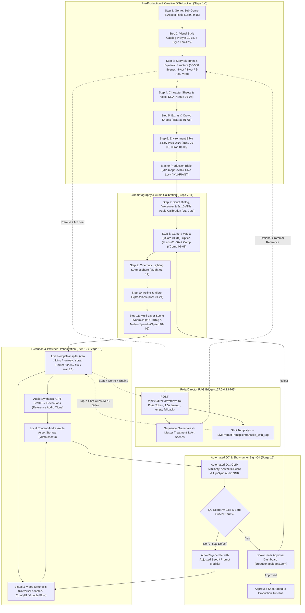

# AI Pipeline: The 12-Step Hollywood Cinematic Framework & 16-Stage Operational Engine

- **Project:** MovieAIProducer
- **Document ID:** PIPE-0001
- **Domain:** AI Generative Pipeline & Cinematic Engineering
- **Version:** 2.1.0
- **Status:** Approved Production Specification
- **Canonical References:** ADR-0004 (Master Production Bible), ADR-0005 (Workflow Engine), ADR-0008 (Prompt Compiler), ADR-0009 (Continuity Engine), ADR-0010 (Quality Control Engine)

---

## 1. Executive Summary & Core Pipeline Vision

The MovieAIProducer AI Pipeline transforms narrative cinema production into a deterministic, high-fidelity engineering workflow. Standard generative AI pipelines suffer from "generative drift"—faces morph between shots, costumes spontaneously alter colors, lighting shifts between adjacent cuts, and dialogue desynchronizes.

MovieAIProducer solves generative drift by enforcing:

1. **DNA Locking:** Creative variables chosen in Steps 1 through 11 are compiled into an immutable Master Production Bible (MPB) aggregate. Step 12 consumes these locked references deterministically.
2. **The 12-Step Cinematic Framework:** The creative DNA sequence establishing visual style, character states, lens optics, lighting matrices, and motion dynamics (`#Style`, `#Cam`, `#Lens`, `#Comp`, `#Light`, `#Act`, `#Speed`).
3. **The 16-Stage Operational Engine:** The management and execution lifecycle orchestrating prompt compilation, asynchronous GPU/API dispatch, automated QC scoring, and human showrunner approval gates.
4. **Polia Director RAG Bridge (Port `8765`):** Real-time semantic retrieval of curated Hollywood `SequenceGrammarBlueprint` and `ShotTemplate` records from `polia-director-trainer` (`http://127.0.0.1:8765/api/v1/director/retrieve`) with strict timeout and graceful fallback so studio generation never blocks.
5. **Reference Implementation Grounding:** Direct interoperability with multi-engine adapters (`veo`, `runway`, `kling`, `sora`, `9router`, `sd35_large_hf`, `flux`, `comfyui` / `wan2.1`) and zero-shot voice synthesis (GPT-SoVITS / ElevenLabs).

---

## 2. End-to-End Pipeline Architecture Diagram

---

## 3. The 12-Step Hollywood Cinematic Framework

### Step 1: Genre, Emotion & Aspect Ratio

- **Aspect Ratios:**
  - `16:9` Cinematic Widescreen (`1.77:1` or `2.39:1` Anamorphic Letterbox) for theatrical and streaming releases.
  - `9:16` Vertical Cinema (`1080x1920`) for social storytelling and mobile-first distribution.
- **Sub-Genre & Emotional Curve:** Establishes the foundational tonal palette (e.g. Neo-Noir Psychological Thriller, Cyberpunk Mystery, Mythological Epic) and feeds genre filtering into the Polia Director RAG Bridge.

### Step 2: Visual Style Catalog (`#Style 01`–`#Style 18`) & 4-Family Negative Sanitization

The visual style code anchors the render tokenizer and model checkpoints (`backend/app/domain/catalog.py` & `matrix_taxonomy.json`):

| Code            | Style Name                       | Visual Characteristics                                                                                 | Color Grade Emulation                                                                                |
| :-------------- | :------------------------------- | :----------------------------------------------------------------------------------------------------- | :--------------------------------------------------------------------------------------------------- |
| **`#Style 01`** | Transformers / Michael Bay       | High-contrast anamorphic flare, metallic sheen, low-angle hero rotation, golden hour, debris-laden air | Teal and orange color grade, Kodak 5219 film stock, heavy tungsten edge lighting                     |
| **`#Style 02`** | Hollywood IMAX 70mm              | Pristine ultra-high resolution, deep dynamic range, lifelike skin pores, massive spatial depth         | Naturalistic color timing, 65mm sensor reproduction, zero artificial vignette                        |
| **`#Style 03`** | Bollywood Grand                  | Opulent color saturation, theatrical wind machines, sweeping crane movements, warm golden light        | Saturated jewel tones (crimson, emerald, gold), high-key fill, warm diffusion filtering              |
| **`#Style 04`** | Xianxia / Chinese Historical     | Ethereal mist, floating silk physics, pastel atmospheric scattering, elegant swordplay choreography    | Desaturated ink-wash, jade and porcelain tones, soft high-key diffusion                              |
| **`#Style 05`** | K-Drama High-End                 | Flawless porcelain skin tones, soft-focus shallow depth, gentle naturalistic backlighting              | Pastel cyan and warm peach grading, creamy bokeh highlights, pristine commercial gloss               |
| **`#Style 06`** | Donghua 3D                       | Hyper-detailed stylized 3D animation, photorealistic particle FX, stylized anime proportions           | Vibrant saturated neon and spiritual hues, sharp specular highlights, clean CGI rendering            |
| **`#Style 07`** | Epic High Fantasy                | Weathered leather, chainmail reflection, moss-covered masonry, sweeping Nordic landscape horizons      | Desaturated earthen tones, muted greens, cold steel blues, overcast northern European lighting       |
| **`#Style 08`** | Sinema Nusantara                 | Tropical humidity haze, warm bamboo and teak textures, practical oil-lamp glows, tactile realism       | Organic sepia and deep tropical greens, warm tungsten shadows, authentic South East Asian realism    |
| **`#Style 09`** | Pixar / Disney 3D Animation      | Exaggerated emotive facial shapes, subsurface scattering on skin, rich whimsical lighting              | Warm primary color harmonies, velvety shadows, clean ray-traced global illumination                  |
| **`#Style 10`** | DreamWorks / Illumination        | Snappy comedic character timing, expressive cartoon eyes, tactile stylized materials                   | High-contrast vibrant saturated primaries, crisp rim highlights, energetic bounce lighting           |
| **`#Style 11`** | Arcane (2.5D Steampunk)          | Painterly brushstroke textures mapped onto dynamic 3D geometry, graphic outlines, steampunk grit       | Monochromatic grime punctuated by glowing neon purples and hextech blues, rough oil-paint finishes   |
| **`#Style 12`** | Unreal Engine 5 Metahuman        | Real-time raytracing, Nanite micro-polygon geometry, Lumen dynamic global illumination                 | Neutral digital calibration, physical camera sensor emulation, precise roughness map reflections     |
| **`#Style 13`** | Stop-Motion Animation            | Tactile plasticine / clay textures, visible fingerprint impressions, 12 fps stepped motion cadence     | Studio miniature warm spotlights, macro depth of field falloff, physical miniature set materials     |
| **`#Style 14`** | Classic 2D Cartoon               | Hand-drawn cel animation, ink line art with variable weighting, flat fills, multi-plane parallax       | 1990s retro animation palette, soft paper texture overlay, zero 3D shading artifacts                 |
| **`#Style 15`** | Anime (Shinkai / Ufotable)       | Hyper-detailed sky cloud formations, photorealistic god rays, radiant lens flares, expressive eyes     | Luminous ultramarine blues, sunset magentas, glistening water reflections, cinematic anime polish    |
| **`#Style 16`** | Studio Ghibli                    | Lush watercolor nature backgrounds, painterly flora, whimsical wind gusts, hand-painted cels           | Earthy greens, gentle cerulean blues, soft eggshell whites, warm childhood nostalgia grading         |
| **`#Style 17`** | Dark Graphic Novel               | Heavy black ink shadows (chiaroscuro), stark angular silhouettes, stylized rain, hard-boiled noir      | High-contrast monochrome black-and-white accented by single spot colors (blood red, toxic yellow)    |
| **`#Style 18`** | Vintage Film (1970s Technicolor) | Organic heavy grain structure, perimeter chromatic aberration, faded dye couplers, gate weave          | Warm faded yellows, sepia skin tones, cyan shadows, authentic 35mm archival print texture            |

- **4-Family Style Taxonomy (`STYLE_TAXONOMY_FAMILIES`):** Negative prompts are sanitized deterministically via `sanitize_negative_prompts_for_style()` so negative tokens never contradict the selected style family:
  - `photorealistic`: `#Style 01, 02, 03, 04, 05, 07, 08, 12, 18`
  - `stylized_3d`: `#Style 06, 09, 10, 11`
  - `stop_motion`: `#Style 13`
  - `anime_2d`: `#Style 14, 15, 16, 17`

### Step 3: Story Blueprint & Dynamic Act Structure (`50`–`500` Scenes)

`PolyaScreenwriterEngine` (`backend/app/domain/screenwriter.py`) computes dynamic scene bounds via `get_act_bounds(total_scenes, structure_type)` across target scales (`50` to `500` scenes) and four dramatic structures:

- **`4_act` (Hollywood 4-Act, default):**
  - When `total_scenes == 50`: Act I (`1–12`), Act II-A (`13–25`), Act II-B (`26–38`), Act III/IV (`39–50`).
  - For arbitrary scene targets (`50–500`): proportional `25% / 25% / 25% / 25%` split.
- **`3_act` (Classic Three-Act):** `25% / 50% / 25%` split.
- **`youtube_viral` (High-Retention Hook Structure):** `15% / 35% / 35% / 15%` split.
- **`5_act` (Five-Act Classical / Shakespearean):** `20% / 20% / 20% / 20% / 20%` split.
- **Intra-Act Chunking:** Acts are generated in chunks of up to `18` scenes with rolling `3`-scene narrative handover.

### Step 4: Character DNA, Voice DNA & State Evolution (`#State 01`–`#State 05`)

- **Character DNA Embedding:** High-resolution facial anchor references (`closeup_image_url`, `front_image_url`) validated in canonical order `[background_path, char_face_path, char_front_path]`.
- **Voice DNA:** Reference audio clip registered for zero-shot synthesis in GPT-SoVITS or ElevenLabs.
- **State Evolution Matrix:**
  - **`#State 01` (Baseline / Pristine):** Clean wardrobe, composed grooming, normal facial expression.
  - **`#State 02` (Strained / Alert):** Perspiration beads, loosened collar/hair, dilated pupils, tense posture.
  - **`#State 03` (Combat / Exhausted):** Smudges of dust/smoke, ripped fabric seams, laboured breath, bruises.
  - **`#State 04` (Injured / Critical):** Lacerations, bloody bandaging, pale skin tone, desperate grimace.
  - **`#State 05` (Transformed / Ascendant):** Heroic glowing aura, costume transformation, supernatural presence, calm authority.

### Step 5: Extras & Crowd Sheets (`#Extras 01`–`#Extras 08`)

Defines distinct demographic and cultural background groups to prevent empty sets or incongruous background characters (`#Extras 01` street vendors/pedestrians through `#Extras 08` fleeing civilian crowd).

### Step 6: Environment Bible & Key Prop DNA (`#Env 01`–`#Env 05`, `#Prop 01`–`#Prop 05`)

- **Environment DNA (`#Env 01–#05`):** Spatial layout, architectural era, prevailing color palette, and weather parameters.
- **Prop DNA (`#Prop 01–#05`):** Hero props tracked with persistent physical traits and wear-and-tear states across scenes.

### Step 7: Script Dialog, Voiceover & Dynamic Duration Calibration (J/L-Cuts)

- **Dynamic Scene Duration Modes (`_determine_scene_duration`):**
  - `dynamic` (default): Odd acts (`1, 3, 5`) target `15.0s` (exposition & emotional depth); even acts (`2, 4`) target `10.0s` (escalation & climactic action).
  - Fixed modes: `flat_5s` (`5.0s`), `flat_10s` (`10.0s`), `flat_15s` (`15.0s`).
- **Speech Calibration Rule:** Word budgets scale to target duration (`<= 14` words for `<= 5s`, `<= 28` words for `<= 10s`, `<= 42` words for `15s`) at ~`2.5–2.8` words/sec.
- **Audio Transitions:**
  - **J-Cut:** Dialogue audio from Scene N+1 leads `1.2s` before Scene N visual cut ends.
  - **L-Cut:** Dialogue audio from Scene N trails `1.0s` into Scene N+1 visual opening.

### Step 8: Camera Matrix (`#Cam 01`–`#Cam 34`), Optics (`#Lens 01`–`#Lens 06`) & Geometry (`#Comp 01`–`#Comp 08`)

Synchronized verbatim with `backend/app/domain/catalog.py` and `polia-director-trainer/config/matrix_taxonomy.json`:

- **Lens Physics (`#Lens 01`–`#Lens 06`):**
  - `#Lens 01`: **2.0x Anamorphic Prime** (`2.39:1` widescreen scope, horizontal blue streak flares, oval bokeh, slight barrel distortion)
  - `#Lens 02`: **35mm Spherical Prime** (minimal distortion, organic human-eye perspective, `f/1.8` smooth spherical bokeh)
  - `#Lens 03`: **85mm Portrait Prime** (tight telephoto background compression, creamy bokeh, `f/1.4` heroic isolation)
  - `#Lens 04`: **24mm Ultra-Wide Angle** (exaggerated spatial depth, dynamic perspective lines, foreground emphasis)
  - `#Lens 05`: **135mm Heavy Telephoto** (severe background spatial compression, sniper/pursuit flattening)
  - `#Lens 06`: **Tilt-Shift Miniature** (selective diagonal focus plane, miniature diorama illusion)
- **Composition Geometry (`#Comp 01`–`#Comp 08`):**
  - `#Comp 01`: **Rule of Thirds** (`1/3` and `2/3` coordinate intersections)
  - `#Comp 02`: **Golden Spiral (Fibonacci)** (logarithmic curve leading eye to micro-detail)
  - `#Comp 03`: **Central Symmetry** (Kubrick-style one-point linear perspective)
  - `#Comp 04`: **Leading Lines** (architectural vectors forcing eye to vanishing point)
  - `#Comp 05`: **180-Degree Action Line** (rigid screen direction continuity across cuts)
  - `#Comp 06`: **Frame Within a Frame** (doorways, broken arches, windows, mirrors)
  - `#Comp 07`: **Dutch Angle (Canted)** (`15°–30°` roll on camera axis for vertigo/disorder)
  - `#Comp 08`: **Deep Focus Mise-en-Scène** (`f/11` hyperfocal aperture keeping FG/MG/BG tack sharp)
- **Camera Matrix (`#Cam 01`–`#Cam 34`):**
  - *Proximity (`#Cam 01–06`):* `#Cam 01` Extreme Close-Up (ECU - Eyes/Mouth), `#Cam 02` Close-Up (CU - Head & Neck), `#Cam 03` Medium Close-Up (MCU - Chest Up), `#Cam 04` Medium Shot (MS - Waist Up), `#Cam 05` Cowboy Shot (Mid-Thigh Up), `#Cam 06` Full Shot (FS - Head to Toe).
  - *Scale (`#Cam 07–08`):* `#Cam 07` Wide Shot (WS - Complete Environment), `#Cam 08` Extreme Wide Shot (EWS - Epic Scale).
  - *Angle & Perspective (`#Cam 09–17`):* `#Cam 09` Bird's Eye View (90° Zenith), `#Cam 10` Worm's Eye View (Ground Level 90° Up), `#Cam 11` Over-The-Shoulder (OTS), `#Cam 12` Point of View (POV), `#Cam 13` Low-Angle Hero Shot (Looking Up 30°), `#Cam 14` High-Angle Vulnerability (Looking Down 30°), `#Cam 15` Dutch Angle Tilt, `#Cam 16` Profile Side Silhouette, `#Cam 17` Frontal Symmetrical Master.
  - *Motion (`#Cam 18–26`):* `#Cam 18` Tracking Shot (Dolly Sideways), `#Cam 19` Dolly-In (Emotional Push), `#Cam 20` Dolly-Out (Isolation Reveal), `#Cam 21` Crane / Jib Sweeping Overhead, `#Cam 22` Whip Pan, `#Cam 23` 360-Degree Orbital Arc, `#Cam 24` Steadicam Forward Push, `#Cam 25` Handheld Shaky-Cam (Warzone Realism), `#Cam 26` Crash Zoom.
  - *Focus, Special, Aerial, Ensemble, Master & Macro (`#Cam 27–34`):* `#Cam 27` Rack Focus, `#Cam 28` Snorricam (Body-Mounted Subject Lock), `#Cam 29` Split-Diopter Dual Plane Focus, `#Cam 30` Drone Panoramic Flyover, `#Cam 31` Two-Shot, `#Cam 32` Crowd Ensemble Master, `#Cam 33` Atmospheric Establishing Master, `#Cam 34` Microscopic Macro Insert.

### Step 9: Cinematic Lighting & Atmosphere (`#Light 01`–`#Light 14`)

| Code            | Lighting Setup          | Technical Specifications                                                                            |
| :-------------- | :---------------------- | :-------------------------------------------------------------------------------------------------- |
| **`#Light 01`** | Golden Hour Backlit     | Low-angle sun at 5° elevation, 2800K golden warmth, rim light silhouette, long cast shadows         |
| **`#Light 02`** | Volumetric God Rays     | Collimated sunbeams through haze/dust, 4500K beam contrast vs 3000K ambient shadows                 |
| **`#Light 03`** | Low-Key Chiaroscuro     | 8:1 key-to-fill ratio, 3200K single hard key source, deep black negative space, Rembrandt triangle  |
| **`#Light 04`** | Silvery Blue Moonlight  | 6500K cool diffused overhead key, 2:1 fill, deep midnight cyan shadows, eye catchlights             |
| **`#Light 05`** | Flickering Torch/Candle | 1800K dynamic flame luminance, 4–8Hz flicker, rapid inverse-square falloff                          |
| **`#Light 06`** | Neon Cyberpunk          | Dual-complementary neon sources (cyan 480nm & magenta 650nm), wet pavement specular reflections     |
| **`#Light 07`** | Overcast Soft           | Diffused 6000K skylight through cloud deck, near-zero cast shadows, smooth skin gradients           |
| **`#Light 08`** | Harsh Midday            | Zenith 90° sun, 5800K blinding intensity, deep racoon shadows under eyes/jawline                    |
| **`#Light 09`** | Practical Headlights    | Twin hard 4000K tungsten beams cutting through rain/fog, direct lens flares, dark silhouettes       |
| **`#Light 10`** | High-Key Ethereal       | Low contrast 1.5:1 ratio, +2 EV background overexposure, soft wrapping daylight, particulate scatter |
| **`#Light 11`** | Lightning Flash         | Instantaneous 10000K cold xenon 2-frame burst, sudden shadow shift, followed by pitch black         |
| **`#Light 12`** | Clinical Cold Sci-Fi    | Overhead fluorescent grids, 6500K sterile white with slight green spike, shadowless illumination    |
| **`#Light 13`** | Dappled Forest          | Canopy-filtered sunlight creating organic moving fractal patterns (4000K spots vs 5200K shade)      |
| **`#Light 14`** | Silhouette Against Fire | Blazing 1500K raging inferno behind subject, jet-black foreground silhouette                        |

### Step 10: Facial & Action Performance (`#Act 01`–`#Act 24`)

Directs somatic micro-expressions (`backend/app/domain/catalog.py`):

- `#Act 01–06`: `#Act 01` Suppressed Trauma, `#Act 02` Cold Calculation, `#Act 03` Primal Rage, `#Act 04` Quiet Melancholy, `#Act 05` Paranoid Dread, `#Act 06` Heroic Resolve.
- `#Act 07–12`: `#Act 07` Cynical Amusement, `#Act 08` Shock and Awe, `#Act 09` Intimate Vulnerability, `#Act 10` Complete Breakdown, `#Act 11` Stoic Endurance, `#Act 12` Deceptive Charm.
- `#Act 13–18`: `#Act 13` Total Exhaustion, `#Act 14` Euphoric Triumph, `#Act 15` Disgust / Repulsion, `#Act 16` Moral Hesitation, `#Act 17` Hypnotic Trance, `#Act 18` Panic Attack.
- `#Act 19–24`: `#Act 19` Seductive Playfulness, `#Act 20` Contemptuous Dismissal, `#Act 21` Sudden Realization, `#Act 22` Physical Agony, `#Act 23` Guilt and Remorse, `#Act 24` Transcendent Peace.

### Step 11: Multi-Layer Scene Dynamics (`#FG/#BG`) & Motion Speed (`#Speed 01`–`#Speed 05`)

- **Spatial Layering:**
  - Foreground (`#FG`): Raindrops on glass, vehicle steering wheel, passing silhouettes adding depth.
  - Middleground (`#MG`): Primary actors executing dialogue and action.
  - Background (`#BG`): Ambient city traffic, stormy sky, moving crowd extras.
- **Motion Cadence (`#Speed 01`–`#Speed 05`):**
  - `#Speed 01`: **Static / Locked-Off** (`0.0 m/s` — zero camera movement; micro-movements only)
  - `#Speed 02`: **Subtle Organic Drift** (`0.2 m/s` — micro-Steadicam breathing drift)
  - `#Speed 03`: **Cinematic Paced** (`1.0 m/s` — deliberate smooth dolly movement)
  - `#Speed 04`: **High-Octane Action** (`3.5 m/s` — rapid pan/tracking for combat & chases)
  - `#Speed 05`: **Hyper-Speed / Time-Lapse** (`>9.0 m/s` or `120 fps` burst capture)

### Step 12: Scene-by-Scene Production & Multi-Engine Prompt Compilation

`LivePromptTranspiler` (`backend/app/domain/transpiler.py`) compiles locked MPB DNA, matrix codes, and optional Polia RAG shot cues into target-specific formats:

| Provider Target (`provider_target`) | Compiled Engine Identifier | RAG Bridge Engine Mapping |
| :---------------------------------- | :------------------------- | :------------------------ |
| `veo`, `google_veo`, `google_flow`  | `google_veo_2`             | `veo`                     |
| `kling`, `kling_ai`, `kling_1.5`    | `kling_v1.5_pro`           | `kling`                   |
| `runway`, `runway_gen3`, `gen3`     | `runway_gen3_alpha`        | `runway`                  |
| `sora`, `openai_sora`               | `openai_sora_v1`           | `sora`                    |
| `9router`, `gemini_image`           | `9router_<model>`          | `flux`                    |
| `sd35`, `sd35_large_hf`             | `sd35_large_hf`            | `flux`                    |
| `flux`, `flux_dev`, `flux_schnell`  | `flux.1_dev`               | `flux`                    |
| `comfyui`, `wan2.1`                 | `comfyui_wan2.1_t2v_14b`   | `wan2.1`                  |

---

## 4. Polia AI Director RAG Bridge (Port 8765)

MovieAIProducer integrates with the local `polia-director-trainer` Knowledge Base via `DirectorRAGClient` (`backend/app/domain/director_rag.py`):

- **Endpoint:** `POST http://127.0.0.1:8765/api/v1/director/retrieve` (`X-Polia-Token` header, `POLIA_RAG_TIMEOUT_SEC=1.5`).
- **Graceful Fallback:** Disabled flag, timeout, HTTP/connection error, or empty KB returns an empty retrieval object so screenplay and preview generation never fail.
- **Injection Points:**
  1. `PolyaScreenwriterEngine.generate_master_treatment`: Retrieves `SequenceGrammarBlueprint` (`top_k=2`) from premise & genre; injects `director_master_rule`, `pacing_curve`, and `dramatic_mini_arcs` when non-empty.
  2. `PolyaScreenwriterEngine.generate_act_scenes`: Retrieves directing context (`top_k=3`) per act; injects `pacing_curve`, `lens_progression`, `lighting_evolution`, and `audio_bridge_strategy` into chunk prompts when non-empty.
  3. `LivePromptTranspiler.transpile_with_rag`: Called by `/api/v1/transpile` and `/generate-preview` (scene, project concept, shot). Retrieves `ShotTemplates` (`top_k=3`), appends cinematography cues without altering locked MPB character/environment DNA, matrix codes, or negative-prompt sanitization, and attaches `rag_references` metadata.

---

## 5. The 16 Operational Stages

| Stage ID     | Operational Stage Name          | Primary Input Artifact          | Primary Output Artifact               | Verification Gate            |
| :----------- | :------------------------------ | :------------------------------ | :------------------------------------ | :--------------------------- |
| **Stage 01** | Creative Brief & Film Strategy  | User brief & premise            | Production Charter & Genre Spec       | Showrunner Sign-off          |
| **Stage 02** | Visual Concept & Style Bible    | Style catalog `#Style 01-18`    | Style Bible & Color Script            | Moodboard Validation         |
| **Stage 03** | Story Architecture & Screenplay | Dynamic Act structure (`50-500`)| Multi-Act Script & Beat Sheet         | Narrative Pacing Review      |
| **Stage 04** | Script Breakdown & Feasibility  | Dynamic Scene Screenplay        | Production Breakdown Matrix           | Generation Budget Check      |
| **Stage 05** | Character Casting & Bible       | Character profiles              | Face Embeddings & Character Sheets    | FaceID Similarity Test       |
| **Stage 06** | Extras, Crowd & Creature Design | Cultural matching specs         | Extras Sheets `#Extras 01-08`         | Background Diversity Check   |
| **Stage 07** | Production Design & Env Bible   | Environment descriptions        | `#Env 01-05` 3D Layout Specs          | Spatial Continuity Lock      |
| **Stage 08** | Wardrobe, Makeup & Props        | `#State 01-05` & `#Prop 01-05`  | Costume Bible & Prop Reference Sheets | Wear-and-Tear Consistency    |
| **Stage 09** | Storyboard, Animatic & Previs   | Scene beats & camera specs      | Visual Storyboard & Animatic Reel     | Editorial Pacing Gate        |
| **Stage 10** | Director's Scene Direction      | Actor motivation & beat goals   | Shot Lists & Director Notes           | Director Sign-off            |
| **Stage 11** | Cinematography Engineering      | `#Lens 01-06`, `#Comp 01-08`    | Optical Physics Specifications        | 180° Rule & Axis Check       |
| **Stage 12** | Lighting & Atmospheric Eng.     | `#Light 01-14` matrices         | Lighting Setup Diagrams & Specs       | Contrast Ratio Check         |
| **Stage 13** | Dialogue & Voice Direction      | Screenplay dialogues            | Calibrated Dialogue & TTS WAVs        | Audio Duration Gate          |
| **Stage 14** | Motion & Continuity Eng.        | Layer specs `#FG/#BG`, `#Speed` | Motion Vectors & ControlNet Maps      | Frame Parallax Check         |
| **Stage 15** | AI Production Orchestration     | Compiled Prompts & Seeds        | Raw Generated Videos & Audio          | Provider Job Success (200 OK)|
| **Stage 16** | Scene Execution, QC & Final Cut | Raw Video/Audio Assets          | Approved Scene & Final Movie Assembly | Automated QC (Score >= 0.85) |

---

## 6. Reference Implementation Interoperability & QC

- **Visual & Video Adapters:** `UniversalImageAdapter` (9Router, Gemini Direct, Hugging Face SD 3.5, Google Flow worker queue) and ComfyUI (`POST /prompt`, WebSocket `/ws`, `/output` CAS storage under `./data/assets`).
- **GPT-SoVITS Voice Synthesis:** Submits calibrated dialogue lines to `POST /tts`, normalizes output to `-14 LUFS`, and persists WAVs to `./data/assets`.
- **Automated Quality Control (`>= 0.85` gate):** Face Drift (`>= 0.82` InsightFace cosine similarity), CLIP semantic consistency (`>= 0.80`), optical flow temporal jitter (`< 0.15`), and dialogue audio SNR (`> 28 dB`) + lip-sync (`> 0.85`).
