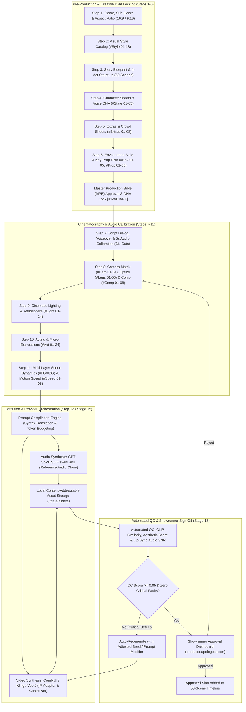

# AI Pipeline: The 12-Step Hollywood Cinematic Framework & 16-Stage Operational Engine

- **Project:** MovieAIProducer
- **Document ID:** PIPE-0001
- **Domain:** AI Generative Pipeline & Cinematic Engineering
- **Version:** 2.0.0
- **Status:** Approved Production Specification
- **Canonical References:** ADR-0004 (Master Production Bible), ADR-0005 (Workflow Engine), ADR-0008 (Prompt Compiler), ADR-0009 (Continuity Engine), ADR-0010 (Quality Control Engine)

---

## 1. Executive Summary & Core Pipeline Vision

The MovieAIProducer AI Pipeline transforms narrative cinema production into a deterministic, high-fidelity engineering workflow. Standard generative AI pipelines suffer from "generative drift"—faces morph between shots, costumes spontaneously alter colors, lighting shifts between adjacent cuts, and dialogue desynchronizes.

MovieAIProducer solves generative drift by enforcing:

1. **DNA Locking:** Creative variables chosen in Steps 1 through 11 are compiled into an immutable Master Production Bible (MPB) aggregate. Step 12 consumes these locked references deterministically.
2. **The 12-Step Cinematic Framework:** The creative DNA sequence establishing visual style, character states, lens optics, lighting matrices, and motion dynamics.
3. **The 16-Stage Operational Engine:** The management and execution lifecycle orchestrating prompt compilation, asynchronous GPU dispatch, automated QC scoring, and human showrunner approval gates.
4. **Reference Implementation Grounding:** Direct interoperability with node-based video execution graphs (ComfyUI) and zero-shot voice cloning with 5-second calibration (GPT-SoVITS).

---

## 2. End-to-End Pipeline Architecture Diagram

---

## 3. The 12-Step Hollywood Cinematic Framework

### Step 1: Genre, Emotion & Aspect Ratio

- **Aspect Ratios:**
  - `16:9` Cinematic Widescreen (`1.77:1` or `2.39:1` Anamorphic Letterbox) for theatrical and streaming releases.
  - `9:16` Vertical Cinema (`1080x1920`) for social storytelling and mobile-first distribution.
- **Sub-Genre & Emotional Curve:** Establishes the foundational tonal palette (e.g. Neo-Noir Psychological Thriller, Cyberpunk Mystery, Mythological Epic).

### Step 2: Visual Style Catalog (#Style 01–#Style 18)

The visual style code anchors the render tokenizer and model checkpoints:

| Code            | Style Name                 | Visual Characteristics                                                                                 | Key Prompt Keywords                                                                                          |
| :-------------- | :------------------------- | :----------------------------------------------------------------------------------------------------- | :----------------------------------------------------------------------------------------------------------- |
| **`#Style 01`** | Transformers / Michael Bay | High contrast, warm skin tones, teal shadows, anamorphic lens flares, kinetic low-angle camera         | `35mm anamorphic, anamorphic flare, intense kinetic realism, high shutter speed, blockbuster color grade`    |
| **`#Style 02`** | Hollywood IMAX 70mm        | Maximum optical sharpness, deep dynamic range, natural skin textures, Christopher Nolan aesthetic      | `shot on 70mm IMAX, pristine optical clarity, large format film stock, photorealistic natural lighting`      |
| **`#Style 03`** | Bollywood Grand            | Saturated color spectrum, dramatic rim lighting, grand practical sets, sweeping choreographed motion   | `vibrant colors, dramatic sweeping crane, high-key spectacle, ornate gold and crimson tones`                 |
| **`#Style 04`** | Drama China / Xianxia      | Flowing silks, ethereal mist, floating light motes, martial arts graceful physics                      | `ethereal wuxia aesthetic, flowing pastel silks, mist-shrouded mountain vistas, soft diffused glow`          |
| **`#Style 05`** | K-Drama High-End           | Shallow depth of field, pastel tonal separation, porcelain skin tone accuracy, emotional intimacy      | `creamy bokeh, soft key beauty light, pastel neutral color palette, intimate medium close-up`                |
| **`#Style 06`** | Donghua 3D                 | High-end Chinese 3D animation, stylized photorealism, dynamic elemental particles                      | `Donghua 3D animation render, stylized photorealistic characters, glowing particle FX, crisp octane render`  |
| **`#Style 07`** | Epic High Fantasy          | Atmospheric haze, rich medieval textures, weathered leather and steel, Lord of the Rings scale         | `gritty high fantasy, volumetric atmospheric haze, weathered iron and stone, naturalistic directional light` |
| **`#Style 08`** | Sinema Nusantara           | Tropical earthy palette, realistic shadows, textured Indonesian architecture and cultural authenticity | `cinematic Indonesian realism, golden tropical light, authentic batik and wood textures, naturalistic grade` |
| **`#Style 09`** | Pixar / Disney Animation   | Subsurface scattering on skin/eyes, expressive character anatomy, masterful color scripting            | `Pixar style 3D animation, subsurface scattering, stylized expressive eyes, rich warm cinematic lighting`    |
| **`#Style 10`** | DreamWorks / Illumination  | Punchy stylized shapes, comedic timing dynamics, crisp bounce light                                    | `energetic 3D animation, bold silhouettes, high saturation bounce light, expressive character staging`       |
| **`#Style 11`** | Arcane (2.5D)              | Hand-painted textures over 3D models, rough painterly brush strokes, dramatic graphic contrast         | `Fortiche Arcane 2.5D style, painterly textures, visible concept art brush strokes, stylized rim lighting`   |
| **`#Style 12`** | Unreal Engine 5 Metahuman  | Real-time Lumen global illumination, Nanite micro-geometry, digital twin realism                       | `Unreal Engine 5.4 render, Lumen global illumination, Metahuman skin shader, 8k raytraced reflections`       |
| **`#Style 13`** | Stop-Motion                | Tactile clay/felt textures, miniature studio lighting, stepped frame motion cadence                    | `Laika stop-motion animation, tactile clay textures, miniature macro depth of field, physical puppets`       |
| **`#Style 14`** | Classic 2D Cartoon         | Hand-drawn traditional cel animation, squash and stretch, ink line art                                 | `classic 1990s 2D cel animation, hand-drawn linework, rich gouache background paintings, warm grain`         |
| **`#Style 15`** | Anime (Shinkai/Ufotable)   | Brilliant sky gradients, hyper-detailed backgrounds, volumetric lens bloom, dramatic anime action      | `Makoto Shinkai aesthetic, luminous clouds, Ufotable dynamic action, glowing lens flare, hyper-detail`       |
| **`#Style 16`** | Studio Ghibli              | Painterly watercolor backgrounds, lush natural environments, gentle nostalgic light                    | `Hayao Miyazaki Ghibli aesthetic, hand-painted watercolor meadow, lush foliage, nostalgic morning light`     |
| **`#Style 17`** | Dark Graphic Novel         | Stark black ink shadows, high-contrast chiaroscuro, monochromatic with selective blood red / neon      | `Frank Miller graphic novel style, extreme high contrast ink, hard shadows, selective monochrome accent`     |
| **`#Style 18`** | Vintage Film (35mm/16mm)   | Visible film grain, halation around highlights, gate weave, organic analog color bias                  | `authentic 35mm Kodak 5219 film stock, organic film grain, red halation, vintage Panavision lenses`          |

### Step 3: Story Blueprint & 4-Act Structure (50 Scenes)

The screenplay is divided into 50 discrete production scenes conforming to the Hollywood 4-Act pacing model:

- **Act I: The Setup (Scenes 01–12):**
  - Scene 01: The Ordinary World & Status Quo.
  - Scene 05: The Inciting Incident.
  - Scene 12: Plot Point 1 (Crossing the First Threshold into the Special World).
- **Act II-A: The Escalation (Scenes 13–25):**
  - Scenes 13–20: Tests, Allies, and Enemies ("Promise of the Premise").
  - Scene 25: The Midpoint (Stakes heighten, shift from reactive to proactive).
- **Act II-B: The Crucible (Scenes 26–38):**
  - Scenes 26–32: Villain counter-attack and deepening crisis.
  - Scene 38: Plot Point 2 ("All Hope is Lost" / The Dark Night of the Soul).
- **Act III & IV: The Climax & Resolution (Scenes 39–50):**
  - Scenes 39–45: The Final Battle & Heroic Transformation.
  - Scene 46: The Climax Peak.
  - Scenes 47–50: The Denouement, Return with the Elixir, and Closing Image.

### Step 4: Character DNA, Voice DNA & State Evolution (#State 01–#State 05)

- **Character DNA Embedding:** High-resolution facial anchor embeddings (InsightFace / FaceID LoRA) linked to the character entity.
- **Voice DNA:** Reference audio clip (10 seconds pristine mono 24kHz WAV) registered for zero-shot synthesis in GPT-SoVITS or ElevenLabs VoiceLab.
- **State Evolution Matrix:**
  - **`#State 01` (Baseline / Pristine):** Clean wardrobe, composed grooming, normal facial expression.
  - **`#State 02` (Strained / Alert):** Perspiration beads, loosened collar/hair, dilated pupils, tense posture.
  - **`#State 03` (Combat / Exhausted):** Smudges of dust/smoke, ripped fabric seams, laboured breath, bruises.
  - **`#State 04` (Injured / Critical):** Lacerations, bloody bandaging, pale skin tone, desperate grimace.
  - **`#State 05` (Transformed / Ascendant):** Heroic glowing aura, costume transformation, supernatural presence, calm authority.

### Step 5: Extras & Crowd Sheets (#Extras 01–#Extras 08)

Defines 5–8 distinct demographic and cultural background groups to prevent empty sets or incongruous background characters:

- `#Extras 01`: Street vendors, market patrons, local city pedestrians.
- `#Extras 02`: High-tech corporate security personnel in tactical gear.
- `#Extras 03`: Underground rebels / cyberpunk hackers with DIY augmentations.
- `#Extras 04`: Grand court nobles in formal ceremonial attire.
- `#Extras 05`: Tactical SWAT / military strike team in uniform.
- `#Extras 06`: Media reporters, paparazzi with flash cameras and microphones.
- `#Extras 07`: Hospital triage medical staff, doctors, and nurses.
- `#Extras 08`: Fleeing civilian crowd in mass panic.

### Step 6: Environment Bible & Key Prop DNA (#Env 01–#Env 05, #Prop 01–#Prop 05)

- **Environment DNA (`#Env 01–#05`):** 3D spatial layout, architectural era, prevailing color palette, and environmental weather parameters.
- **Prop DNA (`#Prop 01–#05`):** Hero props (e.g. Damascus steel dagger, quantum data drive, antique pocket watch) tracked with persistent physical traits and wear-and-tear states across scenes.

### Step 7: Script Dialog, Voiceover & 5-Second Calibration (J/L-Cuts)

- **5-Second Generation Constraint:** Current state-of-the-art video models (Kling 1.5, Veo 2, Luma) generate optimal visual fidelity in 4.0 to 5.0 second increments.
- **Speech Calibration Rule:** Every dialogue line is calibrated to a maximum of 12–14 spoken English words (or 25–30 Indonesian syllables), ensuring exact alignment with the 5.0 second video generation window.
- **Audio Transitions:**
  - **J-Cut:** Dialogue audio from Scene N+1 begins 1.2 seconds before the visual cut of Scene N ends.
  - **L-Cut:** Dialogue audio from Scene N continues 1.0 second into the visual opening of Scene N+1.

### Step 8: Camera Matrix (#Cam 01–#Cam 34), Optics (#Lens 01–#06) & Geometry (#Comp 01–#08)

- **Lens Physics:**
  - `#Lens 01`: Ultra-Wide Angle (`14mm–18mm`, expansive spatial distortion, deep field).
  - `#Lens 02`: Cinematic Wide (`24mm–28mm`, architectural environmental context).
  - `#Lens 03`: Standard Street (`35mm–50mm`, human eye natural perspective).
  - `#Lens 04`: Portrait Prime (`85mm f/1.4`, sharp subject separation, creamy oval bokeh).
  - `#Lens 05`: Long Telephoto (`135mm–200mm`, compressed background plane, visceral isolation).
  - `#Lens 06`: Anamorphic (`2.39:1` aspect, horizontal streak flares, elliptical bokeh).
- **Composition Geometry:**
  - `#Comp 01`: Rule of Thirds Intersection.
  - `#Comp 02`: Symmetrical One-Point Center Perspective (Kubrick style).
  - `#Comp 03`: Leading Lines drawing focus to the narrative subject.
  - `#Comp 04`: Golden Ratio / Fibonacci Spiral layout.
  - `#Comp 05`: Frame Within a Frame (archways, windows, vehicle mirrors).
  - `#Comp 06`: Dutch Angle Cant (`15°–25°` tilt conveying psychological tension).
  - `#Comp 07`: Deep Focus / Split-Diopter (foreground and background both pin-sharp).
  - `#Comp 08`: Negative Space Tension (isolated subject occupying `< 15%` of screen area).
- **Camera Movement Dynamics (`#Cam 01–#34`):**
  - Includes Slow Push-in, Rapid Whip Pan, Orbiting Steadicam, Vertigo Dolly Zoom, Low-Angle Hero Tilt, Handheld Visceral Shake, and Technocrane Vertical Boom.

### Step 9: Cinematic Lighting & Atmosphere (#Light 01–#Light 14)

| Code            | Lighting Setup          | Technical Key, Fill & Backlight Ratios                                              |
| :-------------- | :---------------------- | :---------------------------------------------------------------------------------- |
| **`#Light 01`** | Golden Hour Backlit     | Warm 3200K rim light, subtle soft bounce fill, glowing atmospheric haze             |
| **`#Light 02`** | Volumetric God Rays     | High-powered directional sunlight penetrating atmospheric smoke or dust             |
| **`#Light 03`** | Low-Key Chiaroscuro     | 8:1 contrast ratio, harsh single key light, deep black unlit shadow side            |
| **`#Light 04`** | Silvery Blue Moonlight  | Cool 5600K key light, subtle cyan ambience, soft silver hair highlights             |
| **`#Light 05`** | Flickering Torch/Candle | 2200K warm organic point light, dynamic flickering intensity, dancing shadows       |
| **`#Light 06`** | Neon Cyberpunk          | Dual complementary neon sources (magenta / cyan), wet street ground reflections     |
| **`#Light 07`** | Overcast Soft           | Completely diffused shadowless 6500K daylight, soft wrapping key light              |
| **`#Light 08`** | Harsh Midday            | Unforgiving top-down direct sun, short sharp cast shadows, high specular highlights |
| **`#Light 09`** | Practical Headlights    | Blinding dual vehicle beams cutting through rain/fog, high silhouette contrast      |
| **`#Light 10`** | High-Key Ethereal       | Minimal contrast, luminous white/silver bounce fill, dreamy halation                |
| **`#Light 11`** | Lightning Flash         | Strobe effect, instantaneous 10000K xenon white burst revealing dark scene          |
| **`#Light 12`** | Clinical Cold Sci-Fi    | Overhead fluorescent tubes, 5000K sterile white, zero warm bounce                   |
| **`#Light 13`** | Dappled Forest          | Sunlight broken by windblown tree canopy leaves, shifting organic light patterns    |
| **`#Light 14`** | Silhouette Against Fire | Pure black subject silhouette against 1800K raging flame background                 |

### Step 10: Facial & Action Performance (#Act 01–#Act 24)

Directs actor performance and micro-expressions:

- `#Act 01–#06`: Restrained stoicism, repressed sorrow, cold determination, subtle side-eye suspicion.
- `#Act 07–#12`: Visceral shock, explosive rage, trembling terror, breathless panic.
- `#Act 13–#18`: Warm empathy, genuine laughter, playful irony, poignant resignation.
- `#Act 19–#24`: Physical combat exertion, heavy breathing after sprint, martial focus, triumphant relief.

### Step 11: Multi-Layer Scene Dynamics (#FG/#BG) & Motion Speed (#Speed 01–#05)

- **Spatial Layering:**
  - Foreground (`#FG`): Raindrops on glass, vehicle steering wheel, passing silhouettes adding depth.
  - Middleground (`#MG`): Primary actors executing dialogue and action.
  - Background (`#BG`): Ambient city traffic, stormy sky, moving crowd extras.
- **Motion Cadence:**
  - `#Speed 01`: Hyper-Slow Motion (120fps / 0.2x speed - water droplets, bullet time).
  - `#Speed 02`: Cinematic Slow Motion (60fps / 0.5x speed - emotional realization, dramatic fall).
  - `#Speed 03`: Natural Film Cadence (24fps / 1.0x speed - standard dramatic dialogue).
  - `#Speed 04`: Accelerated Motion (48fps capture played at 24fps - disorienting panic).
  - `#Speed 05`: Hyperlapse / Time-Lapse (sun setting over skyline, crowd blurring through station).

### Step 12: Scene-by-Scene Production (Scene 01–50) & Prompt Compilation

The compiler takes the locked choices from Steps 1–11 and synthesizes the exact JSON payload for the target provider adapter (e.g. ComfyUI workflow JSON or Kling API payload).

---

## 4. The 16 Operational Stages

The platform wraps the 12 creative steps into a complete industrial film production management framework:

| Stage ID     | Operational Stage Name          | Primary Input Artifact          | Primary Output Artifact               | Verification Gate            |
| :----------- | :------------------------------ | :------------------------------ | :------------------------------------ | :--------------------------- |
| **Stage 01** | Creative Brief & Film Strategy  | User brief & premise            | Production Charter & Genre Spec       | Showrunner Sign-off          |
| **Stage 02** | Visual Concept & Style Bible    | Style catalog `#Style 01-18`    | Style Bible & Color Script            | Moodboard Validation         |
| **Stage 03** | Story Architecture & Screenplay | 4-Act structure guidelines      | 50-Scene Script & Beat Sheet          | Narrative Pacing Review      |
| **Stage 04** | Script Breakdown & Feasibility  | 50-Scene Screenplay             | Production Breakdown Matrix           | Generation Budget Check      |
| **Stage 05** | Character Casting & Bible       | Character profiles              | Face Embeddings & Character Sheets    | FaceID Similarity Test       |
| **Stage 06** | Extras, Crowd & Creature Design | Cultural matching specs         | Extras Sheets `#Extras 01-08`         | Background Diversity Check   |
| **Stage 07** | Production Design & Env Bible   | Environment descriptions        | `#Env 01-05` 3D Layout Specs          | Spatial Continuity Lock      |
| **Stage 08** | Wardrobe, Makeup & Props        | `#State 01-05` & `#Prop 01-05`  | Costume Bible & Prop Reference Sheets | Wear-and-Tear Consistency    |
| **Stage 09** | Storyboard, Animatic & Previs   | Scene beats & camera specs      | Visual Storyboard & Animatic Reel     | Editorial Pacing Gate        |
| **Stage 10** | Director's Scene Direction      | Actor motivation & beat goals   | Shot Lists & Director Notes           | Director Sign-off            |
| **Stage 11** | Cinematography Engineering      | `#Lens 01-06`, `#Comp 01-08`    | Optical Physics Specifications        | 180° Rule & Axis Check       |
| **Stage 12** | Lighting & Atmospheric Eng.     | `#Light 01-14` matrices         | Lighting Setup Diagrams & Specs       | Contrast Ratio Check         |
| **Stage 13** | Dialogue & Voice Direction      | Screenplay dialogues            | 5s Calibrated Dialogue & TTS WAVs     | Audio Duration Gate (<=5s)   |
| **Stage 14** | Motion & Continuity Eng.        | Layer specs `#FG/#BG`, `#Speed` | Motion Vectors & ControlNet Maps      | Frame Parallax Check         |
| **Stage 15** | AI Production Orchestration     | Compiled Prompts & Seeds        | Raw Generated Videos & Audio          | GPU Job Success (200 OK)     |
| **Stage 16** | Scene Execution, QC & Final Cut | Raw Video/Audio Assets          | Approved Scene & Final Movie Assembly | Automated QC (Score >= 0.85) |

---

## 5. Reference Implementation Interoperability

### 5.1 ComfyUI Video Generation Workflow

- **Codebase Path:** `/home/ubuntu/workspace/ComfyUI`
- **Execution Workflow:**
  1. Compiles shot prompt into ComfyUI prompt graph format (`default_workflow.json`).
  2. Binds **IP-Adapter FaceID** node with the character reference image from the locked MPB.
  3. Binds **ControlNet OpenPose** / Depth node with previs motion guides.
  4. Submits prompt via `POST /prompt` with a deterministic execution client ID.
  5. Listens to WebSocket messages (`/ws`) for execution status (`executing`, `progress`, `executed`).
  6. Downloads rendered MP4 frames from `/output`, calculates SHA-256 hash, and saves directly to `./data/assets`.

### 5.2 GPT-SoVITS Voice Synthesis Workflow

- **Codebase Path:** `/home/ubuntu/workspace/GPT-SoVITS`
- **Execution Workflow:**
  1. Pulls character Voice DNA reference audio (`ref_wav_path`) and reference transcript (`prompt_text`).
  2. Submits dialogue line to `api_v2.py` via `POST /tts` with parameters:
     - `text`: Calibrated dialogue line (<= 14 words).
     - `text_lang`: English or Indonesian.
     - `ref_audio_path`: CAS path of character voice anchor.
     - `streaming_mode`: Enabled for real-time preview chunking.
  3. Validates output audio loudness (LUFS normalization to -14 LUFS) and saves master WAV asset to `./data/assets`.

---

## 6. Automated Quality Control & Defect Detection

Every generated asset undergoes automated scoring prior to human presentation:

1. **Face Drift Score (InsightFace Cosine Similarity):** Must score `>= 0.82` against character anchor.
2. **CLIP Semantic Consistency:** Prompt-to-video frame similarity must score `>= 0.80`.
3. **Temporal Consistency (Optical Flow Gradient):** Frame-to-frame jitter variance must stay within `< 0.15`.
4. **Dialogue Audio SNR & Lip Sync Confidence:** Audio Signal-to-Noise Ratio must exceed `28 dB`, and lip-sync alignment confidence score must exceed `0.85`.
