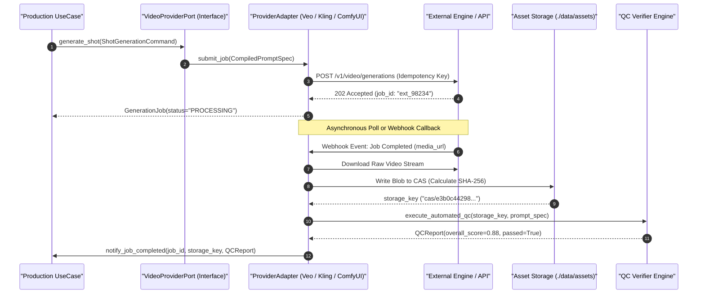

# System Architecture & Technical Design - MovieAIProducer

- **Project:** MovieAIProducer
- **Document ID:** ARCH-0001
- **Domain:** System Architecture & Engineering Blueprint
- **Version:** 2.0.0
- **Status:** Approved Baseline
- **Canonical Architecture Decisions:** ADR-0001 through ADR-0015
- **Public Production Host:** `https://producer.apologets.com`

---

## 1. Architecture Vision & Philosophy

MovieAIProducer is a professional, studio-grade AI film production system designed to execute a strict **12-Step Hollywood Cinematic Framework** across 50 scenes, managed through a **16-Stage Operational Lifecycle**. The system enforces architectural separation between creative intent, narrative continuity, orchestration logic, and external AI execution engines (ComfyUI, Google Veo, Kling, Runway, GPT-SoVITS, ElevenLabs).

### Core Architectural Axioms

1. **Domain-Driven Design (DDD) & Modular Monolith:** Business rules governing the _Master Production Bible (MPB)_, Character DNA, and Scene continuity reside in a pure domain layer isolated from web frameworks and external SDKs.
2. **Explicit Implementation Transparency:** Every subsystem, database table, service port, and API endpoint is explicitly demarcated as either **`[IMPLEMENTED]`** (verified against current codebase) or **`[PLANNED]`** (scheduled roadmap item) to prevent fictional documentation drift.
3. **Immutability of Creative DNA:** Once visual style codes, lighting profiles, character embeddings, and camera physics are approved and locked, they become immutable constraints for downstream generative pipelines.
4. **Provider-Agnostic Execution:** The domain and application layers communicate exclusively with abstract provider interfaces. Generative video engines (e.g. ComfyUI, Kling, Veo) and voice synthesis models (e.g. GPT-SoVITS, ElevenLabs) are hot-swappable infrastructure adapters.

---

## 2. High-Level System Architecture Diagram

```mermaid
flowchart TD
    subgraph ClientLayer ["Client & Delivery Layer"]
        BrowserClient["Browser Client (Desktop / Mobile / Tablet)"]
        PublicDomain["producer.apologets.com (Public HTTPS Endpoint)"]
        ReverseProxy["Traefik / Nginx Reverse Proxy (TLS Termination & Rate Limiting)"]
    end

    subgraph APILayer ["FastAPI Presentation Layer [IMPLEMENTED]"]
        AppFactory["app.main:create_app() [IMPLEMENTED]"]
        ReqIdMid["RequestIDMiddleware (X-Request-ID Header) [IMPLEMENTED]"]
        HostMid["TrustedHostMiddleware (Host Header Filtering) [IMPLEMENTED]"]
        HealthRouter["api.health:router (/health, /ready) [IMPLEMENTED]"]
        PlannedRouters["api.v1 Routers (Projects, Scenes, Shots, Jobs) [PLANNED]"]
    end

    subgraph ApplicationLayer ["Application Orchestration Layer"]
        UseCaseBase["application.common.use_case:UseCase [IMPLEMENTED]"]
        DTOBase["application.common.dtos:DTO [IMPLEMENTED]"]
        PortUoW["application.common.ports:UnitOfWork [IMPLEMENTED]"]
        PortEventBus["application.common.ports:EventPublisher [IMPLEMENTED]"]
        PipelineOrchestrator["Workflow & 16-Stage Orchestrator [PLANNED]"]
        PromptCompiler["Prompt Compilation Engine (12-Step DNA) [PLANNED]"]
        QCEngine["Automated QC & Continuity Verifier [PLANNED]"]
    end

    subgraph DomainLayer ["Domain Layer (Master Production Bible Core)"]
        EntityBase["domain.common.entity:Entity & AggregateRoot [IMPLEMENTED]"]
        VOBase["domain.common.value_object:ValueObject [IMPLEMENTED]"]
        RepoInterface["domain.common.repository:Repository [IMPLEMENTED]"]
        DomainEventBase["domain.common.event:DomainEvent [IMPLEMENTED]"]
        DomainExceptions["domain.common.exceptions:DomainException [IMPLEMENTED]"]
        ProjectAggregate["Project & Bible Aggregates [PLANNED]"]
        SceneAggregate["Scene & Shot Aggregates (50 Scenes) [PLANNED]"]
        ContinuityRules["Continuity & DNA Invariant Engines [PLANNED]"]
    end

    subgraph InfrastructureLayer ["Infrastructure & Persistence Layer"]
        DBEngine["infrastructure.database.engine:create_database_engine [IMPLEMENTED]"]
        DBSession["infrastructure.database.session:create_session_factory [IMPLEMENTED]"]
        SqlUoW["infrastructure.database.unit_of_work:SqlAlchemyUnitOfWork [IMPLEMENTED]"]
        SqlRepo["infrastructure.database.repository:SqlAlchemyRepository [IMPLEMENTED]"]
        FoundationModel["models.foundation:FoundationMetadataModel [IMPLEMENTED]"]
        InMemoryBus["infrastructure.common.event_bus:InMemoryEventBus [IMPLEMENTED]"]
        InMemoryUoW["infrastructure.common.unit_of_work:InMemoryUnitOfWork [IMPLEMENTED]"]
        StorageCAS["Local CAS Asset Storage (./data/assets) [IMPLEMENTED]"]
        AlembicMigrations["Alembic Migrations (0001_foundation) [IMPLEMENTED]"]
        ProductionDB["SQLite DB (./data/movieai.db) / PostgreSQL [IMPLEMENTED]"]
        TaskWorker["Async Task Worker (Redis / RQ / Celery) [PLANNED]"]
    end

    subgraph ExternalProviders ["AI Generative Engines & Reference Adapters"]
        ComfyUIRef["ComfyUI Workflow Engine (Local Node Graph & Execution Queue) [PLANNED]"]
        GPTSoVITSRef["GPT-SoVITS Engine (Zero-Shot Voice Cloning & Streaming) [PLANNED]"]
        VeoAdapter["Google Veo 2 Video Adapter [PLANNED]"]
        KlingAdapter["Kling AI Video Adapter [PLANNED]"]
        RunwayAdapter["Runway Gen-3 Adapter [PLANNED]"]
        ElevenLabsAdapter["ElevenLabs Voice Adapter [PLANNED]"]
    end

    BrowserClient --> PublicDomain
    PublicDomain --> ReverseProxy
    ReverseProxy --> AppFactory
    AppFactory --> ReqIdMid
    ReqIdMid --> HostMid
    HostMid --> HealthRouter
    HostMid --> PlannedRouters

    HealthRouter --> DBEngine
    HealthRouter --> StorageCAS

    PlannedRouters --> UseCaseBase
    UseCaseBase --> ProjectAggregate
    UseCaseBase --> SceneAggregate
    UseCaseBase --> PortUoW

    PortUoW --> SqlUoW
    SqlUoW --> DBSession
    DBSession --> DBEngine
    DBEngine --> ProductionDB
    SqlRepo --> FoundationModel

    PipelineOrchestrator --> PromptCompiler
    PipelineOrchestrator --> TaskWorker
    TaskWorker --> ComfyUIRef
    TaskWorker --> GPTSoVITSRef
    TaskWorker --> VeoAdapter
    TaskWorker --> KlingAdapter
    TaskWorker --> RunwayAdapter
    TaskWorker --> ElevenLabsAdapter
    TaskWorker --> StorageCAS
    TaskWorker --> QCEngine
```



---

## 3. Technology Stack & Verification Matrix

| Layer                      | Technology / Framework                                               | Implementation Status | Grounded File / Reference                                                |
| :------------------------- | :------------------------------------------------------------------- | :-------------------- | :----------------------------------------------------------------------- |
| **Runtime Environment**    | Python 3.11+ / 3.14 (Ubuntu Linux)                                   | **`[IMPLEMENTED]`**   | `pyproject.toml`, `.venv`                                                |
| **Web Framework**          | FastAPI 0.115+                                                       | **`[IMPLEMENTED]`**   | `backend/app/main.py`                                                    |
| **ASGI Server**            | Uvicorn / Starlette                                                  | **`[IMPLEMENTED]`**   | `backend/app/core/config.py`                                             |
| **Settings & Env**         | Pydantic Settings (`BaseSettings`)                                   | **`[IMPLEMENTED]`**   | `backend/app/core/config.py`                                             |
| **Structured Logging**     | `structlog` (JSON in prod, Console in dev)                           | **`[IMPLEMENTED]`**   | `backend/app/core/logging.py`                                            |
| **Middleware**             | `RequestIDMiddleware`, `TrustedHostMiddleware`                       | **`[IMPLEMENTED]`**   | `backend/app/core/middleware.py`                                         |
| **Database ORM**           | SQLAlchemy 2.0 (AsyncIO + aiosqlite / asyncpg)                       | **`[IMPLEMENTED]`**   | `backend/app/infrastructure/database/`                                   |
| **Schema Migrations**      | Alembic                                                              | **`[IMPLEMENTED]`**   | `alembic.ini`, `migrations/versions/0001_initial_database_foundation.py` |
| **Domain Primitives**      | Base `Entity`, `AggregateRoot`, `ValueObject`, `DomainEvent`         | **`[IMPLEMENTED]`**   | `backend/app/domain/common/`                                             |
| **Application Primitives** | Base `UseCase`, `DTO`, `Port`, `UnitOfWork`                          | **`[IMPLEMENTED]`**   | `backend/app/application/common/`                                        |
| **Infrastructure Repos**   | `SqlAlchemyRepository`, `SqlAlchemyUnitOfWork`, `InMemoryRepository` | **`[IMPLEMENTED]`**   | `backend/app/infrastructure/`                                            |
| **Health Monitoring**      | Liveness (`/health`) and Readiness (`/ready`)                        | **`[IMPLEMENTED]`**   | `backend/app/api/health.py`                                              |
| **Asset Storage (CAS)**    | Filesystem content-addressed storage (`./data/assets`)               | **`[IMPLEMENTED]`**   | `backend/app/core/config.py`, `backend/app/main.py`                      |
| **Frontend Dashboard**     | Next.js 14+ / React 19, Tailwind CSS, TypeScript                     | **`[PLANNED]`**       | Targeted at `https://producer.apologets.com`                             |
| **Workflow Engine**        | 16-Stage Operational Orchestrator                                    | **`[PLANNED]`**       | `DECISIONS/ADR/ADR-0005-production-workflow-engine.md`                   |
| **Prompt Compiler**        | 12-Step Hollywood Cinematic Template Engine                          | **`[PLANNED]`**       | `DECISIONS/ADR/ADR-0008-prompt-compilation-engine.md`                    |
| **Reference Node Gen**     | ComfyUI Execution API & Websockets                                   | **`[PLANNED]`**       | `/home/ubuntu/workspace/ComfyUI`                                         |
| **Reference Voice Gen**    | GPT-SoVITS v2 Zero-Shot Voice Synthesis                              | **`[PLANNED]`**       | `/home/ubuntu/workspace/GPT-SoVITS`                                      |
| **Async Task Queue**       | Redis + Celery / RQ Worker Queue                                     | **`[PLANNED]`**       | `DECISIONS/ADR/ADR-0007-async-job-processing.md`                         |
| **Automated QC Engine**    | CLIP / Aesthetic Score / Temporal Consistency                        | **`[PLANNED]`**       | `DECISIONS/ADR/ADR-0010-quality-control-engine.md`                       |

---

## 4. Architectural Layer Boundaries & Enforced Constraints

Architectural integrity is validated by automated boundary tests (`tests/architecture/test_layer_boundaries.py`). The dependency rule strictly requires outer layers to depend on inner layers, never the reverse.

```text
       +-------------------------------------------------------------+
       | Presentation Layer (FastAPI Routers, Middleware, Schemas)   |
       +------------------------------+------------------------------+
                                      |
                                      v
       +-------------------------------------------------------------+
       | Application Layer (UseCases, DTOs, Ports, Event Handlers)   |
       +------------------------------+------------------------------+
                                      |
                                      v
       +-------------------------------------------------------------+
       | Domain Layer (Entities, Value Objects, Domain Events, Repos)|
       +-------------------------------------------------------------+
                                      ^
                                      |
       +------------------------------+------------------------------+
       | Infrastructure Layer (SQLAlchemy Models, Adapters, Storage) |
       +-------------------------------------------------------------+
```

### Layer Rules

1. **Domain Layer (`backend/app/domain/`):**
   - Pure Python with zero dependencies on FastAPI, SQLAlchemy, HTTP clients, or external frameworks.
   - Contains domain invariants, business entities (`AggregateRoot`, `Entity`), value objects (`ValueObject`), and abstract repository interfaces (`Repository`).
   - Domain logic raises domain-specific exceptions (`DomainException`, `InvariantViolationError`).
2. **Application Layer (`backend/app/application/`):**
   - Coordinates use cases (`UseCase[TRequest, TResponse]`) and domain workflows.
   - Defines output/input transfer objects (`DTO`) and outbound port interfaces (`UnitOfWork`, `EventPublisher`).
   - Contains no database-specific queries or external provider SDK calls.
3. **Infrastructure Layer (`backend/app/infrastructure/`):**
   - Implements outbound ports defined by domain and application layers (`SqlAlchemyRepository`, `SqlAlchemyUnitOfWork`, `InMemoryEventBus`).
   - Manages database engine creation (`create_database_engine`), connection pooling, sessions (`create_session_factory`), and Alembic migrations.
   - Houses provider adapters translating domain prompt requests into external API payloads.
4. **Presentation Layer (`backend/app/api/`):**
   - HTTP entry points using FastAPI routers.
   - Translates incoming JSON requests into application DTOs and handles HTTP status codes and error serialization.
   - Injects dependencies (database sessions, use cases) via FastAPI dependency injection.

---

## 5. Domain Aggregates & Invariant Management

### 5.1 Foundation Metadata Aggregate **`[IMPLEMENTED]`**

- **Model:** `backend/app/infrastructure/database/models/foundation.py` (`FoundationMetadataModel`)
- **Table:** `foundation_metadata`
- **Purpose:** Tracks database schema initialization, runtime migration markers, and operational metadata.

### 5.2 Master Production Bible (MPB) Aggregate **`[PLANNED]`**

- **Root Entity:** `MasterProductionBible`
- **Invariants:**
  - Every project possesses exactly one active MPB.
  - A project's visual style `#Style 01` through `#Style 18` must be set before any scene prompt can compile.
  - Locking an MPB version freezes all character visual embeddings, environment DNA, and camera defaults.
  - Revisions create a branching copy with an incremented version number (`version_id`).

### 5.3 Scene & Shot Aggregate **`[PLANNED]`**

- **Root Entity:** `Scene` (1 of 50 in 4-Act structure)
- **Child Entities:** `Shot` (1 to N per scene), `DialogueLine` (with 5-second calibration)
- **Invariants:**
  - Scene numbers are strictly sequential (1 through 50).
  - Every shot must reference valid matrix codes (`#Cam`, `#Lens`, `#Comp`, `#Light`, `#Act`, `#Speed`).
  - Total calibrated dialogue duration per shot cannot exceed generative video frame limits (maximum 5.0 seconds per shot chunk for Kling/Veo).

---

## 6. Provider Adapter Architecture & Reference Integrations

The system decouples cinematic generation logic from vendor APIs using the **Provider Adapter Pattern** (ADR-0003).



### 6.1 Reference Integration: ComfyUI Local Execution **`[PLANNED]`**

- **Reference Location:** `/home/ubuntu/workspace/ComfyUI`
- **Execution Mechanism:** Communicates via ComfyUI's REST API (`POST /prompt`) and WebSocket (`/ws?clientId=...`).
- **Pipeline Architecture:**
  - Transpiles cinematic parameters into ComfyUI node graphs (Load Checkpoint -> TextEncode -> KSampler -> VAE Decode -> SaveImage/SaveVideo).
  - Employs **IP-Adapter** and **ControlNet** to enforce Character Face and Pose DNA.
  - Monitors real-time node progress via WebSocket stream to broadcast progress percentage to the showrunner UI.

### 6.2 Reference Integration: GPT-SoVITS Voice Engine **`[PLANNED]`**

- **Reference Location:** `/home/ubuntu/workspace/GPT-SoVITS`
- **Execution Mechanism:** Communicates via FastAPI endpoints in `api_v2.py`.
- **Pipeline Architecture:**
  - Zero-shot voice cloning using registered reference audio samples (`prompt_wav`) and transcript (`prompt_text`).
  - Performs 5-second dialogue chunking (`cut_punc`) aligned with Hollywood 5s pacing.
  - Streams synthesized audio chunks over HTTP streaming responses for low-latency playback preview.

---

## 7. Storage & Persistence Architecture

### 7.1 Database Persistence

- **Development/Local:** SQLite with `aiosqlite` at `./data/movieai.db`.
- **Production:** PostgreSQL via `asyncpg` targeted at `postgresql+asyncpg://...`.
- **Constraint Conventions:** Cross-database deterministic constraint naming (`POSTGRES_SQLITE_NAMING_CONVENTIONS` in `base.py`).
- **Data Types:** Deterministic UTC timestamps via custom `UTCDateTime` TypeDecorator enforcing timezone-aware datetime objects in SQLite and PostgreSQL.

### 7.2 Content-Addressable Asset Storage (CAS)

- **Base Directory:** Configured via `settings.asset_storage_path` (defaults to `./data/assets`).
- **Storage Strategy:** All media artifacts (character references, video renders, audio tracks, QC reports) are addressed by their SHA-256 checksum:
  `./data/assets/{sha256[0:2]}/{sha256[2:4]}/{sha256}.{ext}`
- **Benefits:** Complete deduplication, tamper-evident immutability, zero naming collisions, and instantaneous integrity audits.

---

## 8. Cross-Cutting Engineering Concerns

### 8.1 Observability & Telemetry **`[IMPLEMENTED]`**

- Every inbound HTTP request receives a unique UUIDv4 `X-Request-ID` attached by `RequestIDMiddleware`.
- Structured logging powered by `structlog` automatically binds `request_id`, service name, and execution context.
- Unhandled exceptions are caught by the global handler in `main.py`, returning a sanitized JSON error payload with the correlation ID.

### 8.2 Security & Isolation **`[IMPLEMENTED / PLANNED]`**

- **`[IMPLEMENTED]`:** Host header validation via `TrustedHostMiddleware` restricting access to `localhost`, `127.0.0.1`, `testserver`, and `producer.apologets.com`.
- **`[IMPLEMENTED]`:** Secret masking in application settings via Pydantic `BaseSettings`.
- **`[PLANNED]`:** Role-Based Access Control (RBAC) isolating Showrunners, Directors, and Reviewers.
- **`[PLANNED]`:** Cryptographic webhook signature verification for asynchronous provider callbacks.

---

## 9. Architectural Verification & Compliance Checklist

- [x] Application initializes cleanly via factory pattern (`backend.app.main:create_app()`).
- [x] Layer boundaries verified via automated tests (`tests/architecture/test_layer_boundaries.py`).
- [x] Health and readiness endpoints operational (`/health`, `/ready`).
- [x] Database foundation schema verified under Alembic migration (`0001_foundation`).
- [x] All database models, API endpoints, and subsystems explicitly labeled as **`[IMPLEMENTED]`** or **`[PLANNED]`**.
- [x] All Mermaid diagrams validated against architecture-diagram guidelines.
