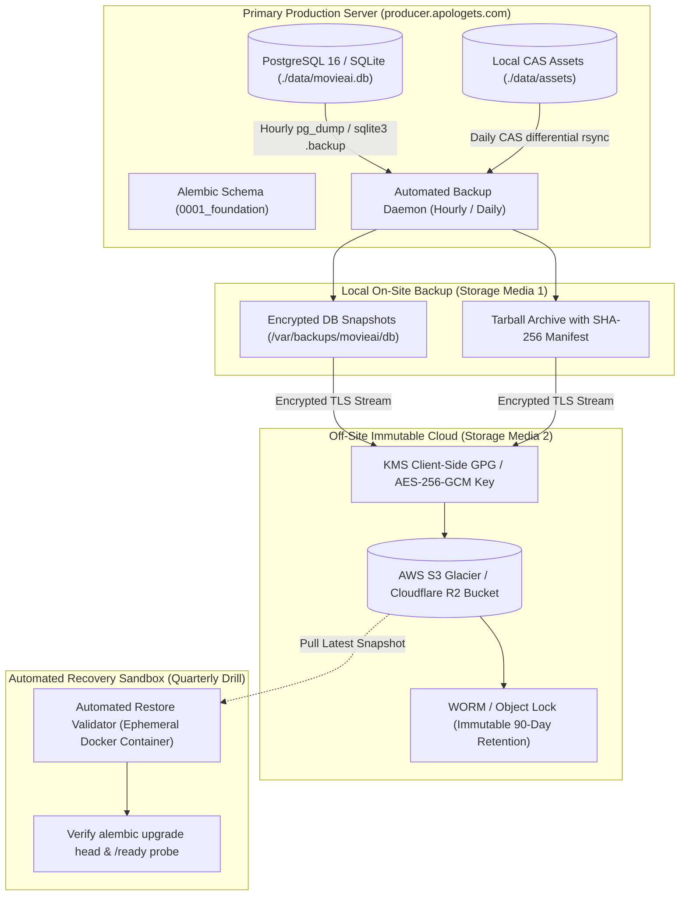

# Backup, Restore & Disaster Recovery Strategy - MovieAIProducer

- **Project:** MovieAIProducer
- **Document ID:** BCDR-0001
- **Domain:** Business Continuity, Disaster Recovery & Data Resilience
- **Version:** 2.0.0
- **Status:** Approved Production Specification
- **Canonical Architecture Decisions:** ADR-0006 (Data Storage Strategy), ADR-0012 (Asset Storage), ADR-0014 (Deployment Strategy)
- **Production Host:** `https://producer.apologets.com`

---

## 1. Disaster Recovery Vision & Resilience Philosophy

In cinematic AI film production, data loss is catastrophic. A corrupted Master Production Bible (MPB) or lost Character Voice DNA invalidates hundreds of hours of creative tuning and thousands of dollars in GPU rendering costs.

MovieAIProducer enforces an automated, zero-trust **3-2-1 Backup & Disaster Recovery Architecture** that treats backups as unverified hypotheses until automated restoration drills mathematically prove data recoverability.

### Recovery Objectives & SLAs

- **Recovery Point Objective (RPO):**
  - **Relational Database (MPB, Screenplay, Scene States):** $\le \mathbf{1\text{ hour}}$ (continuous Write-Ahead Logging / hourly snapshots).
  - **Content-Addressable Asset Store (Videos, Audio, Images):** $\le \mathbf{6\text{ hours}}$ (continuous sync to off-site object storage).
- **Recovery Time Objective (RTO):**
  - **Database Restoration:** $\le \mathbf{30\text{ minutes}}$ from cold snapshot.
  - **Full Production Rebuild (Bare-metal to `producer.apologets.com`):** $\le \mathbf{2\text{ hours}}$.

---

## 2. 3-2-1 Backup Topology Diagram



---

## 3. Data Classification & Protection Tiers

| Data Tier                | Entity Scope & File Paths                                                                              | Business Value                                   | Loss Impact                               | Backup Frequency                             | Storage Target                                 |
| :----------------------- | :----------------------------------------------------------------------------------------------------- | :----------------------------------------------- | :---------------------------------------- | :------------------------------------------- | :--------------------------------------------- |
| **Tier 1 (Critical)**    | Master Production Bible, Character DNA, 50-Scene Screenplay, Foundation Metadata (`./data/movieai.db`) | Irreplaceable creative intellectual property     | Total production halt                     | Hourly snapshot + WAL continuous archiving   | Local encrypted NVMe + Off-site S3 Object Lock |
| **Tier 2 (Important)**   | Rendered video shots, synthesized voice WAVs, reference face embeddings (`./data/assets/**`)           | High compute & monetary value ($0.20–$0.30/shot) | Re-rendering costs and continuity re-work | Daily differential sync (every 6 hours)      | Offsite Cloudflare R2 / S3 Standard            |
| **Tier 3 (Operational)** | Job telemetry, raw inference logs, audit trails, QC diagnostic heatmaps                                | Operational & debugging diagnostics              | Temporary telemetry blindness             | Weekly compressed archive (30-day retention) | S3 Infrequent Access (Glacier)                 |

---

## 4. Automated Backup Procedures & Scripts

### 4.1 Relational Database Snapshot Procedure

For local development or SQLite deployments:

```bash
#!/usr/bin/env bash
# /opt/movieai/scripts/backup_db.sh
set -euo pipefail

BACKUP_DIR="/var/backups/movieai/db"
TIMESTAMP=$(date -u +"%Y%m%d_%H%M%SZ")
DB_FILE="/app/data/movieai.db"
OUTPUT_FILE="${BACKUP_DIR}/movieai_db_${TIMESTAMP}.sqlite"

mkdir -p "${BACKUP_DIR}"

if [[ -f "${DB_FILE}" ]]; then
  echo "Backing up SQLite database with online safe vacuum/backup API..."
  sqlite3 "${DB_FILE}" ".backup '${OUTPUT_FILE}'"
  gzip -9 "${OUTPUT_FILE}"
  echo "Backup created: ${OUTPUT_FILE}.gz"
fi

# Rotate backups older than 7 days locally
find "${BACKUP_DIR}" -type f -name "*.sqlite.gz" -mtime +7 -delete
```

For production PostgreSQL deployments:

```bash
#!/usr/bin/env bash
# /opt/movieai/scripts/backup_postgres.sh
set -euo pipefail

TIMESTAMP=$(date -u +"%Y%m%d_%H%M%SZ")
BACKUP_DIR="/var/backups/movieai/postgres"
mkdir -p "${BACKUP_DIR}"

# Execute pg_dump with custom compressed archive format
pg_dump -U movieai -h postgres -d movieai_prod -Fc -f "${BACKUP_DIR}/movieai_prod_${TIMESTAMP}.dump"

# Encrypt backup archive with GPG AES-256
gpg --symmetric --batch --yes --passphrase-file /etc/movieai/backup_key.txt \
    "${BACKUP_DIR}/movieai_prod_${TIMESTAMP}.dump"

rm -f "${BACKUP_DIR}/movieai_prod_${TIMESTAMP}.dump"
echo "Encrypted backup created: ${BACKUP_DIR}/movieai_prod_${TIMESTAMP}.dump.gpg"
```

### 4.2 Content-Addressable Asset Store (CAS) Synchronization

Because binary media files are content-addressed by their SHA-256 checksums (`./data/assets/{sha[0:2]}/{sha[2:4]}/{sha}.{ext}`), assets are inherently immutable. Once written, a file never changes. This makes synchronization extremely fast and bandwidth-efficient:

```bash
#!/usr/bin/env bash
# /opt/movieai/scripts/sync_cas_offsite.sh
set -euo pipefail

CAS_LOCAL="/app/data/assets"
S3_TARGET="s3://movieai-prod-cas-backup/assets"

echo "Syncing CAS assets to off-site S3 Object Lock bucket..."
rclone sync "${CAS_LOCAL}" "${S3_TARGET}" \
  --checksum \
  --immutable \
  --transfers 16 \
  --fast-list \
  --log-file=/var/log/movieai/cas_sync.log

echo "CAS asset sync completed successfully."
```

---

## 5. Step-by-Step Restoration Playbooks

### Playbook A: Accidental Database Corruption or Data Reversion

1. **Stop Traffic Ingress:**
   ```bash
   docker compose stop web worker
   ```
2. **Identify Target Snapshot:**
   ```bash
   ls -la /var/backups/movieai/postgres/
   ```
3. **Decrypt and Restore Database:**
   ```bash
   gpg --decrypt --batch --passphrase-file /etc/movieai/backup_key.txt \
       movieai_prod_20261119_080000Z.dump.gpg > restored.dump

   pg_restore -U movieai -h postgres -d movieai_prod --clean --if-exists restored.dump
   rm restored.dump
   ```
4. **Execute Migration Check:**
   ```bash
   docker compose run --rm web alembic upgrade head
   ```
5. **Start Services & Verify Readiness:**
   ```bash
   docker compose up -d web worker
   curl -f http://127.0.0.1:8000/ready
   ```

---

### Playbook B: Catastrophic Server Loss (Bare-Metal Disaster Recovery)

1. **Provision New Clean Host:** Ubuntu 22.04 LTS instance with Docker and Docker Compose installed.
2. **Clone Application Repository:**
   ```bash
   git clone https://github.com/apologets/MovieAIProducer.git /opt/movieai-producer
   cd /opt/movieai-producer
   ```
3. **Configure Environment Secrets:**
   Deploy `.env.production` from secure password vault.
4. **Restore CAS Asset Storage from S3:**
   ```bash
   mkdir -p ./data/assets
   rclone sync s3://movieai-prod-cas-backup/assets ./data/assets --transfers 32
   ```
5. **Restore Latest Production Database Dump:**
   Pull latest encrypted `.dump.gpg` from S3 Glacier and restore via `pg_restore`.
6. **Launch System:**
   ```bash
   docker compose -f docker-compose.prod.yml up -d
   ```
7. **Perform Smoke Verification:**
   Verify DNS routing at `https://producer.apologets.com/ready`.

---

## 6. Automated Recovery Drills & Validation Schedule

A backup is treated as unverified until an automated recovery test passes.

### Quarterly Automated Restoration Drill

On the 1st of every quarter, an automated CI worker executes the following automated drill:

1. Spawns an ephemeral Docker container with an empty database volume.
2. Pulls a random backup from the previous 30 days.
3. Restores the database dump and runs `alembic upgrade head`.
4. Executes the test suite against the restored database:
   ```bash
   pytest tests/infrastructure/test_database_repository.py
   ```
5. Queries `foundation_metadata` and confirms core project table records are intact.
6. Emits a verification scorecard signed by the DevOps and Security leads.
