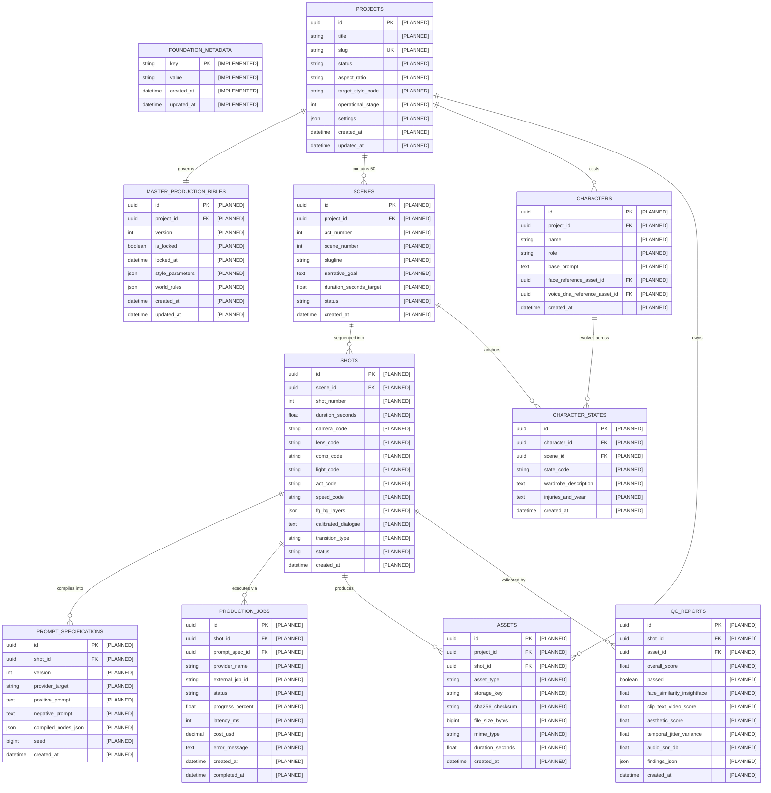

# Data Model & Database Architecture - MovieAIProducer

- **Project:** MovieAIProducer
- **Document ID:** DATA-0001
- **Domain:** Relational Persistence, Schema Definitions & Storage Contracts
- **Version:** 2.0.0
- **Status:** Approved Specification
- **Canonical Architecture References:** ADR-0004 (Master Production Bible), ADR-0006 (Data Storage Strategy), ADR-0012 (Asset Storage)
- **Primary Migration Registry:** `migrations/versions/0001_initial_database_foundation.py`

---

## 1. Data Design Philosophy & Integrity Rules

The MovieAIProducer data model provides relational integrity, deterministic versioning, and immutable audit trails for cinematic storytelling.

### Core Persistence Invariants
1. **Explicit Implementation Transparency:** All tables and columns are explicitly labeled as **`[IMPLEMENTED]`** (verified against current SQLAlchemy models and Alembic migrations) or **`[PLANNED]`** (scheduled roadmap schema).
2. **Deterministic Constraint Naming:** Cross-database constraint consistency between SQLite and PostgreSQL is guaranteed by `POSTGRES_SQLITE_NAMING_CONVENTIONS` defined in `backend/app/infrastructure/database/base.py`.
3. **Timezone-Aware Timestamps:** All datetime columns use the custom `UTCDateTime` TypeDecorator (`backend/app/infrastructure/database/types.py`), ensuring datetime objects are stored and loaded in UTC across SQLite and PostgreSQL.
4. **Content-Addressable Asset Integrity (CAS):** Binary media files (images, audio, video) are decoupled from the relational database. Files are saved to `./data/assets` using their SHA-256 hash. The database stores metadata and the immutable storage key.
5. **DNA Freeze Immutability:** When a Master Production Bible (`master_production_bibles`) version is locked (`is_locked = TRUE`), all related character embeddings and world rules become read-only. Subsequent changes require creating a new incremented version.

---

## 2. Entity Relationship Diagram (ERD)



---

## 3. Implemented Database Models & Schemas `[IMPLEMENTED]`

### 3.1 `foundation_metadata` Table
- **Implementation Status:** **`[IMPLEMENTED]`**
- **Model Class:** `backend.app.infrastructure.database.models.foundation:FoundationMetadataModel`
- **Migration Script:** `migrations/versions/0001_initial_database_foundation.py` (`0001_foundation`)
- **Engine Support:** Fully tested on SQLite (`aiosqlite`) and PostgreSQL (`asyncpg`).

| Column Name | SQL Type | Nullable | Primary Key | Default / Generation | Description |
| :--- | :--- | :--- | :--- | :--- | :--- |
| `key` | `VARCHAR(128)` | No | Yes | None | Unique metadata identifier key |
| `value` | `TEXT` | No | No | None | Serialized configuration or operational value |
| `created_at` | `DATETIME` (UTC) | No | No | `datetime.now(timezone.utc)` | UTC timestamp of record creation |
| `updated_at` | `DATETIME` (UTC) | No | No | `datetime.now(timezone.utc)` | UTC timestamp of latest update |

```python
# Grounded Code Reference: backend/app/infrastructure/database/models/foundation.py
class FoundationMetadataModel(Base):
    __tablename__ = "foundation_metadata"

    key: Mapped[str] = mapped_column(String(128), primary_key=True)
    value: Mapped[str] = mapped_column(Text, nullable=False)
    created_at: Mapped[datetime] = mapped_column(
        UTCDateTime,
        default=lambda: datetime.now(timezone.utc),
        nullable=False,
    )
    updated_at: Mapped[datetime] = mapped_column(
        UTCDateTime,
        default=lambda: datetime.now(timezone.utc),
        onupdate=lambda: datetime.now(timezone.utc),
        nullable=False,
    )
```

---

## 4. Planned Database Models & Relational Schemas `[PLANNED]`

### 4.1 `projects` Table
- **Implementation Status:** **`[PLANNED]`**
- **Domain Root:** Film Project Lifecycle

| Column Name | SQL Type | Nullable | Primary Key | Foreign Key | Description |
| :--- | :--- | :--- | :--- | :--- | :--- |
| `id` | `UUID` | No | Yes | None | Stable UUIDv4 identifier |
| `title` | `VARCHAR(255)` | No | No | None | Display title of the film production |
| `slug` | `VARCHAR(255)` | No | No | None | URL-safe slug (Unique index) |
| `status` | `VARCHAR(32)` | No | No | None | `PLANNING`, `IN_PRODUCTION`, `COMPLETED`, `ARCHIVED` |
| `aspect_ratio` | `VARCHAR(16)` | No | No | None | `16:9` (default) or `9:16` |
| `target_style_code` | `VARCHAR(16)` | No | No | None | Visual style code (`#Style 01` to `#Style 18`) |
| `operational_stage` | `INTEGER` | No | No | None | Active 16-stage number (1 to 16) |
| `settings` | `JSON` | No | No | None | Project-level configuration flags |
| `created_at` | `DATETIME` (UTC) | No | No | None | Timestamp of project creation |
| `updated_at` | `DATETIME` (UTC) | No | No | None | Timestamp of latest project update |

---

### 4.2 `master_production_bibles` Table
- **Implementation Status:** **`[PLANNED]`**
- **Domain Root:** Master Production Bible (MPB) Single Source of Truth

| Column Name | SQL Type | Nullable | Primary Key | Foreign Key | Description |
| :--- | :--- | :--- | :--- | :--- | :--- |
| `id` | `UUID` | No | Yes | None | Stable UUIDv4 identifier |
| `project_id` | `UUID` | No | No | `projects.id` | Project foreign key (Unique index per active version) |
| `version` | `INTEGER` | No | No | None | Monotonically increasing version integer |
| `is_locked` | `BOOLEAN` | No | No | None | Freeze flag; locks creative DNA when TRUE |
| `locked_at` | `DATETIME` (UTC) | Yes | No | None | Timestamp of showrunner approval lock |
| `locked_by_user_id`| `UUID` | Yes | No | None | Showrunner user UUID who approved the freeze |
| `style_parameters` | `JSON` | No | No | None | Serialized style, lighting, and camera rules |
| `world_rules` | `JSON` | No | No | None | Invariants governing environmental continuity |
| `created_at` | `DATETIME` (UTC) | No | No | None | Creation timestamp |
| `updated_at` | `DATETIME` (UTC) | No | No | None | Modification timestamp |

---

### 4.3 `scenes` Table (The 50 Scenes)
- **Implementation Status:** **`[PLANNED]`**
- **Domain Root:** 4-Act Hollywood Story Blueprint

| Column Name | SQL Type | Nullable | Primary Key | Foreign Key | Description |
| :--- | :--- | :--- | :--- | :--- | :--- |
| `id` | `UUID` | No | Yes | None | Stable UUIDv4 identifier |
| `project_id` | `UUID` | No | No | `projects.id` | Owning project foreign key |
| `act_number` | `INTEGER` | No | No | None | Act index: 1 (Act I), 2 (Act II-A), 3 (Act II-B), 4 (Act III/IV) |
| `scene_number` | `INTEGER` | No | No | None | Sequential scene number: 1 through 50 |
| `slugline` | `VARCHAR(255)` | No | No | None | Screenplay slugline (e.g. `EXT. METROPOLIS - DUSK`) |
| `narrative_goal` | `TEXT` | No | No | None | Core dramatic objective of this scene |
| `duration_target`| `FLOAT` | No | No | None | Target duration in seconds (standard 30.0s) |
| `status` | `VARCHAR(32)` | No | No | None | `PLANNED`, `IN_PROGRESS`, `APPROVED`, `LOCKED` |
| `created_at` | `DATETIME` (UTC) | No | No | None | Creation timestamp |

---

### 4.4 `characters` & `character_states` Tables
- **Implementation Status:** **`[PLANNED]`**
- **Domain Root:** Character DNA & Evolutionary Continuity Engine

#### `characters` Table:
| Column Name | SQL Type | Nullable | Primary Key | Foreign Key | Description |
| :--- | :--- | :--- | :--- | :--- | :--- |
| `id` | `UUID` | No | Yes | None | Character UUIDv4 |
| `project_id` | `UUID` | No | No | `projects.id` | Owning project foreign key |
| `name` | `VARCHAR(128)` | No | No | None | Character display name |
| `role` | `VARCHAR(64)` | No | No | None | `PROTAGONIST`, `ANTAGONIST`, `DEUTERAGONIST`, `MENTOR` |
| `base_prompt` | `TEXT` | No | No | None | Base physical prompt description |
| `face_ref_asset_id`| `UUID` | Yes | No | `assets.id` | CAS reference image for InsightFace / IP-Adapter |
| `voice_ref_asset_id`| `UUID` | Yes | No | `assets.id` | CAS reference WAV audio for GPT-SoVITS cloning |

#### `character_states` Table:
| Column Name | SQL Type | Nullable | Primary Key | Foreign Key | Description |
| :--- | :--- | :--- | :--- | :--- | :--- |
| `id` | `UUID` | No | Yes | None | State UUIDv4 |
| `character_id` | `UUID` | No | No | `characters.id`| Parent character foreign key |
| `scene_id` | `UUID` | Yes | No | `scenes.id` | Associated scene foreign key |
| `state_code` | `VARCHAR(16)` | No | No | None | State code (`#State 01` to `#State 05`) |
| `wardrobe` | `TEXT` | No | No | None | Costume description and alterations |
| `injuries_and_wear`| `TEXT` | No | No | None | Persistent physical damage (blood, scars, grime) |
| `expression_anchor`| `TEXT` | No | No | None | Default emotional demeanor |

---

### 4.5 `shots` Table
- **Implementation Status:** **`[PLANNED]`**
- **Domain Root:** Cinematography, Optics, Lighting & Performance Matrix

| Column Name | SQL Type | Nullable | Primary Key | Foreign Key | Description |
| :--- | :--- | :--- | :--- | :--- | :--- |
| `id` | `UUID` | No | Yes | None | Shot UUIDv4 |
| `scene_id` | `UUID` | No | No | `scenes.id` | Owning scene foreign key |
| `shot_number` | `INTEGER` | No | No | None | Sequence order within scene (1 to N) |
| `duration_seconds`| `FLOAT` | No | No | None | Calibrated duration (standard 4.0 to 5.0 seconds) |
| `camera_code` | `VARCHAR(16)` | No | No | None | Camera movement code (`#Cam 01` to `#Cam 34`) |
| `lens_code` | `VARCHAR(16)` | No | No | None | Lens physics code (`#Lens 01` to `#Lens 06`) |
| `comp_code` | `VARCHAR(16)` | No | No | None | Composition geometry code (`#Comp 01` to `#Comp 08`) |
| `light_code` | `VARCHAR(16)` | No | No | None | Cinematic lighting setup (`#Light 01` to `#Light 14`) |
| `act_code` | `VARCHAR(16)` | No | No | None | Performance & acting code (`#Act 01` to `#Act 24`) |
| `speed_code` | `VARCHAR(16)` | No | No | None | Motion speed profile (`#Speed 01` to `#Speed 05`) |
| `fg_bg_layers` | `JSON` | No | No | None | Staged layers: Foreground, Middleground, Background |
| `dialogue` | `TEXT` | Yes | No | None | Calibrated dialogue text (<= 14 words per 5s) |
| `transition_type` | `VARCHAR(16)` | No | No | None | Audio transition (`NONE`, `J_CUT`, `L_CUT`, `HARD_CUT`) |
| `status` | `VARCHAR(32)` | No | No | None | `PLANNED`, `COMPILED`, `GENERATING`, `QC_REVIEW`, `APPROVED` |

---

### 4.6 `production_jobs` & `assets` Tables
- **Implementation Status:** **`[PLANNED]`**
- **Domain Root:** Asynchronous Execution & Content-Addressable Asset Registry

#### `production_jobs` Table:
| Column Name | SQL Type | Nullable | Primary Key | Foreign Key | Description |
| :--- | :--- | :--- | :--- | :--- | :--- |
| `id` | `UUID` | No | Yes | None | Job UUIDv4 |
| `shot_id` | `UUID` | No | No | `shots.id` | Target shot foreign key |
| `provider_name` | `VARCHAR(64)` | No | No | None | Adapter: `comfyui_local`, `veo_2`, `kling_1.5`, `gpt_sovits` |
| `external_job_id`| `VARCHAR(128)`| Yes | No | None | External provider transaction / job identifier |
| `status` | `VARCHAR(32)` | No | No | None | `QUEUED`, `PROCESSING`, `COMPLETED`, `FAILED`, `CANCELLED` |
| `progress_percent`| `FLOAT` | No | No | None | Execution progress (0.0% to 100.0%) |
| `latency_ms` | `INTEGER` | Yes | No | None | Measured turnaround duration in milliseconds |
| `cost_usd` | `NUMERIC(8,4)`| Yes | No | None | Billed generation cost in USD |
| `error_message` | `TEXT` | Yes | No | None | Sanitized error diagnostic if failed |
| `created_at` | `DATETIME` (UTC) | No | No | None | Submission timestamp |
| `completed_at` | `DATETIME` (UTC) | Yes | No | None | Termination timestamp |

#### `assets` Table (CAS Registry):
| Column Name | SQL Type | Nullable | Primary Key | Foreign Key | Description |
| :--- | :--- | :--- | :--- | :--- | :--- |
| `id` | `UUID` | No | Yes | None | Asset UUIDv4 |
| `project_id` | `UUID` | No | No | `projects.id` | Owning project foreign key |
| `shot_id` | `UUID` | Yes | No | `shots.id` | Associated shot foreign key (nullable for project assets) |
| `asset_type` | `VARCHAR(32)` | No | No | None | `IMAGE_REF`, `VIDEO_RENDER`, `AUDIO_VOICE`, `AUDIO_SFX` |
| `storage_key` | `VARCHAR(255)`| No | No | None | Relative CAS path (`cas/8f/3e/8f3e2b9c....mp4`) |
| `sha256_checksum`| `VARCHAR(64)` | No | No | None | SHA-256 digest of binary content (Unique index) |
| `file_size_bytes`| `BIGINT` | No | No | None | Size in bytes |
| `mime_type` | `VARCHAR(64)` | No | No | None | `video/mp4`, `audio/wav`, `image/png`, `image/webp` |
| `duration_seconds`| `FLOAT` | Yes | No | None | Playback duration for audio and video assets |
| `created_at` | `DATETIME` (UTC) | No | No | None | Ingestion timestamp |

---

### 4.7 `qc_reports` Table
- **Implementation Status:** **`[PLANNED]`**
- **Domain Root:** Automated Quality Control & Visual Integrity

| Column Name | SQL Type | Nullable | Primary Key | Foreign Key | Description |
| :--- | :--- | :--- | :--- | :--- | :--- |
| `id` | `UUID` | No | Yes | None | QC Report UUIDv4 |
| `shot_id` | `UUID` | No | No | `shots.id` | Target shot foreign key |
| `asset_id` | `UUID` | No | No | `assets.id` | Evaluated asset foreign key |
| `overall_score` | `FLOAT` | No | No | None | Weighted composite score (0.00 to 1.00) |
| `passed` | `BOOLEAN` | No | No | None | Gate clearance flag (TRUE if score >= 0.85 & 0 criticals) |
| `face_similarity`| `FLOAT` | Yes | No | None | InsightFace cosine similarity against character anchor |
| `clip_score` | `FLOAT` | Yes | No | None | CLIP text-to-frame semantic alignment score |
| `aesthetic_score`| `FLOAT` | Yes | No | None | LAION / Aesthetic predictor rating (1.0 to 10.0) |
| `temporal_jitter`| `FLOAT` | Yes | No | None | Optical flow frame-to-frame variance |
| `audio_snr_db` | `FLOAT` | Yes | No | None | Audio Signal-to-Noise Ratio (dB) |
| `findings_json` | `JSON` | No | No | None | List of detected defect tags and warning strings |
| `created_at` | `DATETIME` (UTC) | No | No | None | Evaluation timestamp |
