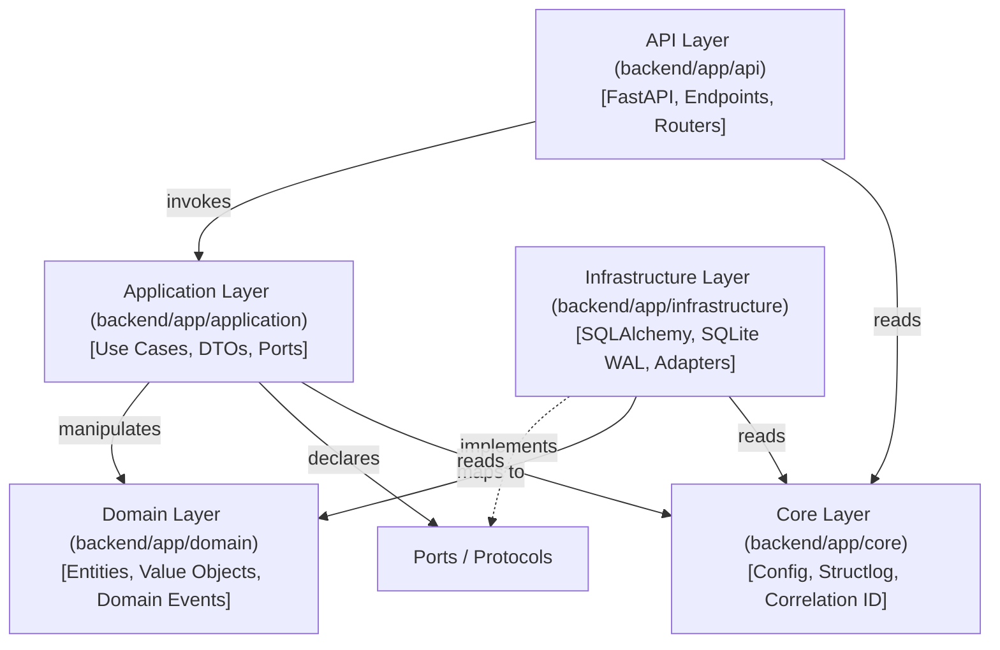

# ADR-0002: Application Structure

| Attribute | Specification |
| :--- | :--- |
| **ADR ID** | ADR-0002 |
| **Title** | Application Structure: Layered Domain-Oriented Clean Architecture Layout |
| **Status** | IMPLEMENTED |
| **Date** | 2026-11-19 |
| **Decision Owners** | Project Architecture & Core Engineering Team |
| **Decision Scope** | Backend repository and package layout |
| **Version** | 1.2 |
| **Canonical Source** | `DECISIONS/ADR/ADR-0002-application-structure.md` |
| **Supersedes** | None |
| **Superseded By** | None |

---

## 1. Context

MovieAIProducer coordinates multiple interconnected film production domains across a 16-stage Hollywood cinematic lifecycle. 

The application structure must support:
- Strict domain separation and encapsulation.
- Clean Architecture / Hexagonal Ports and Adapters.
- Independent testability of pure business rules without third-party frameworks.
- Provider independence for AI generation engines (ComfyUI, ElevenLabs, Runway, OpenAI).
- Asynchronous background processing for long-running media rendering.
- Maintainable and self-documenting directory structure for human engineers and autonomous AI coding agents.

The file organization must reflect business responsibilities and domain boundaries rather than mere technical file types.

---

## 2. Problem Statement

Without a formalized, enforced application structure, typical anti-patterns arise in AI-driven media pipelines:
1. Business logic leaks into API endpoint handlers.
2. Raw database queries and ORM models become tightly coupled with domain entities.
3. Third-party provider SDKs are called directly from core business services.
4. Modules directly mutate another module's internal state.
5. Circular package imports paralyze test execution.
6. Business rules are duplicated across API endpoints and background workers.
7. Testing requires live external services or heavy database instances.

A clear, standardized directory and package structure must be established and enforced across the repository.

---

## 3. Decision Drivers

- **Clear Module Ownership**: Unambiguous domain boundaries.
- **Strict Separation of Concerns**: Isolating domain rules from delivery mechanisms.
- **Dependency Inversion**: Dependencies flow inward toward business abstractions.
- **High Testability**: Unit tests execute in milliseconds without external side effects.
- **AI Agent Friendliness**: Predictable file placement enables autonomous coding agents to navigate the codebase accurately.
- **Production Grounding**: File layout aligns with actual Python packaging standards (PEP 518/621, Hatchling, uv).

---

## 4. Options Considered

### Option A: Layer-Based Technical Structure
```
src/
├── controllers/
├── services/
├── repositories/
├── models/
└── utils/
```
- **Advantages:** Simple to set up initially.
- **Disadvantages:** Domain concepts are fragmented across folders; lacks bounded context boundaries; high coupling.
- **Assessment:** **Rejected.**

### Option B: Feature-Based Slice Structure
```
src/
├── projects/
├── screenplay/
├── characters/
└── prompts/
```
- **Advantages:** High cohesion within specific features.
- **Disadvantages:** Leads to inconsistent architectural layers within features; infrastructure and domain code easily intermingle.
- **Assessment:** **Rejected as standalone.**

### Option C: Domain-Oriented Modular Clean Architecture (Hybrid)
Layered architecture at the system core (`domain/`, `application/`, `infrastructure/`, `core/`, `api/`), supporting modular domain slices internally.
- **Advantages:** Combines rigorous layer boundaries with clear domain ownership; easily verifiable via automated import linter/tests.
- **Assessment:** **Selected and Implemented.**

---

## 5. Architectural Decision

MovieAIProducer adopts a **Layered Domain-Oriented Clean Architecture** structure rooted in `backend/app/`.

### Implemented Repository Layout

```
MovieAIProducer/
├── pyproject.toml              # Project dependencies, build-system (Hatchling), tool config
├── alembic.ini                 # Database migration configuration
├── .env.example                # Environment variable specification
├── backend/
│   └── app/
│       ├── __init__.py
│       ├── main.py             # FastAPI entrypoint, lifespan events, middleware
│       ├── api/                # Presentation Layer: HTTP endpoints & routers
│       │   ├── __init__.py
│       │   └── health.py       # Health check, readiness & liveness probes
│       ├── application/        # Application Layer: Use cases, DTOs & Port interfaces
│       │   ├── __init__.py
│       │   └── common/
│       │       ├── __init__.py
│       │       ├── dtos.py     # Request/Response data transfer objects
│       │       ├── exceptions.py # Application-level exceptions (CDA-0005)
│       │       ├── ports.py    # Clock, EventDispatcher, UnitOfWork protocols
│       │       └── use_case.py # Abstract UseCase[TInput, TOutput] base
│       ├── core/               # Cross-Cutting Infrastructure: Config, logging, security
│       │   ├── __init__.py
│       │   ├── config.py       # Pydantic Settings (environment validation)
│       │   ├── logging.py      # Structlog structured JSON logger
│       │   └── middleware.py   # Correlation ID (X-Correlation-ID) tracking
│       ├── domain/             # Domain Layer: Pure enterprise business rules
│       │   ├── __init__.py
│       │   └── common/
│       │       ├── __init__.py
│       │       ├── entity.py   # Base Entity (UUID identity, timestamps)
│       │       ├── event.py    # Base DomainEvent (event_id, occurred_at)
│       │       ├── exceptions.py # Canonical DomainException hierarchy
│       │       ├── repository.py # Generic BaseRepository[TEntity, TId] protocol
│       │       └── value_object.py # Immutable frozen ValueObject
│       └── infrastructure/     # Infrastructure Layer: Persistence & external adapters
│           ├── __init__.py
│           ├── common/
│           │   ├── __init__.py
│           │   ├── event_bus.py # In-memory async EventDispatcher adapter
│           │   ├── in_memory_repository.py # Test double repository
│           │   └── unit_of_work.py # In-memory test double UnitOfWork
│           └── database/
│               ├── __init__.py
│               ├── base.py     # DeclarativeBase for SQLAlchemy ORM
│               ├── engine.py   # AsyncEngine factory (SQLite WAL mode & PRAGMAs)
│               ├── repository.py # SqlAlchemyBaseRepository[TModel, TEntity, TId]
│               ├── session.py  # async_sessionmaker factory
│               ├── types.py    # UTCDateTime custom SQLAlchemy TypeDecorator
│               ├── unit_of_work.py # SqlAlchemyUnitOfWork transaction manager
│               └── models/
│                   ├── __init__.py
│                   └── foundation.py # FoundationMetadataModel schema
├── migrations/                 # Alembic database migrations
│   ├── env.py                  # Async migration runtime harness
│   ├── script.py.mako
│   └── versions/
│       └── 0001_initial_database_foundation.py
├── tests/                      # Automated Test Suite
│   ├── conftest.py
│   ├── test_health.py
│   ├── application/
│   │   └── test_use_case.py
│   ├── architecture/
│   │   └── test_layer_boundaries.py # Enforces import rules across layers
│   ├── domain/
│   │   └── test_primitives.py
│   └── infrastructure/
│       ├── test_adapters.py
│       ├── test_database_engine.py
│       ├── test_database_migrations.py
│       ├── test_database_repository.py
│       └── test_database_uow.py
├── DECISIONS/                  # Canonical SSOT: ADRs, Audits, CDAs
└── docs/                       # Architectural reference documentation
```

---

## 6. Layer Dependency Hierarchy



### Strict Boundary Rules
1. **Domain Layer:** Pure Python. May **never** import from `application`, `infrastructure`, `api`, or third-party web/database frameworks.
2. **Application Layer:** May import only from `domain` and `core`. Never imports from `infrastructure` or `api`.
3. **Infrastructure Layer:** Implements interfaces/protocols declared in `application` and `domain`. May import from `domain`, `application`, and `core`.
4. **API Layer:** Entry point for HTTP calls. May import from `application`, `core`, and `domain` (for response typing), but delegates business actions strictly to application use cases.
5. **Boundary Verification:** Automatically tested by `tests/architecture/test_layer_boundaries.py`.

---

## 7. Domain Module Ownership

| Domain Module | Primary Business Capability | Directory Location |
| :--- | :--- | :--- |
| **Foundation & Metadata** | System baseline, schema versioning, operational flags | `backend/app/infrastructure/database/models/foundation.py` |
| **Creative Brief** | Project intent, target audience, emotional palette, aspect ratio | `backend/app/domain/creative_brief/` (Phase 2) |
| **Story & Screenplay** | Scene breakdown, script beats, dialogues, emotional arc | `backend/app/domain/screenplay/` (Phase 3) |
| **Master Production Bible** | Canonical approved state for character DNA, environments, props | `backend/app/domain/mpb/` (Phase 4) |
| **Visual Direction** | Styles (#Style 01-18), Lighting (#Light 01-14), Acting (#Act 01-24) | `backend/app/domain/visual_direction/` (Phase 5) |
| **Previsualization** | Storyboard panels, animatic timing, shot blocking | `backend/app/domain/previs/` (Phase 6) |
| **Prompt Engine** | 12-step Hollywood cinematic prompt compilation and tokenization | `backend/app/domain/prompts/` (Phase 7) |
| **AI Orchestration** | Provider adapters, batch job queuing, generation dispatch | `backend/app/domain/orchestration/` (Phase 8) |
| **Continuity Engine** | Multi-shot facial, wardrobe, lighting, and spatial lock checks | `backend/app/domain/continuity/` (Phase 9) |
| **Quality Control (QC)** | Multi-tier validation gates, cinematic compliance scoring | `backend/app/domain/qc/` (Phase 10) |

---

## 8. Configuration & Environment Management

Application configuration is centralized in `backend/app/core/config.py` using `pydantic-settings`:
- Configuration values are validated at application bootstrap (`Settings()`).
- Secrets and environment-specific settings (database URLs, API keys) are loaded from environment variables or `.env`.
- Safe defaults are provided for local development (e.g., `sqlite+aiosqlite:///./data/movieai.db`).
- Hardcoded credentials in source code are strictly forbidden.

---

## 9. Testing Strategy Alignment

The directory structure mirrors the test suite layout in `tests/`:

| Test Category | Target Directory | Primary Focus |
| :--- | :--- | :--- |
| **Architecture Tests** | `tests/architecture/` | Validates layer import boundaries and dependency inversion rules via AST inspection. |
| **Domain Unit Tests** | `tests/domain/` | Validates entity identity, value object immutability, and domain event creation. |
| **Application Tests** | `tests/application/` | Tests use case interactors using in-memory test doubles (`InMemoryRepository`, `InMemoryEventBus`). |
| **Infrastructure Tests** | `tests/infrastructure/` | Validates real SQLite WAL mode connections, Alembic migrations, and SQLAlchemy repository CRUD. |
| **API Integration Tests** | `tests/test_health.py` | Validates FastAPI routers, correlation headers, and JSON error response structures using `TestClient`. |

---

## 10. Consequences & Implementation Evidence

### Positive Consequences
- Crystal-clear developer mental model.
- Architecture tests provide rapid regression feedback in CI.
- Autonomous AI coding agents can reliably locate contracts and implementations.
- Zero cyclic dependencies.

### Implementation Evidence
- Verified directory layout in `backend/app/`.
- Verified passing layer boundary tests: `tests/architecture/test_layer_boundaries.py`.
- Verified passing test suite: 50 tests passed in under 1 second.

---

## 11. Related Documents

- [ADR-0001: Architecture Style](file:///home/ubuntu/MovieAIProducer/DECISIONS/ADR/ADR-0001-architecture-style.md)
- [ADR-0006: Data Storage Strategy](file:///home/ubuntu/MovieAIProducer/DECISIONS/ADR/ADR-0006-data-storage-strategy.md)
- [CDA-0002: Canonical Glossary & Domain Ownership Matrix](file:///home/ubuntu/MovieAIProducer/DECISIONS/CDA/CDA-0002-canonical-glossary-domain-ownership-matrix.md)
- [CDA-0005: Canonical Error & Failure Contract Registry](file:///home/ubuntu/MovieAIProducer/DECISIONS/CDA/CDA-0005-canonical-error-failure-contract-registry.md)
