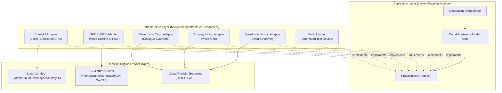
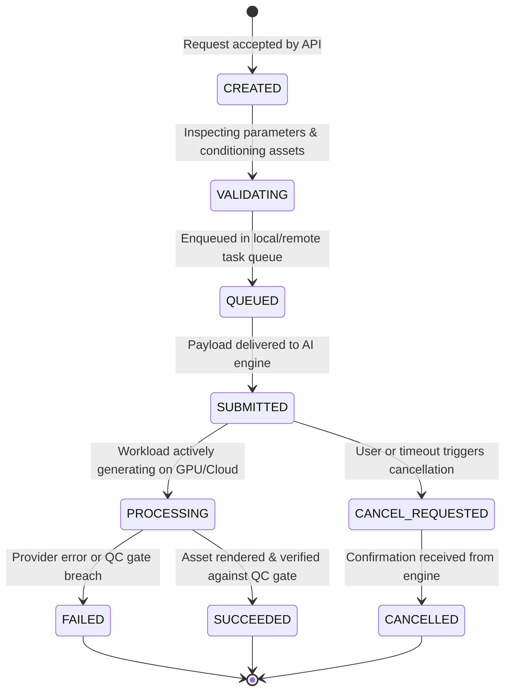

# ADR-0003: Provider Adapter System

| Attribute            | Specification                                                          |
| :------------------- | :--------------------------------------------------------------------- |
| **ADR ID**           | ADR-0003                                                               |
| **Title**            | Provider Adapter System: Ports & Adapters for Heterogeneous AI Engines |
| **Status**           | ACCEPTED                                                               |
| **Date**             | 2026-11-19                                                             |
| **Decision Owners**  | Project Architecture & Core Engineering Team                           |
| **Decision Scope**   | External AI and media generation integrations                          |
| **Version**          | 1.2                                                                    |
| **Canonical Source** | `DECISIONS/ADR/ADR-0003-provider-adapter-system.md`                    |
| **Supersedes**       | None                                                                   |
| **Superseded By**    | None                                                                   |

---

## 1. Context

MovieAIProducer is designed to coordinate professional film production across a heterogeneous landscape of AI providers and media generation technologies.

The platform orchestrates providers across multiple modalities:

- **Large Language Models (LLM)**: Scriptwriting, beat analysis, scene breakdown, directorial intent.
- **Image Generation**: Concept art, character visual DNA, environment keys, storyboard frames.
- **Video Generation**: Scene and shot video rendering, camera motion conditioning.
- **Voice Synthesis & Cloning**: Character dialogue, emotional cadence, voice continuity.
- **Speech Recognition & Alignment**: Dialogue transcription, phoneme alignment, lip-sync.
- **Music & Sound Design**: Score generation, Foley, ambient cinematic soundscapes.
- **Local Media Pipelines**: ComfyUI workflows, GPT-SoVITS local instances, FFmpeg encoding.

Different providers expose fundamentally disparate APIs, request payloads, response envelopes, authentication mechanisms, token limits, rate limits, and asynchronous polling/webhook lifecycles.

Directly coupling business services to vendor SDKs would paralyze system evolution and introduce severe vendor lock-in.

---

## 2. Problem Statement

How should MovieAIProducer integrate multiple external and local AI engines while maintaining:

1. Complete vendor independence and isolation.
2. Normalized generation contracts across all modalities.
3. Capability-aware model routing (e.g., selecting models with character-reference support).
4. Reliable asynchronous execution and webhook/polling status management.
5. Normalized error taxonomy conforming to [CDA-0005](../CDA/CDA-0005-canonical-error-failure-contract-registry.md).
6. Comprehensive usage, latency, and cost tracking.
7. Secure credential isolation.
8. Preservation of canonical prompt intent during provider-specific token compilation.

---

## 3. Decision

Adopt a **Provider Adapter Architecture** based on Hexagonal Ports and Adapters, normalized data contracts, and capability-based routing.

1. **Port Abstraction**: The application layer interacts strictly with abstract protocol interfaces (`ProviderPort`) declared in `backend/app/application/common/ports.py`.
2. **Adapter Isolation**: Each provider adapter translates the normalized domain contract into provider-specific payloads and converts proprietary responses into canonical envelopes.
3. **Capability-Based Routing**: Models are dynamically selected by an intelligent router based on requested capabilities, operational tier, and cost/latency constraints.
4. **Three-Tier Integration Classification**:
   - **Level 1 (Native API)**: Fully automated bidirectional API/socket integration (e.g., ComfyUI API, ElevenLabs API).
   - **Level 2 (Assisted Export)**: Automated generation of compiled prompts and conditioning packages for manual external execution.
   - **Level 3 (Manual External)**: Guided external workflow with manual asset upload.

---

## 4. Architecture & Component Interaction



---

## 5. Architectural Components

### 5.1 Provider Registry & Capability Matrix

The registry tracks active providers, verified capabilities, and operational health:

| Generation Modality       | Primary Engine Candidates                         | Key Model Capabilities                                              | Operational Level      |
| :------------------------ | :------------------------------------------------ | :------------------------------------------------------------------ | :--------------------- |
| **LLM (Script & Story)**  | Anthropic Claude 3.5, OpenAI GPT-4o               | 128k context, structured JSON output, screenwriting format          | Level 1 (Native API)   |
| **Image (Concept & DNA)** | ComfyUI (SDXL/Flux), Midjourney                   | LoRA loading, IP-Adapter character lock, ControlNet depth/canny     | Level 1 & Level 2      |
| **Video (Shot Gen)**      | ComfyUI (Wan2.1/Hunyuan), Runway Gen-3, Kling 1.5 | First/last frame conditioning, camera motion vector control         | Level 1 & Level 2      |
| **Voice (Dialogue)**      | GPT-SoVITS, ElevenLabs                            | Zero-shot voice cloning, emotional prosody, cross-lingual synthesis | Level 1 (Native API)   |
| **Foley & Ambient**       | AudioCraft, ElevenLabs SFX                        | Text-to-audio, looping ambient background, duration matching        | Level 1 & Level 2      |
| **Media Encoding**        | FFmpeg (Native subprocess)                        | Lossless concatenation, H.264/H.265 encoding, ProRes 422            | Level 1 (Local Native) |

### 5.2 Capability-Based Router

The router evaluates generation requests against candidate models using explicit filters:

1. **Mandatory Capability Filters**: Aspect ratio support, reference image conditioning, minimum resolution (1080p/4k).
2. **Operational Status Filter**: Active and healthy models only (automatically bypasses Degraded/Disabled providers).
3. **Economic Constraints**: Maximum budgeted cost per shot or project quota limits.
4. **Fallback Chain**: Automatic fallback to secondary provider if primary rate-limits or times out.

---

## 6. Normalized Contracts

### 6.1 Canonical Generation Request Envelope

```json
{
  "request_id": "uuid-v4",
  "project_id": "uuid-v4",
  "scene_id": "scene-014",
  "shot_id": "shot-003",
  "modality": "video",
  "canonical_prompt": {
    "shot_type": "Close-up",
    "subject": "Elena Vance, determined expression, micro-sweat",
    "lighting": "#Light-03 Low-key chiaroscuro",
    "camera": "35mm Anamorphic, slow push-in",
    "motion": "Subtle breathing, eyes shift to monitor"
  },
  "conditioning_assets": [
    {
      "type": "character_face_reference",
      "asset_id": "asset-dna-elena-001",
      "weight": 0.85
    }
  ],
  "constraints": {
    "aspect_ratio": "16:9",
    "resolution": "1920x1080",
    "duration_seconds": 4.0,
    "fps": 24
  },
  "correlation_id": "corr-uuid"
}
```

### 6.2 Canonical Generation Response Envelope

```json
{
  "request_id": "uuid-v4",
  "job_id": "job-uuid-v4",
  "provider_id": "comfyui-local",
  "model_id": "flux1-dev-fp8",
  "status": "SUCCEEDED",
  "output_assets": [
    {
      "asset_id": "asset-video-099",
      "mime_type": "video/mp4",
      "storage_uri": "storage://projects/p1/shots/s14_03.mp4",
      "checksum_sha256": "e3b0c44298fc1c149afbf4c8996fb92427ae41e4649b934ca495991b7852b855"
    }
  ],
  "execution_metrics": {
    "queue_time_ms": 120,
    "execution_time_ms": 14250,
    "vram_peak_mb": 18400,
    "cost_usd": 0.0
  }
}
```

---

## 7. Normalized Error Taxonomy

Adapters catch vendor-specific exceptions and map them directly into canonical domain exceptions defined in [CDA-0005](../CDA/CDA-0005-canonical-error-failure-contract-registry.md):

| Provider Error Condition               | Canonical Error Code           | HTTP Status             | Retry Policy                                |
| :------------------------------------- | :----------------------------- | :---------------------- | :------------------------------------------ |
| **Authentication Failed**              | `PROVIDER_AUTH_ERROR`          | 502 Bad Gateway         | No retry; alert administrator               |
| **Rate Limit Exceeded**                | `PROVIDER_RATE_LIMIT`          | 429 Too Many Requests   | Exponential backoff with jitter             |
| **Quota / Credits Depleted**           | `PROVIDER_QUOTA_EXHAUSTED`     | 402 Payment Required    | Fast fail; prompt user / fallback           |
| **Model Unavailable / Degraded**       | `PROVIDER_SERVICE_UNAVAILABLE` | 503 Service Unavailable | Fallback to secondary provider              |
| **Content Safety Rejection**           | `PROVIDER_CONTENT_REJECTED`    | 422 Unprocessable       | No retry; return policy violation to author |
| **Timeout During Generation**          | `PROVIDER_TIMEOUT`             | 504 Gateway Timeout     | Retry once with increased timeout           |
| **Invalid Response / Corrupted Asset** | `PROVIDER_MALFORMED_OUTPUT`    | 502 Bad Gateway         | Retry with clean seed                       |

---

## 8. Asynchronous Job Lifecycle



---

## 9. Consequences & Implementation Evidence

### Positive Consequences

- True provider decoupling: Switching from cloud video APIs to local ComfyUI requires zero modifications to domain or workflow code.
- Strict testability: Fully verified via `tests/infrastructure/test_adapters.py`.
- Complete financial and operational auditability across all render jobs.

### Implementation Status: ACCEPTED

- Application port contracts established in `backend/app/application/common/ports.py`.
- Test double adapter contracts verified in `tests/infrastructure/test_adapters.py`.
- Reference implementations for ComfyUI and GPT-SoVITS local instances targeted for Phase 8.

---

## 10. Related Documents

- [ARCHITECTURE.md](../../ARCHITECTURE.md)
- [PROVIDER_MATRIX.md](../../PROVIDER_MATRIX.md)
- [ADR-0001: Architecture Style](ADR-0001-architecture-style.md)
- [ADR-0007: Async Job Processing](ADR-0007-async-job-processing.md)
- [ADR-0008: Prompt Compilation Engine](ADR-0008-prompt-compilation-engine.md)
- [CDA-0004: Canonical Event & Integration Contract Registry](../CDA/CDA-0004-canonical-event-integration-contract-registry.md)
- [CDA-0005: Canonical Error & Failure Contract Registry](../CDA/CDA-0005-canonical-error-failure-contract-registry.md)
