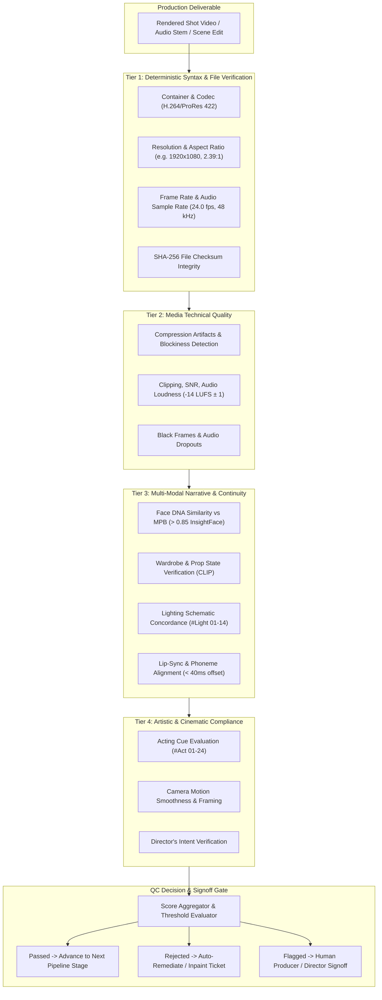

# ADR-0010: Quality Control Engine

| Attribute | Specification |
| :--- | :--- |
| **ADR ID** | ADR-0010 |
| **Title** | Quality Control Engine: 4-Tier Automated Inspection Gates & Human Signoff |
| **Status** | ACCEPTED |
| **Date** | 2026-11-19 |
| **Decision Owners** | Product Owner, Technical Architect & Production Director |
| **Decision Scope** | Multi-tier automated quality gates, technical thresholds, cinematic rubrics, and human signoff |
| **Version** | 1.2 |
| **Canonical Source** | `DECISIONS/ADR/ADR-0010-quality-control-engine.md` |
| **Supersedes** | None |
| **Superseded By** | None |

---

## 1. Context

In professional AI-assisted film production, cinematic quality cannot be assessed solely by technical encoding standards like resolution or frame rate. A shot may be rendered in 4K at 24fps with zero codec corruption, yet remain fundamentally unusable due to:
- A character's facial features morphing between cutaways.
- AI hallucination artifacts (unnatural limb distortions, flickering backgrounds).
- Dialogue audio being out of sync with visual lip phonemes.
- Lighting color temperature abruptly jumping from 3200K tungsten to 5600K daylight.
- Acting performances clashing with the dramatic subtext of the scene.

MovieAIProducer requires a comprehensive Quality Control (QC) Engine that systematically evaluates deliverables across every stage—from screenplay beats to the final master render.

---

## 2. Problem Statement

How should MovieAIProducer inspect, score, and govern production deliverables to:
1. Detect rendering and narrative defects before assets reach editorial assembly.
2. Combine objective, deterministic checks (file syntax, loudness, frame rates) with AI-assisted semantic scoring and human artistic signoff.
3. Prevent subjective or noisy AI scoring from producing false rejections or hiding critical defects.
4. Provide structured, actionable remediation tickets (e.g. pinpointing exact timecodes and required inpaint prompts).
5. Maintain an immutable audit trail of every QC inspection, confidence score, and human override.

---

## 3. Decision

Adopt a **4-Tier Hierarchical Quality Control Engine** combining automated deterministic checks, multi-modal semantic evaluators, and strict human signoff gates.

1. **Tier 1 (Deterministic Syntax & Format)**: Instantaneous binary and container verification (resolution, codec, frame rate, checksum).
2. **Tier 2 (Media Technical Quality)**: Algorithmic signal inspection (compression blockiness, audio clipping, LUFS loudness, black frames).
3. **Tier 3 (Narrative & Continuity)**: Multi-modal embedding verification against the Master Production Bible (face identity, wardrobe state, lighting concordance, lip-sync).
4. **Tier 4 (Cinematic & Artistic Compliance)**: High-level directorial verification against Hollywood codes (#Act 01-24, camera motion smoothness, dramatic intent).
5. **Critical Blocker Rule**: Any critical Tier 1 or Tier 3 defect immediately vetoes asset acceptance, regardless of high scores in other categories.

---

## 4. 4-Tier QC Inspection Architecture

---

## 5. QC Inspection Levels & Granularity

| Inspection Level | Scope | Primary Evaluation Focus |
| :--- | :--- | :--- |
| **Project** | Entire Feature / Short | Creative vision consistency, global tone, narrative pacing |
| **Stage** | 16 Production Stages | Deliverable readiness, prerequisite completeness, milestone signoff |
| **Scene** | Individual Scene | Scene dramatic arc, lighting continuity, dialogue progression |
| **Shot** | Individual Take / Shot | Camera blocking, character facial locks, motion physics, acting |
| **Asset** | Standalone File | Container syntax, codec, audio sample rate, SHA-256 checksum |
| **Final Master** | Conformed Film | Broadcast delivery specs, SMPTE compliance, loudness standards |

---

## 6. Risks and Mitigations

| Risk | Impact | Implemented Mitigation Strategy |
| :--- | :---: | :--- |
| **Subjective AI Drift** | High | Store evaluator confidence, model version, and exact visual evidence frames. |
| **Defect Masking** | Critical | Enforce Critical Blocker Rule: a failed critical check blocks passage regardless of high average score. |
| **False Rejections** | Medium | Calibrate thresholds with human review loop; enable producer override with audit logging. |
| **QC Delaying Production** | Medium | Asynchronous worker execution (ADR-0007); priority queues for bottleneck stages. |
| **High Compute Cost** | Medium | Tiered execution: fail fast on Tier 1 syntax before launching expensive Tier 3/4 AI models. |
| **Stale Downstream Assets** | High | Dependency graph invalidation flags dependent downstream shots whenever a shot is re-rendered. |

---

## 7. Implementation Status: ACCEPTED

- Quality control criteria and gate workflows codified in [CDA-0003](file:///home/ubuntu/MovieAIProducer/DECISIONS/CDA/CDA-0003-canonical-lifecycle-state-transition-matrix.md).
- Automated QC inspection pipeline scheduled for implementation in Phase 10 (Tasks 036-039).

---

## 8. Related Documents

- [ARCHITECTURE.md](file:///home/ubuntu/MovieAIProducer/ARCHITECTURE.md)
- [ERROR_HANDLING.md](file:///home/ubuntu/MovieAIProducer/ERROR_HANDLING.md)
- [ADR-0003: Provider Adapter System](file:///home/ubuntu/MovieAIProducer/DECISIONS/ADR/ADR-0003-provider-adapter-system.md)
- [ADR-0005: Production Workflow Engine](file:///home/ubuntu/MovieAIProducer/DECISIONS/ADR/ADR-0005-production-workflow-engine.md)
- [ADR-0007: Async Job Processing](file:///home/ubuntu/MovieAIProducer/DECISIONS/ADR/ADR-0007-async-job-processing.md)
- [ADR-0009: Continuity Engine](file:///home/ubuntu/MovieAIProducer/DECISIONS/ADR/ADR-0009-continuity-engine.md)
- [CDA-0003: Canonical Lifecycle & State Transition Matrix](file:///home/ubuntu/MovieAIProducer/DECISIONS/CDA/CDA-0003-canonical-lifecycle-state-transition-matrix.md)
- [CDA-0005: Canonical Error & Failure Contract Registry](file:///home/ubuntu/MovieAIProducer/DECISIONS/CDA/CDA-0005-canonical-error-failure-contract-registry.md)
