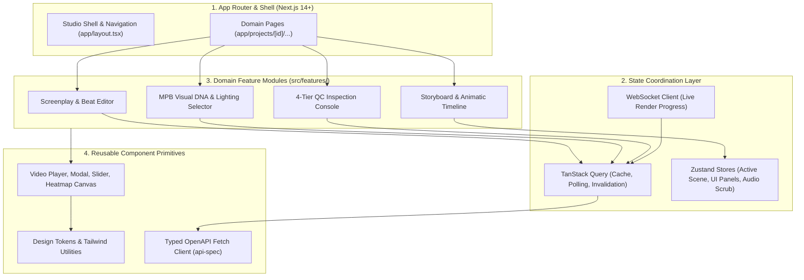

# ADR-0015: Frontend Architecture

| Attribute            | Specification                                                                                 |
| :------------------- | :-------------------------------------------------------------------------------------------- |
| **ADR ID**           | ADR-0015                                                                                      |
| **Title**            | Frontend Architecture: Next.js 14+ Domain-Oriented Production Workspace                       |
| **Status**           | ACCEPTED                                                                                      |
| **Date**             | 2026-11-19                                                                                    |
| **Decision Owners**  | Product Owner, Technical Architect & Frontend Lead                                            |
| **Decision Scope**   | Client web application, Next.js 14+ App Router, production workspace UI, and state management |
| **Version**          | 1.2                                                                                           |
| **Canonical Source** | `DECISIONS/ADR/ADR-0015-frontend-architecture.md`                                             |
| **Supersedes**       | None                                                                                          |
| **Superseded By**    | None                                                                                          |

---

## 1. Context

MovieAIProducer (`producer.apologets.com`) is not a conventional CRUD web portal. It is a professional Hollywood-grade cinematic production studio operating in the browser.

The frontend coordinates multifaceted, highly interactive creative and technical workflows:

- Creative brief formulation and interactive genre/emotional palette selection.
- Multi-column screenplay editor with real-time beat breakdown.
- Master Production Bible (MPB) visual DNA visualizer, character turnaround inspections, and lighting schematic previews.
- Storyboard grid, animatic video player, and camera blocking controls.
- Asynchronous AI render job monitors with live progress bars and WebSocket status feeds.
- 4-Tier Quality Control (QC) inspection console featuring difference heatmaps, audio LUFS meters, and directorial signoff gates.

The UI is fundamentally landscape-oriented, built for professional desktop displays (1920x1080 and ultrawide) while retaining responsive inspection capability on mobile devices.

---

## 2. Problem Statement

Without a formalized frontend architecture, modern media creation tools quickly succumb to:

1. Business logic leaking into presentation components.
2. Inconsistent server state caching causing stale render statuses or duplicate job submissions.
3. Prop-drilling across deep component hierarchies causing rendering bottlenecks.
4. Heavy video/image payloads locking the UI thread and degrading frame rates.
5. Inability to maintain revision-awareness (e.g. user inadvertently editing a superseded MPB revision).
6. Disconnected styling causing visual fragmentation between script editing and QC review.

---

## 3. Decision

Adopt a **Domain-Oriented Frontend Architecture** utilizing **Next.js 14+ (App Router)**, **TypeScript**, **Tailwind CSS**, and **Decoupled State Management (Zustand + TanStack Query)**.

1. **Framework & Layout**:
   - Next.js 14+ with React Server Components (RSC) for rapid initial page loads and SEO/preview rendering.
   - Client components (`'use client'`) strictly scoped to interactive creative tools (screenplay editor, video player, matrix selector).
2. **State Management Separation**:
   - **Server State**: Managed exclusively by **TanStack Query (React Query)** with automatic polling, background refetching, and cache invalidation linked to WebSocket events.
   - **Client/UI State**: Managed via lightweight **Zustand** stores (active scene selection, timeline scrubber position, panel collapse states).
3. **Design System & Cinematic Tokens**:
   - Unified design tokens rooted in a dark cinematic palette (Slate-950 `#020617` background, Cyan `#22d3ee` accents, Emerald `#34d399` success gates, Amber `#fbbf24` review alerts).
   - Component architecture adheres to the standards in [UI_UX.md](../../UI_UX.md).
4. **Backend Authority Invariant**:
   - The frontend never enforces definitive business rules or state transitions unilaterally. All mutations delegate to backend use cases; the UI reflects verified server state.

---

## 4. Frontend Component & Layer Hierarchy



---

## 5. Domain Feature Module Directory Layout

```text
frontend/src/
├── app/                        # Next.js 14 App Router routes
│   ├── layout.tsx              # Root HTML shell & dark theme provider
│   ├── page.tsx                # Landing & studio workspace entry
│   └── projects/
│       └── [projectId]/
│           ├── brief/          # Stage 1: Creative brief workspace
│           ├── script/         # Stage 3: Screenplay & scene beats
│           ├── mpb/            # Stage 4-8: Master Production Bible console
│           ├── storyboard/     # Stage 9: Previsualization & animatic
│           ├── render/         # Stage 15: AI generation monitor
│           └── qc/             # Stage 16: Quality Control console
├── features/                   # Domain-oriented feature modules
│   ├── creative_brief/
│   ├── screenplay/
│   ├── mpb/
│   ├── storyboard/
│   ├── orchestration/
│   └── quality_control/
├── components/                 # Shared UI primitives
│   ├── button.tsx
│   ├── video_player.tsx
│   ├── waveform.tsx
│   └── matrix_selector.tsx
├── hooks/                      # Shared React hooks (useWebSocket, useTimeline)
├── stores/                     # Zustand global client stores
├── services/                   # Typed API service client
└── styles/                     # Tailwind globals & cinematic color tokens
```

---

## 6. Risks and Mitigations

| Risk                                | Impact | Implemented Mitigation Strategy                                                        |
| :---------------------------------- | :----: | :------------------------------------------------------------------------------------- |
| **Coupled UI Components**           |  High  | Enforce feature-sliced directory structure; shared primitives live in `components/`.   |
| **Stale Render Status**             |  High  | WebSocket event bridge triggers targeted TanStack Query cache invalidations.           |
| **UI Performance Drops with Media** |  High  | Virtualized timeline lists for shots; lazy-loaded video previews with poster frames.   |
| **State Desynchronization**         | Medium | Authoritative state rests strictly on the backend; client state is strictly ephemeral. |
| **Responsive Degradation**          | Medium | Tested mobile inspection mode (read-only approvals) vs desktop multi-pane studio view. |

---

## 7. Implementation Status: ACCEPTED

- Blueprint aligned with [UI_UX.md](../../UI_UX.md) and [API_SPEC.md](../../API_SPEC.md).
- Frontend web workspace for `producer.apologets.com` targeted for Phase 2 / Phase 5.

---

## 8. Related Documents

- [UI_UX.md](../../UI_UX.md)
- [API_SPEC.md](../../API_SPEC.md)
- [ADR-0001: Architecture Style](ADR-0001-architecture-style.md)
- [ADR-0002: Application Structure](ADR-0002-application-structure.md)
- [ADR-0004: Master Production Bible](ADR-0004-master-production-bible.md)
- [ADR-0010: Quality Control Engine](ADR-0010-quality-control-engine.md)
- [ADR-0011: Authentication & Authorization](ADR-0011-authentication-authorization.md)
- [ADR-0014: Deployment Strategy](ADR-0014-deployment-strategy.md)
