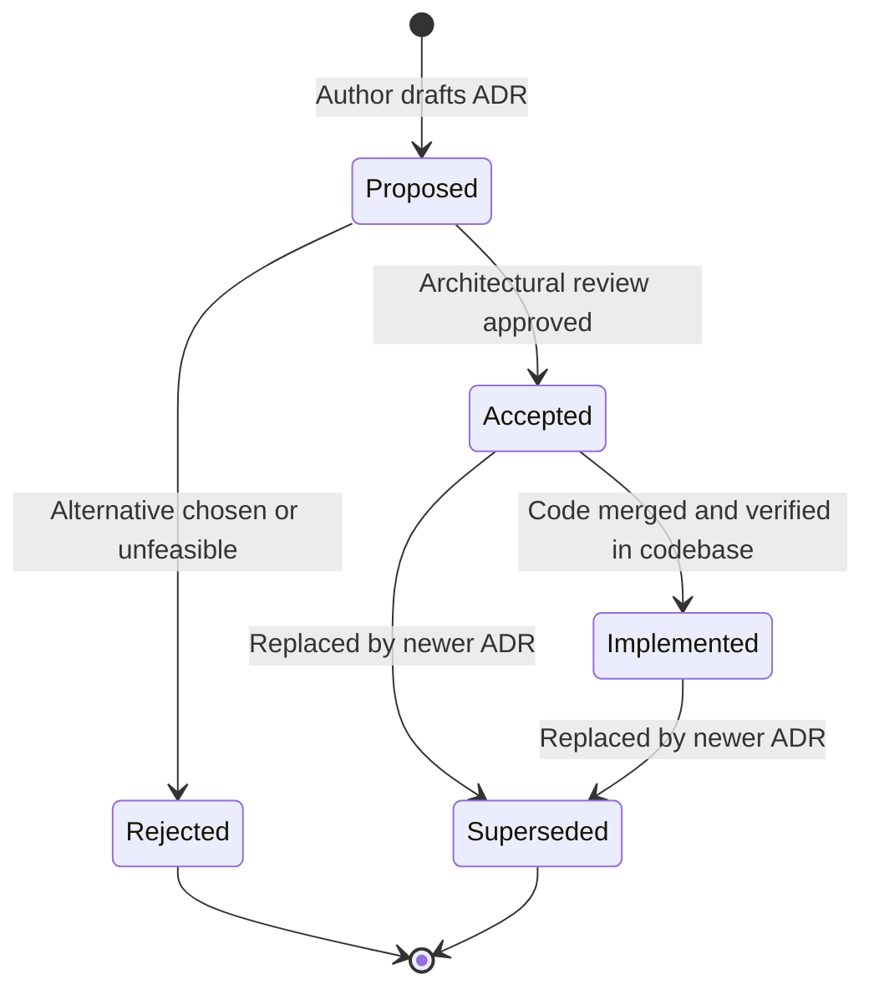

# Architecture Decision Records (ADR) Index & Governance

| Attribute | Specification |
| :--- | :--- |
| **Document ID** | ADR-INDEX |
| **Title** | Architecture Decision Records Index & Governance Framework |
| **Status** | ACCEPTED |
| **Date** | 2026-11-19 |
| **Decision Owners** | Project Architecture & Core Engineering Team |
| **Decision Scope** | Canonical Architectural Decision Repository (`DECISIONS/ADR/`) |
| **Version** | 1.2 |
| **Canonical Source** | `DECISIONS/ADR/README.md` |

---

## 1. Purpose & Canonical Authority

Architecture Decision Records (ADR) form the **Single Source of Truth (SSOT)** for all architectural, structural, and technical decisions governing the MovieAIProducer platform.

The records in this directory serve to:
1. **Establish Definitive Decisions**: Formally record foundational architectural choices to eliminate ambiguity across engineering teams and autonomous AI agents.
2. **Document Rationale**: Preserve the context, business drivers, and technical trade-offs that motivated each decision.
3. **Record Alternatives**: Explicitly document considered and rejected options to avoid revisiting settled technical debates without new evidence.
4. **Clarify Consequences**: Detail the downstream impacts, operational requirements, and risks of each decision.
5. **Enforce Coherence**: Prevent architectural drift and mutually conflicting implementations across modules.
6. **Accelerate Agent & Developer Onboarding**: Provide immediate, self-contained architectural blueprints for human developers and AI coding agents.
7. **Ensure Long-Term Evolutionary Integrity**: Track the lifecycle of decisions as the system matures from MVP to production scale.

---

## 2. ADR Status Lifecycle

Every decision in `DECISIONS/ADR/` follows a strict, formal lifecycle:



### Status Taxonomy

| Status | Meaning & Operational Scope |
| :--- | :--- |
| **PROPOSED** | Under review and awaiting validation. Must **not** be treated as a definitive implementation target by development agents. |
| **ACCEPTED** | Approved by architecture leadership. Represents the canonical target design. Implementation may be planned or underway. |
| **IMPLEMENTED** | Implemented, tested, and actively verified in the production/backend codebase (e.g., in `backend/app/` with passing tests). |
| **SUPERSEDED** | Replaced by a subsequent ADR. Retained permanently for historical traceability and audit trails. |
| **REJECTED** | Evaluated and declined. Contains explicit rationale for rejection to prevent duplicate proposals. |

---

## 3. Master ADR Index

The canonical register of all architectural decisions for MovieAIProducer is detailed below:

| ADR ID | Title | Status | Scope | Date | Implementation Evidence / Location |
| :--- | :--- | :--- | :--- | :--- | :--- |
| [ADR-0001](file:///home/ubuntu/MovieAIProducer/DECISIONS/ADR/ADR-0001-architecture-style.md) | Architecture Style | **IMPLEMENTED** | Overall system architecture | 2026-11-19 | Modular Monolith + Clean Architecture (`backend/app/`, `tests/architecture/`) |
| [ADR-0002](file:///home/ubuntu/MovieAIProducer/DECISIONS/ADR/ADR-0002-application-structure.md) | Application Structure | **IMPLEMENTED** | Repository & package layout | 2026-11-19 | Layered package structure (`domain/`, `application/`, `infrastructure/`, `core/`, `api/`) |
| [ADR-0003](file:///home/ubuntu/MovieAIProducer/DECISIONS/ADR/ADR-0003-provider-adapter-system.md) | Provider Adapter System | **ACCEPTED** | External AI provider integration | 2026-11-19 | Application ports in `ports.py`, provider adapter contracts for ComfyUI / ElevenLabs / Runway |
| [ADR-0004](file:///home/ubuntu/MovieAIProducer/DECISIONS/ADR/ADR-0004-master-production-bible.md) | Master Production Bible (MPB) | **ACCEPTED** | Creative & production SSOT | 2026-11-19 | Domain entity contracts, immutable revision snapshots, creative bible schemas |
| [ADR-0005](file:///home/ubuntu/MovieAIProducer/DECISIONS/ADR/ADR-0005-production-workflow-engine.md) | Production Workflow Engine | **ACCEPTED** | Production lifecycle & state machine | 2026-11-19 | 16-stage cinematic pipeline, deterministic state machine defined in CDA-0003 |
| [ADR-0006](file:///home/ubuntu/MovieAIProducer/DECISIONS/ADR/ADR-0006-data-storage-strategy.md) | Data Storage Strategy | **IMPLEMENTED** | Persistence & storage | 2026-11-19 | Async SQLAlchemy 2.0, SQLite WAL mode, Alembic migrations (`migrations/`), UnitOfWork |
| [ADR-0007](file:///home/ubuntu/MovieAIProducer/DECISIONS/ADR/ADR-0007-async-job-processing.md) | Async Job Processing | **ACCEPTED** | Background jobs & task queues | 2026-11-19 | In-memory asyncio event bus foundation (`event_bus.py`), background job contracts for render workers |
| [ADR-0008](file:///home/ubuntu/MovieAIProducer/DECISIONS/ADR/ADR-0008-prompt-compilation-engine.md) | Prompt Compilation Engine | **ACCEPTED** | 12-Step Hollywood prompt compilation | 2026-11-19 | Structured prompt schemas, MPB resolution rules, Hollywood cinematic codes (#Style, #Light, #Act) |
| [ADR-0009](file:///home/ubuntu/MovieAIProducer/DECISIONS/ADR/ADR-0009-continuity-engine.md) | Continuity Engine | **ACCEPTED** | Visual & narrative consistency | 2026-11-19 | Continuity lock contracts, CLIP embedding validation, cross-shot reference tracking |
| [ADR-0010](file:///home/ubuntu/MovieAIProducer/DECISIONS/ADR/ADR-0010-quality-control-engine.md) | Quality Control (QC) Engine | **ACCEPTED** | Automated & human QC gates | 2026-11-19 | 4-tier QC inspection gates (Syntax, Technical, Narrative, Cinematic), human signoff workflow |
| [ADR-0011](file:///home/ubuntu/MovieAIProducer/DECISIONS/ADR/ADR-0011-authentication-authorization.md) | Authentication & Authorization | **ACCEPTED** | Security, RBAC, tenant isolation | 2026-11-19 | FastAPI security, JWT bearer tokens, role-based access control, tenant boundary enforcement |
| [ADR-0012](file:///home/ubuntu/MovieAIProducer/DECISIONS/ADR/ADR-0012-asset-storage.md) | Asset Storage Architecture | **ACCEPTED** | Binary media file storage | 2026-11-19 | Local filesystem storage for dev, S3-compatible object storage abstraction for production |
| [ADR-0013](file:///home/ubuntu/MovieAIProducer/DECISIONS/ADR/ADR-0013-observability-stack.md) | Observability Stack | **ACCEPTED** | Logging, metrics, tracing | 2026-11-19 | Structlog JSON logging (`logging.py`), correlation ID middleware (`middleware.py`), OpenTelemetry roadmap |
| [ADR-0014](file:///home/ubuntu/MovieAIProducer/DECISIONS/ADR/ADR-0014-deployment-strategy.md) | Deployment Strategy | **ACCEPTED** | Packaging, containers, environments | 2026-11-19 | uv package manager, Python 3.12+ runtime, Docker multi-stage containers |
| [ADR-0015](file:///home/ubuntu/MovieAIProducer/DECISIONS/ADR/ADR-0015-frontend-architecture.md) | Frontend Architecture | **ACCEPTED** | Client web application | 2026-11-19 | Next.js 14+ App Router, Tailwind CSS, TypeScript, Zustand/React Query (`producer.apologets.com`) |

---

## 4. Mandatory ADR Structure

Every newly proposed or revised ADR must adhere to the standard schema below:

```markdown
---
id: ADR-XXXX
title: Decision Title
status: PROPOSED | ACCEPTED | IMPLEMENTED | SUPERSEDED | REJECTED
date: YYYY-MM-DD
decision_owners: Owner Names / Roles
decision_scope: Architectural Scope
version: "X.Y"
canonical_path: DECISIONS/ADR/ADR-XXXX-title.md
---

# ADR-XXXX: Decision Title

| Attribute | Specification |
| :--- | :--- |
| **ADR ID** | ADR-XXXX |
| **Title** | Decision Title |
| **Status** | PROPOSED \| ACCEPTED \| IMPLEMENTED \| SUPERSEDED |
| **Date** | YYYY-MM-DD |
| **Decision Owners** | Specific Roles |
| **Decision Scope** | Bounded context |
| **Version** | X.Y |
| **Canonical Source** | DECISIONS/ADR/ADR-XXXX-title.md |
| **Supersedes** | None / ADR-YYYY |
| **Superseded By** | None / ADR-ZZZZ |

---

## 1. Context
[Problem background, business and cinematic context, relevant technical constraints]

## 2. Problem Statement
[Explicit technical problem to be solved]

## 3. Decision Drivers
[Prioritized architectural qualities: performance, integrity, cost, maintainability]

## 4. Options Considered
[Analysis of Option A, Option B, Option C with advantages and trade-offs]

## 5. Architectural Decision
[The selected approach, core components, and operational policies]

## 6. Architecture & System Flow
[Mermaid diagram illustrating components, sequence, or state flow]

## 7. Consequences & Trade-offs
[Positive impacts, negative trade-offs, and operational burdens]

## 8. Implementation & Verification Requirements
[Concrete mapping to code in backend/, test criteria, and migration path]

## 9. Related Documents & Cross-References
[Links to BRD, PRD, ARCHITECTURE.md, and CDAs]
```

---

## 5. Governance & AI Coding Agent Directives

All engineers and autonomous AI agents working within this repository must strictly adhere to the following governance rules:

1. **Pre-Implementation Verification**: Before modifying backend architecture or creating new domain modules, agents must read the governing ADR(s).
2. **Immutability of Accepted Decisions**: An accepted or implemented ADR cannot be modified to reverse a fundamental decision without an explicit architectural change request.
3. **Superseding Protocol**: To alter a previously accepted architectural decision, author a **new** ADR, link it as superseding the previous record, and update the previous ADR's status to `SUPERSEDED` with a pointer to the new ID. Never delete historical ADRs.
4. **Code-to-ADR Synchronization**: When backend code implementing an accepted ADR is merged into `main` or active development branches and verified with automated tests, the ADR's status must be updated to `IMPLEMENTED`.
5. **Cross-Document Consistency**: Every ADR must maintain strict consistency with the cross-document audits in `DECISIONS/CDA/` (especially CDA-0002 Glossary, CDA-0003 Lifecycle States, CDA-0004 Event Contracts, and CDA-0005 Error Contracts).
