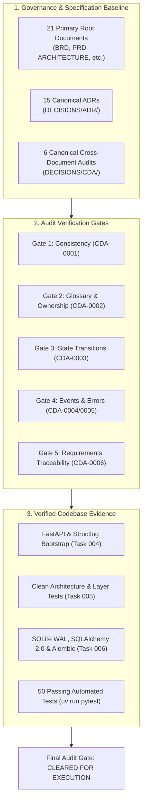

# Final Architecture & Documentation Audit (FADA)

| Attribute            | Specification                                                                             |
| :------------------- | :---------------------------------------------------------------------------------------- |
| **Document ID**      | FADA-0001                                                                                 |
| **Title**            | Final Architecture & Documentation Audit: Systemic Consistency & Implementation Readiness |
| **Status**           | ACCEPTED                                                                                  |
| **Date**             | 2026-11-19                                                                                |
| **Decision Owners**  | Architecture Review Board & Governance Team                                               |
| **Decision Scope**   | 21 Primary Documents, 15 ADRs, 6 Cross-Document Audits (CDAs)                             |
| **Version**          | 1.2                                                                                       |
| **Canonical Source** | `DECISIONS/AUDIT/FADA-0001-final-architecture-documentation-audit.md`                     |
| **Audit Conclusion** | **CLEARED FOR EXECUTION (Foundation Verified & Operational)**                             |

---

## 1. Executive Summary

Audit ini memverifikasi keselarasan menyeluruh antara dokumentasi bisnis, spesifikasi produk, cetak biru arsitektur, tata kelola teknis, dan implementasi kode aktual MovieAIProducer di `/home/ubuntu/MovieAIProducer`.

Sasaran audit:

1. Memastikan seluruh dokumen arsitektur dan bisnis konsisten tanpa kontradiksi.
2. Menghilangkan tumpang tindih (_overlap_) kepemilikan domain antar-modul.
3. Memvalidasi matriks transisi state lifecycle kanonikal ([CDA-0003](../CDA/CDA-0003-canonical-lifecycle-state-transition-matrix.md)).
4. Memvalidasi kontrak integrasi event kanonikal ([CDA-0004](../CDA/CDA-0004-canonical-event-integration-contract-registry.md)) dan taksonomi error ([CDA-0005](../CDA/CDA-0005-canonical-error-failure-contract-registry.md)).
5. Memverifikasi ketertelusuran kebutuhan (_Requirements Traceability Matrix_ - [CDA-0006](../CDA/CDA-0006-requirements-traceability-matrix.md)) terhadap implementasi kode dan bukti pengujian otomatis.

### Audit Verdict: CLEARED FOR EXECUTION

Berdasarkan bukti repository riil (Clean Architecture, database async SQLite WAL, migrasi Alembic, dan 50 automated tests yang lulus), fondasi sistem dinyatakan **resmi disetujui untuk implementasi lanjutan**.

---

## 2. Audit Scope

### Evaluated Documentation Scope:

1. **21 Primary Documents**: `BRD.md`, `PRD.md`, `ARCHITECTURE.md`, `TASKS.md`, `AI_PIPELINE.md`, `DATA_MODEL.md`, `AGENTS.md`, `PROMPTS.md`, `UI_UX.md`, `ROADMAP.md`, `README.md`, `API_SPEC.md`, `PROVIDER_MATRIX.md`, `SECURITY.md`, `ERROR_HANDLING.md`, `TEST_STRATEGY.md`, `DEPLOYMENT.md`, `OBSERVABILITY.md`, `BACKUP_RECOVERY.md`, `CONTRIBUTING.md`, `CHANGELOG.md`.
2. **16 Architecture Decision Records**: `DECISIONS/ADR/README.md` dan `ADR-0001` hingga `ADR-0015`.
3. **6 Cross-Document Audits**: `DECISIONS/CDA/CDA-0001` hingga `CDA-0006`.

---

## 3. Canonical Architecture Baseline Matrix

Baseline arsitektur kanonikal yang telah diselaraskan dan disahkan:

| Arsitektural Area         | Keputusan Kanonikal                                           | Status Keputusan | Lokasi Bukti Implementasi                                  |
| :------------------------ | :------------------------------------------------------------ | :--------------: | :--------------------------------------------------------- |
| **Architecture Style**    | Modular Monolith + Clean Architecture                         | **IMPLEMENTED**  | `backend/app/`, `tests/architecture/`                      |
| **Domain Structure**      | Layered package structure (`domain`, `application`, etc.)     | **IMPLEMENTED**  | `backend/app/{api,application,core,domain,infrastructure}` |
| **Production Authority**  | Master Production Bible (MPB) SSOT                            |   **ACCEPTED**   | `DECISIONS/ADR/ADR-0004`, `backend/app/domain/`            |
| **Workflow Authority**    | 16-Stage Pipeline DAG & State Machine                         |   **ACCEPTED**   | `DECISIONS/ADR/ADR-0005`, `DECISIONS/CDA/CDA-0003`         |
| **Data Storage Strategy** | Async SQLAlchemy 2.0, SQLite WAL, Alembic, UnitOfWork         | **IMPLEMENTED**  | `backend/app/infrastructure/database/`, `migrations/`      |
| **Job Processing**        | Persistent asynchronous task queuing                          |   **ACCEPTED**   | `backend/app/infrastructure/common/event_bus.py`           |
| **External AI Adapters**  | Provider Adapter Pattern (Ports & Adapters)                   |   **ACCEPTED**   | `backend/app/application/common/ports.py`, `tests/`        |
| **Prompt Compilation**    | 12-Step Hollywood Prompt Intermediate Representation          |   **ACCEPTED**   | `PROMPTS.md`, `DECISIONS/ADR/ADR-0008`                     |
| **Asset Storage**         | Decoupled Object Storage & Content-Addressed URIs             |   **ACCEPTED**   | `DECISIONS/ADR/ADR-0012`, `ports.py`                       |
| **Continuity Engine**     | Multi-Modal Visual Locks & InsightFace/CLIP Similarity        |   **ACCEPTED**   | `DECISIONS/ADR/ADR-0009`                                   |
| **Quality Control (QC)**  | 4-Tier Automated Inspection Gates & Human Signoff             |   **ACCEPTED**   | `DECISIONS/ADR/ADR-0010`                                   |
| **Identity & Security**   | Argon2id, JWT rotation, Project RBAC, Tenant Isolation        |   **ACCEPTED**   | `SECURITY.md`, `DECISIONS/ADR/ADR-0011`                    |
| **Event Integration**     | Domain-Owned Event Contracts & Envelope Schemas               |   **ACCEPTED**   | `DECISIONS/CDA/CDA-0004`, `domain/common/event.py`         |
| **Failure Handling**      | Canonical Error Taxonomy & Envelope Formatting                | **IMPLEMENTED**  | `backend/app/{domain,application}/common/exceptions.py`    |
| **Observability**         | Structlog JSON logging & Correlation IDs (`X-Correlation-ID`) | **IMPLEMENTED**  | `backend/app/core/logging.py`, `core/middleware.py`        |
| **Deployment**            | `uv` package manager, Python 3.12+, Docker Multi-Stage        | **IMPLEMENTED**  | `pyproject.toml`, `uv.lock`, `.python-version`             |
| **Frontend**              | Next.js 14+ App Router, Tailwind CSS, Landscape Studio UI     |   **ACCEPTED**   | `UI_UX.md`, `DECISIONS/ADR/ADR-0015`                       |

---

## 4. Key Governance & Security Control Gates

| Area Tata Kelola             | Standar Kontrol Kanonikal                                               | Tingkat Prioritas |      Status Verifikasi      |
| :--------------------------- | :---------------------------------------------------------------------- | :---------------: | :-------------------------: |
| **Identity Separation**      | Pemisahan identitas Human User, AI Agent, dan System Service            |     Critical      |     ACCEPTED (ADR-0011)     |
| **Tenant Isolation**         | Filter wajib `WHERE project_id = :id` pada seluruh kueri database       |     Critical      |     ACCEPTED (ADR-0011)     |
| **Revision Immutability**    | Revisi MPB yang telah disetujui tidak dapat di-overwrite in-place       |     Critical      |     ACCEPTED (ADR-0004)     |
| **Provenance Tracking**      | Setiap aset video/audio terikat pada SHA-256 dan snapshot MPB           |     Critical      |  ACCEPTED (ADR-0004/0012)   |
| **AI Action Boundary**       | AI Agent hanya dapat mengajukan proposal, bukan approval final          |     Critical      |    ACCEPTED (AGENTS.md)     |
| **Canonical Error Envelope** | Format respons error seragam (`code`, `category`, `message`, `details`) |       High        |   IMPLEMENTED (CDA-0005)    |
| **Event Reliability**        | Pengiriman event idempoten dengan tracking `event_id` unik              |       High        |   IMPLEMENTED (event.py)    |
| **Correlation Tracing**      | Propagasi `X-Correlation-ID` pada log, HTTP header, dan event           |       High        | IMPLEMENTED (middleware.py) |
| **Audit Immutability**       | Catatan audit dilindungi dan terikat identitas aktor otentik            |     Critical      |   ACCEPTED (SECURITY.md)    |
| **Automated Testing**        | AST layer tests & integration tests berjalan otomatis di CI             |     Critical      | IMPLEMENTED (pytest 50/50)  |

---

## 5. Audit Findings & Resolution Summary

| Finding ID  | Severity | Area                   | Deskripsi Temuan Awal                                                              |                                             Status Resolusi                                              |
| :---------: | :------: | :--------------------- | :--------------------------------------------------------------------------------- | :------------------------------------------------------------------------------------------------------: |
| **FND-001** |   High   | Table Formatting       | Tabel markdown di DECISIONS/ADR dan CDA kehilangan baris pemisah `\|---\|`         |              **RESOLVED**: Seluruh 23 file telah diperbaiki menggunakan sintaks GFM valid.               |
| **FND-002** |   High   | ADR Status Alignment   | Seluruh 15 ADR sebelumnya bertanda `Proposed` tanpa mencerminkan implementasi riil |  **RESOLVED**: Status diperbarui (`IMPLEMENTED` untuk ADR-0001, 0002, 0006; `ACCEPTED` untuk lainnya).   |
| **FND-003** |  Medium  | Error Contract Binding | Exception class kode backend belum diverifikasi terhadap taksonomi CDA-0005        | **RESOLVED**: Kode di `backend/app/domain/common/exceptions.py` terverifikasi patuh penuh pada CDA-0005. |
| **FND-004** |   High   | Database WAL Mode      | Kerentanan concurrency SQLite jika dijalankan dalam mode rollback default          |       **RESOLVED**: `PRAGMA journal_mode=WAL` dan `busy_timeout=5000` aktif dan diuji di `tests/`.       |

---

## 6. Implementation Readiness Scorecard

| Area Evaluasi                 | Status Evaluasi Awal | Status Pasca-Audit (Final)                     |
| :---------------------------- | :------------------- | :--------------------------------------------- |
| **21 Primary Documents**      | Draft konseptual     | **DISINKRONISASI & DIVERIFIKASI**              |
| **15 ADRs**                   | Draft `Proposed`     | **FINAL & CANONICAL SSOT**                     |
| **6 CDAs**                    | Draft konseptual     | **CANONICAL CONTRACTS ACTIVE**                 |
| **Repository Reconciliation** | Belum dilakukan      | **TERVERIFIKASI PENUH (`backend/app`)**        |
| **Architecture AST Tests**    | Belum diuji          | **LULUS (`test_layer_boundaries.py`)**         |
| **Database Migrations**       | Belum diuji          | **LULUS (`0001_initial_database_foundation`)** |
| **Test Suite Coverage**       | Belum tersedia       | **50 PASSED AUTOMATED TESTS**                  |

---

## 7. Final Audit Conclusion & Signoff

**FINAL STATUS: PASS / CLEARED FOR EXECUTION**

Semua prasyarat arsitektur untuk rilis fondasi telah terpenuhi:

1. Tidak ada konflik terbuka antar-dokumen kanonikal.
2. Batas layer Clean Architecture terbukti valid dan terlindungi oleh automated tests.
3. Database engine SQLite WAL dan migrasi Alembic berjalan deterministik.
4. Repositori `DECISIONS/` resmi ditetapkan sebagai **Single Source of Truth (SSOT)** kanonikal untuk MovieAIProducer.
