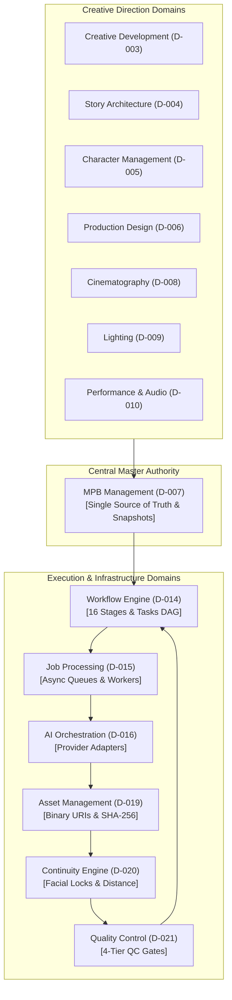

# CDA-0002: Canonical Glossary & Domain Ownership Matrix

| Attribute | Specification |
| :--- | :--- |
| **Document ID** | CDA-0002 |
| **Title** | Canonical Glossary & Domain Ownership Matrix: Systemic Terminology & Bounded Contexts |
| **Status** | ACCEPTED |
| **Date** | 2026-11-19 |
| **Decision Owners** | Architecture Review Board & Governance Team |
| **Decision Scope** | System-wide Terminology, 27 Domain Contexts, Identifier Formats, and Provenance |
| **Version** | 1.2 |
| **Canonical Source** | `DECISIONS/CDA/CDA-0002-canonical-glossary-domain-ownership-matrix.md` |

---

## PART A: CANONICAL GLOSSARY

### 1. Governance Rules
1. Setiap konsep utama memiliki tepat satu istilah kanonis resmi (*canonical term*).
2. Istilah kanonis wajib digunakan secara konsisten dalam dokumentasi, API routes, database schemas, domain events, dan source code.
3. Sinonim tidak boleh digunakan sebagai nama entity yang berbeda.
4. Istilah domain tidak boleh berubah hanya karena variasi penamaan pada antarmuka pengguna (UI).
5. Perubahan istilah wajib melalui proses RFC dokumentasi dan review migrasi data.
6. Pemisahan ketat antara istilah bisnis/kreatif film dan istilah teknis komputasi.

### 2. Product & Production Terminology

| Canonical Term | Definition | Avoid Confusion With |
| :--- | :--- | :--- |
| **Project** | Kontainer utama seluruh pekerjaan film, aset, anggota, dan konfigurasi | Production |
| **Production** | Aktivitas dan proses pembuatan film secara keseluruhan | Project |
| **Production Brief** | Ringkasan kebutuhan teknis dan logistik produksi | Creative Brief |
| **Creative Brief** | Arahan kreatif awal proyek (genre, emosi, premis, audiens) | Production Brief |
| **Master Production Bible (MPB)**| Sistem referensi otoritatif untuk spesifikasi produksi yang disetujui (SSOT) | Single document |
| **Production Stage** | Satu dari 16 tahap besar dalam alur kerja produksi film | Workflow Task |
| **Workflow** | Struktur graf dependensi (DAG) dan status proses kerja | Job |
| **Scene** | Unit naratif dalam cerita yang terikat lokasi dan waktu | Shot |
| **Shot** | Unit pengambilan gambar atau visualisasi kontinu tunggal | Scene |
| **Sequence** | Kelompok scene yang membentuk satu kesatuan dramatis | Workflow |
| **Storyboard** | Representasi visual grafis rencana shot | Final video |
| **Animatic** | Representasi temporal storyboard dengan durasi, scratch audio, dan timing | Final edit |
| **Previsualization (Previs)** | Simulasi visual 2D/3D awal pergerakan kamera dan blocking | Final render |
| **Asset** | Media atau resource digital biner yang dikelola sistem dengan hash SHA-256 | Raw File |
| **Production Artifact** | Dokumen atau manifest yang dihasilkan dalam proses produksi | Binary Asset |
| **Final Delivery** | Paket master hasil produksi yang disiapkan untuk distribusi/siar | Internal preview |

### 3. Master Production Bible (MPB) Terminology

| Canonical Term | Definition |
| :--- | :--- |
| **Bible** | Kumpulan spesifikasi terstruktur untuk suatu domain produksi (Karakter, Lingkungan, dll.) |
| **Bible Entry** | Satu record spesifikasi entitas di dalam Bible |
| **Canonical Reference** | Referensi stabil terhadap entitas atau revisi tertentu |
| **Revision** | Versi perubahan spesifik pada suatu entitas (v1.0 $\rightarrow$ v1.1) |
| **Snapshot** | Rekaman immutable dari konteks MPB pada titik waktu tertentu (terikat SHA-256) |
| **Approval** | Keputusan resmi berwenang atas suatu perubahan atau hasil |
| **Change Request** | Pengajuan modifikasi terhadap spesifikasi yang telah disetujui |
| **Impact Analysis** | Analisis penelusuran dampak perubahan spesifikasi terhadap shot dan aset turunan |
| **Approved Specification** | Spesifikasi yang telah melewati gerbang persetujuan resmi |
| **Production Context** | Kumpulan informasi MPB yang diresolusikan untuk eksekusi shot tertentu |

### 4. Character & World-Building Terminology

| Canonical Term | Definition |
| :--- | :--- |
| **Character** | Identitas tokoh dalam cerita |
| **Character DNA** | Identitas visual permanen, proporsi wajah, etnisitas, dan biometrik dasar tokoh |
| **Character State** | Kondisi dinamis tokoh pada titik tertentu (luka, lelah, emosi, usia) |
| **Character Profile** | Informasi psikologis, latar belakang, dan tujuan dramatis tokoh |
| **Character Reference Asset**| Kumpulan gambar turnaround resmi tokoh untuk penguncian kontinuitas |
| **Character Performance** | Ekspresi wajah, gestur tubuh, dan akting dalam adegan (#Act 01-24) |
| **Figurant / Extra** | Karakter latar belakang yang bukan merupakan tokoh utama |
| **Crowd** | Sekelompok figurant yang dikelola sebagai satu kesatuan visual adegan |

### 5. Cinematography & Lighting Terminology

| Canonical Term | Definition |
| :--- | :--- |
| **Camera Configuration** | Parameter sensor, aspect ratio (16:9 / 2.39:1), dan karakteristik kamera |
| **Lens Intent** | Karakteristik optik (focal length, distorsi anamorphic, depth of field) |
| **Camera Movement** | Pergerakan kamera fisik (pan, tilt, dolly, pedestal, crane, tracking) |
| **Framing** | Komposisi subjek di dalam batas frame (Extreme Close-Up, Wide, dll.) |
| **Lighting Schematic** | Rancangan tata cahaya (#Light 01-14, key/fill ratio, backlight, practicals) |
| **Atmosphere** | Kondisi volumetrik udara (haze, kabut, debu, asap) dan color temperature (Kelvin) |

### 6. AI & Provider Terminology

| Canonical Term | Definition |
| :--- | :--- |
| **AI Provider** | Organisasi atau layanan eksternal/lokal penyedia kapabilitas AI |
| **Provider Adapter** | Komponen infrastruktur yang menghubungkan port aplikasi dengan API engine |
| **Model** | Model kecerdasan buatan spesifik dari provider (misal: Flux.1-Dev, Claude 3.5) |
| **Model Version** | Nomor versi atau checkpoint model yang digunakan |
| **Capability** | Fitur spesifik yang didukung model (text-to-video, inpainting, reference image) |
| **Capability Evidence** | Bukti verifikasi operasional atas kapabilitas yang diklaim |
| **Prompt IR** | Representasi instruksi adegan terstruktur independen dari sintaks vendor |
| **Prompt Compilation** | Proses translasi Prompt IR menjadi prompt target model yang dioptimasi |
| **Generation Request** | Permintaan pembuatan konten dari layer aplikasi |
| **Generation Job** | Tugas latar belakang asinkron untuk mengeksekusi generation request |
| **Generation Result** | Payload dan aset hasil dari eksekusi generator |
| **Model Router** | Komponen yang memilih model terbaik berdasarkan kebutuhan dan batasan biaya |

### 7. Workflow & Job Terminology

| Canonical Term | Definition |
| :--- | :--- |
| **Workflow Definition** | Template graf dependensi (DAG) dari tahapan produksi |
| **Workflow Instance** | Eksekusi graf kerja yang aktif untuk project tertentu |
| **Workflow Task** | Satuan tugas produksi bisnis di dalam workflow |
| **Task Dependency** | Relasi prasyarat antar-tugas |
| **Job** | Unit eksekusi komputasi teknis latar belakang |
| **Job Attempt** | Satu kali percobaan eksekusi teknis dari sebuah job |
| **Job Lease** | Hak sewa kepemilikan pemrosesan job sementara oleh worker |
| **Worker** | Proses runtime independen yang mengeksekusi antrean job |
| **Queue** | Kanal antrean perantara job |
| **Cancellation Request** | Permintaan pembatalan tugas atau job yang sedang berjalan |

### 8. Continuity & Quality Control (QC) Terminology

| Canonical Term | Definition |
| :--- | :--- |
| **Continuity** | Konsistensi visual, spasial, dan naratif lintas-shot dan lintas-scene |
| **Continuity State** | Parameter visual yang wajib dipertahankan antar-shot |
| **Continuity Rule** | Kriteria pemeriksaan kepatuhan visual |
| **Continuity Finding** | Rekaman anomali diskontinuitas yang terdeteksi |
| **QC Run** | Satu sesi pengujian kualitas terhadap suatu deliverable |
| **QC Finding** | Catatan cacat atau deviasi kualitas |
| **QC Severity** | Tingkat keparahan temuan (Critical, High, Medium, Low) |
| **QC Confidence** | Tingkat keyakinan matematis dari evaluator AI terhadap temuan |
| **QC Score** | Nilai terukur berdasarkan rubrik standar Hollywood |
| **QC Blocker** | Temuan kritis yang memblokir penerimaan aset atau transisi stage |
| **QC Approval** | Tanda tangan persetujuan resmi manusia atas hasil evaluasi |

### 9. Asset & Storage Terminology

| Canonical Term | Definition |
| :--- | :--- |
| **Asset ID** | UUID stabil unik yang merepresentasikan entitas aset media |
| **Asset Version** | Nomor versi biner atau metadata aset |
| **Asset Metadata** | Informasi deskriptif aset dalam database relasional |
| **Storage Key** | Jalur URI penyimpanan objek pada storage target |
| **Checksum** | Nilai hash SHA-256 untuk verifikasi integritas biner |
| **Asset Provenance** | Silsilah asal-usul lengkap pembentukan aset media |
| **Derivative** | Aset turunan (thumbnail, waveform, proksi resolusi rendah) |

### 10. Identity & Security Terminology

| Canonical Term | Definition |
| :--- | :--- |
| **User** | Akun pengguna manusia yang terotentikasi |
| **Agent Identity** | Identitas unik AI Agent yang bertindak atas nama sistem |
| **Service Identity** | Identitas internal microservice atau proses latar belakang |
| **Tenant** | Batas isolasi organisasi atau kepemilikan akun |
| **Project Scope** | Batas otorisasi hak akses di dalam konteks project tertentu |
| **Role** | Paket kumpulan izin akses (OWNER, DIRECTOR, PRODUCER, dll.) |
| **Permission** | Hak atomik untuk mengeksekusi suatu aksi |
| **Audit Event** | Catatan kejadian administratif yang tidak dapat diubah |

---

## PART B: DOMAIN OWNERSHIP TOPOLOGY

---

## PART C: CANONICAL DOMAIN REGISTRY

| Domain ID | Bounded Context Name | Primary Responsibility |
| :---: | :--- | :--- |
| **D-001** | **Identity & Access** | Autentikasi user, kredensial, session, RBAC, dan tenant boundary |
| **D-002** | **Project Management** | Metadata proyek film, keanggotaan tim, dan siklus hidup project |
| **D-003** | **Creative Development** | Creative brief, strategi film, genre, dan parameter kreatif utama |
| **D-004** | **Story Architecture** | Premis, logline, struktur 3-act/8-sequence, naskah, dan dialogue |
| **D-005** | **Character Management** | Character visual DNA, casting, profil psikologis, dan state tokoh |
| **D-006** | **Production Design** | Environment, set lokasi, props, wardrobe, dan tata rias |
| **D-007** | **MPB Management** | Otoritas spesifikasi produksi resmi, versioning, dan snapshot |
| **D-008** | **Cinematography** | Kamera, focal length lensa, framing, komposisi, pergerakan |
| **D-009** | **Lighting** | Desain tata cahaya (#Light 01-14), color temperature, dan atmosfer |
| **D-010** | **Performance & Audio** | Arahan akting (#Act 01-24), sulih suara, Foley, musik, dan audio stems |
| **D-011** | **Motion Engineering** | Blocking karakter, fisika gerak, dan konsistensi temporal |
| **D-012** | **Storyboard & Previs** | Storyboard panel, timed animatic MP4, dan blocking kamera |
| **D-013** | **Scene & Shot Management** | Struktur perakitan scene, shot breakdown, dan sluglines |
| **D-014** | **Workflow Engine** | Orkestrasi graf 16 stage produksi, dependensi, dan status tugas |
| **D-015** | **Job Processing** | Manajemen antrean eksekusi komputasi teknis latar belakang |
| **D-016** | **AI Orchestration** | Pemilihan model cerdas (routing) dan koordinasi pemanggilan AI |
| **D-017** | **Provider Integration** | Adapter provider eksternal (ComfyUI, Runway, ElevenLabs) |
| **D-018** | **Prompt Compilation** | Kompilasi Intermediate Representation (IR) menjadi prompt mesin |
| **D-019** | **Asset Management** | Registri metadata aset biner, URI, versi, dan silsilah asal-usul |
| **D-020** | **Continuity Engine** | Penguncian kontinuitas multi-shot dan verifikasi vektor embedding |
| **D-021** | **Quality Control (QC)** | Evaluasi 4-tier gerbang mutu, scoring rubrik, dan verifikasi akhir |
| **D-022** | **Editorial** | Perakitan timeline kasar/halus, conforming shot, dan audio mixing |
| **D-023** | **Delivery** | Pembuatan paket master distribusi final (ProRes / H.264 / SMPTE) |
| **D-024** | **Notifications** | Pengiriman notifikasi event kepada pengguna |
| **D-025** | **Observability** | Pengumpulan log terstruktur, metrik Prometheus, dan jejak trace |
| **D-026** | **Audit Governance** | Penyimpanan catatan audit administratif yang tidak dapat diubah |
| **D-027** | **Administration** | Konfigurasi platform global dan pemantauan sistem |

---

## PART D: DOMAIN DATA OWNERSHIP MATRIX

| Domain Bounded Context | Data Entitas yang Dimiliki (Owns) | Data yang DILARANG Dimiliki (Does Not Own) |
| :--- | :--- | :--- |
| **Identity & Access** | User, Session, RefreshToken, ProjectMember, Role | Isi kreatif naskah, aset biner media |
| **Project Management** | Project metadata, project settings, member mappings | Naskah, konten adegan, snapshot MPB |
| **Creative Development** | Creative Brief manifest, genre, target audience | Snapshot MPB yang telah di-approve |
| **Story Architecture** | Beat sheet, Screenplay text, Scene sluglines, Dialogue | Berkas gambar/video karakter |
| **Character Management** | Character DNA, facial landmark anchors, character state | Berkas biner media fisik |
| **Production Design** | Environment specs, prop geometries, costume continuity | Berkas penyimpanan biner fisik |
| **MPB Management** | Snapshot manifests, revision histories, approval states | Tabel operasional domain internal |
| **Cinematography** | Camera lens configs, framing angles, camera moves | Kepemilikan workflow scene |
| **Lighting** | Lighting schematics, key/fill ratios, Kelvin values | Berkas biner video |
| **Workflow Engine** | Workflow instances, stage states, task DAG dependencies | Logika eksekusi komputasi AI |
| **Job Processing** | Jobs, job attempts, worker leases, execution queues | Persetujuan bisnis produksi |
| **AI Orchestration** | Generation request routing, token costs, provider errors | Keputusan kreatif project |
| **Prompt Compilation** | Prompt IR AST, compiled target prompt envelopes | Otoritas Master Production Bible |
| **Asset Management** | Asset metadata, URIs, MIME types, SHA-256 checksums | Infrastruktur bucket biner |
| **Continuity Engine** | Multi-shot lock rules, embedding distances, drift reports | Modifikasi sepihak spesifikasi MPB |
| **Quality Control (QC)** | QC runs, findings, scores, defect tickets, signoffs | Aset media produksi asli |

---

## PART E: CANONICAL IDENTIFIER CONVENTIONS

| Entitas Sistem | Format Identifier Standar | Contoh Nilai |
| :--- | :--- | :--- |
| **Project** | `project_id` (UUIDv4) | `f47ac10b-58cc-4372-a567-0e02b2c3d479` |
| **User** | `user_id` (UUIDv4) | `a1b2c3d4-e5f6-7a8b-9c0d-1e2f3a4b5c6d` |
| **Scene** | `scene_id` (Prefixed String / UUID) | `scene-014` |
| **Shot** | `shot_id` (Prefixed String / UUID) | `shot-003` |
| **Character** | `character_id` (Prefixed String / UUID) | `char-elena-vance` |
| **Asset** | `asset_id` (UUIDv4) | `7c9e6679-7425-40de-944b-e07fc1f90ae7` |
| **Workflow Task** | `workflow_task_id` (UUIDv4) | `8f5b89a1-2d3e-4b6a-9f8e-1c2d3e4f5a6b` |
| **Job** | `job_id` (UUIDv4) | `9a8b7c6d-5e4f-3a2b-1c0d-9e8f7a6b5c4d` |
| **MPB Snapshot** | `mpb_snapshot_id` (SHA-256 Content Hash) | `snap-e3b0c44298fc1c149afbf4c8996fb924` |
| **QC Run** | `qc_run_id` (UUIDv4) | `b2c3d4e5-f6a7-8b9c-0d1e-2f3a4b5c6d7e` |

---

## PART F: ACCEPTANCE CHECKLIST & VERIFICATION

- [x] Istilah kanonikal terdefinisi dan bebas ambigu.
- [x] Registri 27 bounded context domain ditetapkan.
- [x] Setiap domain memiliki batasan data yang jelas (*Owns* vs *Does Not Own*).
- [x] Otoritas MPB sebagai SSOT ditegaskan.
- [x] Pemisahan tanggung jawab Workflow Task vs Technical Job ditegaskan.
- [x] Konvensi penamaan identifier kanonikal disepakati.

**STATUS: ACCEPTED (Canonical Glossary & Ownership Matrix Active)**
