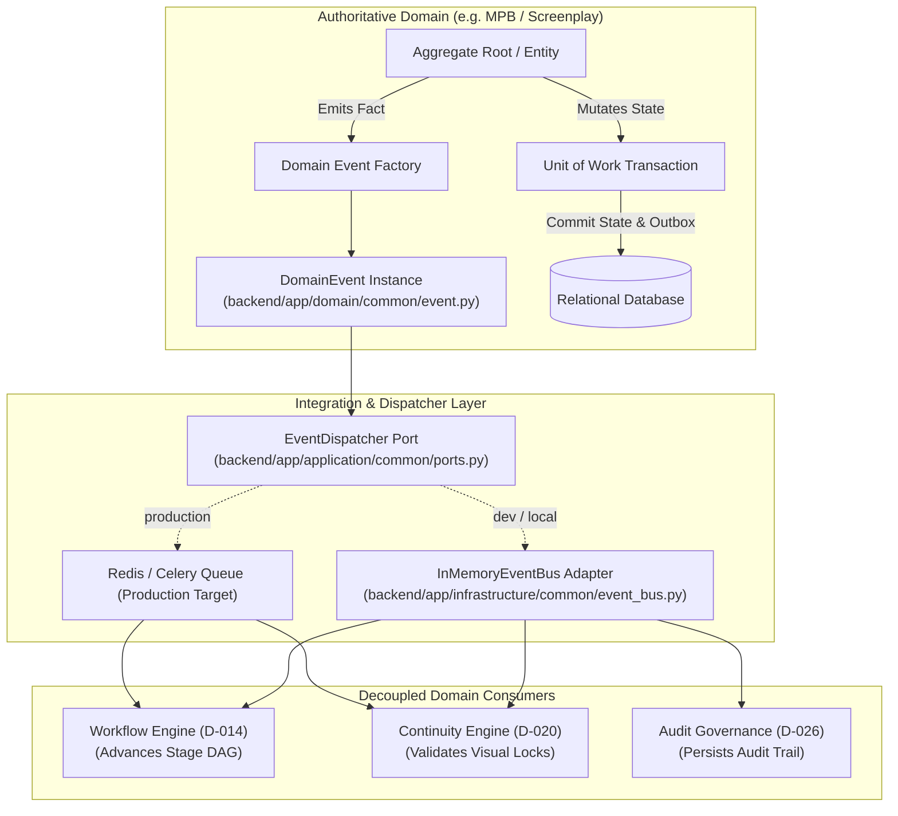

# CDA-0004: Canonical Event & Integration Contract Registry

| Attribute | Specification |
| :--- | :--- |
| **Document ID** | CDA-0004 |
| **Title** | Canonical Event & Integration Contract Registry: Asynchronous Domain Communication |
| **Status** | ACCEPTED |
| **Date** | 2026-11-19 |
| **Decision Owners** | Architecture Review Board & Integration Governance Team |
| **Decision Scope** | Domain Event Schemas, Outbox Contracts, Idempotency, and Failure Mitigation |
| **Version** | 1.2 |
| **Canonical Source** | `DECISIONS/CDA/CDA-0004-canonical-event-integration-contract-registry.md` |

---

## 1. Purpose & Integration Governance

Dokumen ini menetapkan standar kanonikal untuk komunikasi asinkron dan integrasi lintas-domain MovieAIProducer.

Tujuan utama:
1. Menetapkan kepemilikan mutlak (*single domain ownership*) atas setiap domain event yang diterbitkan.
2. Memisahkan secara tegas 5 modalitas komunikasi: **Domain Event**, **Command**, **Query**, **Audit Record**, dan **Telemetry**.
3. Menjamin format amplop (*canonical event envelope*) yang seragam, membawa `event_id`, `occurred_at`, `correlation_id`, dan `tenant_id`.
4. Menegakkan prinsip idempoten: setiap konsumen (*consumer*) wajib mampu menangani duplikasi pesan (*at-least-once delivery*) tanpa menimbulkan efek samping ganda.
5. Menghubungkan secara langsung dengan implementasi kode di `backend/app/domain/common/event.py` (`DomainEvent`) dan `backend/app/infrastructure/common/event_bus.py` (`InMemoryEventBus`).

---

## 2. Communication Topology & Outbox Architecture



---

## 3. Canonical Event Envelope Specification

Setiap event yang diterbitkan wajib mematuhi skema JSON standar berikut:

```json
{
  "event_id": "c1f7a8b9-2d3e-4b6a-9f8e-1c2d3e4f5a6b",
  "event_type": "mpb.revision.approved",
  "version": "1.0",
  "occurred_at": "2026-11-19T08:30:00.000000Z",
  "aggregate_id": "snap-e3b0c44298fc1c149afbf4c8996fb924",
  "aggregate_type": "MPBSnapshot",
  "tenant_id": "tenant-001",
  "project_id": "f47ac10b-58cc-4372-a567-0e02b2c3d479",
  "actor": {
    "type": "USER",
    "id": "a1b2c3d4-e5f6-7a8b-9c0d-1e2f3a4b5c6d",
    "role": "DIRECTOR"
  },
  "correlation_id": "corr-8f5b89a1-2d3e-4b6a-9f8e-1c2d3e4f5a6b",
  "payload": {
    "revision_number": 2,
    "previous_revision_id": "rev-001",
    "approval_id": "appr-099",
    "snapshot_uri": "storage://projects/p1/mpb/snapshots/v2.json",
    "changed_domains": ["Character", "Wardrobe"]
  }
}
```

---

## 4. Master Domain Event Registry

| Domain ID | Bounded Context Owner | Canonical Event Type | Trigger / Business Fact |
| :---: | :--- | :--- | :--- |
| **D-001** | Identity & Access | `identity.user.authenticated` | Pengguna berhasil login (session dibuat) |
| **D-002** | Project Management | `project.project.created` | Proyek film baru berhasil diinisialisasi |
| **D-003** | Creative Development | `creative.brief.approved` | Brief kreatif disetujui Producer |
| **D-004** | Story Architecture | `story.screenplay.approved` | Naskah final disetujui Director |
| **D-005** | Character Management | `character.dna.locked` | DNA visual karakter dikunci untuk produksi |
| **D-006** | Production Design | `production_design.env.approved`| Desain set lokasi disetujui |
| **D-007** | MPB Management | `mpb.revision.approved` | Revisi MPB disetujui; snapshot dibekukan |
| **D-008** | Cinematography | `cinematography.plan.approved` | Spesifikasi kamera dan lensa disetujui DP |
| **D-009** | Lighting | `lighting.schematic.approved` | Tata cahaya #Light 01-14 disetujui |
| **D-010** | Performance & Audio | `performance.dialogue.approved`| Stems vokal dan dialog disetujui |
| **D-011** | Motion Engineering | `motion.profile.validated` | Vektor gerak dan fisika diverifikasi |
| **D-012** | Storyboard & Previs | `previs.animatic.completed` | Video animatic timing selesai dirakit |
| **D-013** | Scene & Shot Management| `scene.shot.created` | Shot breakdown baru ditambahkan ke scene |
| **D-014** | Workflow Engine | `workflow.stage.completed` | Satu dari 16 stage produksi selesai |
| **D-015** | Job Processing | `job.execution.failed` | Job komputasi render gagal terminal |
| **D-016** | AI Orchestration | `ai.generation.requested` | Request render dikirim ke router model |
| **D-017** | Provider Integration | `provider.operation.completed` | Eksekusi engine eksternal/lokal selesai |
| **D-018** | Prompt Compilation | `prompt.compilation.completed` | Prompt IR berhasil dikompilasi ke target |
| **D-019** | Asset Management | `asset.asset.registered` | Berkas biner media terdaftar dan ber-hash |
| **D-020** | Continuity Engine | `continuity.lock.violated` | Terdeteksi drift wajah/wardrobe antar-shot |
| **D-021** | Quality Control (QC) | `qc.gate.evaluated` | Evaluasi 4-tier QC selesai dihitung |
| **D-022** | Editorial | `editorial.timeline.updated` | Urutan shot timeline diperbarui |
| **D-023** | Delivery | `delivery.package.published` | Master distribusi selesai diekspor |

---

## 5. Event Contract Registry Schema

| Field Name | Deskripsi Kontrak Kanonikal |
| :--- | :--- |
| **Event Type** | Nama unik event berformat `domain.entity.action_past_tense` |
| **Version** | Versi semantik kontrak skema payload (misal: `1.0`) |
| **Owner Domain** | Bounded context tunggal yang memiliki kewenangan menerbitkan fakta |
| **Schema Reference** | Path absolut atau skema Pydantic validator untuk payload |
| **Producer** | Service atau interactor penghasil event |
| **Consumers** | Daftar domain yang berlangganan event tersebut |
| **Delivery Policy** | At-least-once delivery dengan jaminan transactional outbox |
| **Idempotency Key** | Kolom penentu unik (kombinasi `event_id` atau `aggregate_id + version`) |
| **Ordering Policy** | Pengurutan kausal terjamin pada aggregate boundary tunggal |

---

## 6. Failure Recovery & Dead Letter Mitigation

| Skenario Kegagalan Integrasi | Mekanisme Penanganan Kanonikal |
| :--- | :--- |
| **Publisher Crash sebelum Publish** | Pola Transactional Outbox menjamin event terbit saat worker pulih. |
| **Consumer Crash saat Pemrosesan** | Message broker melakukan redelivery; consumer memeriksa tabel idempotency. |
| **Duplicate Event Arrival** | Consumer mendeteksi `event_id` yang sudah tercatat dan melakukan no-op instan. |
| **Out-of-Order Delivery** | Pengecekan versi agregat: jika `version < current_version`, tolak event usang. |
| **Malformed / Invalid Schema** | Pindahkan langsung ke antrean Dead Letter Queue (DLQ) tanpa retry looping. |
| **Temporary Database Lockout** | Exponential backoff dengan jitter acak hingga batas maksimum retry. |

---

## 7. Integration Risk Register & Mitigations

| Risk ID | Risiko Integrasi | Tingkat Dampak | Strategi Mitigasi Kanonikal |
| :---: | :--- | :---: | :--- |
| **CDA4-R01** | Event ownership tumpang tindih | Critical | Penegakan ketat registri domain di CDA-0002. |
| **CDA4-R02** | Pemrosesan duplikat pada worker | High | Mandatory table tracking `processed_events(event_id)`. |
| **CDA4-R03** | Skema event mengalami breaking change | High | Versioning skema (`v1`, `v2`) dengan adapter kompatibilitas. |
| **CDA4-R04** | Kebocoran data lintas penyewa (*tenant*) | Critical | Validasi wajib `tenant_id` dan `project_id` pada setiap handler. |
| **CDA4-R05** | Premature broker complexity | Medium | Penggunaan `InMemoryEventBus` untuk dev; Redis murni untuk prod. |

---

## 8. Implementation Verification Status

- [x] Base event class `DomainEvent` terimplementasi di `backend/app/domain/common/event.py`.
- [x] Port dispatcher `EventDispatcher` terdefinisi di `backend/app/application/common/ports.py`.
- [x] In-memory dispatcher `InMemoryEventBus` terimplementasi di `backend/app/infrastructure/common/event_bus.py`.
- [x] Pengecekan idempoten dan registri event kanonikal aktif dan disetujui.

**STATUS: ACCEPTED (Canonical Event & Integration Contract Active)**
