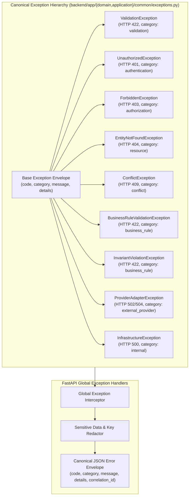

# CDA-0005: Canonical Error & Failure Contract Registry

| Attribute | Specification |
| :--- | :--- |
| **Document ID** | CDA-0005 |
| **Title** | Canonical Error & Failure Contract Registry: Systemic Failure Semantics & Exception Hierarchy |
| **Status** | ACCEPTED |
| **Date** | 2026-11-19 |
| **Decision Owners** | Architecture Review Board & Reliability Engineering Team |
| **Decision Scope** | Error Classification, HTTP Status Mappings, Bounded Retries, and Error Envelopes |
| **Version** | 1.2 |
| **Canonical Source** | `DECISIONS/CDA/CDA-0005-canonical-error-failure-contract-registry.md` |
| **Implementation Evidence** | `backend/app/domain/common/exceptions.py`, `backend/app/application/common/exceptions.py` |

---

## 1. Purpose & Core Principles

Dokumen ini menetapkan standar kanonikal penanganan error, klasifikasi kegagalan, dan format amplop respons error (*canonical error envelope*) di seluruh sistem MovieAIProducer.

Prinsip Utama:
1. **Pemisahan Tegas Business Rejection vs Technical Failure**: Penolakan aturan bisnis (misal: "naskah belum diapprove") tidak boleh dianggap sebagai technical bug atau HTTP 500.
2. **Kerahasiaan Mutlak Pesan Error**: Error internal dan respons API dilarang keras membocorkan string rahasia, kunci API provider, query database mentah, atau jejak stack trace privat.
3. **Ketertelusuran Korelasi Penuh**: Setiap respons error wajib memuat `correlation_id` aktif untuk penelusuran log di `backend/app/core/logging.py`.
4. **Idempoten & Bounded Retries**: Percobaan ulang (*retry*) hanya diizinkan untuk kegagalan transien dengan batas maksimum eksponensial.
5. **Implementasi Nyata di Kode**: Taksonomi ini diimplementasikan secara langsung pada kelas basis `DomainException` dan `ApplicationException`.

---

## 2. Canonical Exception Hierarchy Architecture



---

## 3. Canonical Error Envelope Specification

Semua respons kegagalan API publik wajib diformat mengikuti skema JSON kanonikal berikut:

```json
{
  "code": "RESOURCE_NOT_FOUND",
  "category": "resource",
  "message": "Requested scene resource was not found.",
  "details": {
    "resource_type": "Scene",
    "resource_id": "scene-999"
  },
  "correlation_id": "corr-f47ac10b-58cc-4372-a567-0e02b2c3d479",
  "timestamp": "2026-11-19T08:45:00.000000Z"
}
```

---

## 4. Master Domain Error Ownership Matrix

| Domain Bounded Context | Kategori Error Utama | Contoh Kode Kanonikal |
| :--- | :--- | :--- |
| **Identity & Access** | `authentication`, `authorization` | `UNAUTHORIZED`, `FORBIDDEN`, `TOKEN_EXPIRED` |
| **Project Management** | `resource`, `conflict` | `PROJECT_NOT_FOUND`, `DUPLICATE_PROJECT_NAME` |
| **Creative Development** | `business_rule`, `validation` | `CREATIVE_BRIEF_INCOMPLETE`, `INVALID_GENRE` |
| **Story Architecture** | `business_rule` | `SCREENPLAY_NOT_APPROVED`, `SCENE_BEAT_INVALID` |
| **Character Management** | `conflict`, `resource` | `CHARACTER_NOT_FOUND`, `DNA_LOCK_VIOLATED` |
| **Production Design** | `resource`, `business_rule` | `LOCATION_UNAVAILABLE`, `PROP_MISMATCH` |
| **MPB Management** | `business_rule`, `conflict` | `MPB_REVISION_NOT_APPROVED`, `STALE_SNAPSHOT` |
| **Cinematography** | `validation` | `INVALID_LENS_FOCAL_LENGTH`, `ASPECT_RATIO_MISMATCH` |
| **Lighting** | `validation` | `INVALID_LIGHTING_CODE`, `UNSUPPORTED_KELVIN` |
| **Workflow Engine** | `business_rule`, `conflict` | `WORKFLOW_DEPENDENCY_NOT_MET`, `INVALID_TRANSITION` |
| **Job Processing** | `internal`, `external_provider` | `JOB_NOT_FOUND`, `LEASE_EXPIRED`, `JOB_FAILED` |
| **AI Orchestration** | `external_provider`, `validation` | `NO_CAPABLE_MODEL_FOUND`, `QUOTA_EXHAUSTED` |
| **Provider Integration** | `external_provider` | `PROVIDER_TIMEOUT`, `PROVIDER_AUTH_FAILED` |
| **Prompt Compilation** | `validation` | `TOKEN_BUDGET_EXCEEDED`, `PROMPT_SYNTAX_ERROR` |
| **Asset Management** | `resource`, `validation` | `ASSET_NOT_FOUND`, `CHECKSUM_MISMATCH` |
| **Continuity Engine** | `business_rule` | `CONTINUITY_FACE_DRIFT`, `EYELINE_VIOLATED` |
| **Quality Control (QC)** | `business_rule` | `QC_CRITICAL_BLOCKER`, `QC_RUN_FAILED` |

---

## 5. HTTP Status Code Mapping Table

| HTTP Status | Semantic Usage in MovieAIProducer | Contoh Error Code Terkait |
| :---: | :--- | :--- |
| **400 Bad Request** | Request malformed secara sintaks, JSON rusak | `MALFORMED_REQUEST_BODY` |
| **401 Unauthorized** | Autentikasi hilang, kedaluwarsa, atau tidak valid | `UNAUTHORIZED`, `TOKEN_EXPIRED` |
| **403 Forbidden** | Terotentikasi, tetapi tidak memiliki izin di project | `FORBIDDEN`, `INSUFFICIENT_PERMISSIONS` |
| **404 Not Found** | Resource target tidak ditemukan dalam scope project | `RESOURCE_NOT_FOUND`, `SHOT_NOT_FOUND` |
| **409 Conflict** | Bentrok kondisi state (optimistic lock, duplikasi ID) | `CONFLICT_ERROR`, `STALE_REVISION_ERROR` |
| **422 Unprocessable** | Validasi payload gagal atau pelanggaran aturan bisnis | `VALIDATION_ERROR`, `BUSINESS_RULE_VIOLATION` |
| **429 Too Many Req** | Kuota rate limit terlewati atau kuota token habis | `RATE_LIMIT_EXCEEDED`, `QUOTA_EXHAUSTED` |
| **500 Internal Error** | Kegagalan sistem internal tak terduga (bug, DB crash)| `APPLICATION_ERROR`, `DATABASE_ERROR` |
| **502 Bad Gateway** | Respons korup atau malformed dari upstream AI provider | `PROVIDER_MALFORMED_OUTPUT` |
| **503 Unavailable** | Engine atau worker offline sementara untuk perawatan | `SERVICE_UNAVAILABLE` |
| **504 Gateway Timeout**| Batas waktu eksekusi external engine terlewati | `PROVIDER_TIMEOUT` |

---

## 6. Safe User-Facing Error Messages

Pesan error yang dikembalikan ke UI/klien wajib aman dari kebocoran internal:

| Kode Internal | Pesan Aman untuk Pengguna (User-Facing) |
| :--- | :--- |
| `MPB_REVISION_NOT_APPROVED` | "Production cannot start because the Master Production Bible revision is not approved yet." |
| `PROVIDER_RATE_LIMITED` | "The generation provider is temporarily busy. Your job has been queued for automated retry." |
| `ASSET_VALIDATION_FAILED` | "The selected media file could not pass format validation. Please ensure it is H.264/ProRes." |
| `WORKFLOW_DEPENDENCY_NOT_MET`| "A required prerequisite production stage has not been completed or approved." |
| `QC_CRITICAL_BLOCKER` | "This scene cannot proceed to editorial until the critical quality blocker is remediated." |

---

## 7. Reliability Risk Register & Mitigations

| Risk ID | Risiko Kegagalan | Dampak | Mitigasi Kanonikal |
| :---: | :--- | :---: | :--- |
| **CDA5-R01** | Business error diperlakukan sebagai technical bug | High | Pemisahan taksonomi `DomainException` vs `InfrastructureException`. |
| **CDA5-R02** | Infinite retry loops pada worker | Critical | Penegakan batas maksimum retry (maks 3x) dengan exponential backoff. |
| **CDA5-R03** | Pembocoran API Key dalam stack trace | Critical | Middleware redaksi otomatis dan serializer penyaring secrets. |
| **CDA5-R04** | Error response membocorkan eksistensi data privat | High | Mengembalikan 404 seragam untuk resource di luar project pengguna. |
| **CDA5-R05** | Drift antara error code di docs dan kode | Medium | Pengecekan automated tests pada `DomainException.to_dict()`. |

---

## 8. Implementation Verification Status

- [x] Taksonomi error kanonikal diimplementasikan penuh di `backend/app/domain/common/exceptions.py`.
- [x] Exception aplikasi terstandarisasi di `backend/app/application/common/exceptions.py`.
- [x] Serialisasi dictionary (`to_dict()`) mematuhi amplop kanonikal (`code`, `category`, `message`, `details`).
- [x] Uji otomatis exception dan pemetaan status code lulus di `tests/test_health.py` dan `tests/application/`.

**STATUS: ACCEPTED (Canonical Error & Failure Contract Active & Verified in Code)**
