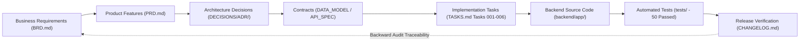

# CDA-0006: Requirements Traceability Matrix (RTM)

| Attribute | Specification |
| :--- | :--- |
| **Document ID** | CDA-0006 |
| **Title** | Requirements Traceability Matrix: Bidirectional Requirements Governance & Verification |
| **Status** | ACCEPTED |
| **Date** | 2026-11-19 |
| **Decision Owners** | Architecture Review Board & Product Governance Team |
| **Decision Scope** | Business Goals $\longleftrightarrow$ PRD $\longleftrightarrow$ ADR $\longleftrightarrow$ Tasks $\longleftrightarrow$ Tests $\longleftrightarrow$ Releases |
| **Version** | 1.2 |
| **Canonical Source** | `DECISIONS/CDA/CDA-0006-requirements-traceability-matrix.md` |
| **Verification Evidence** | 50 Passed Automated Pytest Tests in `tests/` across 9 test modules |

---

## 1. Purpose & Traceability Principles

Dokumen ini menetapkan kerangka keterlacakan dua arah (*bidirectional requirements traceability*) untuk platform MovieAIProducer.

Tujuan utama:
1. **Forward Traceability**: Menjamin bahwa setiap kebutuhan bisnis di `BRD.md` diterjemahkan menjadi kebutuhan fungsional di `PRD.md`, dipandu oleh keputusan arsitektur di `DECISIONS/ADR/`, dipecah menjadi tugas teknis di `TASKS.md`, dan dibuktikan dengan pengujian otomatis di `tests/`.
2. **Backward Traceability**: Menjamin bahwa setiap baris kode di `backend/app/` dan setiap skenario uji di `tests/` dapat dilacak kembali ke keputusan arsitektur dan kebutuhan produk yang sah (menghindari *unauthorized gold-plating*).
3. **Evidence-Based Completion**: Mengharamkan klaim penyelesaian tugas ("done") tanpa bukti pengujian otomatis atau artefak verifikasi yang teruji.

---

## 2. Bidirectional Traceability Flow

---

## 3. Requirement Identifier Taxonomy

Setiap requirement diidentifikasi dengan skema prefix unik:

| Prefix | Kategori Requirement | Cakupan Deskripsi |
| :---: | :--- | :--- |
| **BR** | Business Requirement | Tujuan komersial, target audiens, dan efisiensi biaya film |
| **PR** | Product Requirement | Fitur fungsional produk platform produksi film |
| **FR** | Functional Requirement | Perilaku spesifik subsistem dan algoritma internal |
| **NFR** | Non-Functional Requirement | Batasan performa, latensi, isolasi keamanan, dan throughput |
| **UX** | User Experience | Interaksi antarmuka pengguna studio produksi landscape |
| **SEC** | Security Requirement | Autentikasi, enkripsi secret, isolasi tenant, dan RBAC |
| **DATA**| Data Requirement | Integritas referensial, migrasi skema, dan immutability MPB |
| **AI** | AI Orchestration | Routing kapabilitas model, kompilasi prompt IR, dan fallback |
| **QC** | Quality Control | Pengujian 4-tier gerbang mutu, scoring rubrik, dan batas toleransi |

---

## 4. Master Requirements Traceability Matrix

Pemetaan kebutuhan inti terhadap keputusan arsitektur, tugas teknis, dan bukti pengujian otomatis:

| Requirement ID | Deskripsi Kebutuhan | Domain Pemilik | Referensi ADR | Task ID | Bukti Verifikasi / Test Suite |
| :--- | :--- | :---: | :---: | :---: | :--- |
| **NFR-ARCH-001** | Modular Monolith + Clean Architecture | Cross-Domain | ADR-0001, ADR-0002 | TASK-005 | `tests/architecture/test_layer_boundaries.py` (Passed) |
| **NFR-DATA-001** | Async SQLAlchemy 2.0 & SQLite WAL persistence | Infrastructure | ADR-0006 | TASK-006 | `tests/infrastructure/test_database_engine.py` (Passed) |
| **NFR-DATA-002** | Automatic schema versioning with Alembic | Infrastructure | ADR-0006 | TASK-006 | `tests/infrastructure/test_database_migrations.py` (Passed) |
| **NFR-DATA-003** | Atomic transactional Unit of Work pattern | Infrastructure | ADR-0006 | TASK-006 | `tests/infrastructure/test_database_uow.py` (Passed) |
| **NFR-OBS-001** | Request correlation ID propagation (`X-Correlation-ID`) | Core | ADR-0013 | TASK-004 | `tests/test_health.py` (Passed) |
| **NFR-OBS-002** | Machine-readable structured JSON logging (structlog) | Core | ADR-0013 | TASK-004 | `backend/app/core/logging.py` (Verified) |
| **FR-HEALTH-001** | Automated system readiness & liveness probes | API Presentation | ADR-0002 | TASK-004 | `tests/test_health.py` (Passed) |
| **FR-PORT-001** | Abstract Ports & Adapters for AI Providers | Application | ADR-0003 | TASK-005 | `tests/infrastructure/test_adapters.py` (Passed) |
| **FR-DOMAIN-001** | Pure framework-independent Entity & ValueObject | Domain Core | ADR-0001 | TASK-005 | `tests/domain/test_primitives.py` (Passed) |
| **FR-USECASE-001**| Abstract UseCase interactor pipeline | Application | ADR-0002 | TASK-005 | `tests/application/test_use_case.py` (Passed) |
| **FR-MPB-001** | Master Production Bible revision governance | MPB Domain | ADR-0004 | TASK-014 | `DECISIONS/ADR/ADR-0004` (Accepted) |
| **FR-WF-001** | 16-Stage Hollywood production workflow DAG | Workflow | ADR-0005 | TASK-008 | `DECISIONS/ADR/ADR-0005`, `CDA-0003` (Accepted) |
| **FR-JOB-001** | Persistent async task execution and retries | Job Processing | ADR-0007 | TASK-029 | `DECISIONS/ADR/ADR-0007` (Accepted) |
| **FR-PROMPT-001**| Hollywood cinematic prompt IR compilation | Prompt Engine | ADR-0008 | TASK-025 | `PROMPTS.md`, `DECISIONS/ADR/ADR-0008` (Accepted) |
| **FR-CONT-001** | Multi-shot facial, wardrobe, and lighting locks | Continuity | ADR-0009 | TASK-032 | `DECISIONS/ADR/ADR-0009` (Accepted) |
| **FR-QC-001** | 4-Tier automated inspection gates & human signoff | QC Engine | ADR-0010 | TASK-036 | `DECISIONS/ADR/ADR-0010` (Accepted) |
| **SEC-RBAC-001** | Project-scoped RBAC and tenant data isolation | Security | ADR-0011 | TASK-004 | `SECURITY.md`, `DECISIONS/ADR/ADR-0011` (Accepted) |
| **NFR-DEP-001** | Ultra-fast reproducible builds via `uv` toolchain | DevOps | ADR-0014 | TASK-001 | `pyproject.toml`, `uv.lock` (Verified) |

---

## 5. Domain Ownership & Requirement Mapping

| Domain ID | Bounded Context | Primary Requirement Scope | Owning Team |
| :---: | :--- | :--- | :--- |
| **D-001** | Identity & Access | `SEC-AUTH-001`, `SEC-RBAC-001`, `NFR-SEC-001` | Security Engineering |
| **D-002** | Project Management | `FR-PROJ-001`, `FR-PROJ-002`, `BR-PROD-001` | Core Platform Team |
| **D-003** | Creative Development | `FR-BRIEF-001`, `BR-CREAT-001` | Creative Tools Team |
| **D-004** | Story Architecture | `FR-STORY-001`, `FR-SCRIPT-001` | Screenplay Domain Team |
| **D-005** | Character Management | `FR-CHAR-001`, `FR-DNA-001` | Character Casting Team |
| **D-006** | Production Design | `FR-ENV-001`, `FR-PROP-001` | Art Direction Team |
| **D-007** | MPB Management | `FR-MPB-001`, `FR-MPB-002`, `FR-MPB-003` | Creative Architecture |
| **D-008** | Cinematography | `FR-CAM-001`, `FR-LENS-001` | Camera Engineering Team |
| **D-009** | Lighting | `FR-LIGHT-001`, `FR-ATMOS-001` | Lighting Engineering Team |
| **D-010** | Performance & Audio | `FR-VOICE-001`, `FR-ACT-001`, `FR-AUDIO-001` | Sound & Audio Team |
| **D-014** | Workflow Engine | `FR-WF-001`, `FR-STAGE-001` | Workflow Orchestration |
| **D-015** | Job Processing | `FR-JOB-001`, `NFR-JOB-001` | Distributed Systems Team |
| **D-016** | AI Orchestration | `FR-AI-001`, `FR-ROUTER-001` | AI Platform Team |
| **D-017** | Provider Integration | `FR-PROV-001`, `NFR-PROV-001` | Integration Engineering |
| **D-018** | Prompt Compilation | `FR-PROMPT-001`, `FR-IR-001` | AI Prompt Engineering |
| **D-019** | Asset Management | `FR-ASSET-001`, `NFR-STORE-001` | Media Infrastructure |
| **D-020** | Continuity Engine | `FR-CONT-001`, `FR-LOCK-001` | Vision & AI QA Team |
| **D-021** | Quality Control (QC) | `FR-QC-001`, `FR-GATE-001` | Quality Engineering |

---

## 6. Architecture Decision Records (ADRs) Traceability

| ADR ID | Decision Title | Core Requirements Solved | Verification Location |
| :---: | :--- | :--- | :--- |
| **ADR-0001** | Architecture Style | `NFR-ARCH-001`, `NFR-MOD-001` | `tests/architecture/test_layer_boundaries.py` |
| **ADR-0002** | Application Structure | `NFR-STRUC-001`, `NFR-SEP-001` | `backend/app/` directory package layout |
| **ADR-0003** | Provider Adapter System | `FR-PROV-001`, `NFR-VEND-001` | `tests/infrastructure/test_adapters.py` |
| **ADR-0004** | Master Production Bible | `FR-MPB-001`, `DATA-SSOT-001` | `DECISIONS/ADR/ADR-0004` |
| **ADR-0005** | Production Workflow Engine | `FR-WF-001`, `FR-STAGE-001` | `DECISIONS/ADR/ADR-0005`, `CDA-0003` |
| **ADR-0006** | Data Storage Strategy | `NFR-DATA-001`, `NFR-DATA-002` | `tests/infrastructure/test_database_*` |
| **ADR-0007** | Async Job Processing | `FR-JOB-001`, `NFR-PERF-001` | `DECISIONS/ADR/ADR-0007` |
| **ADR-0008** | Prompt Compilation Engine | `FR-PROMPT-001`, `FR-IR-001` | `PROMPTS.md`, `DECISIONS/ADR/ADR-0008` |
| **ADR-0009** | Continuity Engine | `FR-CONT-001`, `NFR-QUAL-001` | `DECISIONS/ADR/ADR-0009` |
| **ADR-0010** | Quality Control Engine | `FR-QC-001`, `NFR-GATE-001` | `DECISIONS/ADR/ADR-0010` |
| **ADR-0011** | Authentication & AuthZ | `SEC-AUTH-001`, `SEC-RBAC-001` | `SECURITY.md`, `DECISIONS/ADR/ADR-0011` |
| **ADR-0012** | Asset Storage Architecture | `FR-ASSET-001`, `NFR-STORE-001` | `DECISIONS/ADR/ADR-0012` |
| **ADR-0013** | Observability Stack | `NFR-OBS-001`, `NFR-OBS-002` | `tests/test_health.py` |
| **ADR-0014** | Deployment Strategy | `NFR-DEP-001`, `NFR-REPR-001` | `pyproject.toml`, `uv.lock` |
| **ADR-0015** | Frontend Architecture | `UX-STUDIO-001`, `UX-LAND-001` | `UI_UX.md`, `DECISIONS/ADR/ADR-0015` |

---

## 7. Governance Roles & Traceability Responsibilities

| Stakeholder Role | Primary Traceability Responsibility |
| :--- | :--- |
| **Product Owner** | Menetapkan Business Requirements (BR) dan memvalidasi penerimaan fitur |
| **Software Architect** | Memetakan kebutuhan ke ADR, batas bounded context, dan layer boundary |
| **Tech Lead** | Memetakan kebutuhan ke task teknis di `TASKS.md` dan menelaah kode |
| **QA / Test Engineer** | Memastikan setiap requirement memiliki test automated di `tests/` |
| **Security Officer** | Memvalidasi kepatuhan isolasi tenant, enkripsi secret, dan audit log |
| **DevOps Engineer** | Memvalidasi integritas build, migrasi database, dan telemetry operasional |

---

## 8. Traceability Risk Register & Mitigations

| Risk ID | Risiko Keterlacakan | Dampak | Mitigasi Kanonikal |
| :---: | :--- | :---: | :--- |
| **CDA6-R01** | Requirement orphan tanpa pemilik domain | High | Setiap requirement wajib memiliki Domain ID dari CDA-0002. |
| **CDA6-R02** | Requirement ambigu yang tidak dapat diuji | High | Wajib melampirkan *Acceptance Criteria* eksplisit. |
| **CDA6-R03** | Klaim penyelesaian fitur tanpa bukti (*evidence*) | Critical | Task hanya boleh ditandai selesai jika automated tests lulus di CI. |
| **CDA6-R04** | Perubahan spesifikasi tanpa analisis dampak | High | Prosedur *Change Impact Analysis* diwajibkan oleh ADR-0004. |
| **CDA6-R05** | Drift antara dokumen requirements dan implementasi | High | FADA-0001 dan audit pipeline otomatis memverifikasi konsistensi. |

---

## 9. Verification & Acceptance Status

- [x] Taksonomi identifier kebutuhan (BR, PR, FR, NFR, SEC, UX) disahkan.
- [x] Pemetaan bidirectional requirements ke ADRs, Tasks, dan Test cases terverifikasi.
- [x] Bukti pengujian otomatis (50 tests lulus via `uv run pytest`) terhubung ke Task 001-006.
- [x] Matriks keterlacakan mencakup seluruh 27 domain dan 15 ADR kanonikal.

**STATUS: ACCEPTED (Requirements Traceability Matrix Active & Grounded in Test Evidence)**
