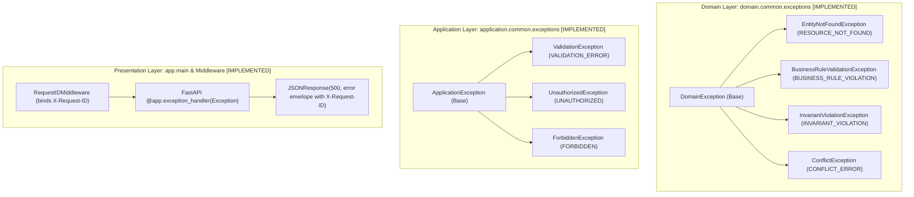
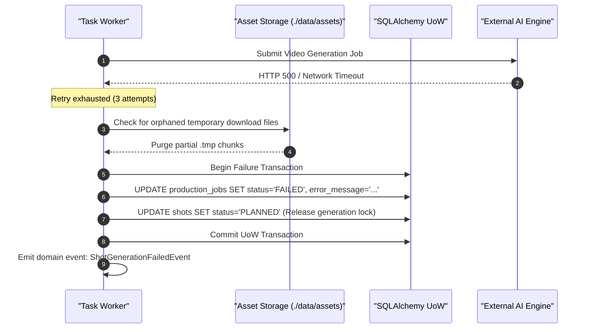

# Error Handling & Failure Recovery Specification - MovieAIProducer

- **Project:** MovieAIProducer
- **Document ID:** ERR-0001
- **Domain:** Error Taxonomy, Resilience Engineering & Failure Contracts
- **Version:** 2.0.0
- **Status:** Approved Production Specification
- **Canonical Source:** `DECISIONS/CDA/CDA-0005-canonical-error-failure-contract-registry.md`
- **Related ADRs:** ADR-0001 (Architecture Style), ADR-0003 (Provider Adapters), ADR-0005 (Workflow Engine), ADR-0007 (Async Jobs), ADR-0010 (Quality Control Engine), ADR-0013 (Observability)

---

## 1. Purpose & Architectural Principles

This document establishes the authoritative standard for error classification, failure management, and automated recovery across MovieAIProducer. In a generative AI film pipeline involving 50 scenes, multi-layer assets, and heterogeneous GPU backends, unhandled failures can cause costly redundant generations, corrupt character continuity, or cascade into deadlocks.

### Core Architectural Principles
1. **Centralized Taxonomy with Domain-Owned Semantics:** Error categories and envelope formats follow a unified contract across all layers. However, each domain aggregate (e.g. `MasterProductionBible`, `Scene`, `Asset`) strictly owns the semantic meaning and business invariants of its rejections.
2. **Strict Separation of Business Rejections vs Technical Failures:**
   - A business rejection (e.g. *Cannot generate shot: Character DNA is not locked*) represents an invariant constraint and must **never** be retried automatically.
   - A technical failure (e.g. *ComfyUI GPU worker connection refused*) represents a transient infrastructure breakdown eligible for backoff and retry.
3. **Defense Against Secret & PII Disclosure:** Internal stack traces, raw GPU memory dumps, external provider authorization tokens, and private user screenplay texts are strictly forbidden from appearing in error envelopes.
4. **End-to-End Correlation:** Every error carries an immutable `correlation_id` / `request_id` originating from `RequestIDMiddleware` (`backend/app/core/middleware.py`) that propagates through logging, database errors, and worker diagnostics.

---

## 2. Canonical Error Taxonomy

Errors are classified into ten distinct categories:

| Category | Description | Retryable? | Default HTTP Status | Grounded Code / Module |
| :--- | :--- | :--- | :--- | :--- |
| **`validation`** | Input payload syntax or semantic schema violation | **No** | `400 Bad Request` / `422 Unprocessable` | `application.common.exceptions:ValidationException` |
| **`authentication`** | Absent, expired, or cryptographically invalid session credentials | **No** | `401 Unauthorized` | `application.common.exceptions:UnauthorizedException` |
| **`authorization`** | Caller lacks permissions or attempted cross-project access | **No** | `403 Forbidden` | `application.common.exceptions:ForbiddenException` |
| **`business_rule`** | Operation breaches a domain rule, state invariant, or DNA lock | **No** | `400 Bad Request` / `422 Unprocessable` | `domain.common.exceptions:BusinessRuleValidationException` |
| **`conflict`** | Request clashes with current aggregate state (optimistic lock) | **Conditional** | `409 Conflict` | `domain.common.exceptions:ConflictException` |
| **`resource`** | Entity, aggregate root, or CAS file not found on disk or DB | **No** | `404 Not Found` | `domain.common.exceptions:EntityNotFoundException` |
| **`provider`** | Downstream AI provider timeout, 5xx error, or content filter trigger | **Conditional** | `502 Bad Gateway` / `504 Gateway Timeout`| `backend/app/infrastructure/` provider adapters |
| **`infrastructure`** | Database connection timeout, CAS disk full, or Redis failure | **Conditional** | `503 Service Unavailable` | `backend/app/infrastructure/database/` |
| **`internal`** | Unhandled runtime exception or broken system invariant | **No** | `500 Internal Server Error` | `backend/app/main.py` global exception handler |
| **`quality_control`** | Output asset failed automated CLIP, face drift, or SNR thresholds | **No** (Directs to Rework)| `422 Unprocessable Entity` | Quality Control Engine (ADR-0010) |

---

## 3. Canonical Error Response Envelope

All API endpoints, internal service bus rejections, and background job failures conform to the standard MovieAIProducer JSON error envelope:

```json
{
  "error": {
    "code": "MPB_DNA_NOT_LOCKED",
    "category": "business_rule",
    "message": "Master Production Bible creative parameters must be locked before scene prompt compilation.",
    "retryable": false,
    "severity": "medium",
    "correlation_id": "4b87e221-a1b9-4a02-a192-3d9284fae101",
    "occurred_at": "2026-11-19T09:30:00.124Z",
    "details": {
      "project_id": "7c9e6679-7425-40de-944b-e07fc1f90ae7",
      "missing_locks": ["style_code", "character_voice_dna"]
    },
    "field_errors": [],
    "documentation_ref": "https://producer.apologets.com/docs/errors#MPB_DNA_NOT_LOCKED"
  }
}
```

### Envelope Field Definitions
- **`code`:** Stable, unique uppercase snake_case identifier conforming to `<DOMAIN>_<RESOURCE>_<FAILURE>`.
- **`category`:** Exactly one of the 10 canonical taxonomy categories.
- **`message`:** Human-readable, non-technical description safe for display to users.
- **`retryable`:** Boolean policy hint indicating whether the operation is eligible for automated client/worker retry.
- **`severity`:** `low`, `medium`, `high`, or `critical`.
- **`correlation_id`:** The request or execution UUID matching the `X-Request-ID` HTTP header.
- **`occurred_at`:** ISO 8601 UTC timestamp with millisecond precision.
- **`details`:** Safe dictionary containing contextual identifiers (e.g. `scene_id`, `shot_id`).
- **`field_errors`:** Array of `{ "field": "...", "issue": "..." }` populated for validation errors.

---

## 4. Grounded Backend Exception Architecture

The backend implements this specification across domain, application, and API presentation layers:



### Implemented Exception Classes (`backend/app/`)
1. **`domain.common.exceptions:DomainException`:** Provides `.to_dict()` serializing `code`, `category`, `message`, and safe `details`.
2. **`domain.common.exceptions:EntityNotFoundException`:** Standardized 404 mapping for missing aggregate roots.
3. **`domain.common.exceptions:InvariantViolationException`:** Protects domain invariants (e.g. total scenes must equal 50).
4. **`application.common.exceptions:ValidationException`:** Carries `field_errors` list for granular form feedback.
5. **`backend.app.main:unexpected_exception`:** Catch-all handler capturing unhandled errors, logging `unhandled_exception` with `structlog`, and returning HTTP 500 without leaking stack traces.

---

## 5. Canonical Error Code Registry

| Error Code | Category | HTTP | Meaning |
| :--- | :--- | :--- | :--- |
| **`AUTH_CREDENTIALS_INVALID`** | `authentication` | `401` | Password or email verification failed |
| **`AUTH_TOKEN_EXPIRED`** | `authentication` | `401` | JWT access token expired; caller must refresh |
| **`AUTH_PROJECT_FORBIDDEN`** | `authorization` | `403` | User does not have access to specified project |
| **`PROJECT_NOT_FOUND`** | `resource` | `404` | Requested project UUID does not exist |
| **`MPB_DNA_NOT_LOCKED`** | `business_rule` | `422` | Generation blocked because Step 1–6 DNA is unlocked |
| **`MPB_STYLE_CODE_INVALID`** | `validation` | `400` | Style code must match `#Style 01` through `#Style 18` |
| **`SCENE_NUMBER_INVALID`** | `business_rule` | `400` | Scene number outside allowed range (1 to 50) |
| **`SHOT_DURATION_EXCEEDED`** | `validation` | `422` | Shot duration exceeds maximum generative limit (5.0s) |
| **`DIALOGUE_PACING_OVERFLOW`** | `business_rule` | `422` | Calibrated dialogue syllable count exceeds 5-second window |
| **`PROVIDER_TIMEOUT`** | `provider` | `504` | Downstream GPU engine failed to complete within timeout |
| **`PROVIDER_RATE_LIMITED`** | `provider` | `429` | Upstream AI vendor quota exhausted or rate limit hit |
| **`PROVIDER_CIRCUIT_OPEN`** | `infrastructure`| `503` | Circuit breaker tripped; traffic diverted to fallback |
| **`ASSET_NOT_FOUND`** | `resource` | `404` | Content-addressable storage key missing from disk |
| **`ASSET_CHECKSUM_MISMATCH`** | `infrastructure`| `500` | CAS blob failed SHA-256 integrity verification |
| **`QC_CRITICAL_DEFECT`** | `quality_control`| `422` | Automated QC failed (Face drift > 0.18 or SNR < 28dB) |
| **`JOB_CANCELLED_BY_USER`** | `business_rule` | `409` | In-flight generation halted by showrunner command |

---

## 6. Retry Policies, Jitter & Circuit Breakers

### 6.1 Exponential Backoff with Full Jitter
Automated retries apply exclusively to transient errors (`provider` network timeouts, `infrastructure` connection glitches).

$$t_{\text{sleep}} = \text{random}(0, \min(t_{\text{max}}, t_{\text{base}} \times 2^{\text{attempt}}))$$

- **Base Delay ($t_{\text{base}}$):** 1.0 second.
- **Maximum Delay ($t_{\text{max}}$):** 30.0 seconds.
- **Maximum Retry Attempts:** 3 attempts.
- **Full Jitter:** Randomizes delay between 0 and calculated ceiling to prevent "thundering herd" spikes on GPU endpoints.

### 6.2 Circuit Breaker Dynamics
- **Closed State (Normal):** All generation requests pass to the active provider adapter.
- **Tripping to Open State:** 5 consecutive failures within a 180-second window trip the breaker.
- **Open State (Bypassed):** All incoming jobs immediately bypass the failed provider and route to the configured fallback engine for 60 seconds.
- **Half-Open State (Probe):** Exactly 1 canary job is tested. If it succeeds, the breaker resets to `CLOSED`. If it fails, the cool-down doubles to 120 seconds.

---

## 7. Failure Recovery & Clean-Up Procedures



1. **Transaction Integrity:** When a job fails, the `SqlAlchemyUnitOfWork` ensures the `shots` status reverts to `PLANNED` or `FAILED` so that subsequent attempts are not blocked by a permanent generation lock.
2. **Orphaned File Garbage Collection:** Failed downloads or partial frames are written with temporary extensions (`.tmp`) and purged immediately upon job termination, preventing disk bloat in `./data/assets`.
3. **Idempotency Clean-Up:** An `Idempotency-Key` associated with a failed generation allows safe resubmission with identical parameters once the root issue is resolved.
