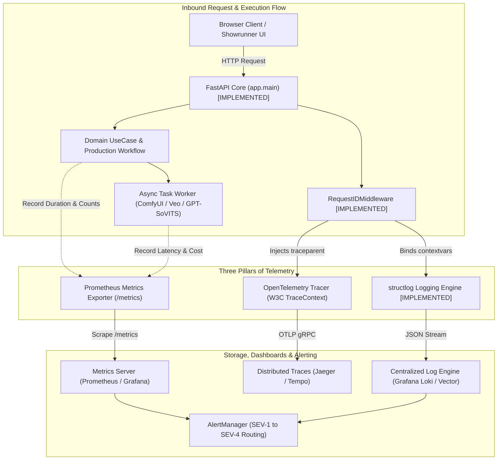

# Observability, Logging & Monitoring Specification - MovieAIProducer

- **Project:** MovieAIProducer
- **Document ID:** OBS-0001
- **Domain:** Telemetry, Distributed Tracing, Metrics & Incident Management
- **Version:** 2.0.0
- **Status:** Approved Production Specification
- **Canonical Architecture Decisions:** ADR-0013 (Observability Stack), ADR-0007 (Async Job Processing), ADR-0010 (Quality Control Engine)
- **Implemented Codebase Grounding:** `backend/app/core/logging.py`, `backend/app/core/middleware.py`, `backend/app/api/health.py`, `backend/app/main.py`

---

## 1. Observability Vision & Architecture

In an industrial AI film production platform coordinating 50 scenes across external models (Google Veo, Kling) and local GPU execution graphs (ComfyUI, GPT-SoVITS), observability is essential for debugging, controlling GPU costs, and guaranteeing narrative continuity.

MovieAIProducer implements an integrated three-pillar observability framework:

1. **Context-Bound Structured Logging:** Powered by `structlog`, producing structured JSON events with standardized correlation IDs (`request_id`, `project_id`, `scene_id`, `shot_id`).
2. **End-to-End Distributed Tracing:** OpenTelemetry instrumentation propagating W3C TraceContext across HTTP requests, async worker queues, and GPU generation tasks.
3. **Domain & Pipeline Telemetry:** Prometheus metrics monitoring system health, GPU worker latency, provider dollar consumption, and automated QC score distributions.

---

## 2. Telemetry Architecture Diagram



---

## 3. Structured Logging Architecture `[IMPLEMENTED]`

Structured logging is implemented in `backend/app/core/logging.py` using `structlog` and integrated into the FastAPI request lifecycle via `RequestIDMiddleware` (`backend/app/core/middleware.py`).

### 3.1 Implemented Logger Configuration

- **Standard Processors:**
  - `structlog.stdlib.add_log_level`: Standardizes severity levels (`DEBUG`, `INFO`, `WARNING`, `ERROR`, `CRITICAL`).
  - `structlog.processors.TimeStamper(fmt="iso")`: Formats timestamps as ISO 8601 strings in UTC.
  - `structlog.contextvars.merge_contextvars`: Automatically extracts bound variables from Python `contextvars` (such as `request_id`).
  - `structlog.processors.format_exc_info`: Standardizes exception tracebacks into structured fields.
  - `structlog.processors.JSONRenderer`: Formats log events into single-line JSON records in production environments.

### 3.2 Canonical JSON Log Record Format

```json
{
  "timestamp": "2026-11-19T09:40:12.482019Z",
  "level": "info",
  "event": "shot_generation_completed",
  "service": "movieai-producer",
  "environment": "production",
  "request_id": "4b87e221-a1b9-4a02-a192-3d9284fae101",
  "project_id": "7c9e6679-7425-40de-944b-e07fc1f90ae7",
  "scene_number": 14,
  "shot_number": 2,
  "provider": "comfyui_local",
  "model": "wan2.1_t2v_14b",
  "latency_ms": 48210,
  "cost_usd": 0.0,
  "storage_key": "cas/8f/3e/8f3e2b9c7a10298374fbead74892018a.mp4",
  "qc_score": 0.89
}
```

### 3.3 Zero-Secret & Zero-PII Policy

To prevent security leaks, logger configuration enforces:

1. **Secret Masking:** Keys matching `*token*`, `*secret*`, `*password*`, `*api_key*`, or `*authorization*` are automatically redacted with `[REDACTED]`.
2. **Zero Raw Prompt Content in Production Logs:** User screenplays and character prompts are omitted or truncated to SHA-256 hashes in production logs.

---

## 4. Health Indicators & Probes `[IMPLEMENTED]`

Implemented in `backend/app/api/health.py`, the platform exposes two standardized probes:

### 4.1 Liveness Probe (`GET /health`)

- **Purpose:** Verifies that the FastAPI process is responsive and event loops are unblocked.
- **Payload:** `{"status": "alive"}`
- **Frequency:** Every 10 seconds via container orchestrator.

### 4.2 Readiness Probe (`GET /ready`)

- **Purpose:** Verifies external dependencies before routing traffic to the instance:
  1. **Database Connectivity:** Executes `SELECT 1` on the SQLAlchemy engine.
  2. **Asset CAS Storage:** Verifies `settings.asset_storage_path` (`./data/assets`) exists, is a valid directory, and is writeable.
- **Payload (Healthy):**
  ```json
  {
    "status": "ready",
    "checks": {
      "database": true,
      "asset_storage": true
    }
  }
  ```
- **HTTP Status:** Returns `200 OK` when all checks pass; `503 Service Unavailable` if any check fails.

---

## 5. Prometheus Telemetry & Pipeline Metrics Specification `[PLANNED]`

Metrics are exported via `/metrics` in OpenMetrics standard format:

### 5.1 System & HTTP Presentation Metrics

- **`http_requests_total`** (Counter): Total incoming HTTP requests labeled by `method`, `handler`, `status_code`.
- **`http_request_duration_seconds`** (Histogram): Request latency buckets `[0.01, 0.05, 0.1, 0.25, 0.5, 1.0, 2.5, 5.0, 10.0]`.
- **`db_connection_pool_active`** (Gauge): Number of active database connections in the SQLAlchemy pool.

### 5.2 AI Generation & Task Queue Metrics

- **`ai_jobs_total`** (Counter): Total generation jobs labeled by `provider` (veo, kling, comfyui, gpt_sovits) and `status` (queued, completed, failed, cancelled).
- **`ai_job_duration_seconds`** (Histogram): Execution duration per provider buckets `[5.0, 15.0, 30.0, 60.0, 120.0, 300.0]`.
- **`ai_cost_usd_total`** (Counter): Cumulative generation costs in USD labeled by `project_id`, `provider`, and `model`.
- **`ai_worker_queue_depth`** (Gauge): Current pending jobs in the Redis/background queue.

### 5.3 Cinematic Quality Control & Continuity Metrics

- **`qc_evaluations_total`** (Counter): Total shots evaluated labeled by `result` (passed, failed).
- **`qc_score_histogram`** (Histogram): Composite QC score distribution labeled by `metric` (`face_similarity`, `clip_alignment`, `aesthetic_score`, `audio_snr`).
- **`dna_drift_violations_total`** (Counter): Total detected character face or costume drift incidents exceeding acceptable thresholds.

---

## 6. Distributed Tracing Specification (OpenTelemetry) `[PLANNED]`

Distributed tracing follows the W3C TraceContext recommendation.

### Standard Trace Hierarchy:

```text
[Span: HTTP POST /api/v1/shots/{id}/generate] (Trace ID: 8a93e1b20...)
  |
  +-- [Span: UseCase: SubmitShotGenerationUseCase]
        |
        +-- [Span: DB: Fetch Shot & Locked MPB (SQLAlchemy)]
        +-- [Span: Compiler: Transpile 12-Step DNA to ComfyUI Graph]
        +-- [Span: Queue: Enqueue Task in Redis]
              |
              +-- [Worker Span: ComfyUI Adapter Execution]
                    |
                    +-- [Span: HTTP POST ComfyUI /prompt]
                    +-- [Span: WS ComfyUI Monitor Progress]
                    +-- [Span: CAS: Ingest & Compute SHA-256 Checksum]
                    +-- [Span: QC: Run InsightFace & CLIP Scoring]
```

---

## 7. Incident Classification & Alerting Rules

| Severity             | Definition                                            | Threshold Condition                                                     | Notification Channel              | Response SLA      |
| :------------------- | :---------------------------------------------------- | :---------------------------------------------------------------------- | :-------------------------------- | :---------------- |
| **SEV-1 (Critical)** | Core platform or generation pipeline entirely halted  | API 5xx rate > 5%, `/ready` probe failing, or Redis queue stalled > 10m | PagerDuty, SMS, Emergency Channel | 15 minutes        |
| **SEV-2 (Major)**    | Primary provider outage; fallback operational         | Veo/Kling circuit breaker tripped OPEN; generation latency P95 > 180s   | Slack Urgent, Email Broadcast     | 1 hour            |
| **SEV-3 (Moderate)** | Elevated QC defect rate or asset degradation          | Automated QC failure rate > 20% over 10 consecutive shots               | Slack `#dev-alerts`               | 4 hours           |
| **SEV-4 (Minor)**    | Non-blocking metric variance or transient retry spike | Temporary provider rate limit backoff (< 3 retries)                     | Daily Digest Report               | Next Business Day |
