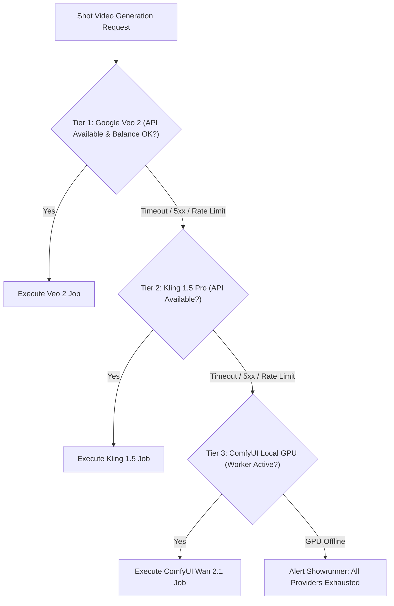
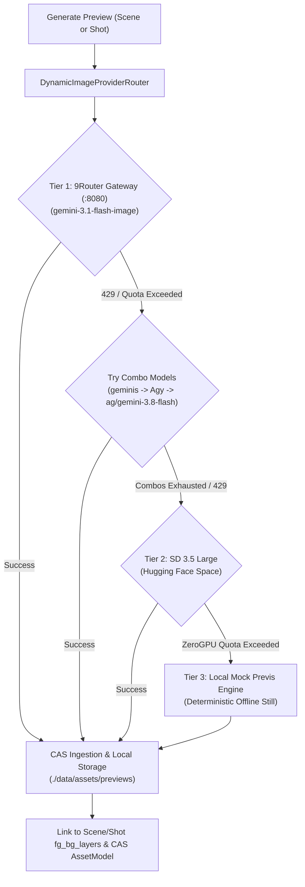

# AI Provider & Model Integration Matrix - MovieAIProducer

- **Project:** MovieAIProducer
- **Document ID:** PROV-0001
- **Domain:** AI Infrastructure Adapters & Provider Capabilities
- **Version:** 2.0.0
- **Status:** Approved Production Specification
- **Canonical Architecture Decisions:** ADR-0003 (Provider Adapter System), ADR-0007 (Async Job Processing), ADR-0010 (Quality Control Engine)
- **Local Reference Engines:** `/home/ubuntu/workspace/ComfyUI`, `/home/ubuntu/workspace/GPT-SoVITS`

---

## 1. Provider Adapter Architecture & Routing Strategy

MovieAIProducer treats external AI models and local GPU inference servers as hot-swappable infrastructure adapters. The core domain layer (`MasterProductionBible`, `Scene`, `Shot`) interacts exclusively with standard abstract ports (`VideoProviderPort`, `VoiceProviderPort`, `ReasoningProviderPort`, `QCProviderPort`).

### Key Operational Invariants

1. **Zero Vendor Lock-In:** Workflows are defined in terms of Hollywood 12-Step creative requirements, not proprietary API syntax.
2. **Automated Failover & Resilience:** Every generative tier defines a primary engine, a secondary fallback, and a local contingency engine. Circuit breakers prevent cascading timeouts.
3. **Deterministic Cost & Latency Boundaries:** Background task workers enforce strict execution timeouts and budget caps per scene and per project.
4. **Local GPU First for Privacy & Zero Marginal Cost:** Reference implementations in `/home/ubuntu/workspace/ComfyUI` and `/home/ubuntu/workspace/GPT-SoVITS` allow fully air-gapped, zero-cost production for local development and private studios.

---

## 2. Comprehensive Provider Evaluation & Capability Matrix

### 2.1 Cinematic Video Generation Engines

| Provider / Model                      | Integration Level      | Primary Strengths                                                                                     | Supported Resolutions    | Max Duration per Shot | Latency (P50 / P95)  | Cost (USD)              | Integration Status                |
| :------------------------------------ | :--------------------- | :---------------------------------------------------------------------------------------------------- | :----------------------- | :-------------------- | :------------------- | :---------------------- | :-------------------------------- |
| **Google Veo 2**                      | Native API             | Exceptional prompt adherence, complex multi-character physical interactions, realistic camera physics | 1080p, 4K (16:9, 9:16)   | 5.0s – 8.0s           | 45s / 95s            | ~$0.30 / 5s shot        | **`[PLANNED]`** (Primary Tier 1)  |
| **Kling AI (1.5 / 2.0 Pro)**          | Native API             | High photorealism, superb Image-to-Video (I2V) character face consistency, natural motion blur        | 1080p (16:9, 9:16)       | 5.0s – 10.0s          | 60s / 120s           | ~$0.20 / 5s shot        | **`[PLANNED]`** (Primary Tier 2)  |
| **Runway Gen-3 Alpha**                | Native API             | Advanced camera director controls, motion brush, high aesthetic quality                               | 720p, 1080p (16:9)       | 5.0s – 10.0s          | 40s / 80s            | ~$0.25 / 5s shot        | **`[PLANNED]`** (Fallback Tier 2) |
| **Luma Dream Machine (Ray 2)**        | Native API             | Rapid shot turnaround, dynamic kinetic action, smooth camera zooms                                    | 1080p (16:9, 9:16)       | 5.0s                  | 25s / 50s            | ~$0.18 / 5s shot        | **`[PLANNED]`** (Fast Iteration)  |
| **MiniMax (Hailuo AI Video-01)**      | Native API             | Complex organic movements, expressive facial animations                                               | 1080p (16:9)             | 6.0s                  | 55s / 110s           | ~$0.15 / 6s shot        | **`[PLANNED]`** (Alternative)     |
| **ComfyUI Self-Hosted (Wan 2.1 14B)** | Local WebSocket & REST | Zero API cost, IP-Adapter FaceID continuity, ControlNet OpenPose motion locking                       | 1080p, 720p (16:9, 9:16) | 5.0s                  | 50s / 90s (RTX 4090) | $0.00 (Self-hosted GPU) | **`[PLANNED]`** (Local Reference) |

---

### 2.2 Voice & Speech Synthesis Engines (TTS & Voice DNA)

| Provider / Model            | Integration Level              | Primary Strengths                                                                         | Supported Languages                    | Voice Cloning Requirements         | Latency (P50 / P95)    | Cost (USD)          | Integration Status                    |
| :-------------------------- | :----------------------------- | :---------------------------------------------------------------------------------------- | :------------------------------------- | :--------------------------------- | :--------------------- | :------------------ | :------------------------------------ |
| **GPT-SoVITS v2**           | Self-Hosted REST (`api_v2.py`) | Zero-shot cloning with 5s reference audio, zero per-token cost, real-time chunk streaming | English, Indonesian, Chinese, Japanese | 5s – 10s clean reference WAV audio | 1.2s / 2.8s (Streamed) | $0.00 (Local GPU)   | **`[PLANNED]`** (Local Reference)     |
| **ElevenLabs (Turbo v2.5)** | Native API                     | Industry-standard emotional inflections, whispering/shouting nuance, VoiceLab cloning     | 32 Languages (incl. ID & EN)           | 60s high-quality reference audio   | 1.5s / 3.5s            | ~$0.003 / 100 chars | **`[PLANNED]`** (Primary Cloud)       |
| **OpenAI TTS (tts-1-hd)**   | Native API                     | Clean acoustic floor, high reliability, neutral documentary narration                     | 57 Languages                           | Preset voices only (no zero-shot)  | 0.8s / 1.8s            | ~$0.015 / 1k chars  | **`[PLANNED]`** (Voiceover Narration) |

---

### 2.3 Concept Art & Keyframe Generation Engines

| Provider / Model                                | Integration Level            | Primary Strengths                                                                                     | Native Resolutions                      | Prompt Adherence | Latency (P50 / P95) | Cost (USD)             | Integration Status                    |
| :---------------------------------------------- | :--------------------------- | :---------------------------------------------------------------------------------------------------- | :-------------------------------------- | :--------------- | :------------------ | :--------------------- | :------------------------------------ |
| **9Router API Gateway (`gemini-3.1-flash-image`, `geminis`, `Agy`)** | Local Gateway (`:8080/v1`)   | Multi-Model Combo routing, connection pooling across 20+ accounts, zero marginal cost, 429 auto-failover | 1024x576, 576x1024, 1024x1024, 1024x512 | Exceptional      | 1.2s / 3.5s         | $0.00 (Pooled Quota)   | **`[IMPLEMENTED]`** (Primary Tier 1)  |
| **Stability AI SD 3.5 Large (HF Spaces)**       | Gradio REST / SSE Stream     | 8B parameter diffusion model, pristine 35mm film grain, Hollywood cinematic textures                  | 1024x576, 1024x1024, 576x1024           | High             | 22s / 45s           | $0.00 (ZeroGPU) / Pro  | **`[IMPLEMENTED]`** (Fallback Tier 2) |
| **Local Previs Mock Engine**                    | Deterministic Engine         | Guaranteed zero-downtime offline fallback, high-contrast cinematic layout SVG/WebP                    | Flexible (16:9, 1:1, 9:16)              | Instant          | <10ms / <20ms       | $0.00                  | **`[IMPLEMENTED]`** (Tier 3 Offline)  |
| **FLUX.1 [dev]**                                | Local / Replicate / Together | 12B parameter flow transformer, pristine photorealism, typography in-scene                             | Up to 2048x2048                         | Exceptional      | 8s / 16s            | $0.025 / image         | **`[PLANNED]`** (Concept High-End)    |
| **Midjourney v6.1**                             | Assisted / Webhook           | World-class visual aesthetics, cinematic color grading, concept moodboards                            | 1024x1024 to 2048x2048                  | High             | 30s / 60s           | Subscription           | **`[PLANNED]`** (Moodboard Previs)    |
| **SDXL + LoRA (ComfyUI)**                       | Local Node Graph             | Character FaceID locking, custom costume LoRAs, instant generation                                    | 1024x1024                               | High (with LoRA) | 2.5s / 5.0s (GPU)   | $0.00                  | **`[PLANNED]`** (Local Anchor)        |

---

### 2.4 Story Architecture, Script Breakdown & Reasoning Engines

| Provider / Model      | Integration Level | Primary Strengths                                                                       | Context Window | Best Use in 16-Stage Pipeline             | Cost (Input/Output 1M) | Integration Status                    |
| :-------------------- | :---------------- | :-------------------------------------------------------------------------------------- | :------------- | :---------------------------------------- | :--------------------- | :------------------------------------ |
| **Claude 3.5 Sonnet** | Native API        | Cinematic dialogue cadence, screenplay formatting, nuanced emotional character beats    | 200k tokens    | Stage 01–04 (Story, Script & Feasibility) | $3.00 / $15.00         | **`[PLANNED]`** (Lead Screenplay)     |
| **Gemini 1.5 Pro**    | Native API        | Massive context window, whole-screenplay continuity audits, multimodal video inspection | 2M tokens      | Stage 09, 14, 16 (Previs, Continuity, QC) | $1.25 / $5.00          | **`[PLANNED]`** (Continuity Auditor)  |
| **GPT-4o**            | Native API        | Structured JSON outputs, Pydantic schema generation, camera matrix extraction           | 128k tokens    | Stage 11–12 (Camera & Lighting Spec)      | $2.50 / $10.00         | **`[PLANNED]`** (Matrix Transpiler)   |
| **DeepSeek-V3 / R1**  | Native API        | Ultra-low cost reasoning, batch prompt transpilation into engine syntax                 | 64k tokens     | Stage 15 (Batch Prompt Compilation)       | $0.14 / $0.28          | **`[PLANNED]`** (Batch Prompt Worker) |

---

### 2.5 Visual Quality Control (QC) & Multimodal Verification

| Engine / Library              | Execution Mode | Verification Scope                                      | Pass Threshold     | Latency          | Integration Status               |
| :---------------------------- | :------------- | :------------------------------------------------------ | :----------------- | :--------------- | :------------------------------- |
| **InsightFace (ArcFace)**     | Local PyTorch  | Character facial embedding cosine similarity            | `>= 0.82`          | ~150ms / frame   | **`[PLANNED]`** (Automated Gate) |
| **CLIP (ViT-L/14)**           | Local PyTorch  | Semantic text-to-frame alignment score                  | `>= 0.80`          | ~120ms / frame   | **`[PLANNED]`** (Automated Gate) |
| **LAION Aesthetic Predictor** | Local PyTorch  | Cinematic visual composition and lighting quality       | `>= 7.5 / 10.0`    | ~80ms / frame    | **`[PLANNED]`** (Automated Gate) |
| **Farneback Optical Flow**    | Local OpenCV   | Temporal jitter, stuttering, and frame flicker variance | `<= 0.12 variance` | ~300ms / 5s clip | **`[PLANNED]`** (Automated Gate) |
| **Wav2Lip Confidence**        | Local PyTorch  | Speech-to-lip synchronization confidence                | `>= 0.85`          | ~450ms / 5s clip | **`[PLANNED]`** (Automated Gate) |

---

## 3. Fallback Hierarchy & Circuit Breakers

When a production job is submitted, the orchestrator routes tasks through a three-tier hierarchy:

### Circuit Breaker Specifications

1. **Failure Threshold:** 5 consecutive 5xx errors or network timeouts within a rolling 3-minute window transitions the provider state from `CLOSED` to `OPEN`.
2. **Cool-Down Period:** Provider remains `OPEN` (bypassed) for 60 seconds, during which all traffic routes to the secondary tier.
3. **Half-Open Probe:** After 60 seconds, exactly 1 canary request is sent. If successful, state resets to `CLOSED`; if failed, cool-down doubles to 120 seconds.
4. **Idempotency Safeguard:** When retrying across providers, a new external job ID is generated, but the internal `shot_id` and production version tracking remain correlated.

---

## 3.1 Visual Previews & Keyframe Dynamic Switching (9Router & SD 3.5)

To guarantee 100% storyboard preview availability without single-token bottlenecks or ZeroGPU downtime:

### Rate Limits & Multi-Model Combo Policy

| Provider Tier | Engine / Combo | Rate Limit & Quota Envelope | Handling Strategy |
| :--- | :--- | :--- | :--- |
| **Tier 1 (Primary)** | `gemini-3.1-flash-image` | 15 RPM / 1,500 RPD per key | Immediate failover to `geminis` on HTTP 429 |
| **Tier 1 (Combo Fallback A)** | `geminis` | 60 RPM across pooled accounts | Rotates `flash-lite` -> `sonnet` -> `flash-low` |
| **Tier 1 (Combo Fallback B)** | `Agy` | 60 RPM across Antigravity pool | Burst mitigation buffer |
| **Tier 2 (Fallback)** | `sd35_large_hf` | ~80s ZeroGPU quota per rolling window | Triggers Tier 3 on `ZeroGPUQuotaExceededError` |
| **Tier 3 (Contingency)** | `mock` | Unlimited (offline, 0ms latency) | Deterministic SVG/WebP with visual metadata |

### Non-Disruption Guarantee for Live Streaming Feeds

`MovieAIProducer` operates strictly on ports `8090` (FastAPI) and `3090` (Next.js) behind `producer.apologets.com`. It connects to `9router` on port `8080`.
The live-streaming automation subsystem on `apologets.com` and `studio.apologets.com` utilizes ports `8085` (Dashboard/HTTP), `8086` (WebSocket streaming pipe), `3000` (Polya AI), and `7681` (Terminal).
The image generation dynamic provider router does not modify, bind, or intercept any streaming sockets or live pipeline processes.

---

## 4. Secret Management & Key Isolation

1. **Zero Secret Leaks in Prompts:** API keys (OpenAI, Anthropic, ElevenLabs, Kling) are stored in secure environment variables or vault secrets, never embedded into compiled prompt templates or database tables.
2. **Settings Grounding:** Managed via Pydantic `BaseSettings` in `backend/app/core/config.py` with `case_sensitive=False` and `.env` encapsulation.
3. **Egress Network Filtering:** Backend instances communicate with external AI endpoints over TLS 1.3 with pinned root certificates.
