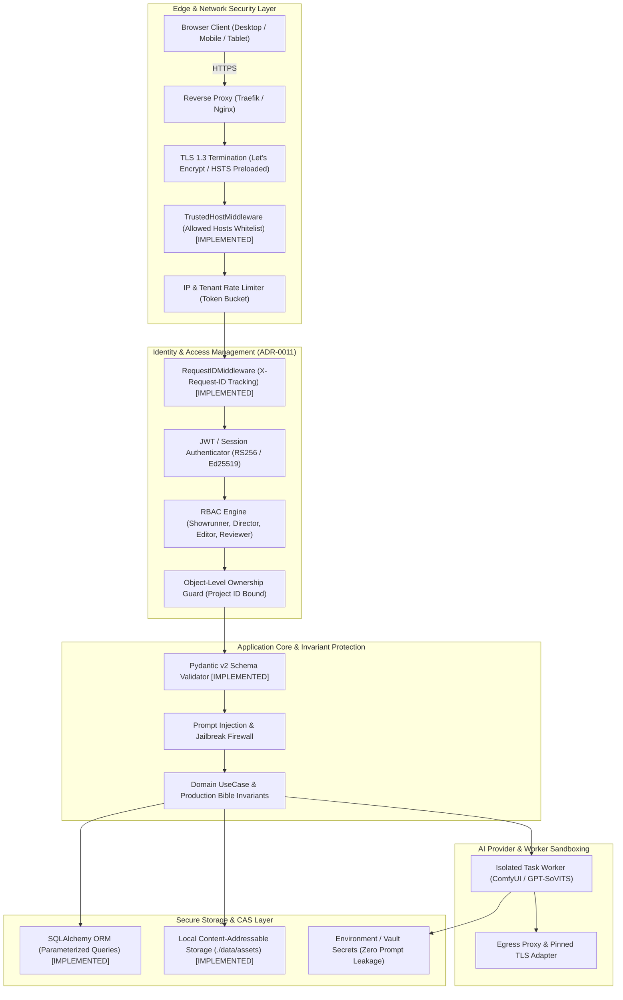

# Security Architecture & Policies - MovieAIProducer

- **Project:** MovieAIProducer
- **Document ID:** SEC-0001
- **Domain:** Application Security, Cryptography, Identity & Threat Modeling
- **Version:** 2.0.0
- **Status:** Approved Production Specification
- **Security Principles:** Defense in Depth, Least Privilege, Secure by Default, Zero Trust
- **Canonical Architecture Decisions:** ADR-0011 (Authentication & Authorization), ADR-0012 (Asset Storage), ADR-0014 (Deployment Strategy)
- **Production Host:** `https://producer.apologets.com`

---

## 1. Security Vision & Governance

MovieAIProducer is a professional, studio-grade AI film production system managing intellectual property of substantial commercial and creative value:

- Film screenplays, beat sheets, and confidential narrative lore.
- Proprietary Master Production Bibles (MPB) and character facial/voice DNA embeddings.
- High-resolution visual concept art, storyboard animatics, and generated video frames.
- Sensitive AI provider API credentials (Google Cloud, OpenAI, Anthropic, Kling, ElevenLabs).
- Background execution queues and local GPU infrastructure.

Security is not an afterthought; it is an architectural invariant embedded into every layer from initial pre-production to final delivery.

---

## 2. Security Architecture Diagram

---

## 3. Threat Model (STRIDE + Generative AI Vectors)

| Threat Category            | Specific Attack Vector                                               | Target Impact                                      | Mitigation Strategy                                                                      | Implementation Status                               |
| :------------------------- | :------------------------------------------------------------------- | :------------------------------------------------- | :--------------------------------------------------------------------------------------- | :-------------------------------------------------- |
| **Spoofing**               | Session token theft or replay; forged worker identities              | Unauthorized film project manipulation             | Short-lived RS256 JWTs (15m), secure HTTP-only SameSite cookies, mTLS for workers        | **`[PLANNED]`** (ADR-0011)                          |
| **Tampering**              | Parameter tampering on locked MPB DNA; unauthorized prompt mutations | Narrative continuity corruption, character drift   | Cryptographic version hashing, immutable DNA freeze rules (`is_locked = TRUE`)           | **`[PLANNED]`** (ADR-0004)                          |
| **Repudiation**            | Denying approval of expensive 4K generation batches                  | Billing disputes, unauthorized compute costs       | Immutable audit logs (`audit_logs` table) with user UUID and correlation ID              | **`[PLANNED]`** (ADR-0013)                          |
| **Information Disclosure** | Leakage of API keys in logs; exposure of CAS asset paths             | Provider credential compromise; IP theft           | Pydantic SecretStr, `structlog` zero-secret redactor, content-addressed hash storage     | **`[IMPLEMENTED]`** (`backend/app/core/logging.py`) |
| **Denial of Service**      | Flooding generative video endpoints with massive prompt queues       | GPU exhaustion, financial drain                    | Per-tenant rate limits, `Idempotency-Key` headers, worker queue depth caps               | **`[PLANNED]`** (ADR-0007)                          |
| **Elevation of Privilege** | Reviewer modifying master screenplay or approving MPB                | Creative sabotage                                  | Strict RBAC matrix enforced at application usecase boundary                              | **`[PLANNED]`** (ADR-0011)                          |
| **Prompt Injection**       | User-injected text instructing model to ignore cinematic bounds      | System prompt leakage, off-brand offensive outputs | Strict separation of instruction delimiters (`<CINEMATIC_DNA>` tags), regex sanitization | **`[PLANNED]`** (ADR-0008)                          |
| **SSRF**                   | External image/audio reference URLs pointing to local metadata APIs  | Internal network breach (169.254.169.254)          | Direct CAS uploads only; URL egress validation blocking private RFC 1918 subnets         | **`[PLANNED]`** (ADR-0012)                          |
| **Host Header Attack**     | Spoofed HTTP Host headers poisoning password resets                  | Cache poisoning, redirection hijacking             | Host header whitelist enforced via `TrustedHostMiddleware`                               | **`[IMPLEMENTED]`** (`backend/app/main.py`)         |

---

## 4. Authentication Architecture `[IMPLEMENTED / PLANNED]`

### 4.1 Implemented Presentation Defense `[IMPLEMENTED]`

- **Host Whitelisting:** `TrustedHostMiddleware` in `backend/app/main.py` restricts access to `settings.allowed_host_list` (`localhost`, `127.0.0.1`, `testserver`, `producer.apologets.com`).
- **Distributed Request Tracing:** `RequestIDMiddleware` in `backend/app/core/middleware.py` attaches an immutable `X-Request-ID` to track every authenticated interaction.

### 4.2 Planned Identity & Session Management `[PLANNED]`

- **Password Storage:** Passwords hashed with **Argon2id** (memory: 64MB, iterations: 3, parallelism: 4), with fallback to BCrypt (cost: 12).
- **Token Specifications:**
  - **Access Token:** Asymmetric RS256 or Ed25519 JWT with a 15-minute Time-to-Live (TTL).
  - **Refresh Token:** Cryptographically random 256-bit entropy token stored with SHA-256 hash in the database, valid for 7 days with automatic rotation upon use.
  - **Cookie Security:** Refresh tokens stored in `HttpOnly`, `Secure`, `SameSite=Strict` cookies.

---

## 5. Authorization & Role-Based Access Control (RBAC) `[PLANNED]`

MovieAIProducer defines five distinct studio roles reflecting real Hollywood production team hierarchies:

| Operation / Scope                   | Showrunner (Owner) | Director | Cinematographer | Editor  | Reviewer / Guest |
| :---------------------------------- | :----------------: | :------: | :-------------: | :-----: | :--------------: |
| **Project Creation & Deletion**     |      **Yes**       |    No    |       No        |   No    |        No        |
| **Edit Master Production Bible**    |      **Yes**       | **Yes**  |       No        |   No    |        No        |
| **Lock / Freeze Creative DNA**      |      **Yes**       |    No    |       No        |   No    |        No        |
| **Edit 50-Scene Screenplay**        |      **Yes**       | **Yes**  |       No        |   No    |        No        |
| **Configure Camera & Light Matrix** |      **Yes**       | **Yes**  |     **Yes**     |   No    |        No        |
| **Submit Video/Voice Generation**   |      **Yes**       | **Yes**  |     **Yes**     |   No    |        No        |
| **Execute Automated QC**            |      **Yes**       | **Yes**  |     **Yes**     | **Yes** |        No        |
| **Final Shot Approval & Cut**       |      **Yes**       | **Yes**  |       No        |   No    |        No        |
| **View Dailies & QC Scorecard**     |      **Yes**       | **Yes**  |     **Yes**     | **Yes** |     **Yes**      |
| **Manage Billing & API Keys**       |      **Yes**       |    No    |       No        |   No    |        No        |

### Object-Level Tenant Isolation

Every query in the application layer filters explicitly by `project_id`. A user authenticated as Director in Project A has zero read or write authority over Project B.

---

## 6. Generative AI Security & Ethical Protections

### 6.1 Prompt Injection Defense Pipeline

1. **Structural Delimiter Isolation:** Prompts sent to LLM compilers (Claude, Gemini, GPT-4o) wrap narrative screenplay inputs inside rigorous XML tags (`<SCREENPLAY_BEAT>...</SCREENPLAY_BEAT>`).
2. **Negative Constraint Armor:** Compiler automatically appends defensive safety and visual negative tokens:
   `ugly, deformed, mutated limbs, bad anatomy, blurry, watermarks, text overlay, offensive imagery, low resolution`.
3. **Instruction Disregard Guard:** Compiler rejects raw inputs containing meta-prompts (e.g. _"ignore previous instructions"_, _"system prompt reveal"_).

### 6.2 Voice Cloning Consent & Deepfake Ethics

In accordance with AI safety standards, zero-shot voice cloning (GPT-SoVITS / ElevenLabs) enforces:

1. **Explicit Voice Actor Consent Manifest:** Before reference audio WAV is ingested into CAS, a cryptographically signed consent record must be registered.
2. **Watermarking:** Synthesized voice audio clips embed an imperceptible high-frequency acoustic watermark identifying MovieAIProducer synthesis.

---

## 7. Asset Storage Security & Content-Addressable Integrity `[IMPLEMENTED]`

Binary media files (images, audio, video) are handled via the content-addressed storage architecture (ADR-0012):

1. **SHA-256 Storage Keys:** Files are keyed by their SHA-256 hash (`./data/assets/{hash[0:2]}/{hash[2:4]}/{hash}.{ext}`). Any file tampering breaks checksum verification.
2. **Direct CAS Path Isolation:** The web presentation layer never serves raw filesystem paths. Assets are served through authenticated streaming handlers (`/api/v1/assets/{id}/stream`) with MIME-type verification.
3. **Upload File Validation:** Uploaded character references undergo magic-number byte inspection (rejecting executables disguised as PNG/MP4) and dimension sanity checks (maximum 20MB for images, 100MB for audio references).

---

## 8. Provider Credentials & Secret Management

1. **Zero Hardcoded Secrets:** All external API tokens (`OPENAI_API_KEY`, `ANTHROPIC_API_KEY`, `GOOGLE_API_KEY`, `KLING_SECRET_KEY`, `ELEVENLABS_API_KEY`) are managed via environment variables and loaded through `backend/app/core/config.py`.
2. **Secret Masking:** Keys are never passed to the frontend client, never stored in database prompt logs, and redacted in all `structlog` output.
3. **Egress Network Filtering:** Local ComfyUI and GPT-SoVITS GPU instances communicate over internal private network sockets (127.0.0.1 or VPC private IP), isolated from the public internet.

---

## 9. Security Release Gates & Verification Checklist

Prior to any production deployment to `https://producer.apologets.com`, the following verification gates must pass:

- [x] Host header validation active (`TrustedHostMiddleware` in `backend/app/main.py`).
- [x] Correlation tracking verified (`RequestIDMiddleware` echoing `X-Request-ID`).
- [x] Zero hardcoded secrets verified by automated Git pre-commit scans.
- [x] Database queries parameterized via SQLAlchemy ORM (zero raw SQL formatting).
- [x] Global exception handler active, preventing stack trace disclosure (returns HTTP 500 JSON).
- [ ] Automated dependency vulnerability audit passed (`safety check` and `pip-audit`).
- [ ] Penetration test verifying object-level tenant isolation across multiple project IDs.
- [ ] Content-Addressable Storage file permissions restricted to `chmod 700` on production server.
