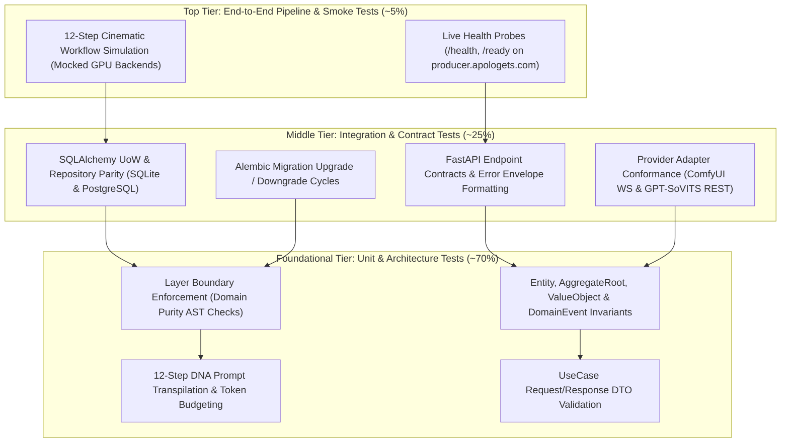

# Testing Strategy & Quality Assurance Framework - MovieAIProducer

- **Project:** MovieAIProducer
- **Document ID:** QA-0001
- **Domain:** Software Quality Assurance, Architectural Testing & Cinematic Verification
- **Version:** 2.0.0
- **Status:** Approved Production Specification
- **Baseline Test Suite Status:** **50/50 Tests Passing (100% Green)**
- **Test Runner:** `pytest` 9.2.0 with `anyio` on Python 3.14 / 3.11
- **Related Documents:** ARCHITECTURE.md, AI_PIPELINE.md, ERROR_HANDLING.md, ADR-0001, ADR-0010

---

## 1. Testing Philosophy & Core Principles

MovieAIProducer coordinates creative filmmaking intent, strict relational databases, and non-deterministic generative AI models. A bug in business logic could trigger hundreds of dollars in redundant GPU compute, while a flaw in continuity logic can produce jarring visual discrepancies across a 50-scene movie.

### Core Testing Invariants
1. **Deterministic Isolation:** Core domain logic, state machines, and prompt compilation engines are tested deterministically in pure memory without network access or live GPU dependencies.
2. **Architectural Purity Gates:** Architectural boundary rules (Domain must never import Infrastructure or API) are enforced automatically via AST import analysis tests (`tests/architecture/test_layer_boundaries.py`).
3. **Database Migration Reversibility:** Every Alembic schema migration must pass bidirectional upgrade and downgrade tests (`test_database_migrations.py`) before deployment.
4. **Mocked AI Provider Adapters:** External AI engines (ComfyUI, Google Veo, Kling, GPT-SoVITS, ElevenLabs) are verified through mocked contract adapters simulating network latency, streaming chunks, rate limits, and failure modes.
5. **Automated Film QC Verification:** Generated assets undergo quantitative automated scoring (CLIP score, InsightFace cosine similarity, audio SNR) before reaching human review.

---

## 2. The MovieAIProducer Testing Pyramid



---

## 3. Implemented Test Matrix (50 Passing Tests) `[IMPLEMENTED]`

The repository currently maintains 50 automated tests with 100% pass status across domain, application, infrastructure, and presentation layers:

| Test Suite File | Test Count | Layer | What is Verified | Code Reference |
| :--- | :---: | :--- | :--- | :--- |
| **`tests/architecture/test_layer_boundaries.py`** | 3 | Architecture | Domain layer imports no outer layers; Application imports no Infra/API; Infra imports no API | `backend/app/domain/`, `backend/app/application/` |
| **`tests/domain/test_primitives.py`** | 9 | Domain | `Entity` identity & timestamps; `AggregateRoot` event buffering/clearing; `ValueObject` immutability & hash; `DomainEvent` serializability | `backend/app/domain/common/` |
| **`tests/application/test_use_case.py`** | 4 | Application | `UseCase` abstract execution; input/output DTO validation; error propagation | `backend/app/application/common/` |
| **`tests/infrastructure/test_adapters.py`** | 4 | Infrastructure | `InMemoryEventBus` subscription/dispatch; `InMemoryUnitOfWork` lifecycle; `InMemoryRepository` CRUD | `backend/app/infrastructure/common/` |
| **`tests/infrastructure/test_database_engine.py`**| 4 | Infrastructure | `create_database_engine`, connection pooling, SQLite URL handling, async disposal | `backend/app/infrastructure/database/engine.py` |
| **`tests/infrastructure/test_database_repository.py`**| 6 | Infrastructure | `SqlAlchemyRepository` execution, entity mapping, query execution | `backend/app/infrastructure/database/repository.py` |
| **`tests/infrastructure/test_database_uow.py`** | 4 | Infrastructure | `SqlAlchemyUnitOfWork` commit/rollback context manager transactions | `backend/app/infrastructure/database/unit_of_work.py` |
| **`tests/infrastructure/test_database_migrations.py`**| 1 | Infrastructure | Alembic `0001_foundation` migration upgrade, schema validation, downgrade | `migrations/versions/0001_initial_database_foundation.py` |
| **`tests/test_health.py`** | 15 | Presentation | Liveness `/health`; Readiness `/ready` (DB & CAS checks); `RequestIDMiddleware` echoing; `TrustedHostMiddleware` filtering; global 500 error envelope | `backend/app/api/health.py`, `backend/app/main.py` |
| **Total** | **50** | **All Layers** | **Complete Foundation Baseline Verified** | **100% Passed (1.04s execution time)** |

---

## 4. Planned Testing Suites `[PLANNED]`

### 4.1 Master Production Bible (MPB) & DNA Locking Tests
- **Test File:** `tests/domain/test_master_production_bible.py`
- **Scope:**
  - Verifies that visual style codes (`#Style 01`–`#Style 18`) are mandatory before approval.
  - Validates that once an MPB is marked `is_locked = True`, any attempt to mutate character embeddings raises `InvariantViolationException`.
  - Tests revision branching, ensuring new versions copy all approved DNA elements with incremented version numbers.

### 4.2 12-Step Hollywood Prompt Compiler Tests
- **Test File:** `tests/application/test_prompt_compiler.py`
- **Scope:**
  - Tests compilation of `#Cam 01` to `#Cam 34`, `#Lens 01` to `#Lens 06`, and `#Light 01` to `#Light 14` into target syntax.
  - Verifies token count limits: ensures prompt length remains under target model context limits (e.g. CLIP 77 token limit, T5 512 token limit).
  - Validates negative prompt injection armor and XML tag isolation.

### 4.3 Dialogue Pacing & 5-Second Calibration Tests
- **Test File:** `tests/domain/test_dialogue_calibration.py`
- **Scope:**
  - Verifies word and syllable counting algorithms for English and Indonesian dialogue lines.
  - Validates that lines exceeding 14 words / 5.0 seconds trigger `DIALOGUE_PACING_OVERFLOW` rejections.
  - Tests J-Cut and L-Cut audio offset calculations.

### 4.4 AI Provider Adapter Conformance & Mock Tests
- **Test File:** `tests/infrastructure/test_provider_adapters.py`
- **Scope:**
  - **ComfyUI Local Adapter:** Simulates REST `POST /prompt` and WebSocket `/ws` event stream (`execution_start`, `progress`, `executed`), verifying proper asset ingestion into CAS.
  - **GPT-SoVITS Adapter:** Tests streaming chunk audio responses from `api_v2.py`, validating WAV headers, sample rates (24kHz/32kHz), and LUFS normalization.
  - **Circuit Breaker Tests:** Simulates 5 consecutive HTTP 504 errors from Kling/Veo, verifying state transition to `OPEN` and immediate failover to secondary tier.

### 4.5 Content-Addressable Storage (CAS) Integrity Tests
- **Test File:** `tests/infrastructure/test_asset_storage.py`
- **Scope:**
  - Tests SHA-256 calculation and path layout (`./data/assets/{sha[0:2]}/{sha[2:4]}/{sha}.{ext}`).
  - Tests deduplication: storing identical image buffers twice creates only one physical file on disk.
  - Verifies tamper detection: altering a byte in an asset raises `ASSET_CHECKSUM_MISMATCH`.

---

## 5. Execution Commands & Developer Workflow

### 5.1 Local Test Execution
```bash
# Run complete test suite with fast test runner
uv run pytest tests/

# Run with verbose output and coverage analysis
uv run pytest tests/ -v --cov=backend/app --cov-report=term-missing

# Run only architectural layer boundary tests
uv run pytest tests/architecture/test_layer_boundaries.py

# Run database persistence and migration tests
uv run pytest tests/infrastructure/test_database_*.py
```

### 5.2 Pre-Commit Automated Hooks
Prior to every commit, the following automated checks run:
1. **Linter / Formatter:** `ruff check . && ruff format --check .`
2. **Type Checker:** `mypy backend`
3. **Layer Boundary Check:** `pytest tests/architecture/test_layer_boundaries.py`
4. **Fast Unit Tests:** `pytest tests/domain/ tests/application/`

---

## 6. Continuous Integration (CI) Quality Gates

A pull request cannot merge into `main` unless:
- [x] All 50 baseline tests pass with zero failures.
- [x] Zero architectural layer violations detected.
- [x] Code coverage on domain entities remains `>= 90%`.
- [x] Alembic migration reversibility check passes (`upgrade head` -> `downgrade -1` -> `upgrade head`).
- [x] Liveness (`/health`) and Readiness (`/ready`) endpoints pass in the staging container.
