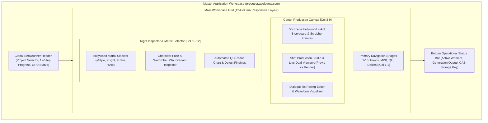
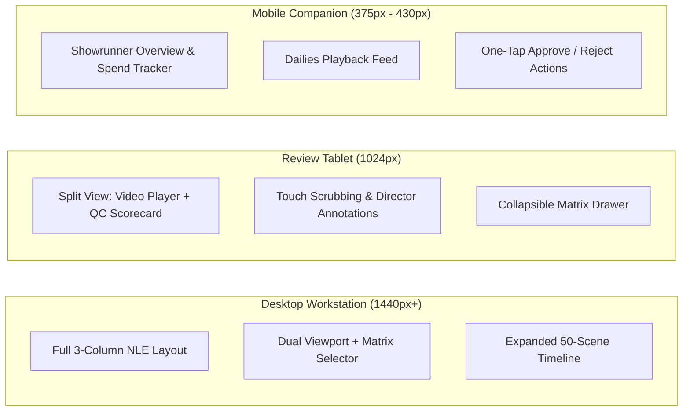

# UI/UX Production Blueprint & Design System - MovieAIProducer

- **Project:** MovieAIProducer
- **Document ID:** UIUX-0001
- **Domain:** User Interface, User Experience & Frontend Design System
- **Version:** 2.0.0
- **Status:** Approved Production Specification
- **Production Host:** `https://producer.apologets.com`
- **Frontend Stack:** Next.js 14+ (App Router), React 19, Tailwind CSS, Lucide Icons, Radix UI Primitives
- **Related Documents:** ARCHITECTURE.md, AI_PIPELINE.md, API_SPEC.md, ADR-0015 (Frontend Architecture)

---

## 1. Design Vision & Studio Philosophy

MovieAIProducer (`producer.apologets.com`) is a professional, studio-grade Non-Linear AI Film Production Environment. It abstracts generative AI complexity behind a tactile, director-centric interface inspired by DaVinci Resolve, Final Cut Pro, and Unreal Engine 5.

### Core UX Axioms

1. **Director-Centric & Visual-First:** Filmmakers think in lenses, lighting, framing, and emotional beats—not CFG scales, random seeds, or latent diffusion steps. The UI translates Hollywood cinematic vocabulary directly into backend prompt compilation graphs.
2. **Context Persistence & Zero Page Reloads:** A unified workspace keeps the active Project, 4-Act Storyboard, active Scene (1 of 50), and active Shot visible and navigable at all times.
3. **Deterministic State Feedback:** The UI never fakes progress. Status badges, progress bars, and node execution rings mirror real backend WebSocket events originating from ComfyUI and external provider adapters.
4. **Touch & Keyboard Ergonomics:** Full support for industry-standard NLE keyboard shortcuts (`J-K-L` shuttle scrubbing, `Space` preview playback, `A` approve shot, `R` reject/rework).

---

## 2. Design System & Token Specifications

The visual design language uses a **Cinematic Dark Slate & Neon Accent** aesthetic engineered for prolonged studio sessions in dimly lit editing bays.

### 2.1 Color Tokens

```text
+-----------------------------------------------------------------------------------------+
| Token Name             | Hex Code   | Semantic Role in Studio UI                        |
+-----------------------------------------------------------------------------------------+
| bg-canvas              | #020617    | Slate-950 deep canvas background                  |
| bg-surface             | #0f172a    | Slate-900 panels, card surfaces, sidebars         |
| bg-surface-elevated    | #1e293b    | Slate-800 modal dialogs, tooltips, hover states   |
| border-subtle          | #334155    | Slate-700 1px component borders and dividers       |
| border-focus           | #38bdf8    | Sky-400 active input focus outline                |
| text-primary           | #f8fafc    | Slate-50 high-contrast headings & screenplay text |
| text-secondary         | #94a3b8    | Slate-400 metadata, descriptions, sublabels       |
| text-muted             | #64748b    | Slate-500 disabled states, inactive matrix codes  |
| accent-cyan (Director) | #22d3ee    | Cyan-400 primary actions, camera controls         |
| accent-emerald (QC OK) | #34d399    | Emerald-400 approved shots, passing QC badges     |
| accent-amber (Warn)    | #fbbf24    | Amber-400 pending review, warnings, lighting codes|
| accent-violet (DNA)    | #a78bfa    | Violet-400 Master Production Bible, locked DNA    |
| accent-rose (Defect)   | #fb7185    | Rose-400 QC failures, rejected shots, errors      |
+-----------------------------------------------------------------------------------------+
```

### 2.2 Typography System

- **Cinematic Display Titles:** _Cinzel_ / _Playfair Display_ (Weight: 600, for film title, act transitions).
- **Interface & Screenplay Typography:** _Inter_ / _Plus Jakarta Sans_ (Weight: 400, 500, 600, clean legibility).
- **Technical Metrics & Matrix Codes:** _JetBrains Mono_ (Weight: 400, 500, for `#Style 08`, `#Light 03`, `#Lens 04`, frame numbers, timecodes `00:01:24:12`, and SHA-256 digests).

### 2.3 Elevation & Glassmorphism Tokens

- **Backdrop Blur:** `backdrop-blur-md` (`12px` gaussian blur) with `rgba(15, 23, 42, 0.75)` for floating floating inspectors and modal overlays.
- **Card Shadows:** `box-shadow: 0 4px 20px -2px rgba(0, 0, 0, 0.5)` with `1px solid rgba(51, 65, 85, 0.5)`.

---

## 3. Master Workspace Layout & Component Hierarchy



---

## 4. Key Component Architecture & Blueprint Specifications

### 4.1 Global Showrunner Header

- **Project Selector & Status:** Dropdown displaying current production title (`Chronicles of Nusantara 2099`), aspect ratio badge (`16:9`), and status (`IN_PRODUCTION`).
- **12-Step Cinematic Scrubber:** Horizontal interactive pill sequence highlighting completed steps in emerald, active step in cyan with pulsing glow, and upcoming steps in slate.
- **Worker & GPU Telemetry:** Live heartbeat indicator showing active ComfyUI workers, queue depth (`Queue: 2`), and current spend (`$14.20 / $50.00`).

### 4.2 The 50-Scene 4-Act Storyboard Canvas

- **Act Categorization:**
  - **Act I (Scenes 01–12):** Slate border header with gold accent (`The Setup & Catalyst`).
  - **Act II-A (Scenes 13–25):** Cyan border header (`Rising Action & Promise of Premise`).
  - **Act II-B (Scenes 26–38):** Violet border header (`Midpoint Shift & The Crisis`).
  - **Act III & IV (Scenes 39–50):** Rose border header (`Climax, Final Battle & Resolution`).
- **Scene Cards:** Displays Scene Number (e.g. `SCENE 14`), Slugline (`INT. CYBERPUNK LAB - NIGHT`), shot count (`4 Shots`), thumbnail preview, and status pill (`APPROVED` in green, `GENERATING` in pulsing amber, `PLANNED` in slate).
- **Drag-and-Drop Sequencing:** Direct reordering of shots with automatic duration re-calibration.

### 4.3 Matrix Selector UI Component

The Matrix Selector eliminates freeform prompt errors by providing an interactive visual picker:

```text
+------------------------------------------------------------------------------------+
| CINEMATOGRAPHY & LIGHTING MATRIX INSPECTOR                                         |
+------------------------------------------------------------------------------------+
| [ #Style ]  [ #Light ]  [ #Cam ]  [ #Lens ]  [ #Comp ]  [ #Act ]  [ #Speed ]       |
+------------------------------------------------------------------------------------+
| Selected: #Light 03 (Low-Key Chiaroscuro)                                          |
| Description: Harsh single directional key light, 8:1 contrast, deep black shadows   |
|                                                                                    |
| +------------------+  +------------------+  +------------------+  +--------------+ |
| | [Thumbnail]      |  | [Thumbnail]      |  | [Thumbnail]      |  | [Thumbnail]  | |
| | #Light 01        |  | #Light 02        |  | #Light 03 (ACTIVE|  | #Light 04    | |
| | Golden Hour      |  | God Rays Volum.  |  | Chiaroscuro      |  | Moonlit Blue | |
| +------------------+  +------------------+  +------------------+  +--------------+ |
|                                                                                    |
| Prompt Transpilation Preview:                                                      |
| "cinematic chiaroscuro lighting, hard key light with deep dramatic cast shadows,   |
|  high contrast ratio 8:1, Rembrandt lighting on cheekbone..."                      |
+------------------------------------------------------------------------------------+
```

### 4.4 Shot Detail Studio & Dual-Viewport

- **Left Viewport (Previs / Reference):** Displays locked Character Face DNA anchor, storyboard sketch, or previs frame.
- **Right Viewport (Rendered Video / Daily):** HTML5 video player with frame-accurate scrubbing, audio waveform, and J/L cut markers.
- **Live QC Overlay:** Toggleable heatmaps showing InsightFace facial alignment points and temporal flow vectors.

### 4.5 Dialogue Calibration & Waveform Visualizer

- **5-Second Hard Constraint:** Visual progress bar tracking word and syllable counts. Turns red if line exceeds 14 words (`5.0s`).
- **J/L-Cut Audio Handles:** Sliders adjusting audio lead (`-1.2s` J-cut) or audio overhang (`+1.0s` L-cut) over adjacent cuts.

---

## 5. Responsive Design & Multi-Device Strategy



1. **Desktop Workstation (`1440px` and wider):** The primary production canvas. Persistent 3-column layout displaying navigation, central canvas, and matrix inspector simultaneously.
2. **Review Tablet (`768px` to `1024px`):** Ideal for on-set review and showrunner dailies playback. Sidebars collapse into slide-over drawers; video viewport expands to touch-friendly full width.
3. **Mobile Companion (`375px` to `430px`):** Focused on executive monitoring. Displays real-time GPU queue progress, push notification alerts for completed scenes, and one-tap **Approve / Reject** buttons.

---

## 6. Keyboard Shortcuts & NLE Ergonomics

| Shortcut Key           | Action in Production Studio                             |
| :--------------------- | :------------------------------------------------------ |
| **`Space`**            | Play / Pause active shot video or audio preview         |
| **`J`**                | Shuttle backward (`-1x`, `-2x`, `-4x` speed)            |
| **`K`**                | Shuttle pause / stop                                    |
| **`L`**                | Shuttle forward (`1x`, `2x`, `4x` speed)                |
| **`[` / `]`**          | Jump to Previous / Next Shot in active scene            |
| **`Up` / `Down`**      | Jump to Previous / Next Scene in 50-scene timeline      |
| **`A`**                | Showrunner Quick-Approve active shot (locks into cut)   |
| **`R`**                | Quick-Reject active shot (opens rework dialogue prompt) |
| **`M`**                | Toggle Matrix Selector Inspector drawer                 |
| **`Q`**                | Toggle Automated QC Scorecard & Defect Overlay          |
| **`Cmd/Ctrl + Enter`** | Compile and Submit Generation Job to GPU Queue          |

---

## 7. Frontend Integration with Backend API

The frontend directly binds to the grounded backend contracts:

1. **Health Probes:** Periodic background polling of `/ready` to warn showrunners if database or CAS asset storage goes offline.
2. **Asynchronous Generation Jobs:** Submits generation commands to `POST /api/v1/shots/{id}/generate`, immediately receiving `202 Accepted` with `job_id`.
3. **WebSocket Event Stream:** Connects to `WS /api/v1/ws/projects/{id}/events` to update progress rings without HTTP polling.
4. **CAS Asset Streaming:** Media playback connects directly to `/api/v1/assets/{id}/stream` with HTTP Range headers supporting instant seeking.
