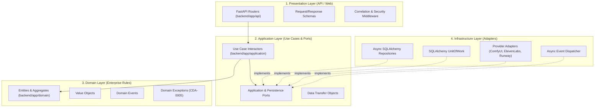
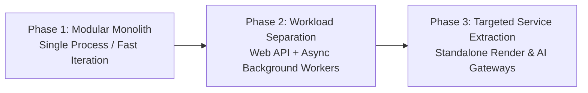

# ADR-0001: Architecture Style

> **Canonical Source**: This document is mirrored from the canonical version in `DECISIONS/`.

| Attribute            | Specification                                             |
| :------------------- | :-------------------------------------------------------- |
| **ADR ID**           | ADR-0001                                                  |
| **Title**            | Architecture Style: Modular Monolith + Clean Architecture |
| **Status**           | IMPLEMENTED                                               |
| **Date**             | 2026-11-19                                                |
| **Decision Owners**  | Project Architecture & Core Engineering Team              |
| **Decision Scope**   | Overall application architecture                          |
| **Version**          | 1.2                                                       |
| **Canonical Source** | `DECISIONS/ADR/ADR-0001-architecture-style.md`            |
| **Supersedes**       | None                                                      |
| **Superseded By**    | None                                                      |

---

## 1. Context

MovieAIProducer is a professional AI-powered film production platform designed to manage the complete filmmaking workflow, from creative development to final production and quality control.

The platform coordinates multiple complex domains, including:

- Creative brief and film strategy.
- Story architecture and screenplay.
- Character and environment development.
- Production design and continuity.
- Storyboard and previsualization.
- Cinematography and lighting.
- Performance, dialogue, and audio.
- AI provider orchestration.
- Scene execution and production tracking.
- Editorial planning and final quality control.

The platform must support multiple AI providers, asynchronous generation jobs, complex production assets, structured creative data, and long-running workflows.

The architecture must therefore provide:

1. Clear separation of business responsibilities.
2. Maintainable and testable modules.
3. Independent evolution of production domains.
4. Provider-independent AI integration.
5. Reliable data consistency and workflow execution.
6. A migration path toward distributed services when justified.
7. A practical implementation strategy for the MVP.

The initial architecture must avoid unnecessary operational complexity while preserving the ability to scale.

---

## 2. Problem Statement

Which architecture style should be adopted for MovieAIProducer?

The selected architecture must balance:

- Development speed.
- Architectural clarity.
- Long-term maintainability.
- Testing and reliability.
- Deployment simplicity.
- Scalability.
- Operational cost.
- Future extensibility.

Premature microservices could introduce distributed-system complexity before the product requires it.

A traditional monolith without enforced boundaries could create tightly coupled modules and make future changes increasingly expensive.

The architecture decision must address both risks.

---

## 3. Decision

Adopt a **Modular Monolith combined with Clean Architecture** (Hexagonal / Ports & Adapters) for the MVP and initial production releases.

The application will be deployed as one primary application system while its internal business domains remain modular and independently testable.

The architecture enforces:

- Domain-oriented modules.
- Explicit module ownership.
- Separation of business logic from infrastructure.
- Strict dependency inversion.
- Provider-independent integration contracts.
- Controlled inter-module communication.
- Independent testing of domain logic.
- Clear boundaries for future service extraction.

The architecture is not a commitment to remain monolithic forever. It establishes a controlled evolution path based on measurable requirements.

---

## 4. Architecture Principles

### 4.1 Modular Monolith

The application runs as a cohesive deployment unit initially, but its internal modules have explicit responsibilities. Each module owns its business rules and exposes controlled interfaces to other modules. Modules must not directly manipulate another module's internal implementation.

### 4.2 Clean Architecture

Each domain module strictly follows the dependency inversion direction:

$$\text{Presentation / Infrastructure} \longrightarrow \text{Application} \longrightarrow \text{Domain}$$

- **Domain** contains business entities, rules, and domain contracts.
- **Application** contains use cases, DTOs, and port interfaces.
- **Infrastructure** implements persistence, external APIs, queues, and technical integrations.
- **Presentation (API)** exposes HTTP endpoints and user-facing schemas.

Dependencies point strictly inward toward business rules. Domain logic does not depend on FastAPI, React, SQLite/PostgreSQL drivers, AI provider SDKs, or deployment infrastructure.

### 4.3 Separation of Concerns

Each component has one clearly defined responsibility. Business rules, workflow coordination, external integrations, persistence, and user interface logic remain separated.

### 4.4 Explicit Contracts

Modules communicate through documented interfaces, application services, or domain events. Direct access to another module's private repositories, tables, or internal services is prohibited.

### 4.5 Provider Independence

AI provider integrations are isolated behind provider adapters and normalized contracts (see [ADR-0003](ADR-0003.md)). Core business logic never depends on any single vendor's SDK or proprietary payload format.

### 4.6 Testability

Domain and application logic must be testable without requiring live AI provider calls, production databases, external network access, a running frontend, or cloud infrastructure.

---

## 5. Architecture Options Considered

### Option A: Traditional Monolith

All application components are developed in one codebase with limited or informal internal boundaries.

- **Advantages:** Simple initial deployment; low operational overhead; fast initial prototyping.
- **Disadvantages:** High risk of tight coupling; unclear module ownership; difficult independent testing; high regression risk; difficult future extraction.
- **Assessment:** **Rejected.** MovieAIProducer has multiple complex production domains requiring strict internal boundaries.

### Option B: Microservices

Each major business domain operates as an independently deployed service.

- **Advantages:** Independent deployment; independent scaling; clear service ownership; technology flexibility.
- **Disadvantages:** Distributed data consistency; network failure handling; service discovery and communication overhead; complex observability; increased infrastructure and operational cost.
- **Assessment:** **Rejected for MVP.** Current operational requirements do not justify distributed operational complexity.

### Option C: Modular Monolith + Clean Architecture

One primary application deployment with independently structured business modules and enforced dependency boundaries.

- **Advantages:** Simpler deployment than microservices; strong internal separation; clear domain ownership; easy unit and integration testing; low operational overhead; clear future extraction path.
- **Disadvantages:** Requires architectural discipline; module boundaries must be actively enforced via tests.
- **Assessment:** **Selected.** Provides the optimal balance between rapid delivery and long-term architectural integrity.

---

## 6. Logical Architecture & Layer Hierarchy

### Layer Responsibilities

1. **Presentation Layer (`backend/app/api`):**
   - HTTP API routes (FastAPI), request validation, response serialization, correlation headers (`X-Correlation-ID`).
   - Must not contain business rules or direct database queries.

2. **Application Layer (`backend/app/application`):**
   - Use cases, orchestrators, transaction boundaries (Unit of Work), application DTOs, and port interfaces.
   - Coordinates domain behavior without knowing persistence or framework implementation details.

3. **Domain Layer (`backend/app/domain`):**
   - Pure business entities, value objects, domain events, domain exceptions (CDA-0005), and aggregate invariants.
   - Zero external framework dependencies; pure Python 3.12+ code.

4. **Infrastructure Layer (`backend/app/infrastructure`):**
   - Database engines, SQLite/aiosqlite WAL connections, SQLAlchemy ORM mappings, repository implementations, external AI provider adapters, event dispatchers.
   - Implements ports defined by the application and domain layers.

---

## 7. Domain Module Boundaries

The canonical domain module boundaries are:

| Module                      | Primary Responsibility                                                   | Target Bounded Context     |
| :-------------------------- | :----------------------------------------------------------------------- | :------------------------- |
| **Creative Brief**          | Project objectives, target audience, themes, and creative guidelines     | `domain/creative_brief`    |
| **Story & Screenplay**      | Narrative architecture, scene breakdown, beats, and dialogue             | `domain/screenplay`        |
| **Character Casting**       | Character visual DNA, psychological profile, voice models, wardrobe      | `domain/character`         |
| **Production Design**       | World building, environments, props, architecture, style bible           | `domain/production_design` |
| **Previsualization**        | Storyboard keyframes, shot list, camera blocking, animatic               | `domain/previs`            |
| **Cinematography & Light**  | Shot framing, lenses, camera movement, 14 lighting styles (#Light 01-14) | `domain/cinematography`    |
| **Audio & Performance**     | Voice synthesis, dialogue timing, Foley, ambient score, acting cues      | `domain/audio`             |
| **Master Production Bible** | Canonical approved creative specifications and immutable snapshots       | `domain/mpb`               |
| **Continuity Engine**       | Multi-shot visual & narrative lock validation, CLIP consistency          | `domain/continuity`        |
| **AI Orchestration**        | Provider routing, prompt compiling, generation dispatch, fallbacks       | `domain/orchestration`     |
| **Production Workflow**     | 16-stage pipeline execution, step dependencies, human approvals          | `domain/workflow`          |
| **Quality Control (QC)**    | Multi-tier automated scoring, cinematic gates, compliance signoff        | `domain/qc`                |
| **Asset Management**        | Versioned media files, hashes, derivatives, storage references           | `domain/asset`             |
| **Identity & Security**     | User authentication, RBAC, tenant isolation, audit trails                | `domain/identity`          |

---

## 8. Module Communication Rules

Modules interact strictly through approved mechanisms:

1. **Public Application Ports**: Interactors call use case ports exposed by neighboring modules.
2. **Domain Events**: Modules publish immutable `DomainEvent` instances across the `EventDispatcher` port for decoupled asynchronous notifications.
3. **Explicit Query Contracts**: Read-only queries pass through explicit DTO interfaces.

Prohibitions:

- No circular dependencies between packages.
- No direct access to internal repository implementations or raw database tables of another module.
- No importing infrastructure adapters inside domain or application layers.
- Boundary enforcement is verified via automated tests (`tests/architecture/test_layer_boundaries.py`).

---

## 9. Data Ownership and Consistency

- Each domain module strictly owns its entities and transactional invariants.
- Modules share a single relational database for the MVP (SQLite in WAL mode for development, PostgreSQL target for production) coordinated via the `UnitOfWork` pattern.
- Long-running AI generation jobs never hold database transactions open.
- The Master Production Bible (MPB) acts as the immutable single source of truth for approved creative specifications (see [ADR-0004](ADR-0004.md)).

---

## 10. Scalability & Service Extraction Roadmap

### Extraction Criteria

A domain module will only be extracted into an independent microservice if at least one operational condition is satisfied:

1. **Disproportionate Compute**: AI rendering or video generation requires dedicated GPU nodes or autoscaling independent of API traffic.
2. **Distinct Lifecycle**: An integration module requires zero-downtime canary deployments independent of core business rules.
3. **Security Boundary**: Credential management or asset rendering requires isolated network VPC boundaries.

---

## 11. Security and Reliability Requirements

The architecture mandates:

- Authentication & authorization at application ingress (JWT Bearer tokens, RBAC).
- Secure credential injection via environment variables (`pydantic-settings`).
- Complete traceability with correlation IDs (`X-Correlation-ID`) across every request, log, and job.
- Idempotency for asynchronous task retries.
- Circuit breakers and timeouts for all external AI provider calls.

---

## 12. Consequences & Trade-offs

### Positive Consequences

- Strict decoupling allows independent domain testing and parallel feature development.
- Zero premature microservice overhead (no distributed tracing overhead, network latency, or split-brain states).
- Fast local development with `uv` and automated test suite.
- Clean migration path to distributed workers when workload scales.

### Negative Consequences

- Developers must maintain architectural discipline and observe layer boundaries.
- Boundary violations must be actively caught by architecture tests.

---

## 13. Risks and Mitigations

| Risk                         | Impact   | Mitigation Strategy                                                                              |
| :--------------------------- | :------- | :----------------------------------------------------------------------------------------------- |
| **Layer Boundary Erosion**   | High     | Enforce automated AST/import layer tests in `tests/architecture/test_layer_boundaries.py` in CI. |
| **Shared Database Coupling** | Medium   | Isolate module schemas; enforce access strictly through domain repositories and UnitOfWork.      |
| **Provider SDK Lock-in**     | High     | Enforce Provider Adapter Pattern; domain interacts only with abstract ports.                     |
| **Blocking API Threads**     | Critical | Offload all AI generation and media processing to async workers via background event dispatcher. |

---

## 14. Implementation & Verification Status

### Status: IMPLEMENTED

The core foundations of ADR-0001 have been implemented and verified in the codebase:

- [x] **Layer Separation**: `backend/app/domain/`, `backend/app/application/`, `backend/app/infrastructure/`, `backend/app/core/`, and `backend/app/api/` established.
- [x] **Framework Independence**: Domain primitives (`Entity`, `ValueObject`, `DomainEvent`, `BaseRepository`) have zero external third-party dependencies.
- [x] **Automated Architecture Tests**: Layer boundaries verified in `tests/architecture/test_layer_boundaries.py`.
- [x] **Database Abstraction**: Async SQLAlchemy 2.0 engine, custom `UTCDateTime`, and `UnitOfWork` implemented in `backend/app/infrastructure/database/`.
- [x] **Passing Test Suite**: 50 automated tests executing and passing with `uv run pytest`.

---

## 15. Related Documents

- [README.md](../../README.md)
- [ARCHITECTURE.md](../../ARCHITECTURE.md)
- [ADR-0002: Application Structure](ADR-0002.md)
- [ADR-0003: Provider Adapter System](ADR-0003.md)
- [ADR-0006: Data Storage Strategy](ADR-0006.md)
- [CDA-0002: Canonical Glossary & Domain Ownership Matrix](../CDA/CDA-0002.md)
- [CDA-0005: Canonical Error & Failure Contract Registry](../CDA/CDA-0005.md)
