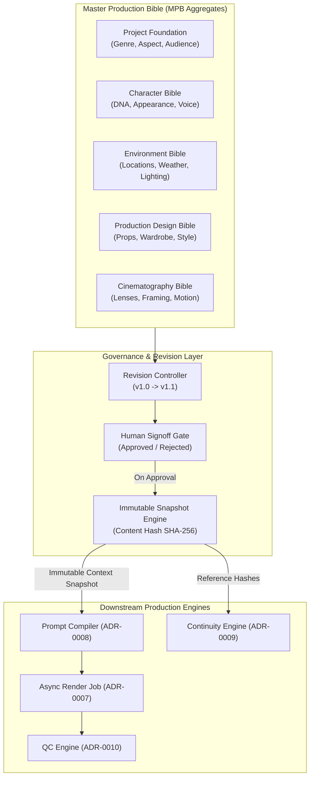

# ADR-0004: Master Production Bible as the Single Source of Truth

> **Canonical Source**: This document is mirrored from the canonical version in `DECISIONS/`.

| Attribute            | Specification                                               |
| :------------------- | :---------------------------------------------------------- |
| **ADR ID**           | ADR-0004                                                    |
| **Title**            | Master Production Bible (MPB) as the Single Source of Truth |
| **Status**           | ACCEPTED                                                    |
| **Date**             | 2026-11-19                                                  |
| **Decision Owners**  | Project Architecture & Creative Engineering Team            |
| **Decision Scope**   | Canonical creative and production data governance           |
| **Version**          | 1.2                                                         |
| **Canonical Source** | `DECISIONS/ADR/ADR-0004-master-production-bible.md`         |
| **Supersedes**       | None                                                        |
| **Superseded By**    | None                                                        |

---

## 1. Context

MovieAIProducer coordinates a complete AI-assisted filmmaking workflow. A single feature or short film project contains hundreds of deeply interconnected production specifications:

- Creative brief, target audience, and emotional direction.
- Screenplay, story structure, scene breakdowns, and character dialogue.
- Character visual DNA, psychological profiles, voice models, and wardrobe.
- Environment keys, architectural styles, weather conditions, and spatial layouts.
- Props, materials, and asset state progressions.
- Cinematography, camera packages, lenses, aspect ratios, and blocking.
- Lighting designs (#Light 01-14) and color palettes.
- Performance, acting tags (#Act 01-24), dialogue delivery, and audio cues.
- Scene continuity, multi-shot locks, and Quality Control (QC) thresholds.

These specifications are tightly coupled: modifying a character's wardrobe in Act 1 invalidates subsequent shot prompts, reference images, generated video renders, and continuity verification.

Without a canonical Single Source of Truth (SSOT), autonomous AI agents and decoupled pipeline stages inevitably generate drifting, contradictory versions of creative assets.

---

## 2. Problem Statement

How should MovieAIProducer govern creative and production decisions across all pipeline stages to ensure:

1. A single authoritative source for approved production specifications.
2. Structured relationships across domain aggregates without monolithic JSON blobs.
3. Strict revision history and auditable change control.
4. Complete provenance from creative decisions to generated media assets.
5. Invariable consistency across scenes, shots, and iterations.
6. Guardrails preventing autonomous AI agents from silently mutating approved specifications.
7. Reproducible render execution through immutable production snapshots.

---

## 3. Decision

Adopt the **Master Production Bible (MPB)** as the canonical **Single Source of Truth (SSOT)** for all creative and technical production specifications.

1. **Logical Aggregate**: The MPB coordinates domain-owned aggregates (Character, Environment, Cinematography, etc.) into an integrated production manifest.
2. **Authoritative Approval**: Only specifications marked `APPROVED` are authoritative for generation jobs. Drafts, proposals, and variations are strictly isolated.
3. **AI Proposal Boundary**: AI agents may propose revisions, identify inconsistencies, and suggest alternatives, but cannot mutate approved MPB specifications without human review or explicit rule-based approval gates.
4. **Immutable Snapshots**: Before any production generation job executes, the platform captures an immutable, content-hashed snapshot of the relevant MPB context. Downstream render jobs reference this immutable snapshot ID.

---

## 4. Architecture & Snapshot Lifecycle

---

## 5. Domain Ownership Matrix

The MPB integrates specifications from dedicated domain owners:

| Production Domain     | Canonical Ownership     | Primary Specifications Managed                                    |
| :-------------------- | :---------------------- | :---------------------------------------------------------------- |
| **Creative Brief**    | Project Leadership      | Creative premise, genre, audience, emotion, aspect ratio          |
| **Story & Script**    | Screenplay Engine       | Narrative beats, scenes, dialogues, sluglines, transitions        |
| **Character Casting** | Character Engine        | Visual DNA, facial features, voice model ID, wardrobe states      |
| **Production Design** | Environment Engine      | Locations, architecture, geography, weather, props                |
| **Wardrobe & Makeup** | Wardrobe Engine         | Costume specs, damage progression, continuity attachments         |
| **Cinematography**    | Camera Engine           | Lens choice (35mm/50mm), sensor format, shot sizes, camera motion |
| **Lighting**          | Lighting Engine         | 14 lighting styles (#Light 01-14), key/fill ratios, color temp    |
| **Audio & Acting**    | Performance Engine      | Acting cues (#Act 01-24), prosody, dialogue timing, Foley         |
| **Workflow Engine**   | Production Orchestrator | Stage lifecycle, task execution, approval state transitions       |
| **Continuity**        | Continuity Engine       | Cross-shot visual locks, CLIP embedding validation                |
| **Quality Control**   | QC Engine               | Automated gate scores, defect detection, final signoff            |
| **Asset Management**  | Storage Engine          | Media URIs, SHA-256 checksums, storage tiers                      |

---

## 6. MPB Revisioning & Snapshot Invariants

### 6.1 Revision Model

Every change to an approved specification produces a versioned revision:

- `revision_id`: UUIDv4
- `entity_type`: Character, Location, Scene, etc.
- `version_major_minor`: Semantic counter (e.g., 2.1)
- `change_summary`: Explicit description of changes
- `author_id`: Actor identity (human user or AI agent)
- `approval_state`: `DRAFT`, `PENDING_REVIEW`, `APPROVED`, `REJECTED`, `SUPERSEDED`

### 6.2 Immutable Production Snapshots

When a scene or shot is dispatched for rendering:

1. The orchestrator resolves all active, approved revisions for the scene's characters, location, lighting, camera, and wardrobe.
2. The resolved state is frozen into an immutable JSON document stored with a SHA-256 checksum.
3. If an MPB specification is later modified to revision 2.2, previous renders remain strictly bound to revision 2.1 snapshot.

---

## 7. Consequences & Trade-offs

### Positive Consequences

- Guarantees creative continuity across multi-scene, multi-shot feature production.
- Prevents accidental overwrite of approved director intent by AI tools.
- Render provenance: Every MP4 or WAV file can be traced back to the exact character DNA and lighting prompt used to create it.
- Enables deterministic re-renders.

### Accepted Trade-offs

- Requires structured approval workflows rather than immediate unversioned editing.
- Storage overhead for maintaining immutable historical snapshots (mitigated by JSON deduplication).

---

## 8. Implementation Status: ACCEPTED

- Domain entity primitives (`Entity`, `ValueObject`, `DomainEvent`) established in `backend/app/domain/common/`.
- Full MPB aggregate models and revision snapshot schema scheduled for implementation in Phase 4 (Task 014-017).

---

## 9. Related Documents

- [ARCHITECTURE.md](../../ARCHITECTURE.md)
- [DATA_MODEL.md](../../DATA_MODEL.md)
- [ADR-0001: Architecture Style](ADR-0001.md)
- [ADR-0005: Production Workflow Engine](ADR-0005.md)
- [ADR-0008: Prompt Compilation Engine](ADR-0008.md)
- [ADR-0009: Continuity Engine](ADR-0009.md)
- [CDA-0002: Canonical Glossary & Domain Ownership Matrix](../CDA/CDA-0002.md)
- [CDA-0003: Canonical Lifecycle & State Transition Matrix](../CDA/CDA-0003.md)
