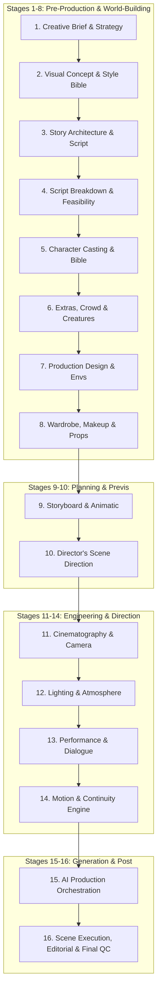

# ADR-0005: Production Workflow Engine

> **Canonical Source**: This document is mirrored from the canonical version in `DECISIONS/`.

| Attribute            | Specification                                                            |
| :------------------- | :----------------------------------------------------------------------- |
| **ADR ID**           | ADR-0005                                                                 |
| **Title**            | Production Workflow Engine: Directed Acyclic Graph (DAG) & State Machine |
| **Status**           | ACCEPTED                                                                 |
| **Date**             | 2026-11-19                                                               |
| **Decision Owners**  | Project Architecture & Workflow Orchestration Team                       |
| **Decision Scope**   | Production lifecycle orchestration and execution management              |
| **Version**          | 1.2                                                                      |
| **Canonical Source** | `DECISIONS/ADR/ADR-0005-production-workflow-engine.md`                   |
| **Supersedes**       | None                                                                     |
| **Superseded By**    | None                                                                     |

---

## 1. Context

MovieAIProducer coordinates a professional multi-stage AI-assisted filmmaking lifecycle structured into **16 operational stages**:

1. **Creative Brief & Film Strategy**: Commercial intent, audience demographics, genre, themes.
2. **Visual Concept & Style Bible**: Visual tone, aesthetic DNA, color palettes (#Style 01-18).
3. **Story Architecture & Screenplay**: 3-act / 8-sequence structure, character arcs, dialogue.
4. **Script Breakdown & Production Feasibility**: Scene sluglines, asset requirements, cost estimates.
5. **Character Casting & Character Bible**: Face visual DNA, voice profiles, physical features.
6. **Extras, Crowd & Creature Design**: Background character palettes, creature topologies.
7. **Production Design & Environment Bible**: Set locations, architecture, geographic layouts.
8. **Wardrobe, Makeup & Prosthetics Bible**: Costume specifications, aging, battle damage progression.
9. **Storyboard, Animatic & Previsualization**: 2D/3D panels, camera framing, timing animatic.
10. **Director's Scene Direction**: Subtext, pacing, dramatic beats, performance objectives.
11. **Cinematography & Camera Engineering**: Lenses (anamorphic/spherical), sensor format, camera movements.
12. **Lighting & Atmospheric Engineering**: 14 lighting paradigms (#Light 01-14), volumetric fog, color temperature.
13. **Performance, Dialogue & Voice Direction**: Acting tags (#Act 01-24), voice cadence, dialogue delivery.
14. **Motion, Physics & Continuity Engineering**: Character blocking, physics constraints, multi-shot locks.
15. **AI Production Orchestration**: Generation dispatch across ComfyUI, Runway, ElevenLabs, and video engines.
16. **Scene Execution, Editorial & Final QC**: Lossless stitching, color grading, audio mixing, 4-tier QC signoff.

These stages involve complex dependencies: some are sequential, while others operate concurrently across independent scenes. A naive linear pipeline cannot represent these relationships.

---

## 2. Problem Statement

How should MovieAIProducer coordinate multi-level production workflows while guaranteeing:

1. Deterministic dependency resolution across projects, stages, scenes, shots, and tasks.
2. Safe parallel execution of independent scenes.
3. Rigid human approval gates between critical creative milestones.
4. Transparent allocation of tasks between autonomous AI agents and human creators.
5. Resilient recovery from interrupted or failed long-running generation jobs.
6. Cascade invalidation: automatically flagging downstream shots when an upstream script revision occurs.
7. Strict alignment with the canonical state lifecycle matrix defined in [CDA-0003](../CDA/CDA-0003.md).

---

## 3. Decision

Adopt a **Persistent, Dependency-Aware Production Workflow Engine** utilizing Directed Acyclic Graphs (DAG), explicit state machines, and event-driven coordination.

1. **Hierarchical Orchestration**: The engine manages workflows at four nested granularities: Project $\rightarrow$ Stage $\rightarrow$ Scene $\rightarrow$ Shot $\rightarrow$ Task.
2. **Deterministic State Transitions**: State transitions are strictly validated against [CDA-0003](../CDA/CDA-0003.md). Unregistered or illegal transitions throw `InvalidStateTransitionException`.
3. **Approval Gate Decoupling**: AI agents may mark tasks as `AWAITING_APPROVAL`, but stage progression to `COMPLETED` requires human signoff or explicit policy-based gate passage.
4. **Engine Independence**: Workflow scheduling is decoupled from external generation tools; task execution delegates to the Provider Adapter System ([ADR-0003](ADR-0003.md)) via async background jobs ([ADR-0007](ADR-0007.md)).

---

## 4. 16-Stage Hollywood Pipeline Architecture

---

## 5. Workflow State Machine Lifecycle

Conforming to [CDA-0003](../CDA/CDA-0003.md), every stage and task adheres to the following deterministic lifecycle:

```mermaid
stateDiagram-v2
    [*] --> NOT_STARTED
    NOT_STARTED --> READY: Upstream prerequisites satisfied
    READY --> IN_PROGRESS: Task execution dispatched
    IN_PROGRESS --> PAUSED: Paused by user or rate limit
    PAUSED --> IN_PROGRESS: Resumed
    IN_PROGRESS --> AWAITING_APPROVAL: Work completed; submitted to gate
    AWAITING_APPROVAL --> COMPLETED: Authorized human signoff
    AWAITING_APPROVAL --> IN_PROGRESS: Changes requested / rejected
    IN_PROGRESS --> FAILED: Unrecoverable execution error
    FAILED --> READY: Retried after remediation
    COMPLETED --> [*]
```

### State Definitions

| State                 | Semantic Meaning                                     | Allowed Next States                                               |
| :-------------------- | :--------------------------------------------------- | :---------------------------------------------------------------- |
| **NOT_STARTED**       | Prerequisite tasks or upstream stages are incomplete | `READY`, `CANCELLED`                                              |
| **READY**             | All dependency constraints satisfied; ready to run   | `IN_PROGRESS`, `CANCELLED`                                        |
| **IN_PROGRESS**       | Actively processing in worker, agent, or provider    | `PAUSED`, `AWAITING_APPROVAL`, `COMPLETED`, `FAILED`, `CANCELLED` |
| **PAUSED**            | Temporarily halted without loss of state             | `IN_PROGRESS`, `CANCELLED`                                        |
| **AWAITING_APPROVAL** | Generated assets or specs waiting for human signoff  | `COMPLETED`, `IN_PROGRESS` (rework), `REJECTED`                   |
| **COMPLETED**         | Verification passed and signoff granted              | `ARCHIVED`, `SUPERSEDED`                                          |
| **FAILED**            | Terminal execution failure; awaiting intervention    | `READY` (retry), `CANCELLED`                                      |
| **CANCELLED**         | Cancelled by user or pipeline abort                  | `ARCHIVED`                                                        |

---

## 6. Hollywood 16 Operational Stages Matrix

| Stage  | Name                            | Key Inputs           | Primary Deliverables                                   |   Human Signoff Required?    |
| :----: | :------------------------------ | :------------------- | :----------------------------------------------------- | :--------------------------: |
| **1**  | Creative Brief & Film Strategy  | Pitch, Market Data   | Creative brief manifest, premise, target audience      |        Yes (Producer)        |
| **2**  | Visual Concept & Style Bible    | Creative brief       | #Style 01-18 visual codes, moodboards, color palette   |      Yes (Art Director)      |
| **3**  | Story Architecture & Screenplay | Beat sheet           | Screenplay draft, sluglines, dialogue, scene beats     |      Yes (Lead Writer)       |
| **4**  | Script Breakdown & Feasibility  | Approved screenplay  | Scene breakdown sheets, budget & token estimates       |        Yes (Producer)        |
| **5**  | Character Casting & Bible       | Character breakdowns | Visual DNA, portrait renders, voice models             |        Yes (Director)        |
| **6**  | Extras, Crowd & Creature Design | Scene requirements   | Secondary character specs, creature visual keys        |           Optional           |
| **7**  | Production Design & Envs        | Scene sluglines      | Location architectural keys, floor plans, 3D mats      |  Yes (Production Designer)   |
| **8**  | Wardrobe, Makeup & Props        | Character states     | Costume continuity sheets, prop models                 |    Yes (Costume Designer)    |
| **9**  | Storyboard & Animatic           | Script breakdown     | 2D/3D storyboard frames, timed animatic video          |        Yes (Director)        |
| **10** | Director's Scene Direction      | Animatic, Script     | Subtext notes, dramatic tempo, actor cues              |        Yes (Director)        |
| **11** | Cinematography & Camera         | Shot list            | Lens focal lengths, sensor profiles, camera paths      |           Yes (DP)           |
| **12** | Lighting & Atmosphere           | Location layout      | #Light 01-14 lighting schematics, key/fill ratios      |       Yes (Gaffer/DP)        |
| **13** | Performance & Dialogue          | Voice models, Lines  | Synthesized dialogue stems, #Act 01-24 acting passes   |    Yes (Sound Supervisor)    |
| **14** | Motion & Continuity Engine      | Character & Env keys | Motion vectors, facial/costume continuity locks        |          Automated           |
| **15** | AI Production Orchestration     | Compiled prompts     | Raw video/image shot renders from AI engines           |          Automated           |
| **16** | Scene Execution, Editorial & QC | Shot renders, Audio  | Conformed scene edit, 4-tier QC signoff, master export | Yes (Lead Editor / Director) |

---

## 7. Consequences & Trade-offs

### Positive Consequences

- Guarantees systematic execution of complex Hollywood-grade productions.
- Full parallelization of scene rendering while maintaining global narrative dependencies.
- Immediate visibility into project progress, bottlenecks, and costs.
- Enforces strict human governance at artistic milestone gates.

### Accepted Trade-offs

- Increased orchestration overhead: Task state, dependency resolution, and event logging must be persisted.
- Strict gating prevents skipping mandatory pre-production steps without explicit managerial override.

---

## 8. Implementation Status: ACCEPTED

- State machine transition rules codified in [CDA-0003](../CDA/CDA-0003.md).
- Event dispatcher foundation established in `backend/app/infrastructure/common/event_bus.py`.
- Workflow engine aggregate models and DAG runner scheduled for implementation in Phase 2 / Phase 8.

---

## 9. Related Documents

- [ARCHITECTURE.md](../../ARCHITECTURE.md)
- [AI_PIPELINE.md](../../AI_PIPELINE.md)
- [ADR-0001: Architecture Style](ADR-0001.md)
- [ADR-0004: Master Production Bible](ADR-0004.md)
- [ADR-0007: Async Job Processing](ADR-0007.md)
- [ADR-0010: Quality Control Engine](ADR-0010.md)
- [CDA-0003: Canonical Lifecycle & State Transition Matrix](../CDA/CDA-0003.md)
- [CDA-0004: Canonical Event & Integration Contract Registry](../CDA/CDA-0004.md)
