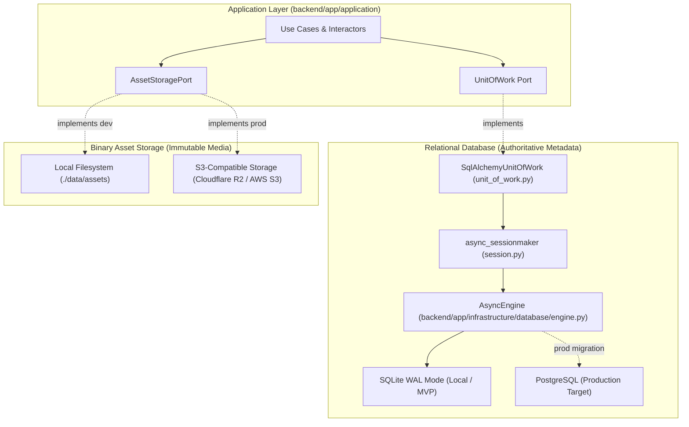
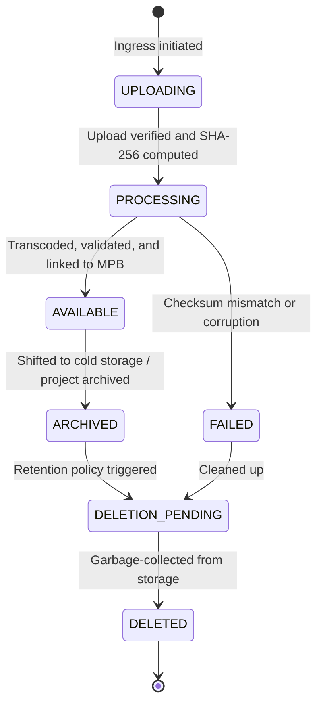

# ADR-0006: Data Storage Strategy

> **Canonical Source**: This document is mirrored from the canonical version in `DECISIONS/`.

| Attribute            | Specification                                                                                     |
| :------------------- | :------------------------------------------------------------------------------------------------ |
| **ADR ID**           | ADR-0006                                                                                          |
| **Title**            | Data Storage Strategy: Hybrid Storage Architecture (Async SQLAlchemy, SQLite WAL, Object Storage) |
| **Status**           | IMPLEMENTED                                                                                       |
| **Date**             | 2026-11-19                                                                                        |
| **Decision Owners**  | Project Architecture & Data Engineering Team                                                      |
| **Decision Scope**   | Persistence, relational database, binary media storage, and transactions                          |
| **Version**          | 1.2                                                                                               |
| **Canonical Source** | `DECISIONS/ADR/ADR-0006-data-storage-strategy.md`                                                 |
| **Supersedes**       | None                                                                                              |
| **Superseded By**    | None                                                                                              |

---

## 1. Context

MovieAIProducer manages diverse categories of production data with vastly different access patterns, volume characteristics, and consistency requirements:

1. **Transactional Business Data**: User accounts, tenant isolation, project memberships, permissions, system settings.
2. **Creative Domain Data**: Screenplay breakdowns, scene beats, character DNA, location specs, props, wardrobe continuity.
3. **Master Production Bible (MPB)**: Canonical approved specifications, versioned revisions, immutable context snapshots.
4. **Production Workflow State**: 16-stage pipeline progress, task execution graphs, DAG dependencies, human approval gates.
5. **AI Orchestration Records**: Generation prompts, model routing decisions, token usage, execution latency, provider errors.
6. **Binary Media Assets**: Concept images, character portraits, audio stems, video shot renders, video timelines.
7. **Audit & Traceability Logs**: Actor-attributed mutations, cryptographic checksums, correlation IDs (`X-Correlation-ID`).

Storing high-bandwidth binary media inside the transactional database causes rapid database bloat, degrades query performance, and complicates backups. Conversely, storing transactional metadata strictly on filesystems lacks relational integrity and ACID guarantees.

---

## 2. Problem Statement

What data storage strategy should MovieAIProducer adopt to satisfy:

1. Strict ACID consistency for business, workflow, and MPB revisions.
2. High-performance, scalable binary asset storage for multi-gigabyte video and audio streams.
3. Seamless developer experience with zero-friction local development (no mandatory Docker or heavy database setup for local dev).
4. Resilient database concurrency without write lockouts.
5. Clean migration path from MVP local development to multi-node production deployment.
6. Absolute decoupling of domain logic from concrete database drivers and vendors.

---

## 3. Decision

Adopt a **Hybrid Storage Architecture** combining an **Asynchronous Relational Database** for transactional metadata with an **Abstracted Object / File Storage Service** for binary assets.

### 3.1 Relational Storage Strategy

- **ORM & Driver**: SQLAlchemy 2.0 with asynchronous I/O (`sqlalchemy.ext.asyncio`).
- **Development & Single-Node Deployment**: SQLite with `aiosqlite` and mandatory Write-Ahead Logging (`PRAGMA journal_mode=WAL;`), busy timeout (`PRAGMA busy_timeout=5000;`), and normal synchronous mode (`PRAGMA synchronous=NORMAL;`).
- **Production Target**: PostgreSQL (`asyncpg`) without domain code alteration, enabled entirely through environment configuration (`DATABASE_URL`).
- **Schema Migrations**: Managed exclusively via Alembic (`migrations/`) with async runtime execution.
- **Transaction Management**: Handled via the `UnitOfWork` pattern (`backend/app/infrastructure/database/unit_of_work.py`).

### 3.2 Binary Media Storage Strategy

- **Abstraction**: `AssetStoragePort` interface decoupling storage consumers from storage targets.
- **Local Development**: Filesystem storage rooted in `./data/assets/`.
- **Production Target**: S3-compatible object storage (AWS S3, Cloudflare R2, MinIO).
- **Referential Invariant**: Relational database stores authoritative media metadata (URI, MIME type, size, SHA-256 checksum); the storage service stores immutable binary bytes.

---

## 4. Logical Storage Architecture



---

## 5. Implementation Grounding in Backend Codebase

The architecture specified in ADR-0006 is actively implemented and verified in `backend/app/infrastructure/database/`:

### 5.1 Async Engine with WAL Pragma Configuration

File: `backend/app/infrastructure/database/engine.py`

```python
# Enforces WAL mode and foreign key constraints on SQLite connections
@event.listens_for(engine.sync_engine, "connect")
def _set_sqlite_pragmas(dbapi_connection, connection_record):
    cursor = dbapi_connection.cursor()
    cursor.execute("PRAGMA journal_mode=WAL")
    cursor.execute("PRAGMA synchronous=NORMAL")
    cursor.execute("PRAGMA busy_timeout=5000")
    cursor.execute("PRAGMA foreign_keys=ON")
    cursor.close()
```

### 5.2 Custom UTC DateTime Mapping

File: `backend/app/infrastructure/database/types.py`

- Implements `UTCDateTime(TypeDecorator)` to guarantee that all timestamps persisted to SQLite are normalized to UTC timezone-aware objects upon retrieval, preventing timezone drift bugs across platforms.

### 5.3 Alembic Migration Framework

File: `migrations/versions/0001_initial_database_foundation.py`

- Initial database foundation creates the `foundation_metadata` table tracking baseline schema versions, system flags, and runtime capabilities.

### 5.4 Unit of Work Pattern

File: `backend/app/infrastructure/database/unit_of_work.py`

- Implements `SqlAlchemyUnitOfWork` conforming to `UnitOfWork` protocol in `backend/app/application/common/ports.py`:
  - `async with uow:` creates transactional boundary.
  - Automatic rollback on unhandled exceptions.
  - Explicit `await uow.commit()` required for persistence.

---

## 6. Binary Media Asset Lifecycle



---

## 7. Domain Data Ownership Matrix

| Domain Module               | Relational Data Ownership                            | Binary Media Responsibility            |
| :-------------------------- | :--------------------------------------------------- | :------------------------------------- |
| **Identity & Access**       | Users, roles, credentials, project memberships       | User profile avatars                   |
| **Creative Brief**          | Brief manifest, premise, target audience, format     | Reference moodboards                   |
| **Story & Script**          | Screenplay structure, scenes, dialogues, beats       | Screenplay PDF exports                 |
| **Character Casting**       | Character DNA, psychological profiles, voice IDs     | Reference portraits, turnaround sheets |
| **Production Design**       | Environment specifications, architectural parameters | Concept art, location keys, HDRI       |
| **Wardrobe & Props**        | Prop specifications, costume continuity sheets       | Costume reference photos, textures     |
| **Cinematography & Light**  | Shot framing, camera packages, lighting schematics   | Lighting diagrams, test plates         |
| **Master Production Bible** | Canonical revisions, immutable context snapshots     | Snapshot JSON manifests                |
| **Workflow Engine**         | 16-stage pipeline state, task execution DAG          | Stage execution logs                   |
| **AI Orchestration**        | Provider requests, routing decisions, token costs    | Raw provider responses                 |
| **Asset Management**        | URIs, MIME types, SHA-256 hashes, file sizes         | Binary media storage lifecycle         |
| **Quality Control (QC)**    | QC gate results, defect reports, signoff status      | QC heatmaps, difference masks          |

---

## 8. Risks and Mitigations

| Risk                            | Impact | Implemented Mitigation Strategy                                                                          |
| :------------------------------ | :----- | :------------------------------------------------------------------------------------------------------- |
| **Database Bloat from Media**   | High   | Strict physical separation: media files live strictly in file/object storage; only metadata in DB.       |
| **SQLite Concurrency Lockouts** | Medium | Mandatory WAL mode (`journal_mode=WAL`) and 5-second busy timeout (`busy_timeout=5000`).                 |
| **Orphaned Media Files**        | Medium | Bidirectional verification: database stores SHA-256; automated orphan cleanup worker reconciles storage. |
| **Timezone Inconsistencies**    | High   | `UTCDateTime` custom TypeDecorator forces all SQLite datetime fields into ISO UTC format.                |
| **Migration Drift**             | High   | Automated migration tests in `tests/infrastructure/test_database_migrations.py`.                         |
| **Vendor Lock-in**              | High   | Abstract `UnitOfWork` and repository ports allow zero-downtime transition to PostgreSQL.                 |

---

## 9. Verification & Implementation Status: IMPLEMENTED

The database foundation defined in ADR-0006 is fully operational and verified:

- [x] **Async SQLite Engine with WAL**: Verified in `tests/infrastructure/test_database_engine.py`.
- [x] **Alembic Migrations**: Initial migration verified in `tests/infrastructure/test_database_migrations.py`.
- [x] **Unit of Work Pattern**: Verified with commit and rollback assertions in `tests/infrastructure/test_database_uow.py`.
- [x] **Generic Repository**: CRUD operations verified in `tests/infrastructure/test_database_repository.py`.

---

## 10. Related Documents

- [ARCHITECTURE.md](../../ARCHITECTURE.md)
- [DATA_MODEL.md](../../DATA_MODEL.md)
- [ADR-0001: Architecture Style](ADR-0001.md)
- [ADR-0002: Application Structure](ADR-0002.md)
- [ADR-0007: Async Job Processing](ADR-0007.md)
- [ADR-0012: Asset Storage](ADR-0012.md)
- [CDA-0003: Canonical Lifecycle & State Transition Matrix](../CDA/CDA-0003.md)
