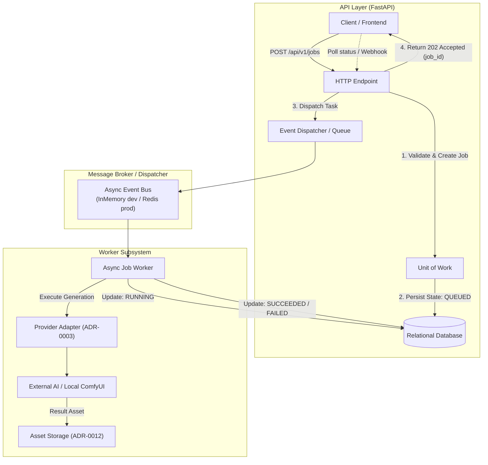
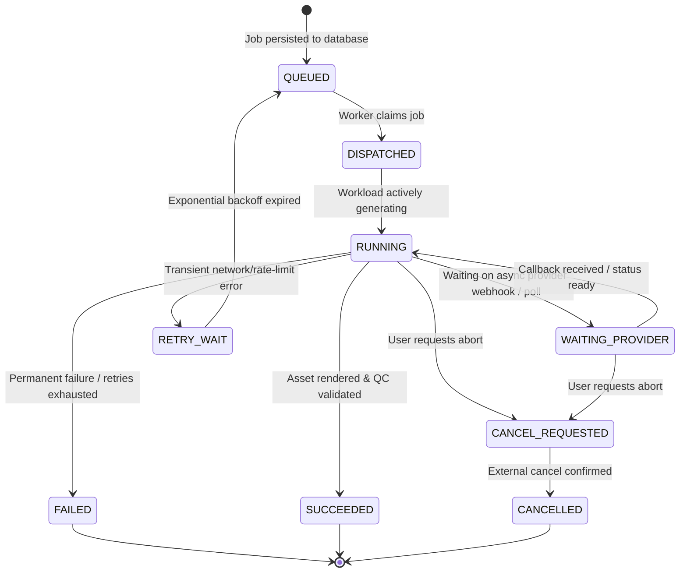
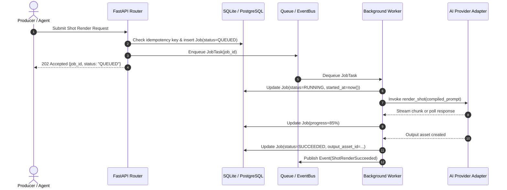

# ADR-0007: Async Job Processing

> **Canonical Source**: This document is mirrored from the canonical version in `DECISIONS/`.

| Attribute            | Specification                                                                          |
| :------------------- | :------------------------------------------------------------------------------------- |
| **ADR ID**           | ADR-0007                                                                               |
| **Title**            | Async Job Processing: Persistent Distributed Task Queues & Event-Driven Workers        |
| **Status**           | ACCEPTED                                                                               |
| **Date**             | 2026-11-19                                                                             |
| **Decision Owners**  | Product Architect & Core Infrastructure Team                                           |
| **Decision Scope**   | Background task execution, asynchronous AI generation, job queuing, and retry policies |
| **Version**          | 1.2                                                                                    |
| **Canonical Source** | `DECISIONS/ADR/ADR-0007-async-job-processing.md`                                       |
| **Supersedes**       | None                                                                                   |
| **Superseded By**    | None                                                                                   |

---

## 1. Context

MovieAIProducer executes long-running computational workloads that cannot and must not block standard synchronous HTTP request/response lifecycles:

- **Screenplay Analysis & Scene Breakdown**: Multi-turn LLM reasoning (15–60s).
- **High-Resolution Concept & Storyboard Generation**: Diffusion models on GPU clusters (10–45s).
- **AI Video Generation**: Multi-second shot rendering on ComfyUI / Runway / Kling (30s–5m).
- **Character Voice Synthesis**: Dialogue prosody and zero-shot voice cloning on GPT-SoVITS / ElevenLabs (5–30s).
- **Media Transcoding & Conforming**: Lossless stitching, 4K rendering, FFmpeg pipelines (1–10m).
- **Multi-Modal Continuity & QC**: CLIP embedding similarity, facial landmark drift, audio-visual sync (10–60s).

Certain external providers return results via asynchronous webhook callbacks or polling endpoints (`operation_id`). Other local engines (such as local ComfyUI WebSocket queues) require persistent connection monitoring.

---

## 2. Problem Statement

Without a persistent, structured job processing architecture, the system risks:

1. HTTP gateway timeouts (504 Gateway Timeout) on video and audio generation requests.
2. Severely degraded API responsiveness and thread pool exhaustion.
3. Lost jobs and orphaned state during server restarts or worker crashes.
4. Duplicate generation billing caused by uncoordinated retries.
5. Inability to monitor queue backlog, worker saturation, and per-shot render progress.
6. Untracked failures leaving pipeline stages permanently stuck in `IN_PROGRESS`.

---

## 3. Decision

Adopt a **Persistent Asynchronous Job Processing Architecture** utilizing database-backed job state, task queues, idempotent execution keys, and decoupled worker runtimes.

1. **Decoupled Job Lifecycle**: The API accepts generation requests, writes a persistent `Job` record with status `QUEUED`, and returns `202 Accepted` immediately with a canonical `job_id` and polling URI.
2. **Execution Runtimes**:
   - **Local Development / MVP**: In-memory asynchronous event bus (`backend/app/infrastructure/common/event_bus.py`) with `asyncio` background tasks.
   - **Production / Dedicated Workers**: Distributed message broker (Redis / Celery / ARQ) executing independent worker processes across GPU/CPU nodes.
3. **Idempotency Guarantee**: Every job payload carries an `idempotency_key` based on the immutable MPB snapshot hash, shot ID, and model seed. Duplicate requests return the existing active job rather than dispatching a duplicate render.
4. **State Machine Conformance**: All job transitions strictly adhere to the canonical matrix defined in [CDA-0003](../CDA/CDA-0003.md).

---

## 4. Architecture & Component Interaction

---

## 5. Asynchronous Job State Machine

---

## 6. Job Categories & Routing Matrix

| Job Category   | Representative Operations                       | Max Execution Timeout | Retry Policy                     |
| :------------- | :---------------------------------------------- | :-------------------: | :------------------------------- |
| **CREATIVE**   | Screenplay generation, beat expansion           |         120s          | 2 retries (linear backoff)       |
| **IMAGE**      | Character DNA turnaround, concept art           |          90s          | 3 retries (exponential backoff)  |
| **VIDEO**      | First/last frame conditioned shot render        |         600s          | 1 retry (seed perturbation)      |
| **AUDIO**      | Dialogue voice synthesis, sound effects         |          60s          | 3 retries (exponential backoff)  |
| **ANALYSIS**   | Script breakdown, scene sentiment analysis      |         120s          | 2 retries                        |
| **RENDER**     | Multi-track timeline assembly, FFmpeg stitching |         900s          | 1 retry (clean temporary buffer) |
| **CONTINUITY** | Vector embedding distance, face verification    |          60s          | 2 retries                        |
| **QC**         | 4-tier automated quality gate inspection        |         180s          | 1 retry                          |
| **EXPORT**     | Master ProRes / H.264 film packaging            |         1800s         | 0 retries (manual inspection)    |

---

## 7. Execution Sequence & Lifecycle

---

## 8. Idempotency & Fault-Tolerance Principles

1. **At-Least-Once Delivery**: Workers assume duplicate delivery can occur. The job runner uses atomic database state checks (`UPDATE jobs SET status='RUNNING' WHERE id=:id AND status='QUEUED'`) to guarantee that only one worker thread claims execution.
2. **Dead Letter Queue (DLQ)**: Jobs that fail after exceeding max retries are moved to a dead-letter state with complete error stack traces and correlation IDs, preventing poisoned jobs from thrashing workers.
3. **Heartbeats & Zombie Cleanup**: Active workers emit heartbeats every 30 seconds. A scheduled sweeper flags jobs whose worker has been silent for $> 3 \times \text{heartbeat interval}$ as `STALE_RETRYABLE`.

---

## 9. Implementation Status: ACCEPTED

- In-memory asynchronous event bus implemented in `backend/app/infrastructure/common/event_bus.py`.
- Job lifecycle states aligned with [CDA-0003](../CDA/CDA-0003.md).
- Distributed queue integration (Redis/ARQ or Celery) scheduled for implementation in Phase 8 (Production Orchestration).

---

## 10. Related Documents

- [ARCHITECTURE.md](../../ARCHITECTURE.md)
- [ERROR_HANDLING.md](../../ERROR_HANDLING.md)
- [ADR-0003: Provider Adapter System](ADR-0003.md)
- [ADR-0005: Production Workflow Engine](ADR-0005.md)
- [ADR-0006: Data Storage Strategy](ADR-0006.md)
- [CDA-0003: Canonical Lifecycle & State Transition Matrix](../CDA/CDA-0003.md)
- [CDA-0004: Canonical Event & Integration Contract Registry](../CDA/CDA-0004.md)
