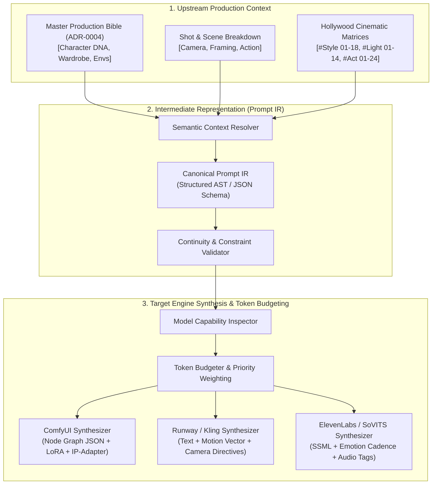

# ADR-0008: Prompt Compilation Engine

> **Canonical Source**: This document is mirrored from the canonical version in `DECISIONS/`.

| Attribute            | Specification                                                                                          |
| :------------------- | :----------------------------------------------------------------------------------------------------- |
| **ADR ID**           | ADR-0008                                                                                               |
| **Title**            | Prompt Compilation Engine: Intermediate Representation (IR) & Cinematic Matrices                       |
| **Status**           | ACCEPTED                                                                                               |
| **Date**             | 2026-11-19                                                                                             |
| **Decision Owners**  | Product Architect & AI Technical Lead                                                                  |
| **Decision Scope**   | Hollywood cinematic prompt compilation, Intermediate Representation (IR), and provider token synthesis |
| **Version**          | 1.2                                                                                                    |
| **Canonical Source** | `DECISIONS/ADR/ADR-0008-prompt-compilation-engine.md`                                                  |
| **Supersedes**       | None                                                                                                   |
| **Superseded By**    | None                                                                                                   |

---

## 1. Context

MovieAIProducer is not a superficial prompt generator. The platform is engineered to translate professional directorial intent, dramatic narrative arcs, and Master Production Bible (MPB) specifications into executable, mathematically disciplined prompts across diverse AI generative engines.

A production-grade cinematic prompt requires precise synthesis across multiple domains:

- **Creative Strategy**: Premise, visual tone, emotional palette, genre conventions.
- **Master Production Bible (MPB)**: Character visual DNA, wardrobe states, location keys, prop identities.
- **Cinematography & Optics**: Sensor sizes, focal lengths (e.g. 35mm / 50mm Anamorphic), depth of field, framing.
- **Lighting Design**: 14 Hollywood lighting paradigms (#Light 01-14), key/fill ratios, atmospheric volumetric haze.
- **Performance & Acting**: 24 Hollywood acting codes (#Act 01-24), emotional subtext, eye tracking, micro-expressions.
- **Visual Style Catalog**: 18 Hollywood aesthetic codes (#Style 01-18), film stock emulation (e.g., Kodak Vision3 500T).
- **Physical Continuity Locks**: Facial geometry embeddings, wardrobe damage progression, spatial lighting vector consistency.

Different AI engines (ComfyUI SDXL/Flux, Midjourney, Runway Gen-3, Kling, ElevenLabs) enforce contradictory prompt syntaxes, token limits (e.g. 77 CLIP tokens vs 256 T5 tokens), weight conventions (e.g., `(word:1.2)` vs `--cw 80`), and negative prompt parameters.

Directly writing ad-hoc prompt strings leads to catastrophic style drift, character hallucination, and broken cinematic continuity.

---

## 2. Problem Statement

How should MovieAIProducer compile structured production intent into engine-specific prompt instructions while guaranteeing:

1. Complete separation of artistic intent from vendor-specific syntax quirks.
2. Lossless resolution of MPB character DNA, wardrobe, and environment constraints.
3. Strict enforcement of Hollywood cinematic codes (#Style 01-18, #Light 01-14, #Act 01-24).
4. Automatic token budgeting and priority pruning (preventing critical directorial cues from being truncated by token limits).
5. Immutable prompt provenance: linking every generated video or audio asset to the exact compiled prompt IR and seed.

---

## 3. Decision

Adopt a **Multi-Pass Prompt Compilation Engine** centered around a **Canonical Prompt Intermediate Representation (Prompt IR)**.

---

## 4. Prompt Intermediate Representation (IR) Components

The Canonical Prompt IR decomposes scene generation into discrete, validated semantic blocks:

| IR Component             | Primary Responsibility                                           | Sourced From                  |
| :----------------------- | :--------------------------------------------------------------- | :---------------------------- |
| **Creative Intent**      | Emotional tone, dramatic tension, narrative purpose              | Creative Brief / Screenplay   |
| **Subject DNA**          | Immutable facial structure, ethnicity, hair, biometric anchors   | Character Bible (MPB)         |
| **Character State**      | Micro-expression, sweat, physical exhaustion, eye gaze           | Scene Direction / #Act 01-24  |
| **Wardrobe & Props**     | Garment materials, tears, battle wear, handheld prop state       | Wardrobe & Prop Bible (MPB)   |
| **Environment DNA**      | Architectural style, textures, spatial layout, time of day       | Environment Bible (MPB)       |
| **Atmosphere & Light**   | Key/fill ratio, volumetric fog, color temperature (Kelvin)       | Lighting Bible / #Light 01-14 |
| **Camera & Lens**        | Focal length, lens distortion, anamorphic bokeh, camera movement | Cinematography Bible          |
| **Style DNA**            | Film stock emulation, grain, color timing, aesthetic code        | Style Catalog / #Style 01-18  |
| **Continuity Locks**     | Reference image URIs, vector embeddings, facial masks            | Continuity Engine (ADR-0009)  |
| **Negative Constraints** | Prohibited elements, rendering artifacts, unapproved styles      | Engine Negative Registry      |
| **Output Target**        | Target resolution, aspect ratio (2.39:1 / 16:9), duration, FPS   | Project Specifications        |

---

## 5. Token Budgeting & Priority Pruning

Different diffusion and video models enforce strict context window limits. When the combined prompt tokens exceed the model's budget, the compiler applies **deterministic priority pruning**:

1. **Priority 1 (Protected Anchors)**: Character DNA reference tokens, primary subject description, aspect ratio parameters. _Never pruned._
2. **Priority 2 (Cinematic Execution)**: Camera framing, lighting style codes, primary action. _Preserved with highest weight._
3. **Priority 3 (Environmental Nuance)**: Secondary background props, distant atmospheric textures. _Compressed or summarized._
4. **Priority 4 (Stylistic Modifiers)**: Generic quality boosters (e.g., "photorealistic", "masterpiece"). _Stripped first._

---

## 6. Implementation Status: ACCEPTED

- Structured prompt schema and Hollywood cinematic code integration defined in [PROMPTS.md](../../PROMPTS.md).
- Prompt compiler module scheduled for implementation in Phase 7 (Tasks 025-028).

---

## 7. Related Documents

- [PROMPTS.md](../../PROMPTS.md)
- [AI_PIPELINE.md](../../AI_PIPELINE.md)
- [ADR-0003: Provider Adapter System](ADR-0003.md)
- [ADR-0004: Master Production Bible](ADR-0004.md)
- [ADR-0009: Continuity Engine](ADR-0009.md)
- [CDA-0004: Canonical Event & Integration Contract Registry](../CDA/CDA-0004.md)
