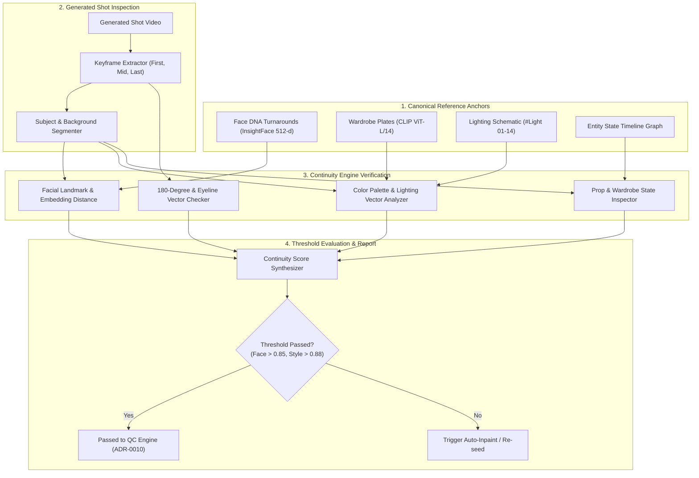

# ADR-0009: Continuity Engine

> **Canonical Source**: This document is mirrored from the canonical version in `DECISIONS/`.

| Attribute            | Specification                                                                                      |
| :------------------- | :------------------------------------------------------------------------------------------------- |
| **ADR ID**           | ADR-0009                                                                                           |
| **Title**            | Continuity Engine: Multi-Shot Visual Locks & Embedding Consistency Verification                    |
| **Status**           | ACCEPTED                                                                                           |
| **Date**             | 2026-11-19                                                                                         |
| **Decision Owners**  | Product Architect & Creative Technical Lead                                                        |
| **Decision Scope**   | Cross-shot visual and narrative continuity, facial locks, embedding similarity, and state tracking |
| **Version**          | 1.2                                                                                                |
| **Canonical Source** | `DECISIONS/ADR/ADR-0009-continuity-engine.md`                                                      |
| **Supersedes**       | None                                                                                               |
| **Superseded By**    | None                                                                                               |

---

## 1. Context

AI-generated cinema fundamentally differs from traditional live-action filming: every individual shot may be produced asynchronously across different generative models, diffusion samplers, and random seeds.

Without an active continuity governance system, consecutive shots exhibit severe, unwatchable discontinuities:

- **Facial DNA Drift**: Character facial structure, eye spacing, or age shifting between cutaways.
- **Wardrobe Inconsistencies**: Clothing colors, jacket styles, or damage states morphing between shots.
- **Spatial Disorientation**: Breaking the 180-degree rule, inverted eyelines, or impossible actor positions.
- **Atmospheric & Lighting Flicker**: Sun angles, shadow directions, or color temperatures changing mid-scene.
- **Prop Hallucinations**: Objects disappearing or changing physical scale between takes.

Continuity cannot be maintained purely by text prompting; it requires mathematical verification, multi-shot conditioning locks, and embedding distance checks.

---

## 2. Problem Statement

How should MovieAIProducer enforce and verify visual and narrative continuity across multi-scene film production to:

1. Prevent visual identity drift across hundreds of generated shots.
2. Track progressive entity states (e.g., progressive fatigue, wounding, wardrobe degradation across scenes).
3. Validate spatial geometry, eyelines, and screen direction between adjacent shots.
4. Detect continuity breaches automatically before shots reach human editorial review.
5. Provide actionable remediation paths (e.g., inpainting, re-seeding, or ControlNet reference re-injection).

---

## 3. Decision

Adopt a **Dedicated Continuity Engine** utilizing **Multi-Modal Visual Locks, Vector Embedding Similarity, and State Tracking Graphs**.

1. **Continuity Locks**: Formal data contracts establishing immutable visual reference anchors (Character Face Turnarounds, Wardrobe Reference Plates, Environment Layouts).
2. **Automated Verification Pipeline**: Generated video frames are automatically extracted and compared against canonical MPB anchors using CLIP, InsightFace, and Depth estimation models.
3. **Continuous State Tracking**: Progressive character and prop states are tracked across a chronological timeline graph (e.g., character starts scene clean $\rightarrow$ bruised in shot 3 $\rightarrow$ bandage added in shot 7).
4. **Severity-Based Gate Enforcement**: Continuity violations are categorized by severity. Critical violations automatically block stage advancement and trigger auto-remediation.

---

## 4. Continuity Verification Architecture

---

## 5. Continuity Defect Severity Taxonomy

Violations detected by the engine are classified into standardized severity tiers:

| Finding Category                | Severity | Confidence Threshold | Action Required                                                |
| :------------------------------ | :------: | :------------------: | :------------------------------------------------------------- |
| **Character Face Drift**        | Critical |      $\ge 0.90$      | Automatic rejection; trigger face-restore / IP-Adapter re-seed |
| **Eyeline / 180° Inversion**    | Critical |      $\ge 0.85$      | Automatic rejection; invert camera azimuth prompt              |
| **Wardrobe Style Mismatch**     |   High   |      $\ge 0.88$      | Flagged for review; inpaint garment area                       |
| **Missing Signature Prop**      |   High   |      $\ge 0.85$      | Re-inject prop conditioning image                              |
| **Lighting Direction Flip**     |  Medium  |      $\ge 0.80$      | Adjust #Light schematic tokens                                 |
| **Background Detail Variation** |   Low    |      $\ge 0.70$      | Advisory notification; acceptable within tolerance             |

---

## 6. Implementation Status: ACCEPTED

- Continuity constraints and reference specifications established in [ADR-0004](ADR-0004.md) and [PROMPTS.md](../../PROMPTS.md).
- Automated continuity engine inspection pipeline scheduled for implementation in Phase 9 (Tasks 032-035).

---

## 7. Related Documents

- [AI_PIPELINE.md](../../AI_PIPELINE.md)
- [ADR-0003: Provider Adapter System](ADR-0003.md)
- [ADR-0004: Master Production Bible](ADR-0004.md)
- [ADR-0008: Prompt Compilation Engine](ADR-0008.md)
- [ADR-0010: Quality Control Engine](ADR-0010.md)
- [CDA-0003: Canonical Lifecycle & State Transition Matrix](../CDA/CDA-0003.md)
