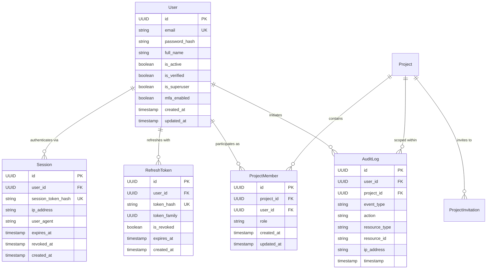
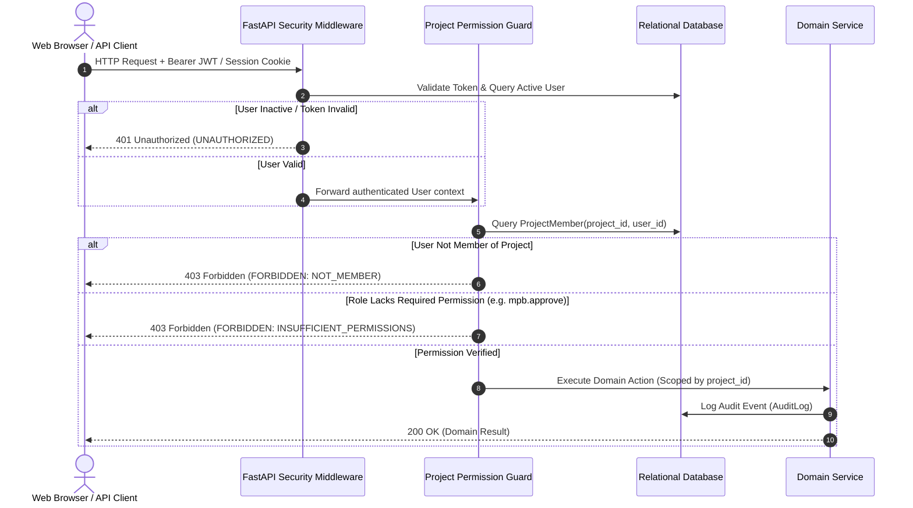

# ADR-0011: Authentication & Authorization

> **Canonical Source**: This document is mirrored from the canonical version in `DECISIONS/`.

| Attribute            | Specification                                                              |
| :------------------- | :------------------------------------------------------------------------- |
| **ADR ID**           | ADR-0011                                                                   |
| **Title**            | Authentication & Authorization: Multi-Tenant RBAC & JWT/Session Governance |
| **Status**           | ACCEPTED                                                                   |
| **Date**             | 2026-11-19                                                                 |
| **Decision Owners**  | Security Architect, Technical Lead & Product Owner                         |
| **Decision Scope**   | System-wide authentication, RBAC, tenant isolation, and secret management  |
| **Version**          | 1.2                                                                        |
| **Canonical Source** | `DECISIONS/ADR/ADR-0011-authentication-authorization.md`                   |
| **Supersedes**       | None                                                                       |
| **Superseded By**    | None                                                                       |

---

## 1. Context

MovieAIProducer adalah platform produksi film berbasis kecerdasan buatan (AI) yang mengorkestrasi alur kerja kreatif tingkat profesional: dari brief kreatif, penulisan skenario, Master Production Bible (MPB), perancangan karakter dan dunia, storyboard, animatic, kompilasi prompt, eksekusi render AI multi-provider, kontinuitas, hingga Quality Control (QC).

Seluruh siklus ini melibatkan aset digital bernilai tinggi, kekayaan intelektual (IP) skenario, aset referensi visual/suara, serta kredensial provider AI pihak ketiga (OpenAI, Anthropic, Runway, Kling, ElevenLabs, dll.) yang memiliki implikasi biaya finansial nyata pada setiap eksekusi komputasi.

Selain itu, produksi film adalah kerja kolaboratif yang melibatkan beragam peran dengan tanggung jawab berbeda: Sutradara (Director), Produser (Producer), Editor, Operator AI, QC Reviewer, dan Eksekutif/Klien. Setiap peran membutuhkan tingkat akses dan wewenang yang spesifik.

Oleh karena itu, MovieAIProducer membutuhkan arsitektur Autentikasi (Authentication / AuthN) dan Otorisasi (Authorization / AuthZ) yang kokoh, modular, terisolasi per-project, aman secara default, serta mematuhi prinsip _Least Privilege_ dan _Defense in Depth_.

---

## 2. Problem Statement

Tanpa arsitektur autentikasi dan otorisasi yang terdefinisi secara ketat, sistem menghadapi risiko kritis:

1. **Pencurian Kekayaan Intelektual (IP Leakage)**: Naskah dan aset visual film bocor ke pihak yang tidak berhak atau lintas project (_Cross-Tenant Data Exposure_).
2. **Eskalasi Biaya Tanpa Otorisasi**: Eksekusi render AI yang mahal dipicu oleh anggota tim tanpa wewenang anggaran (_Unauthorized Financial Burn_).
3. **Kerusakan Integritas Kreatif**: Modifikasi sepihak terhadap Master Production Bible (MPB) yang sudah disetujui sutradara.
4. **Kebocoran Kredensial Provider**: API Key penyedia AI (OpenAI, Anthropic, Runway) terekspos ke klien frontend atau log publik.
5. **Kelemahan Sesi**: Kerentanan terhadap serangan Cross-Site Scripting (XSS), Cross-Site Request Forgery (CSRF), session hijacking, dan replay attacks.

---

## 3. Decision

Mengadopsi arsitektur keamanan bertingkat (_multi-layered security architecture_) yang memisahkan tanggung jawab Autentikasi dan Otorisasi:

1. **Autentikasi (AuthN)**:
   - **Web Frontend**: Menggunakan cookie sesi yang aman (`HttpOnly`, `Secure`, `SameSite=Lax`, prefix `__Host-`) untuk memitigasi risiko XSS dan pencurian token di browser.
   - **CLI / SDK / Background Agent**: Menggunakan Bearer JWT (_JSON Web Token_) berumur pendek (15 menit) yang dipasangkan dengan Refresh Token terotasi (14 hari) di database.
   - **Password Hashing**: Menggunakan algoritma standar industri **Argon2id** (OWASP recommended parameters: Memory 64MB, Iterations 3, Parallelism 4).

2. **Otorisasi Berbasis Peran dalam Project (Project-Scoped RBAC)**:
   - Model otorisasi tidak bersifat global, melainkan diikat pada konteks spesifik project (`ProjectMember.role`).
   - Menerapkan 8 peran formal: `OWNER`, `ADMIN`, `DIRECTOR`, `PRODUCER`, `EDITOR`, `OPERATOR`, `REVIEWER`, `VIEWER`.
   - Menggunakan evaluasi permission berbasis deklaratif di FastAPI (`Depends(require_project_permission(...))`).

3. **Isolasi Mutlak Lintas Project (_Tenant Isolation_)**:
   - Seluruh query database untuk data kreatif, scene, shot, aset, dan job wajib menyertakan filter eksplisit `WHERE project_id = :project_id`.
   - Mencegah kerentanan Insecure Direct Object References (IDOR).

4. **Perlindungan Kredensial & Secrets**:
   - Provider API Keys disimpan di environment variable atau dienkripsi dalam database menggunakan **AES-256-GCM** dengan IV unik untuk skenario BYOK (_Bring Your Own Key_).
   - Log masking otomatis untuk seluruh string rahasia dan header `Authorization`.

---

## 4. Role-Based Access Control (RBAC) Matrix

### 4.1 Definisi Peran (Roles)

| Peran        | Deskripsi Tanggung Jawab                                                                                                        |
| :----------- | :------------------------------------------------------------------------------------------------------------------------------ |
| **OWNER**    | Pemilik project, memiliki kontrol absolut atas administrasi, penagihan, penghapusan project, dan penugasan anggota.             |
| **ADMIN**    | Pengelola konfigurasi teknis, integrasi provider API, manajemen member, dan kuota.                                              |
| **DIRECTOR** | Penentu visi kreatif film: persetujuan naskah, approval Master Production Bible (MPB), dan persetujuan akhir setiap scene/shot. |
| **PRODUCER** | Pengendali jadwal, anggaran, alur kerja produksi, pipeline staging, dan alokasi resource eksekusi.                              |
| **EDITOR**   | Pengelola aset, urutan adegan, perakitan shot, timeline kasar/halus, dan ekspor produksi.                                       |
| **OPERATOR** | Penanggung jawab teknis eksekusi pekerjaan AI: memicu kompilasi prompt, rendering shot, dan pemantauan job.                     |
| **REVIEWER** | Petugas peninjau kualitas dan kontinuitas: menjalankan QC, memberikan catatan revisi, dan validasi kepatuhan MPB.               |
| **VIEWER**   | Akses baca saja (_read-only_) untuk stakeholder eksternal, klien, atau peninjau tanpa hak eksekusi.                             |

### 4.2 Matriks Hak Akses (Permissions)

| Kategori Permission    | Nama Permission          | OWNER | ADMIN | DIRECTOR | PRODUCER | EDITOR | OPERATOR | REVIEWER | VIEWER |
| :--------------------- | :----------------------- | :---: | :---: | :------: | :------: | :----: | :------: | :------: | :----: |
| **Project**            | `project.read`           |   ✓   |   ✓   |    ✓     |    ✓     |   ✓    |    ✓     |    ✓     |   ✓    |
|                        | `project.update`         |   ✓   |   ✓   |    -     |    ✓     |   -    |    -     |    -     |   -    |
|                        | `project.delete`         |   ✓   |   -   |    -     |    -     |   -    |    -     |    -     |   -    |
|                        | `project.members.manage` |   ✓   |   ✓   |    -     |    -     |   -    |    -     |    -     |   -    |
| **Secrets/Providers**  | `provider.config.read`   |   ✓   |   ✓   |    -     |    -     |   -    |    -     |    -     |   -    |
|                        | `provider.config.update` |   ✓   |   ✓   |    -     |    -     |   -    |    -     |    -     |   -    |
| **Screenplay/Story**   | `story.read`             |   ✓   |   ✓   |    ✓     |    ✓     |   ✓    |    ✓     |    ✓     |   ✓    |
|                        | `story.write`            |   ✓   |   -   |    ✓     |    -     |   -    |    -     |    -     |   -    |
|                        | `story.approve`          |   ✓   |   -   |    ✓     |    ✓     |   -    |    -     |    -     |   -    |
| **Master Bible (MPB)** | `mpb.read`               |   ✓   |   ✓   |    ✓     |    ✓     |   ✓    |    ✓     |    ✓     |   ✓    |
|                        | `mpb.draft`              |   ✓   |   -   |    ✓     |    -     |   -    |    -     |    -     |   -    |
|                        | `mpb.approve` (DNA Lock) |   ✓   |   -   |    ✓     |    -     |   -    |    -     |    -     |   -    |
| **Shot & Direction**   | `shot.plan`              |   ✓   |   -   |    ✓     |    ✓     |   ✓    |    -     |    -     |   -    |
|                        | `shot.execute` (AI Run)  |   ✓   |   -   |    -     |    ✓     |   -    |    ✓     |    -     |   -    |
|                        | `job.cancel`             |   ✓   |   ✓   |    -     |    ✓     |   -    |    ✓     |    -     |   -    |
| **Continuity & QC**    | `qc.read`                |   ✓   |   ✓   |    ✓     |    ✓     |   ✓    |    ✓     |    ✓     |   ✓    |
|                        | `qc.run`                 |   ✓   |   -   |    -     |    ✓     |   -    |    ✓     |    ✓     |   -    |
|                        | `qc.approve`             |   ✓   |   -   |    ✓     |    ✓     |   -    |    -     |    ✓     |   -    |
|                        | `qc.override_blocker`    |   ✓   |   -   |    ✓     |    -     |   -    |    -     |    -     |   -    |
| **Assets & Export**    | `asset.read`             |   ✓   |   ✓   |    ✓     |    ✓     |   ✓    |    ✓     |    ✓     |   ✓    |
|                        | `asset.manage`           |   ✓   |   ✓   |    -     |    ✓     |   ✓    |    -     |    -     |   -    |
|                        | `asset.export_master`    |   ✓   |   -   |    ✓     |    ✓     |   ✓    |    -     |    -     |   -    |

---

## 5. Security Data Model

---

## 6. Authentication & Authorization Execution Flow

---

## 7. Implementation Status: ACCEPTED

- Security exceptions (`UnauthorizedException`, `ForbiddenException`) implemented in `backend/app/application/common/exceptions.py`.
- Correlation tracking middleware active in `backend/app/core/middleware.py`.
- Full user authentication, Argon2id hashing, and RBAC tables scheduled for implementation in Phase 1 / Security Hardening.

---

## 8. Related Documents

- [SECURITY.md](../../SECURITY.md)
- [API_SPEC.md](../../API_SPEC.md)
- [DATA_MODEL.md](../../DATA_MODEL.md)
- [ADR-0001: Architecture Style](ADR-0001.md)
- [ADR-0006: Data Storage Strategy](ADR-0006.md)
- [CDA-0005: Canonical Error & Failure Contract Registry](../CDA/CDA-0005.md)
