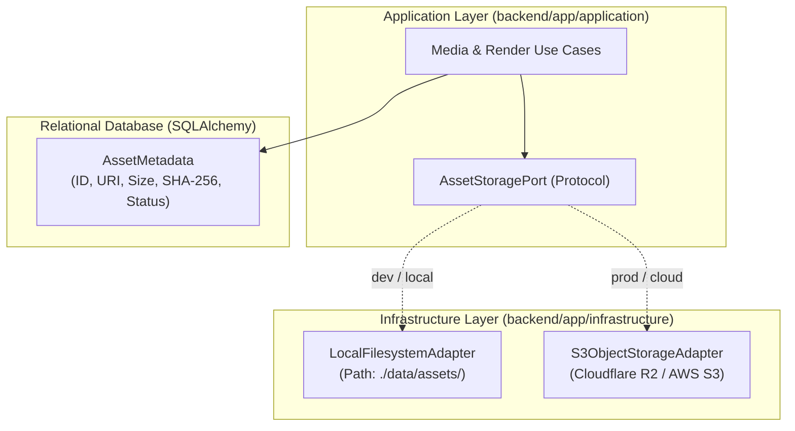
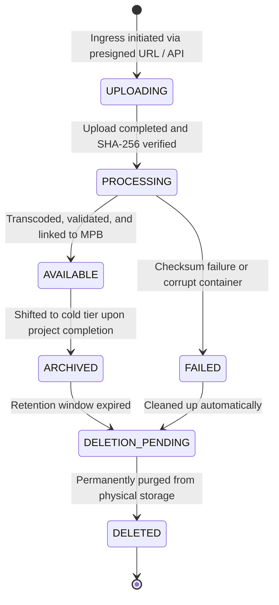

# ADR-0012: Asset Storage Architecture

> **Canonical Source**: This document is mirrored from the canonical version in `DECISIONS/`.

| Attribute            | Specification                                                                         |
| :------------------- | :------------------------------------------------------------------------------------ |
| **ADR ID**           | ADR-0012                                                                              |
| **Title**            | Asset Storage Architecture: Pluggable Storage Adapters & Content-Addressed Media      |
| **Status**           | ACCEPTED                                                                              |
| **Date**             | 2026-11-19                                                                            |
| **Decision Owners**  | Product Owner, Technical Architect & Infrastructure Owner                             |
| **Decision Scope**   | Binary media asset management, storage ports, lifecycle tiers, and content addressing |
| **Version**          | 1.2                                                                                   |
| **Canonical Source** | `DECISIONS/ADR/ADR-0012-asset-storage.md`                                             |
| **Supersedes**       | None                                                                                  |
| **Superseded By**    | None                                                                                  |

---

## 1. Context

MovieAIProducer coordinates massive volumes of multimedia assets throughout the 16-stage Hollywood film production lifecycle:

- High-resolution reference moodboards and character turnaround sheets.
- Previsualization storyboards, timed animatic MP4s, and 3D camera projections.
- Generated raw video clips from ComfyUI, Runway, Kling, and Veo.
- Multi-track voice stems, dialogue passes, ambient Foley, and orchestral scores.
- Conformed scene edits, ProRes 422 intermediate renders, and H.264/H.265 master deliverables.
- Quality Control (QC) inspection heatmaps, difference masks, and audit evidence.

These media files range in size from tens of kilobytes (prompts and manifests) to tens of gigabytes (uncompressed ProRes 4K master timelines).

Treating production media as unmanaged arbitrary files on a local disk without ownership, cryptographic hashing, and lifecycle tracking causes orphaned files, broken playback links, and impossible project recovery.

---

## 2. Problem Statement

How should MovieAIProducer architect its media storage subsystem to ensure:

1. Complete abstraction between application business logic and the physical storage medium.
2. Effortless zero-dependency local development (using the local filesystem) with seamless switching to cloud object storage (S3 / Cloudflare R2 / MinIO) in production.
3. Content-addressed integrity: every asset is verified with a SHA-256 checksum to guarantee uncorrupted delivery.
4. Rigid access control: no public, unauthenticated buckets or directories by default; all access is authorized via signed URLs or application proxies.
5. Automated lifecycle management: handling uploads, processing, archiving, and retention-compliant deletion.

---

## 3. Decision

Adopt a **Pluggable Storage Adapter Architecture** based on the Ports and Adapters pattern, separating authoritative relational metadata from content-addressed binary files.

1. **Storage Port Abstraction**: Domain and application use cases interact exclusively with the `AssetStoragePort` interface defined in `backend/app/application/common/ports.py`.
2. **Pluggable Adapters**:
   - **LocalFilesystemAdapter** (`backend/app/infrastructure/storage/local.py`): Rooted in `./data/assets/`, used for local development and offline testing.
   - **S3ObjectStorageAdapter** (`backend/app/infrastructure/storage/s3.py`): Uses `aioboto3` for asynchronous S3-compatible cloud storage (Cloudflare R2, AWS S3).
3. **Database-Storage Decoupling**: The relational database stores metadata (UUID, project ID, MIME type, size, SHA-256 checksum, storage URI, MPB snapshot reference). The storage medium stores the immutable binary stream.
4. **Content-Addressed Paths**: Storage keys follow a deterministic hierarchical convention:
   `projects/{project_id}/{category}/{entity_id}/{asset_uuid}.{ext}`

---

## 4. Architecture & Storage Adapter Flow

---

## 5. Canonical Asset Categories

| Asset Category  | Representative Files & Modalities                      |   Storage Tier    | Retention Policy         |
| :-------------- | :----------------------------------------------------- | :---------------: | :----------------------- |
| **REFERENCE**   | Director moodboards, lighting references, style plates |     Standard      | Project Lifetime         |
| **CHARACTER**   | Facial turnaround portraits, 512-d DNA embeddings      |        Hot        | Project Lifetime         |
| **ENVIRONMENT** | Location concept art, 360° panoramas, HDRI maps        |     Standard      | Project Lifetime         |
| **DESIGN**      | Prop blueprints, vehicle keys, wardrobe sheets         |     Standard      | Project Lifetime         |
| **STORYBOARD**  | 2D/3D storyboard frames, animatic MP4 timelines        |        Hot        | Project Lifetime         |
| **VIDEO**       | Raw shot renders from ComfyUI / Runway / Kling         |        Hot        | Active Production        |
| **AUDIO**       | Dialogue voice stems, Foley effects, music cues        |        Hot        | Project Lifetime         |
| **RENDER**      | Multi-shot timeline conforms, color-graded scenes      |     Standard      | Project Lifetime         |
| **QC_EVIDENCE** | Difference heatmaps, failed frame captures             |       Cold        | 90 Days post-approval    |
| **DELIVERY**    | Final master exports (ProRes 422 HQ / H.264)           | Glacier / Archive | Permanent Studio Archive |

---

## 6. Binary Media Asset State Lifecycle

---

## 7. Risks and Mitigations

| Risk                        |  Impact  | Implemented Mitigation Strategy                                                                              |
| :-------------------------- | :------: | :----------------------------------------------------------------------------------------------------------- |
| **Metadata / Binary Drift** |   High   | Atomic database transactions update status to `AVAILABLE` only after storage write and SHA-256 match.        |
| **Storage Cost Explosion**  |  Medium  | Automated lifecycle workers transition inactive raw takes to cold storage; deduplicate via SHA-256.          |
| **Asset Leakage / IDOR**    | Critical | No public buckets. Access granted solely via short-lived signed URLs (15 min) verified by RBAC.              |
| **Broken File References**  |   High   | Absolute URLs are forbidden in DB. Store canonical URIs (`storage://projects/{id}/...`) resolved at runtime. |
| **Provider Lock-in**        |  Medium  | Abstract `AssetStoragePort` isolates application code from AWS/Cloudflare proprietary APIs.                  |

---

## 8. Implementation Status: ACCEPTED

- Asset storage abstraction and port contracts defined in `backend/app/application/common/ports.py`.
- Local filesystem storage adapter rooted in `./data/assets/` scheduled for implementation in Phase 1 / Task 007.

---

## 9. Related Documents

- [ARCHITECTURE.md](../../ARCHITECTURE.md)
- [SECURITY.md](../../SECURITY.md)
- [ADR-0001: Architecture Style](ADR-0001.md)
- [ADR-0004: Master Production Bible](ADR-0004.md)
- [ADR-0006: Data Storage Strategy](ADR-0006.md)
- [ADR-0010: Quality Control Engine](ADR-0010.md)
- [ADR-0011: Authentication & Authorization](ADR-0011.md)
