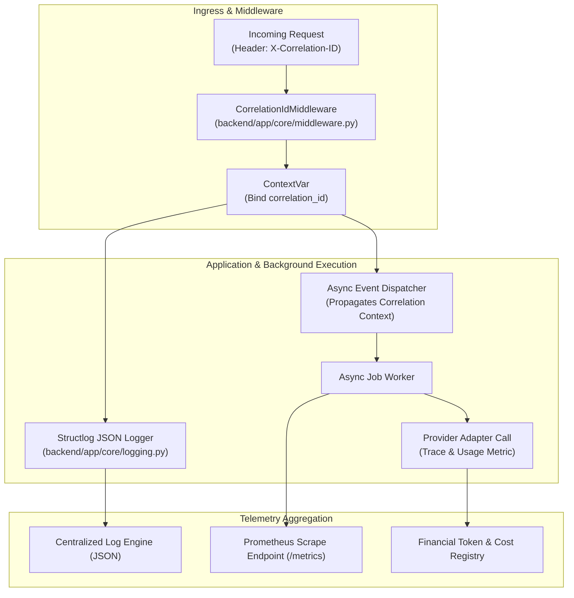

# ADR-0013: Observability Stack

> **Canonical Source**: This document is mirrored from the canonical version in `DECISIONS/`.

| Attribute            | Specification                                                                                       |
| :------------------- | :-------------------------------------------------------------------------------------------------- |
| **ADR ID**           | ADR-0013                                                                                            |
| **Title**            | Observability Stack: Unified Structured Logging, Correlation IDs & OpenTelemetry                    |
| **Status**           | ACCEPTED                                                                                            |
| **Date**             | 2026-11-19                                                                                          |
| **Decision Owners**  | Product Owner, Technical Architect & Infrastructure Owner                                           |
| **Decision Scope**   | Structured logging, correlation tracking, Prometheus metrics, and OpenTelemetry distributed tracing |
| **Version**          | 1.2                                                                                                 |
| **Canonical Source** | `DECISIONS/ADR/ADR-0013-observability-stack.md`                                                     |
| **Supersedes**       | None                                                                                                |
| **Superseded By**    | None                                                                                                |

---

## 1. Context

MovieAIProducer operates a complex, multi-stage AI filmmaking platform spanning multiple runtime environments:

- FastAPI presentation endpoints.
- Pure domain business services and application use cases.
- Background asynchronous workers executing media render jobs.
- External cloud AI provider integrations (OpenAI, Runway, ElevenLabs) with unpredictable latency and failure modes.
- Local high-load GPU pipelines (/home/ubuntu/workspace/ComfyUI and GPT-SoVITS).
- SQLite and PostgreSQL persistence layers.

Production workflows are inherently asynchronous, long-running (seconds to hours), and financially consequential (each render invocation consumes API credits or GPU time).

Traditional unstructured text logging (`print()` or basic `logging.info()`) makes debugging intermittent failures impossible, fails to correlate user requests with background worker tasks, and provides zero visibility into provider spending.

---

## 2. Problem Statement

How should MovieAIProducer architect its observability subsystem to guarantee:

1. End-to-end distributed traceability across API gateways, use cases, background queues, and external AI calls.
2. Machine-readable, structured JSON logs adhering to uniform schema conventions.
3. Strict redaction of secrets, prompt personal data, and API keys.
4. Granular operational and financial metrics (e.g., generation latency, token expenditure per scene).
5. Comprehensive health checks (`/health/live`, `/health/ready`) for container orchestrators.

---

## 3. Decision

Adopt a **Three-Pillar Observability Stack** combining **Structured Logging (Structlog)**, **Application Metrics (Prometheus)**, and **Distributed Tracing (OpenTelemetry)** anchored by an ubiquitous **Correlation Identifier (`X-Correlation-ID`)**.

1. **Structured Logging (Implemented)**:
   - Configured in `backend/app/core/logging.py` using `structlog`.
   - Produces machine-parseable JSON logs in production and human-friendly colored output during local development.
   - Enforces contextual binding: every log record automatically carries `correlation_id`, `environment`, `service_name`, and timestamp.
2. **Correlation Tracking Middleware (Implemented)**:
   - Configured in `backend/app/core/middleware.py`.
   - Inspects incoming HTTP requests for `X-Correlation-ID`; generates a fresh UUIDv4 if missing.
   - Injects `X-Correlation-ID` into response headers and binds it to context-local storage for all downstream loggers and async tasks.
3. **Application & Provider Metrics (Targeted)**:
   - Exposes standard Prometheus metrics (`/metrics`) tracking HTTP request durations, queue depths, provider token costs, and QC pass rates.
4. **Distributed Tracing (OpenTelemetry Target)**:
   - Propagates trace context (W3C Trace Context) into background job payloads and external provider metadata.

---

## 4. Observability Architecture & Context Propagation

---

## 5. Telemetry Data Classification & Retention

| Data Stream                   | Primary Format            | Retention Policy | Security & Redaction Standard             |
| :---------------------------- | :------------------------ | :--------------: | :---------------------------------------- |
| **Debug Logs**                | Structured JSON           |      7 Days      | Stripped in production                    |
| **Application Logs**          | Structured JSON           |     30 Days      | Filtered: API keys and passwords masked   |
| **Operational Metrics**       | Time-Series (Prometheus)  |     90 Days      | High-cardinality labels prohibited        |
| **Distributed Traces**        | OpenTelemetry Spans       |     14 Days      | Sampled: 100% of errors, 10% of successes |
| **Financial / Usage Records** | Relational Database (SQL) |     7 Years      | Immutable, strictly auditable             |
| **QC Verification Records**   | Relational Database (SQL) | Project Lifetime | Checksum verified                         |

---

## 6. Risks and Mitigations

| Risk                                |  Impact  | Implemented Mitigation Strategy                                                                        |
| :---------------------------------- | :------: | :----------------------------------------------------------------------------------------------------- |
| **Secret / Key Leakage in Logs**    | Critical | Automated redaction processors in `logging.py` scrub `Authorization`, `token`, and `api_key` patterns. |
| **Log Volume / Disk Exhaustion**    |   High   | Configurable log levels (`INFO` default in prod); log rotation enforced by host environment.           |
| **High Metric Cardinality**         |  Medium  | Prohibit dynamic UUIDs in metric label values; track dimensions strictly at model/provider level.      |
| **Context Loss Across Async Tasks** |   High   | `EventDispatcher` port explicitly carries correlation IDs in event metadata.                           |

---

## 7. Implementation Status: ACCEPTED (Logging Implemented)

- [x] **Structured Logging Foundation**: Implemented with `structlog` in `backend/app/core/logging.py`.
- [x] **Correlation Tracking**: Implemented via `CorrelationIdMiddleware` in `backend/app/core/middleware.py`.
- [x] **Health Probes**: Implemented with `/health` router in `backend/app/api/health.py`.
- [ ] **Prometheus Metrics & OpenTelemetry Tracing**: Scheduled for Phase 1 / Production Hardening.

---

## 8. Related Documents

- [OBSERVABILITY.md](../../OBSERVABILITY.md)
- [SECURITY.md](../../SECURITY.md)
- [ADR-0001: Architecture Style](ADR-0001.md)
- [ADR-0002: Application Structure](ADR-0002.md)
- [ADR-0003: Provider Adapter System](ADR-0003.md)
- [ADR-0007: Async Job Processing](ADR-0007.md)
- [CDA-0005: Canonical Error & Failure Contract Registry](../CDA/CDA-0005.md)
