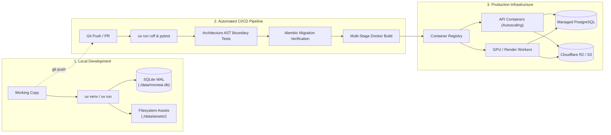

# ADR-0014: Deployment Strategy

> **Canonical Source**: This document is mirrored from the canonical version in `DECISIONS/`.

| Attribute            | Specification                                                                                     |
| :------------------- | :------------------------------------------------------------------------------------------------ |
| **ADR ID**           | ADR-0014                                                                                          |
| **Title**            | Deployment Strategy: Containerized Progressive Delivery & `uv` Package Management                 |
| **Status**           | ACCEPTED                                                                                          |
| **Date**             | 2026-11-19                                                                                        |
| **Decision Owners**  | Product Owner, Technical Architect & DevOps / Infrastructure Lead                                 |
| **Decision Scope**   | Container packaging, environment separation, uv package manager, and production release pipelines |
| **Version**          | 1.2                                                                                               |
| **Canonical Source** | `DECISIONS/ADR/ADR-0014-deployment-strategy.md`                                                   |
| **Supersedes**       | None                                                                                              |
| **Superseded By**    | None                                                                                              |

---

## 1. Context

MovieAIProducer coordinates multiple runtime components:

- FastAPI presentation API and WebSocket servers.
- Next.js 14+ client frontend application (`producer.apologets.com`).
- Asynchronous media background workers.
- SQLite (local development) and PostgreSQL (production) databases.
- Media processing tools (FFmpeg, ImageMagick).
- Local AI GPU workspaces (`/home/ubuntu/workspace/ComfyUI` and `GPT-SoVITS`).
- Cloud AI provider connections via HTTPS/WSS.

The deployment architecture must balance extreme local development agility (rapid onboarding, deterministic package resolution, near-instant test runs) with enterprise-grade production reliability (reproducible container builds, zero-downtime rolling deploys, strict secret isolation).

---

## 2. Problem Statement

What deployment strategy should MovieAIProducer adopt to avoid:

1. Environment drift between local developer machines, testing pipelines, and production servers ("works on my machine" syndrome).
2. Dependency resolution hell and slow CI build pipelines caused by legacy Python package managers.
3. Leaked API credentials and hardcoded secrets in source code or Docker images.
4. Database migration failures locking production tables or causing downtime during releases.
5. Inability to scale asynchronous render workers independently of API web nodes.

---

## 3. Decision

Adopt a **Progressive Containerized Deployment Strategy** powered by the **`uv` package manager**, environment-separated configuration, and multi-stage Docker builds.

1. **Modern Packaging with `uv`**:
   - MovieAIProducer utilizes `uv` for ultra-fast, deterministic dependency resolution based on `pyproject.toml` and `uv.lock`.
   - Requires Python $\ge 3.12, < 3.15$ (actively executing on Python 3.14).
2. **Environment Separation**:
   - Four distinct environments: **Development**, **Testing**, **Staging**, and **Production**.
   - Configuration is injected strictly via environment variables validated by `pydantic-settings` (`backend/app/core/config.py`).
3. **Multi-Stage Containerization**:
   - Production images are built using multi-stage Dockerfiles:
     - _Builder Stage_: Compiles wheel packages and installs dependencies into a virtual environment using `uv`.
     - _Runtime Stage_: Minimal Debian/Alpine base, non-root user (`appuser:10001`), containing only the runtime virtual environment and application code.
4. **Workload Decoupling**:
   - In production, web API containers (`uvicorn`) and background render workers (`celery/arq`) use the same base image but execute distinct entrypoint commands, allowing independent scaling.

---

## 4. Progressive Deployment Topology

---

## 5. Environment Configuration Matrix

| Dimension          | Development                        | Testing (CI)                      | Staging                 | Production                    |
| :----------------- | :--------------------------------- | :-------------------------------- | :---------------------- | :---------------------------- |
| **Python Runtime** | `uv` / Local Python 3.14           | Github Actions / `uv`             | Docker Multi-Stage      | Kubernetes / Docker Compose   |
| **Database**       | SQLite WAL mode (`aiosqlite`)      | Ephemeral SQLite in-memory / file | PostgreSQL 16           | Managed PostgreSQL 16 (HA)    |
| **Asset Storage**  | Local Filesystem (`./data/assets`) | Temp Dir Fixture                  | Cloudflare R2 (Staging) | Cloudflare R2 / AWS S3 (Prod) |
| **Worker Queue**   | Asyncio Event Bus in-process       | In-memory Bus                     | Redis Cluster           | Redis Cluster (Managed)       |
| **Log Format**     | Console / Human Colorized          | Console                           | JSON Structured         | Centralized JSON Aggregator   |
| **Secrets Source** | `.env` file (Git-ignored)          | CI Secret Variables               | Vault / KMS             | Encrypted Cloud Secrets Vault |

---

## 6. Migration Execution Invariants

1. **Pre-Deployment Migration Rule**: Database migrations (`alembic upgrade head`) execute in an isolated initialization job _before_ new API containers accept customer traffic.
2. **Backwards-Compatible Schema Changes**: All database migrations must be backwards-compatible (expand/contract pattern). Dropping columns or renaming tables in-place without a transitional phase is strictly forbidden.
3. **Automated Rollback Preparedness**: Every deployment artifact is pinned to an immutable git commit SHA and container tag.

---

## 7. Risks and Mitigations

| Risk                       |  Impact  | Implemented Mitigation Strategy                                                                        |
| :------------------------- | :------: | :----------------------------------------------------------------------------------------------------- |
| **Environment Drift**      |   High   | `uv.lock` ensures byte-for-byte identical Python packages across local and production runtimes.        |
| **Secret Leakage**         | Critical | `.env` is git-ignored; `pydantic-settings` validates environment variables without hardcoded defaults. |
| **Migration Lockout**      | Critical | Automated migration testing in CI (`tests/infrastructure/test_database_migrations.py`).                |
| **Worker Incompatibility** |   High   | API and Worker share identical container image version tags during deployment rollout.                 |
| **GPU Node Depletion**     |  Medium  | Background render worker concurrency is capped based on active VRAM availability.                      |

---

## 8. Implementation Status: ACCEPTED

- [x] **Local Development & `uv` Toolchain**: Fully implemented with `pyproject.toml` and `uv.lock`.
- [x] **Config Management**: Implemented with `pydantic-settings` in `backend/app/core/config.py`.
- [x] **Migration Pipeline**: Async Alembic runner implemented in `migrations/`.
- [ ] **Docker Production Multi-Stage Container**: Scheduled for Phase 1 / Task 004 Deployment polish.

---

## 9. Related Documents

- [DEPLOYMENT.md](../../DEPLOYMENT.md)
- [SECURITY.md](../../SECURITY.md)
- [ADR-0001: Architecture Style](ADR-0001.md)
- [ADR-0002: Application Structure](ADR-0002.md)
- [ADR-0006: Data Storage Strategy](ADR-0006.md)
- [ADR-0007: Async Job Processing](ADR-0007.md)
- [ADR-0013: Observability Stack](ADR-0013.md)
