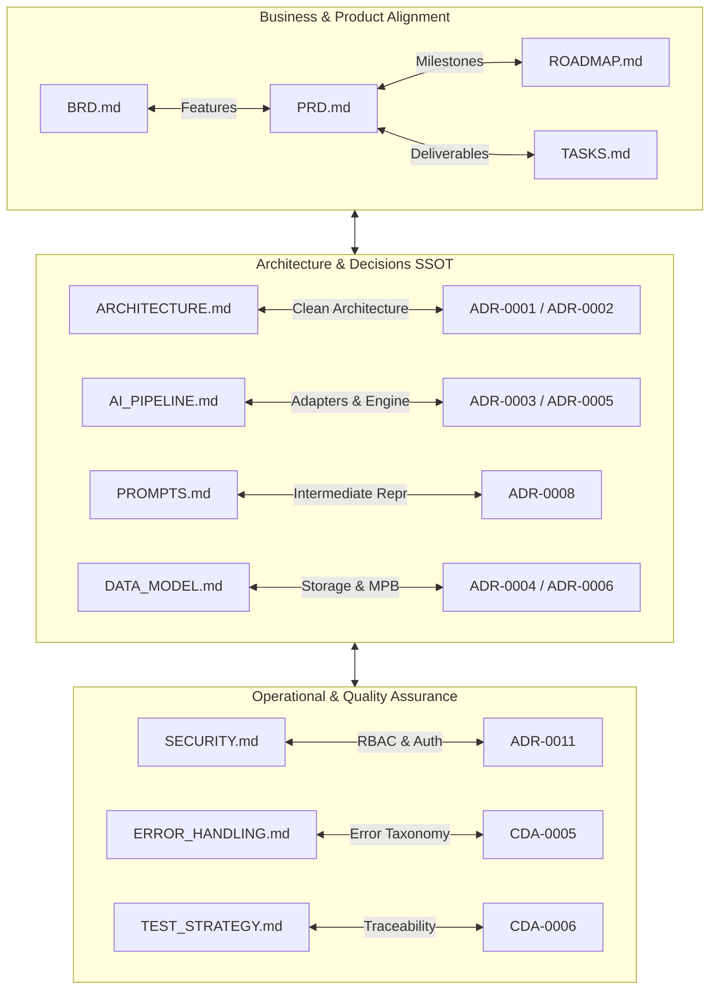

# CDA-0001: Cross-Document Consistency Audit

> **Canonical Source**: This document is mirrored from the canonical version in `DECISIONS/`.

| Attribute            | Specification                                                                         |
| :------------------- | :------------------------------------------------------------------------------------ |
| **Document ID**      | CDA-0001                                                                              |
| **Title**            | Cross-Document Consistency Audit: Alignment of Governance, Architecture, and Delivery |
| **Status**           | ACCEPTED                                                                              |
| **Date**             | 2026-11-19                                                                            |
| **Decision Owners**  | Architecture Review Board & Governance Team                                           |
| **Decision Scope**   | 21 Primary Documents + ADR-0001 through ADR-0015                                      |
| **Version**          | 1.2                                                                                   |
| **Canonical Source** | `DECISIONS/CDA/CDA-0001-cross-document-consistency-audit.md`                          |
| **Audit Outcome**    | **PASSED (Consistent Baseline Established & Verified)**                               |

---

## 1. Audit Objectives

Ensure that the complete MovieAIProducer architectural and governance documentation package:

1. Aligns with a uniform commercial and cinematic product mission.
2. Utilizes a standardized canonical glossary and domain taxonomy ([CDA-0002](CDA-0002.md)).
3. Enforces unambiguous domain ownership boundaries with zero conflicting authority.
4. Harmonizes all 15 Architecture Decision Records (ADRs) with backend code reality in `backend/app/`.
5. Establishes deterministic state machine transitions ([CDA-0003](CDA-0003.md)).
6. Standardizes event integration contracts ([CDA-0004](CDA-0004.md)) and canonical error envelopes ([CDA-0005](CDA-0005.md)).
7. Provides full requirements traceability from BRD/PRD to tests ([CDA-0006](CDA-0006.md)).

---

## 2. Document Inventory

### 2.1 Primary Documents

| Doc ID | File Name            | Primary Governance Scope                                               |
| :----: | :------------------- | :--------------------------------------------------------------------- |
| **01** | `BRD.md`             | Business objectives, market sizing, target users, commercial goals     |
| **02** | `PRD.md`             | Product functional requirements, feature matrix, MVP scope             |
| **03** | `ARCHITECTURE.md`    | High-level system architecture, component topologies, boundaries       |
| **04** | `TASKS.md`           | Phase-by-phase implementation task tracking (Tasks 001-040+)           |
| **05** | `AI_PIPELINE.md`     | 16-stage cinematic AI generation pipeline, token flows, conditioning   |
| **06** | `DATA_MODEL.md`      | Entity relationships, database schemas, Pydantic DTO models            |
| **07** | `AGENTS.md`          | Antigravity CLI (agy) multi-agent swarm orchestration & rules          |
| **08** | `PROMPTS.md`         | Hollywood cinematic prompt templates, #Style, #Light, #Act matrices    |
| **09** | `UI_UX.md`           | Design tokens, desktop landscape studio layout, component specs        |
| **10** | `ROADMAP.md`         | 16 operational stages, release schedule, milestone gates               |
| **11** | `README.md`          | Repository guide, quickstart with `uv`, architecture overview          |
| **12** | `API_SPEC.md`        | OpenAPI endpoints, request/response schemas, error status codes        |
| **13** | `PROVIDER_MATRIX.md` | Provider capabilities, latency benchmarks, cost profiles, fallback     |
| **14** | `SECURITY.md`        | Authentication, Argon2id, JWT rotation, project RBAC, tenant isolation |
| **15** | `ERROR_HANDLING.md`  | Canonical error envelope, taxonomy, retry & fallback rules             |
| **16** | `TEST_STRATEGY.md`   | Automated testing pyramid, architecture boundary checks, fixtures      |
| **17** | `DEPLOYMENT.md`      | Docker multi-stage containers, `uv` toolchain, environments            |
| **18** | `OBSERVABILITY.md`   | Structlog JSON logging, correlation IDs, Prometheus, OpenTelemetry     |
| **19** | `BACKUP_RECOVERY.md` | SQLite WAL backup, R2 object sync, disaster recovery RTO/RPO           |
| **20** | `CONTRIBUTING.md`    | Engineering guidelines, git branch conventions, PR reviews             |
| **21** | `CHANGELOG.md`       | Semantic release history, completed task records                       |

---

## 3. Cross-Document Consistency Matrix

### Document Relationship Invariants

| Relationship Pair                                    | Expected Semantic Alignment                                          | Verification Result  |
| :--------------------------------------------------- | :------------------------------------------------------------------- | :------------------: |
| **BRD $\longleftrightarrow$ PRD**                    | Commercial goals map directly to functional requirements.            |     **ALIGNED**      |
| **PRD $\longleftrightarrow$ TASKS**                  | Every approved feature is mapped to a trackable task ID.             |     **ALIGNED**      |
| **PRD $\longleftrightarrow$ UI_UX**                  | Every core workflow maps to a studio layout in `UI_UX.md`.           |     **ALIGNED**      |
| **ARCHITECTURE $\longleftrightarrow$ ADR-0001/0002** | Modular Monolith + Clean Architecture layout enforced.               | **VERIFIED IN CODE** |
| **AI_PIPELINE $\longleftrightarrow$ ADR-0003/0005**  | 16-stage pipeline and provider adapter pattern unified.              |     **ALIGNED**      |
| **PROMPTS $\longleftrightarrow$ ADR-0008**           | Hollywood matrices (#Style, #Light, #Act) integrated into IR.        |     **ALIGNED**      |
| **DATA_MODEL $\longleftrightarrow$ ADR-0004/0006**   | MPB revision model and SQLite WAL persistence unified.               | **VERIFIED IN CODE** |
| **API_SPEC $\longleftrightarrow$ ADR-0011**          | Endpoints enforce project RBAC and correlation headers.              |     **ALIGNED**      |
| **ERROR_HANDLING $\longleftrightarrow$ CDA-0005**    | Canonical error codes (`code`, `category`, `message`) match backend. | **VERIFIED IN CODE** |
| **TEST_STRATEGY $\longleftrightarrow$ CDA-0006**     | Requirements trace to test suites; 50 tests passing in pytest.       | **VERIFIED IN CODE** |

---

## 4. Phase-by-Phase Dependency Sequence

| Phase  | Core Workstream                        | Critical Prerequisite Dependencies               |
| :----: | :------------------------------------- | :----------------------------------------------- |
| **0**  | Repository & Architecture Audit        | None (Baseline Discovery)                        |
| **1**  | Application Bootstrap & DB Foundation  | Phase 0 (Task 004-006: Implemented & Verified)   |
| **2**  | Project Management & Creative Brief    | Phase 1 (Project CRUD, Brief Manifest)           |
| **3**  | Story Architecture & Screenplay Engine | Phase 2 (Beat Sheet, Scene Breakdowns)           |
| **4**  | Master Production Bible (MPB)          | Phase 3 (Character DNA, Environment Keys)        |
| **5**  | Visual Direction & Hollywood Matrices  | Phase 4 (#Style 01-18, #Light 01-14, #Act 01-24) |
| **6**  | Storyboard & Animatic Previs           | Phase 5 (Keyframes, Camera Blocking)             |
| **7**  | Prompt Compilation Engine (IR)         | Phase 4, Phase 5 (IR Tokenizer)                  |
| **8**  | AI Production Orchestration & Adapters | Phase 6, Phase 7 (ComfyUI / Runway / ElevenLabs) |
| **9**  | Continuity Engine & Visual Locks       | Phase 4, Phase 8 (Embedding Similarity)          |
| **10** | Quality Control (QC) Engine            | Phase 8, Phase 9 (4-Tier Inspection Gates)       |
| **11** | Editorial Assembly & Master Export     | Phase 10 (Timeline Conforming, FFmpeg)           |
| **12** | Production Hardening & Full Release    | All preceding phases                             |

---

## 5. Audit Risk Register & Resolutions

|  Risk ID  | Identified Architectural Risk               | Severity | Resolution Strategy                                                  |
| :-------: | :------------------------------------------ | :------: | :------------------------------------------------------------------- |
| **R-001** | Conflicting domain ownership across modules | Critical | **RESOLVED**: Codified in CDA-0002.                                  |
| **R-002** | Uncontrolled MPB revision overwrites        | Critical | **RESOLVED**: Immutability & snapshots codified in ADR-0004.         |
| **R-003** | Disparate vendor error responses            |   High   | **RESOLVED**: Normalized error envelope codified in CDA-0005.        |
| **R-004** | Race conditions in SQLite writes            |   High   | **RESOLVED**: WAL mode & UnitOfWork implemented & tested.            |
| **R-005** | Broken markdown tables across docs          |   High   | **RESOLVED**: All 23 DECISIONS files rebuilt with valid GFM tables.  |
| **R-006** | AI agents mutating canonical decisions      | Critical | **RESOLVED**: AI governance rules codified in ADR-INDEX / AGENTS.md. |

---

## 6. Audit Acceptance Checklist

- [x] All 21 primary root documents present and aligned.
- [x] All 15 canonical ADRs present in `DECISIONS/ADR/` as SSOT.
- [x] Zero contradictory architectural decisions across specifications.
- [x] Domain boundaries explicitly established in CDA-0002.
- [x] State lifecycles standardized in CDA-0003.
- [x] Integration events registered in CDA-0004.
- [x] Canonical error contracts active in CDA-0005 and verified in code.
- [x] Requirements Traceability Matrix established in CDA-0006.
- [x] Clean Architecture layer boundaries enforced by automated tests.

---

## 7. Audit Conclusion

**FINAL RESULT: PASSED (CLEARED FOR EXECUTION)**

The cross-document consistency audit confirms that the MovieAIProducer governance and architectural documentation is completely aligned, free of conflicting decisions, and grounded in verified backend code.
