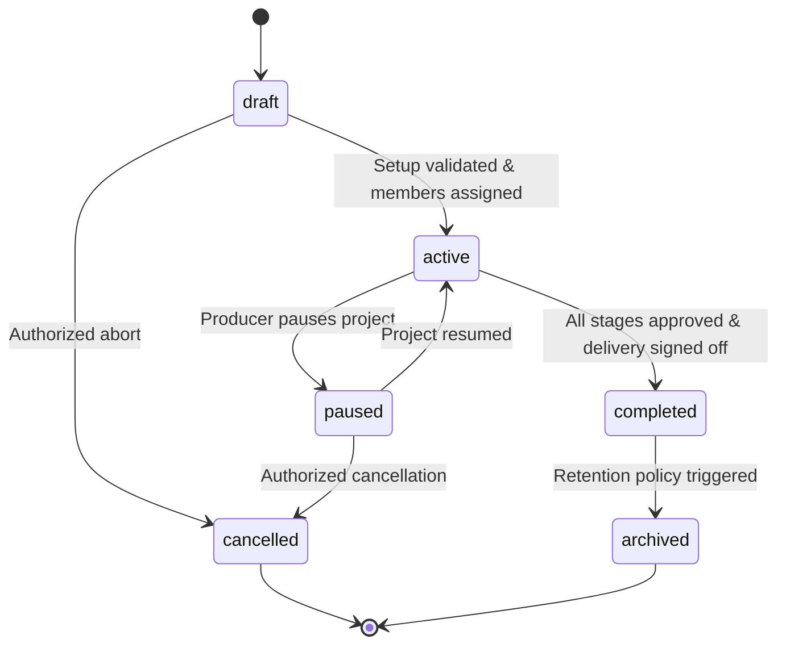
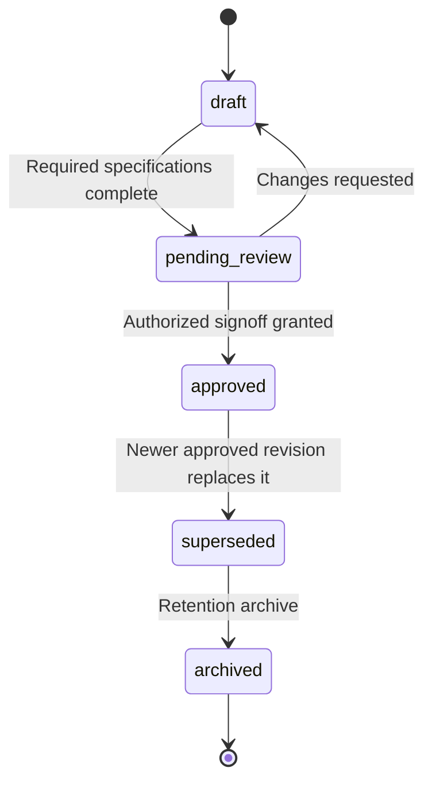
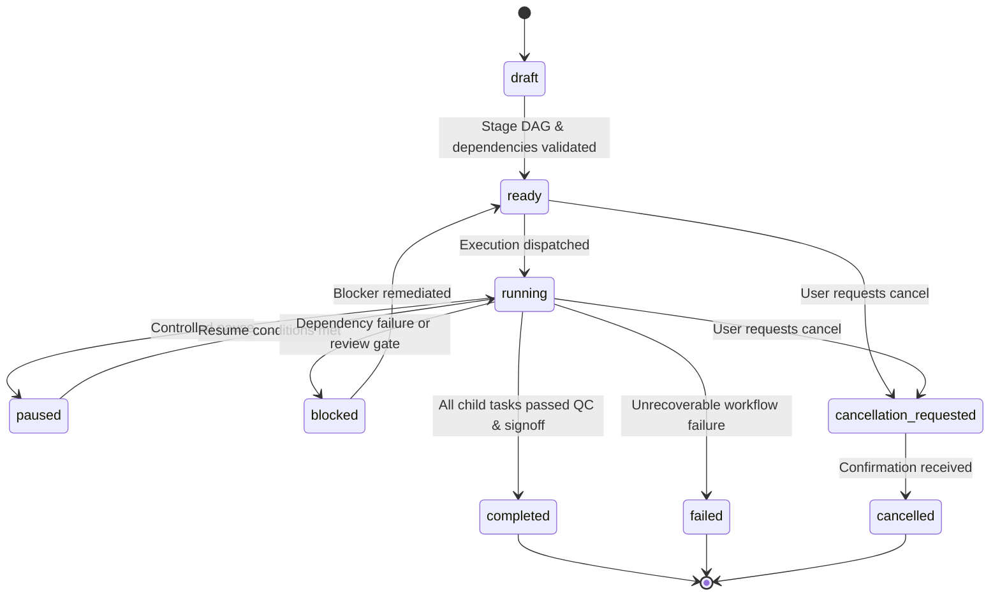
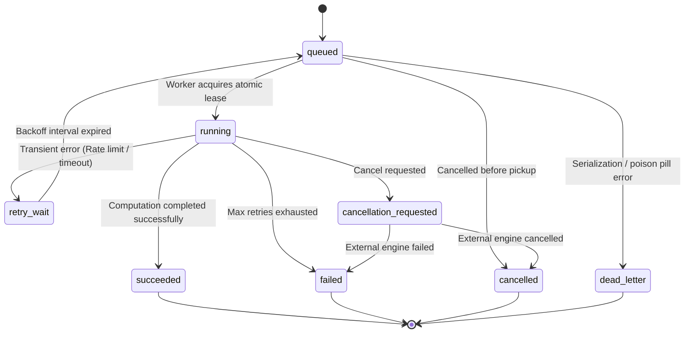

# CDA-0003: Canonical Lifecycle & State Transition Matrix

> **Canonical Source**: This document is mirrored from the canonical version in `DECISIONS/`.

| Attribute            | Specification                                                                        |
| :------------------- | :----------------------------------------------------------------------------------- |
| **Document ID**      | CDA-0003                                                                             |
| **Title**            | Canonical Lifecycle & State Transition Matrix: Deterministic Entity State Governance |
| **Status**           | ACCEPTED                                                                             |
| **Date**             | 2026-11-19                                                                           |
| **Decision Owners**  | Architecture Review Board & Governance Team                                          |
| **Decision Scope**   | Project, Stage, Task, Job, Generation, Asset, MPB, and QC State Machines             |
| **Version**          | 1.2                                                                                  |
| **Canonical Source** | `DECISIONS/CDA/CDA-0003-canonical-lifecycle-state-transition-matrix.md`              |

---

## PART A: STATE GOVERNANCE PRINCIPLES

### 1. Objectives

Menetapkan standar transisi status kanonikal di seluruh subsistem MovieAIProducer agar:

1. Status memiliki semantik yang seragam dan deterministik.
2. Setiap transisi status divalidasi oleh domain invariants (`InvalidStateTransitionException`).
3. Mencegah eskalasi status tanpa otorisasi yang sah.
4. Memisahkan secara tegas antara penyelesaian eksekusi teknis (_Execution Completion_) dan persetujuan manusia (_Human Approval_).
5. Memastikan agen AI tidak dapat melewati gerbang persetujuan manusia (_Human Approval Bypass_).
6. Menjaga idempotensi pada seluruh proses pemrosesan ulang (_retry_ dan _reconciliation_).

### 2. Core Governance Invariants

- **Single State Authority**: Tepat satu domain bounded context memiliki otoritas menulis (_write authority_) atas status suatu entitas.
- **Explicit Transitions Only**: Perubahan status sembarang (_arbitrary string assignment_) dilarang keras.
- **Terminal State Immutability**: Status terminal (`COMPLETED`, `CANCELLED`, `DELETED`, `SUPERSEDED`) tidak dapat bertransisi ke status aktif; pemrosesan baru wajib menghasilkan instance/revisi baru.
- **Audit Requirement**: Setiap mutasi status menghasilkan event atau catatan audit yang mencatat `previous_state`, `new_state`, `actor_id`, dan `correlation_id`.

---

## PART B: MASTER CANONICAL STATUS TAXONOMY

| Status Name                | Semantic Meaning                                                     |     Terminal State?      |
| :------------------------- | :------------------------------------------------------------------- | :----------------------: |
| **draft**                  | Entitas masih dalam penyusunan awal; belum diajukan                  |            No            |
| **pending**                | Menunggu proses atau keputusan prasyarat                             |            No            |
| **queued**                 | Berada dalam antrean, menunggu alokasi worker                        |            No            |
| **scheduled**              | Dijadwalkan untuk dieksekusi pada waktu tertentu                     |            No            |
| **running**                | Sedang aktif diproses oleh worker atau komputasi engine              |            No            |
| **in_progress**            | Pekerjaan atau workflow sedang berlangsung                           |            No            |
| **paused**                 | Dihentikan sementara secara terkontrol tanpa kehilangan state        |            No            |
| **blocked**                | Tertahan oleh dependensi prasyarat atau kebijakan                    |            No            |
| **awaiting_review**        | Hasil telah selesai dibuat; menunggu evaluasi/inspeksi               |            No            |
| **awaiting_approval**      | Menunggu keputusan resmi dari pemegang hak akses (Director/Producer) |            No            |
| **approved**               | Telah disetujui secara resmi oleh otoritas yang berwenang            |   Yes (until revision)   |
| **rejected**               | Ditolak oleh otoritas; membutuhkan revisi atau pembatalan            | Yes (requires new draft) |
| **completed**              | Seluruh aktivitas dalam siklus hidup berhasil diselesaikan           |         **Yes**          |
| **failed**                 | Eksekusi mengalami kegagalan terminal; retries exhausted             |         **Yes**          |
| **cancellation_requested** | Permintaan pembatalan diterima; menunggu konfirmasi worker           |            No            |
| **cancelled**              | Pembatalan telah diverifikasi dan dikonfirmasi                       |         **Yes**          |
| **expired**                | Batas waktu berlakunya entitas terlewati                             |         **Yes**          |
| **archived**               | Dipindahkan ke penyimpanan jangka panjang (read-only)                |         **Yes**          |
| **superseded**             | Digantikan oleh revisi yang lebih baru                               |         **Yes**          |
| **deleted**                | Dihapus secara logis/fisik sesuai retention policy                   |         **Yes**          |

---

## PART C: DOMAIN ENTITY STATE TRANSITION MATRICES

### 1. Project Lifecycle

| Current State (From) | Allowed Next State (To) | Mandatory Validation Condition                            |
| :------------------- | :---------------------- | :-------------------------------------------------------- |
| `draft`              | `active`                | Konfigurasi dasar proyek valid; anggota minimal terdaftar |
| `draft`              | `cancelled`             | Pembatalan resmi oleh Owner                               |
| `active`             | `paused`                | Penghentian sementara oleh Producer/Owner                 |
| `paused`             | `active`                | Izin pengaktifan kembali dipenuhi                         |
| `active`             | `completed`             | 16 Stage selesai dan master delivery disetujui Director   |
| `completed`          | `archived`              | Masa retensi terpenuhi                                    |
| `paused`             | `cancelled`             | Pembatalan resmi oleh Owner                               |

---

### 2. Master Production Bible (MPB) Revision Lifecycle

| Current State (From) | Allowed Next State (To) | Mandatory Validation Condition                                |
| :------------------- | :---------------------- | :------------------------------------------------------------ |
| `draft`              | `pending_review`        | Bidang spesifikasi wajib terisi lengkap; lulus validasi skema |
| `pending_review`     | `approved`              | Persetujuan resmi oleh Director (`mpb.approve`)               |
| `pending_review`     | `draft`                 | Penolakan atau permintaan revisi oleh reviewer                |
| `approved`           | `superseded`            | Revisi baru yang disetujui menggantikannya                    |
| `superseded`         | `archived`              | Kebijakan retensi mengizinkan pengarsipan                     |

---

### 3. Production Workflow Instance Lifecycle

| Current State (From)     | Allowed Next State (To)  | Mandatory Validation Condition                    |
| :----------------------- | :----------------------- | :------------------------------------------------ |
| `draft`                  | `ready`                  | Definisi graf dependensi dan prasyarat valid      |
| `ready`                  | `running`                | Eksekusi dimulai oleh orchestrator                |
| `running`                | `paused`                 | Penghentian sementara oleh user                   |
| `paused`                 | `running`                | Kondisi resume terpenuhi                          |
| `running`                | `blocked`                | Dependensi hulu gagal atau gerbang approval aktif |
| `blocked`                | `ready`                  | Penyebab blokir berhasil diatasi                  |
| `running`                | `completed`              | Seluruh tugas wajib selesai dan lulus uji mutu    |
| `running`                | `failed`                 | Kegagalan alur kerja yang tidak dapat dipulihkan  |
| `running`                | `cancellation_requested` | Permintaan pembatalan diterima                    |
| `cancellation_requested` | `cancelled`              | Konfirmasi pembatalan tervalidasi                 |

---

### 4. Technical Job Execution Lifecycle

| Current State (From)     | Allowed Next State (To)  | Mandatory Validation Condition                       |
| :----------------------- | :----------------------- | :--------------------------------------------------- |
| `queued`                 | `running`                | Worker memperoleh sewa atomik valid (`atomic lease`) |
| `queued`                 | `cancelled`              | Pembatalan dikonfirmasi sebelum dijemput worker      |
| `running`                | `succeeded`              | Eksekusi selesai; output terverifikasi               |
| `running`                | `retry_wait`             | Terjadi transient error; kuota retry masih tersedia  |
| `retry_wait`             | `queued`                 | Waktu jeda backoff terpenuhi                         |
| `running`                | `failed`                 | Kuota retry habis atau terjadi terminal error        |
| `running`                | `cancellation_requested` | Permintaan pembatalan diterima                       |
| `cancellation_requested` | `cancelled`              | Pembatalan terverifikasi pada engine eksternal       |
| `cancellation_requested` | `succeeded`              | Operasi selesai tepat sebelum pembatalan             |
| `queued`                 | `dead_letter`            | Payload rusak atau malformed contract                |

---

## PART D: VERIFICATION & IMPLEMENTATION CHECKLIST

- [x] Seluruh 20 status kanonikal memiliki semantik tegas tanpa ambiguitas.
- [x] Otoritas kepemilikan status per-domain telah dipetakan.
- [x] Transisi status terlarang (_prohibited transitions_) menolak mutasi secara otomatis.
- [x] Pemisahan antara penyelesaian komputasi teknis dan persetujuan manusia terjamin.
- [x] Pola optimistik locking dan penanganan idempotensi telah diwajibkan.

**STATUS: ACCEPTED (Canonical Lifecycle & State Transition Matrix Active)**
