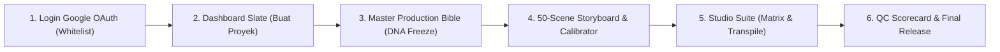
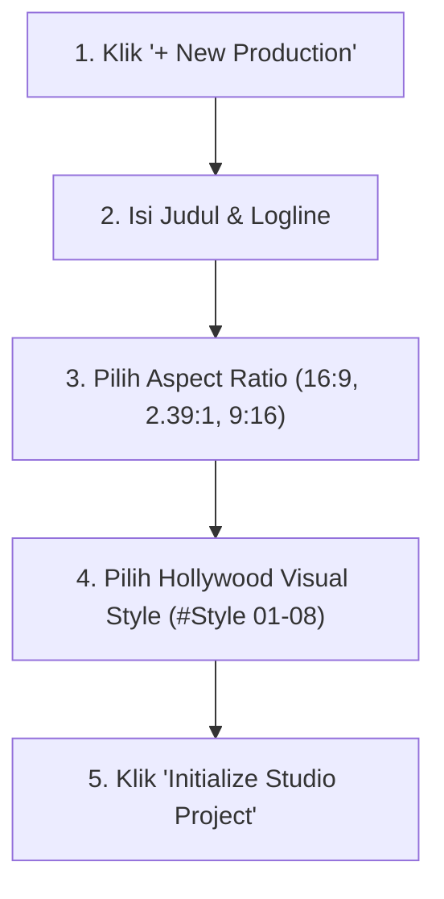

# Panduan Lengkap Penggunaan Platform Web MovieAIProducer
**DaVinci Obsidian Engine // Autonomous Hollywood AI Film Production Studio Suite**

Website URL: **[https://producer.apologets.com](https://producer.apologets.com)**

---

## Daftar Isi
1. [Langkah 1: Akses & Autentikasi Google OAuth (Showrunner Gate)](#langkah-1-akses--autentikasi-google-oauth-showrunner-gate)
2. [Langkah 2: Navigasi Dashboard (Production Slate)](#langkah-2-navigasi-dashboard-production-slate)
3. [Langkah 3: Membuat Proyek Film Baru (+ New Production)](#langkah-3-membuat-proyek-film-baru--new-production)
4. [Langkah 4: Bekerja di NLE AI Studio Suite](#langkah-4-bekerja-di-nle-ai-studio-suite)
5. [Langkah 5: Mengunci Visual DNA di Master Production Bible (MPB)](#langkah-5-mengunci-visual-dna-di-master-production-bible-mpb)
6. [Langkah 6: Storyboard 50 Adegan, Durasi Dinamis (5s/10s/15s) & Kalibrasi Dialog](#langkah-6-storyboard-50-adegan-durasi-dinamis-5s10s15s--kalibrasi-dialog)
7. [Langkah 7: Menjalankan Quality Control (QC Scorecard) & Ekspor](#langkah-7-menjalankan-quality-control-qc-scorecard--ekspor)
8. [Tips & Troubleshooting Umum](#tips--troubleshooting-umum)

---

## Alur Kerja Produksi Studio (Production Flow)

---

## Langkah 1: Akses & Autentikasi Google OAuth (Showrunner Gate)

1. Buka browser (Google Chrome, Safari, atau Firefox) dan kunjungi alamat:
   **[https://producer.apologets.com](https://producer.apologets.com)**
2. Jika Anda belum login, sistem secara otomatis mengarahkan Anda ke portal **Studio Access Gate (`/login`)**.
3. Klik tombol **`Sign in with Google`**.
4. Pilih akun Google Showrunner resmi yang telah didaftarkan dalam whitelist studio *(alamat disamarkan demi privasi)*:
   - `nee***19@gmail.com`
   - `nur***09@gmail.com`
   - `mei***y0@gmail.com`
   - `ari***ey@gmail.com`
5. Setelah autentikasi berhasil, Anda akan otomatis dialihkan ke halaman **Production Slate (Dashboard)** dengan sesi aman HttpOnly (*Role: SHOWRUNNER*).

> [!NOTE]
> Jika menggunakan email di luar daftar di atas, sistem akan menampilkan notifikasi **`Error 403: Early Studio Access Required - Authorized Personnel Only`**. Hubungi administrator studio untuk mendaftarkan email baru ke whitelist.

---

## Langkah 2: Navigasi Dashboard (Production Slate)

Halaman Dashboard adalah pusat kendali untuk memantau portofolio seluruh judul film yang sedang dalam fase perencanaan maupun produksi aktif.

### Fitur Utama Dashboard:
1. **Search Bar**: Ketik judul atau slug film untuk mencari proyek secara instan.
2. **Filter Tahapan (Stage Filter)**:
   - Filter kartu proyek berdasarkan tahapan aktif (misalnya: *Stage 1 Concept*, *Stage 3 Blueprint*, atau *Stage 16 Final Master*).
3. **Kartu Film (Project Cards)**:
   - Menampilkan poster/rasio aspek, kode gaya visual (misal: `#Style 01 Cyberpunk Neo-Noir`), jumlah adegan, status kunci DNA, dan tahap produksi saat ini.
4. **Tombol Quick Advance Stage**:
   - Memajukan tahapan produksi proyek ke tahap berikutnya langsung dari dashboard tanpa harus membuka studio lengkap.
5. **Tombol Masuk Studio**:
   - Klik kartu proyek atau tombol panah $(\rightarrow)$ untuk membuka **NLE Studio Suite** proyek tersebut.

---

## Langkah 3: Membuat Proyek Film Baru (+ New Production)

Untuk menginisiasi produksi film baru:

1. Di kanan atas dashboard, klik tombol amber **`+ New Production`**.
2. Jendela modal pembuatan film akan terbuka:
   - **Production Title**: Masukkan judul film (contoh: *The Jakarta Syndicate 2099*).
   - **Production Slug**: Otomatis terisi (atau sesuaikan slug URL uniknya).
   - **Cinematic Aspect Ratio**:
     - `16:9 Cinema Widescreen`: Standar penyiaran TV & streaming (YouTube, Netflix, OTT).
     - `2.39:1 Anamorphic Scope`: Format layar lebar bioskop (*Hollywood Panavision*).
     - `9:16 Vertical Cinema`: Format sinematik vertikal untuk platform mobile/TikTok/Reels.
   - **Target Hollywood Style Code**:
     - `#Style 01`: *Cyberpunk Neo-Noir* (Hujan neon Blade Runner & flare anamorphic).
     - `#Style 02`: *70s Panavision Vintage* (Kodak 5247 grain hangat bernuansa klasik).
     - `#Style 03`: *Ethereal High Fantasy* (Pencahayaan volumetrik emas Lord of the Rings).
     - `#Style 04`: *Hyper-Realistic Sci-Fi* (Krom steril & kontras luar angkasa Interstellar).
     - `#Style 05`: *Golden Hour Naturalism* (Estetika kamera genggam 35mm Terrence Malick).
     - `#Style 06`: *Technicolor Vintage 1950s* (Saturasi tinggi 3-strip dye transfer film).
     - `#Style 07`: *Japanese Anime Cel* (Pencahayaan refraksi awan Makoto Shinkai).
     - `#Style 08`: *Psychological Monochrome* (Hitam-putih bergradasi tajam Fincher).
   - **Logline / Narrative Concept**: Tuliskan ringkasan cerita inti (premise) dalam 1-2 kalimat.
3. Klik tombol **`Initialize Studio Project`**.
4. Sistem akan membuat database proyek, menginisiasi Master Bible versi 1, dan langsung membawa Anda ke halaman **NLE AI Studio**.

---

## Langkah 4: Bekerja di NLE AI Studio Suite

Akses URL: `/projects/{id}/studio`

Halaman ini merupakan workstation utama sutradara dan produser untuk mengarahkan kamera, memilih pencahayaan, meramu prompt generative AI, dan memantau rendering.

### 1. Dual Viewport Player
- **Viewport A (Acuan / Master Reference)**: Menampilkan gambar referensi karakter, storyboard acuan, atau benchmark visual.
- **Viewport B (AI Render Output)**: Menampilkan hasil render video dari engine generative AI.
- **Playback Controls**: Dilengkapi tombol *Play/Pause*, *Loop*, *Mute*, dan pengatur kecepatan (*0.5x*, *1.0x*, *2.0x*).

### 2. Matrix Selector (Parameter 7 Dimensi)
Pilih kombinasi parameter sinematik di panel matrix:
- **Style Code (`#Style`)**: Gaya visual film.
- **Light Code (`#Light`)**: Skema pencahayaan (misal: *Chiaroscuro*, *Neon Rim Light*, *Soft Diffused*).
- **Acting Cue (`#Act`)**: Panduan emosi & mikro-ekspresi karakter.
- **Camera Movement (`#Cam`)**: Pergerakan kamera (*Slow Dolly In*, *Steadicam Follow*, *Static Tripod*).
- **Lens & Bokeh (`#Lens`)**: Panjang fokal (*35mm Anamorphic*, *50mm Prime T1.3*, *85mm Portrait*).
- **Composition (`#Comp`)**: Pembingkaian (*Rule of Thirds*, *Dutch Angle*, *Extreme Close-Up*).
- **Speed / FPS (`#Speed`)**: Kecepatan gerak (*24fps Cinematic*, *48fps High Motion*, *Slow-Motion 120fps*).

### 3. Prompt Transpiler Engine
Di bagian bawah Matrix Selector, terdapat mesin penerjemah otomatis:
1. Pilih **Target Engine**:
   - `Veo` (Google Veo)
   - `Kling` (Kling AI v1.5/v2)
   - `Runway` (Runway Gen-3 Alpha Turbo)
   - `Sora` (OpenAI Sora)
   - `ComfyUI` (Local Pipeline)
2. Klik tombol **`Transpile Hollywood Prompt`**.
3. Sistem secara otomatis menyusun:
   - **Positive Prompt**: Perintah detail dengan terminologi lensa, warna, dan pencahayaan sinematik standar industri.
   - **Negative Prompt**: Pencegah distorsi anatomi, artefak motion blur berlebih, dan CGI cartoony.
4. Klik **`Copy Prompt`** untuk langsung dipakai di provider AI terkait.

### 4. 16-Stage Pipeline Gate & Approval
Di sidebar kiri (*LeftNavPipeline*), pantau perkembangan 16 gerbang produksi film:
- Klik tombol **`Stage Gate Approval`** di atas timeline untuk memajukan gerbang produksi.
- Anda dapat memilih tindakan:
  - **`APPROVE`**: Menyetujui hasil tahap saat ini dan lanjut ke gerbang berikutnya.
  - **`REVISE`**: Mengembalikan status untuk revisi dengan menyertakan catatan sutradara.
  - **`LOCK`**: Mengunci tahap secara permanen.

---

## Langkah 5: Mengunci Visual DNA di Master Production Bible (MPB)

Akses: Klik menu navigasi **`Production Bible`** di header atau URL `/projects/{id}/bible`.

Master Production Bible adalah dokumen acuan tunggal (*Single Source of Truth / SSOT*) agar kecerdasan buatan tidak menghasilkan karakter yang wajahnya berubah-ubah atau gaya visual yang melenceng antar-shot.

### Tab yang Tersedia:
1. **Visual DNA Tab**:
   - Menetapkan master color palette, film stock (misal: Kodak Vision3 500T), dan rasio aspek default.
2. **Character Matrix Tab**:
   - Tambahkan karakter baru: Masukkan nama, peran narasi (*Protagonist/Antagonist*), dan deskripsi wajah biometrik permanen.
   - Tetapkan **Character States**: Pakaian (*Wardrobe*), luka/kotoran (*Injuries & Wear*), serta ekspresi dasar.
3. **World & Props Tab**:
   - Mendefinisikan aturan arsitektur lokasi utama dan properti penting dalam cerita.
4. **Rules & Invariants Tab**:
   - Aturan absolut yang tidak boleh dilanggar oleh AI (misalnya: *"Tidak boleh ada senjata api laser"* atau *"Karakter utama selalu menggunakan trench coat hitam"*).
5. **Revision Lock Tab (Fitur Kritis)**:
   - Klik tombol **`Freeze & Lock Visual DNA`**.
   - Sekali dikunci (*LOCKED*), parameter DNA film berstatus *read-only* terlindungi, memastikan kontinuitas gambar 100% konsisten sepanjang pembuatan film.

---

## Langkah 6: Storyboard 50 Adegan, Durasi Dinamis (5s/10s/15s) & Kalibrasi Dialog

Akses: Klik menu navigasi **`50-Scene Storyboard`** di header atau URL `/projects/{id}/scenes`.

MovieAIProducer menggunakan arsitektur narasi sinematik 4-Babak yang terbagi presisi ke dalam **50 Adegan**:
- **Babak I (Adegan 01 - 12)**: *Ordinary World, Inciting Incident, & Threshold Crossing*.
- **Babak II-A (Adegan 13 - 25)**: *Trials, First Obstacles, & Midpoint Reversal*.
- **Babak II-B (Adegan 26 - 38)**: *Dark Night of the Soul & All Is Lost*.
- **Babak III (Adegan 39 - 50)**: *Climax, Confrontation, & Master Resolution*.

### 1. Generate / Muat Blueprint
- Jika adegan belum terisi, klik tombol **`Generate 50-Scene Blueprint`**.
- Sistem akan merancang arsitektur 50 adegan lengkap dengan target durasi dan narasi beat.

### 2. Membuka Detail Adegan & Pemilihan Durasi Fleksibel (5s | 10s | 15s)
- Klik pada salah satu kartu adegan untuk membuka panel samping (**Scene Detail Drawer**).
- Anda dapat mengedit *Slugline*, tujuan naratif (*Narrative Goal*), dan memilih target durasi adegan:
  - **`5s` (Standard)**: Shot pendek dinamis, reaksi cepat, transisi, atau cut aksi intens.
  - **`10s` (Extended)**: Dialog dua arah, eksposisi cerita, atau pergerakan aktor melintasi set.
  - **`15s` (Long Take)**: Puncak emosional, monolog kunci, atau sekuens klimaks dramatis.

### 3. Auto-Split Multi-Shot Assembly (Solusi Batasan Inferensi AI Video)
- **Tantangan Teknis**: Generator video AI (Veo, Kling, Runway, Sora) beroperasi paling konsisten pada durasi render ~5.0 detik per take untuk mencegah deformasi biometrik (*morphing*).
- **Solusi Auto-Split**: Saat durasi adegan ditetapkan `10s` atau `15s`, tombol **`Auto-Split (2x5s)`** atau **`Auto-Split (3x5s)`** otomatis muncul di panel drawer.
- Sekali klik, sistem secara cerdas menyusun shot-shot individual berdurasi 5.0 detik dengan variasi sudut kamera (*camera coverage*) Hollywood:
  - **Scene 5s**: **1 Shot @ 5.0s** (`#Cam 01` Push-In Master, `#Lens 02` 35mm Wide).
  - **Scene 10s**: **2 Shot @ 5.0s** (`2x5s`) &rarr; Shot 1: Master Push-In (`#Cam 01`), Shot 2: OTS Profile Coverage (`#Cam 06`).
  - **Scene 15s**: **3 Shot @ 5.0s** (`3x5s`) &rarr; Shot 1: Master Push-In (`#Cam 01`), Shot 2: OTS Coverage (`#Cam 06`), Shot 3: Hero Close-Up (`#Cam 13`).
  - *Idempoten*: Klik berulang tidak akan menduplikasi shot yang ada.

### 4. Kalibrasi Dialog Dinamis & Pacing Suku Kata
Modul **Dialogue Calibrator** kini beroperasi adaptif mengikuti durasi adegan (~0.34s per kata / 140 WPM):
1. **Target 5 Detik**: Maksimal **14 kata** (~21 suku kata).
2. **Target 10 Detik**: Maksimal **28 kata** (~42 suku kata).
3. **Target 15 Detik**: Maksimal **42 kata** (~63 suku kata).
4. Status evaluasi real-time:
   - **`STATUS: PASSED (≤ Target Detik)`**: Dialog aman diucapkan tuntas tanpa terpotong.
   - **`STATUS: OVERFLOW (> Target Detik)`**: Dialog melebihi batas durasi; direkomendasikan memangkas dialog atau memperpanjang durasi.

### 5. Rekomendasi Transisi Audio Proporsional (J-Cut / L-Cut / Hard Cut)
Sistem menghitung rasio kepadatan dialog terhadap durasi adegan:
- **Rasio > 75%** &rarr; **`J-CUT (1.0s lead)`**: Suara dialog masuk 1.0 detik lebih awal mendahului cutaway visual agar perpindahan scene terasa mulus.
- **Rasio 40% - 75%** &rarr; **`L-CUT (0.5s trail)`**: Suara dialog berlanjut 0.5 detik melintasi cut visual ke reaksi lawan bicara.
- **Rasio < 40%** &rarr; **`HARD_CUT`**: Potongan visual dan audio tegas bersamaan tanpa overlap.

### 6. Manajemen Shot Individual & Presets Durasi
- Pada panel **Shot List Manager**, sutradara dapat menambah shot manual dengan opsi preset durasi: `5.0s (Standard)`, `10.0s (Extended)`, atau `15.0s (Long Take)`.

---

## Langkah 7: Menjalankan Quality Control (QC Scorecard) & Ekspor

1. **QC Scorecard**:
   - Di dalam drawer adegan/shot, buka tab **QC Scorecard**.
   - Sistem melakukan evaluasi otomatis multi-metrik:
     - **Face Similarity Score**: Konsistensi wajah karakter acuan (InsightFace target > 85%).
     - **Aesthetic / CLIP Score**: Kualitas sinematik dan kesesuaian gambar dengan prompt.
     - **Temporal Jitter Variance**: Kehalusan gerakan tanpa patah-patah (*anti-morphing*).
     - **Acoustic SNR (dB)**: Kejernihan vokal dan audio.
   - Jika terdapat cacat visual (*artifact defect*), sistem menandai dengan status **`FLAGGED`** atau **`FAILED`** dan memberikan catatan perbaikan.
2. **Export Master Package**:
   - Dari menu dropdown proyek, pilih **`Export Production Package`**.
   - Anda dapat mengunduh paket produksi lengkap dalam format JSON/ZIP yang mencakup seluruh prompt, metadata shot, daftar adegan, dan lembar kontinuitas untuk kebutuhan post-production.

---

## Tips & Troubleshooting Umum

> [!TIP]
> **Koneksi Cepat & Hemat Kuota di Mobile**:
> Antarmuka web MovieAIProducer telah dioptimasi secara adaptif untuk layar smartphone (iPhone / Android) maupun desktop (1440px). Jika membuka di ponsel, tombol navigasi utama dapat diakses melalui menu drawer di kanan atas.

> [!IMPORTANT]
> **Mengatasi Sesi Kedaluwarsa**:
> Sesi login dilindungi token berumur 7 hari. Jika sesi berakhir atau Anda berganti perangkat, cukup buka kembali [https://producer.apologets.com](https://producer.apologets.com) dan klik tombol `Sign in with Google` untuk memperbarui sesi tanpa kehilangan data proyek.

> [!WARNING]
> **Jangan Mengubah DNA Saat Produksi Berjalan**:
> Hindari membuka kunci (*Unlock*) Master Production Bible di tengah proses render batch, karena perubahan parameter warna atau lensa di tengah jalan dapat menyebabkan perbedaan tone yang drastis antar adegan.
